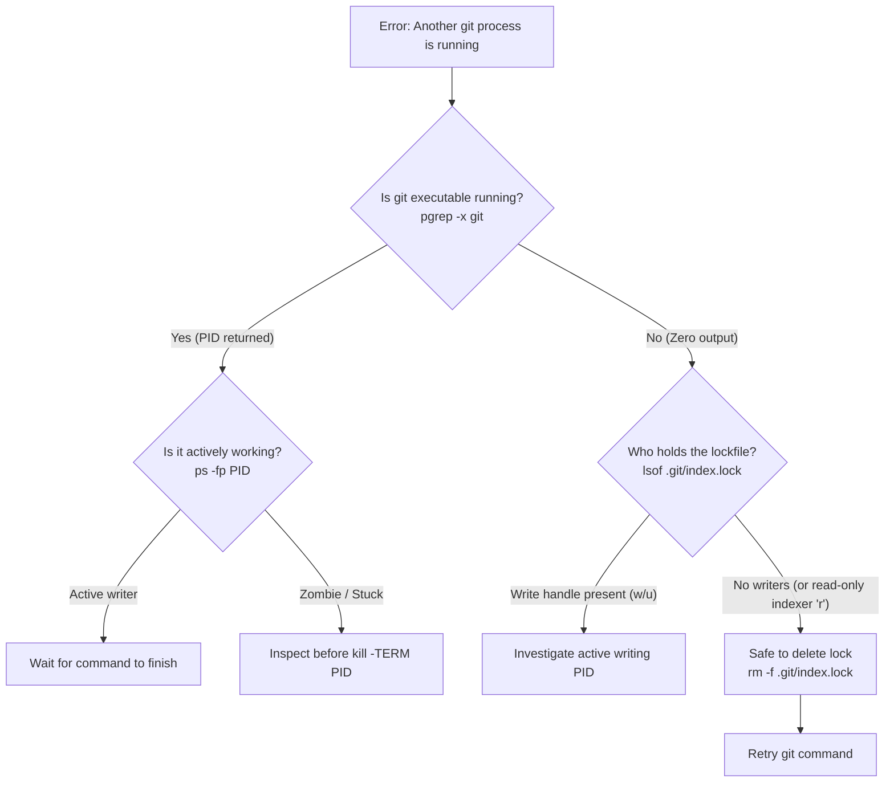

# Developer's Darkest Hour: When Git Locks Become Lethal Traps in the Process Table

*How a routine commit guard turned a Node daemon's $PATH into a phantom concurrency collision.*

> "Debugging is twice as hard as writing the code in the first place. Therefore, if you write the code as cleverly as possible, you are, by definition, not smart enough to debug it."
> — Brian W. Kernighan

```text
❌ Another git process seems to be running. Please wait or check running processes.
```

No interactive rebase was paused. No background fetch was running. The working tree was quiescent. Yet every invocation of our automated commit wrapper aborted instantly with that single line.

By the end of this post, you will understand why `pgrep -f` triggers false positives across unrelated background processes on Darwin and BSD kernels, how file indexers hold harmless read handles on `.git/index.lock`, and how to write process boundary checks that never confuse inherited environment strings with active write transactions.

---

## The Anatomy of an Over-Clever Guard

When a Git operation halts because of a lock collision, the culprit is almost always `.git/index.lock`. Git relies on this sentinel file as an atomic transaction boundary. Before any command alters the staging area, it opens `.git/index.lock` using the `O_CREAT | O_EXCL` flags. When the mutation completes successfully, Git atomically renames the lockfile over `.git/index` via `rename(2)`.

If the process terminates abruptly during that window—from an unhandled `SIGKILL`, a laptop lid closing mid-index write, or a dead battery—the zero-byte sentinel file is left behind. Future Git commands see the file, assume another transaction is in progress, and immediately exit with an error code.

To spare developers from manually running `rm -f .git/index.lock` after every crashed session, our local commit wrapper (`scripts/repo-sync.sh`) implemented self-healing logic:

```bash
# Handle stale index.lock file if left behind by interrupted git processes
LOCK_FILE=".git/index.lock"
if [ -f "$LOCK_FILE" ]; then
    if ! pgrep -f "git.*core-platform" > /dev/null 2>&1 && ! pgrep -x git > /dev/null 2>&1; then
        echo "⚠️  Found stale $LOCK_FILE with no running git process. Cleaning up..."
        rm -f "$LOCK_FILE"
    else
        echo "❌ Another git process seems to be running. Please wait or check running processes."
        exit 1
    fi
fi
```

The defensive reasoning appeared sound:

1. Check if `.git/index.lock` exists.
2. If it does, check whether any process named `git` is currently alive (`pgrep -x git`), or whether any command line contains both `git` and our repo path `core-platform` (`pgrep -f "git.*core-platform"`).
3. If no matching process exists, remove the orphaned lock and proceed.
4. If a matching process is detected, refuse to touch the file to prevent corrupting an active transaction.

The script failed at step 4. It insisted a Git transaction was active. Yet running `pgrep -x git` in the terminal returned an exit code of 1 and zero lines of output. There was no running binary named `git` on the entire system.

---

## Interrogating the Process Table

If no process named `git` existed, why did the defensive guard trip? The answer had to lie in the broad pattern match: `pgrep -f "git.*core-platform"`.

We ran the regex directly against the live process table:

```bash
$ pgrep -f "git.*core-platform"
17214
28984
```

Two process identifiers returned immediately. We inspected their command lines using `ps`:

```bash
$ ps -fp 17214,28984
  UID   PID  PPID   CMD
  501 17214 17213   npm exec @modelcontextprotocol/server-pdf --stdio
  501 28984 28659   npm exec @modelcontextprotocol/server-pdf --stdio
```

The active PIDs were background Node.js daemons running a local Model Context Protocol (MCP) PDF server. The command string `npm exec @modelcontextprotocol/server-pdf --stdio` contained neither the word `git` nor the repository name `core-platform`.

Yet `pgrep` claimed an exact match.

---

## The Trap of `pgrep -f` Across BSD and Darwin

Most developers assume `pgrep -f <pattern>` restricts its inspection to the process argument list (`argv[0] ... argv[n]`). On Linux systems reading from `/proc/[pid]/cmdline`, that assumption is mostly accurate.

On macOS and BSD-derived kernels, `pgrep -f` uses the `KERN_PROCARGS2` sysctl. Depending on how the process was initialized and how memory was allocated, this buffer does not stop cleanly at the end of the argument vector. It contains the contiguous memory segment holding the process's inherited environment variables.

We dumped the full environment block of PID 17214 using `ps -Eww`:

```text
PATH=/path/to/custom-git-bins:/path/to/repo/core-platform/scripts/bin:/usr/local/bin:/usr/bin
```

The mystery resolved instantly:

1. The user's inherited `$PATH` contained a custom directory: `/path/to/custom-git-bins` (which contains the substring `git`).
2. Several directories later in the same string, `$PATH` contained the workspace script directory: `/core-platform/scripts/bin`.
3. Because the regex was unanchored (`git.*core-platform`), the regular expression engine evaluated the full environment string:

```text
...custom-[git]-bins:.../workspace/[core-platform]...
```

The background Node process had been launched from a terminal session that exported that `$PATH`. It had never executed a Git binary in its lifecycle. But because the substring `git` occurred prior to `core-platform` anywhere within its memory block, `pgrep -f` flagged it as an active repository transaction.

A safety check that inspects process memory without word boundaries will eventually mistake its own environment for an active transaction.

---

## The Second Layer: Phantom Writers vs. Harmless Indexers

Once we understood the false positive, we turned to the lockfile itself. Why was `.git/index.lock` present on disk in the first place? If no transaction was running, was an editor or language server actively writing to it?

We queried open file descriptors on the lockfile with `lsof`:

```bash
$ lsof .git/index.lock
COMMAND     PID      USER   FD   TYPE DEVICE SIZE/OFF     NODE NAME
language_ 82589   devuser   33r   REG   1,17        0 84516209 .git/index.lock
filewatch 86807   devuser  127r   REG   1,17        0 84516209 .git/index.lock
```

The file descriptor indicators (`33r` and `127r`) told the entire story. The trailing `r` denotes a **read-only** file handle. Modern IDE language servers and filesystem watchers (such as `kqueue` listeners on macOS or `inotify` listeners on Linux) monitor the `.git` directory for state changes. When an abandoned lockfile sits in the directory, watchers open read-only descriptors to inspect its metadata.

Next, we checked the file's modification timestamp:

```bash
$ ls -l .git/index.lock
-rw-r--r--  1 devuser  staff  0 Oct 10 22:30 .git/index.lock
```

The file was a zero-byte orphan generated fourteen hours earlier during an ungraceful terminal shutdown. No process held a write descriptor (`w` or `u`). No process was running `git`. Yet our defensive automation script was paralyzed by its own regex.

---

## Diagnostic Matrix: `pgrep` Flags and Matching Behavior

| Command | What It Actually Inspects | Vulnerable to $PATH? | Recommended Use Case |
| :--- | :--- | :--- | :--- |
| `pgrep -x git` | Process binary name (`comm` / `argv[0]`) | No | Verifying if any standard Git binary is running system-wide |
| `pgrep -f "git.*repo"` | Raw process memory block (`KERN_PROCARGS2`) | Yes (Severe) | Never; prone to false positives on environment strings |
| `pgrep -f "^([^ ]*/)?git[ \t]"` | Command line starting with `git` binary | No | Inspecting specific Git invocations without matching directory names |
| `lsof -w .git/index.lock` | Active file descriptor table across all PIDs | No | Determining whether an active writer is mutating the index |

---

## The Surgical Fix

To prevent ambient environment variables from matching command line patterns, we replaced the loose substring regex with an anchored command boundary:

```bash
# Look for genuine running git commands accessing this repository
GIT_CMD_REGEX="^([^ ]*/)?git[ \t].*core-platform"

if ! pgrep -f "$GIT_CMD_REGEX" > /dev/null 2>&1 && ! pgrep -x git > /dev/null 2>&1; then
    echo "⚠️  Found stale $LOCK_FILE with no running git process. Cleaning up..."
    rm -f "$LOCK_FILE"
else
    echo "❌ Another git process seems to be running. Please wait or check running processes."
    exit 1
fi
```

### Why This Pattern Holds

- `^([^ ]*/)?git[ \t]`: Matches only when `git` appears at the start of the command line or immediately after a path separator (`/`), followed strictly by a space or horizontal tab.
- It rejects occurrences where `git` is embedded inside directory paths (e.g., `/my-git-tools/`) or environment exports (e.g., `PATH=...`).
- It isolates legitimate CLI invocations such as `/usr/bin/git add` or `git commit -m`.

When tested against the orphan lock with the PDF server running in the background, the guard evaluated cleanly:

```text
⚠️  Found stale .git/index.lock with no running git process. Cleaning up...
[main 4f1a92e] chore: sync workspace state
 2 files changed, 14 insertions(+), 2 deletions(-)
```

---

## Stale Git Lock Diagnostic Runbook

When a Git command tells you another process is running, avoid blind `rm -f` commands without verifying the underlying process table first.



### Quick 60-Second Diagnostic Routine

Run this three-step sequence in your terminal to safely distinguish real transactions from orphaned locks:

```bash
# 1. Verify whether an actual git binary is running
pgrep -x git || echo "No active git binary found"

# 2. Check if any process holds an open file handle on the lock
lsof .git/index.lock

# 3. Check the file modification age
ls -l .git/index.lock
```

🩸 **Warning:** Never purge `.git/index.lock` purely based on timestamp age. A multi-gigabyte rebase, an unpack-objects sequence, or an aggressive `git gc` on a large monorepo can legitimately run for tens of minutes without updating the lockfile's timestamp. Always verify that no process holds a write handle before unlinking.

---

## 🧠 Elevation: The Boundary Inspection Principle

### The Law of Environmental Containment
When a diagnostic probe queries system state at a broader boundary than its execution intent, false positive rates scale with the complexity of the surrounding environment.

### Mechanism
Operating system APIs frequently optimize for bulk data retrieval rather than syntactic isolation. `pgrep -f` searches the command buffer provided by the kernel, which aggregates `argv`, `argc`, and environment memory on BSD and Darwin platforms. Writing substring assertions against an aggregated memory block treats ambient configuration (`$PATH`, `$JAVA_HOME`, exported tool parameters) as if it were executable intent.

### Boundary Condition
Strict command boundary regexes (`^([^ ]*/)?git[ \t]`) assume conventional process invocation. If an operation is invoked via subshells, indirect wrapper scripts, or non-standard argument separators, boundary regexes can produce false negatives. In mission-critical orchestration, querying kernel file locks directly via `fcntl`/`flock` or inspecting active file descriptors via `lsof` is strictly superior to parsing process strings.

> Generalize: When querying system tables for running services, are you filtering by the process boundary or by substrings that live in inherited environment variables?

---

Have you audited your internal wrapper scripts for unanchored `pgrep -f` invocations, or are your automation guards one environment variable away from hallucinating their own deadlocks?