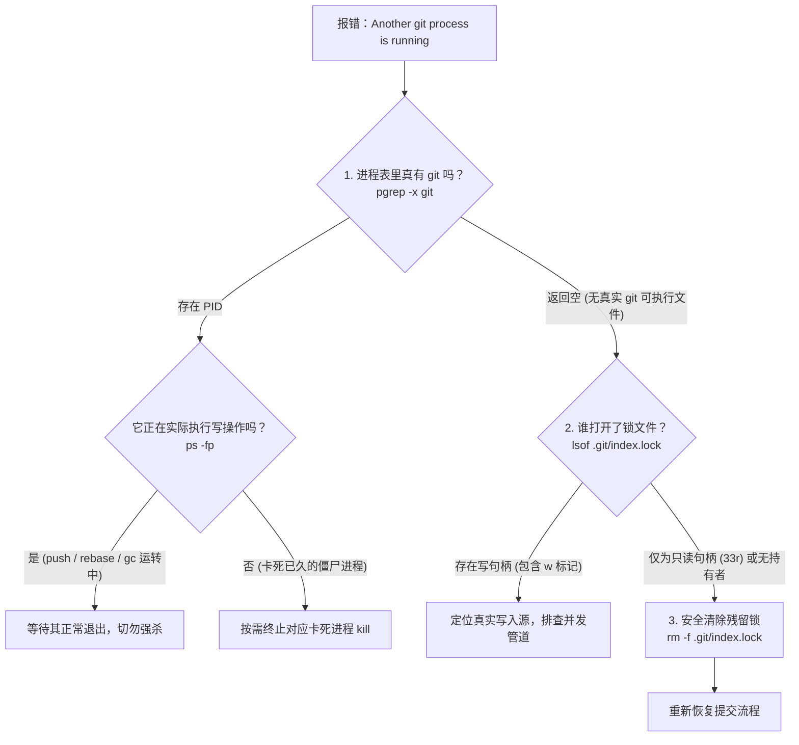

# 开发者的至暗时刻：当Git锁成为进程表中的致命陷阱

*一个精心编写的 index.lock 自动清理脚本，如何在进程表和 $PATH 的夹缝里制造了一场无中生有的死锁*

> “计算机系统里最难缠的死锁，往往不是真正的并发竞争，而是我们自以为健壮的防御逻辑，在一个完全错位的假设上忠实地执行到底。”

```text
❌ Another git process seems to be running. Please wait or check running processes.
```

你打开活动监视器或者任务管理器，没有后台 rebase，没有正在卡死的 push，工作区安静得像午夜的自习室。但你的自动化脚本坚定地告诉你：有人正握着方向盘，你别想碰这个仓库。

读完这篇，你不仅能彻底搞清楚为什么脚本里的 `.git/index.lock` 清理逻辑会离奇误判，还能拿到一套排查任何 Git 锁冲突的标准诊断流程与防误伤正则。

---

### 谁动了我的锁？一段“过于聪明”的防御逻辑

任何经常在终端作战的工程师，都会给代码提交配上一套极简的自动化包装脚本。在这个工作流中，脚本负责自动暂存、生成提交信息、同步与推送。为了保证健壮性，脚本作者往往会预判一种常见意外：当开发者意外合上笔记本电脑屏幕、或者终端进程被 `SIGKILL` 强杀时，Git 可能会在仓库里留下一具遗体——`.git/index.lock`。

Git 的机制本身是极其保守且优雅的。每次修改暂存区之前，它都会创建一个 `.git/index.lock` 作为排他锁和事务屏障；所有变动写入锁文件后，再一次性原子重命名覆盖 `.git/index`。如果进程中途暴毙，锁文件就会被遗弃。

脚本为了避免人工每次去敲 `rm -f`，特意设计了一段“自愈”守卫逻辑：

```bash
# 检查是否存在遗留的 index.lock
LOCK_FILE=".git/index.lock"
if [ -f "$LOCK_FILE" ]; then
    if ! pgrep -f "git.*core-repo" > /dev/null 2>&1 && ! pgrep -x git > /dev/null 2>&1; then
        echo "⚠️  Found stale $LOCK_FILE with no running git process. Cleaning up..."
        rm -f "$LOCK_FILE"
    else
        echo "❌ Another git process seems to be running. Please wait or check running processes."
        exit 1
    fi
fi
```

这段防御逻辑的推理链条看似无懈可击：

1. 如果发现 `.git/index.lock` 存在；
2. 检查系统中是否有正在运行的 `git` 进程（`pgrep -x git`），或者包含当前仓库名称的 Git 进程（`pgrep -f "git.*core-repo"`）；
3. 如果**没有任何**相关进程在跑，说明这是一具孤魂野鬼，直接清理并继续；
4. 如果**有**相关进程，说明真的有并发操作，立即阻断报错。

既然脚本报错退出了，按照逻辑学演绎，当前系统里必然有一个正在吞吐这个仓库的 Git 进程。

但真相往往在第一把钥匙插进锁孔时就裂开了。

---

### 拷问进程表：幽灵 PID 从何而来

第一步当然是验证进程现实：

```bash
$ pgrep -x git
# 返回码为 1，没有任何输出
```

系统中连一个名叫 `git` 的可执行文件都没有跑。

那为什么脚本中的分支走进了 `else`？让我们把脚本里那行模糊匹配命令单独拎出来执行：

```bash
$ pgrep -f "git.*core-repo"
17214
28984
```

终端赫然吐出了两个活生生的 PID：`17214` 和 `28984`。

这一瞬间非常容易让人怀疑底层内核的调度。既然可执行文件名不是 `git`，那到底是何方神圣接管了这个字符串？我们直接用 `ps` 调出这两个进程的完整清单：

```bash
$ ps -fp 17214,28984
  UID   PID  PPID   CMD
  501 17214 17213   npm exec @modelcontextprotocol/server-pdf --stdio
  501 28984 28659   npm exec @modelcontextprotocol/server-pdf --stdio
```

一个跑在后台的 Node.js PDF 服务进程？它跟 Git、跟当前仓库的代码版本管理有半毛钱关系吗？

| 检查项 | 预期行为 | 实际检测结果 | 冲突点 |
| :--- | :--- | :--- | :--- |
| `pgrep -x git` | 捕获正在运行的 Git 命令 | 退出码 1（无任何输出） | 真实 Git 并不存在 |
| `pgrep -f "git.*core-repo"` | 过滤关联当前仓库的 Git 操作 | 返回 PID 17214, 28984 | 匹配到了 PDF 守护进程 |
| `ps -fp <PID>` | 显示 Git 相关的子命令 | 显示 `npm exec ... server-pdf` | 命令实体完全无关 |

一个解析文档的后台服务，为什么能匹配上 `git.*core-repo` 这种正则表达式？

---

### 陷阱深处：macOS 与 BSD 内核中 `pgrep -f` 的隐式漫游

大多数工程师在 Linux 手册里学到的是：`pgrep -f <pattern>` 会匹配整条命令行参数（full argument list），也就是从 `argv[0]` 到 `argv[n]`。

但在 macOS 以及多种 BSD 衍生内核的实现中，事情发生了一次隐秘的位移。系统通过 `sysctl` 读取进程缓冲区（如 `KERN_PROCARGS2`）时，如果在特定状态下内存对齐或者参数解构未作严格边界截断，`pgrep -f` 会扫描整个进程启动时载入的**环境内存块**！

我们直接把 PID `17214` 的环境变量全量打出来看看：

```bash
$ ps -Eww -p 17214
```

在滚动的数百行变量里，赫然躺着它的 `$PATH` 定义：

```text
PATH=/path/to/my-git-custom-tools/:/path/to/workspace/core-repo/scripts/:/usr/local/bin:...
```

注意这个路径里的字符排列：

1. 前面包含了用于存放辅助脚本的自定义目录：`/path/to/my-git-custom-tools/`，里面含有子串 `git`；
2. 经过几个冒号分隔符后，包含了仓库的工程路径：`/path/to/workspace/core-repo/scripts/`，里面含有子串 `core-repo`。

由于当初脚本作者写的是一条极其随意的贪婪正则表达式：

```regex
git.*core-repo
```

它顺理成章地在这段环境变量文本里达成了命中：

```text
...my-[git]-custom-tools:.../workspace/[core-repo]...
```

PDF 守护进程是在父 Shell 会话中启动的，它继承了包含上述路径的完整 `$PATH` 变量。它从始至终没有调用过哪怕一次 `git`，但因为 `$PATH` 里恰好先出现了 `git` 目录、后出现了项目目录，它在 `pgrep -f` 的扫描镜下被永远打上了“正在操作该代码库的 Git 进程”的标签。

**只读句柄不是并发威胁，把环境噪声当成进程信号才是灾难的源头。**

只要磁盘上因为任何编辑器的瞬态探测或者过去的非正常退出留下了一个空的 `.git/index.lock`，这个防御脚本就会进入永久锁死状态。

---

### 第二重迷雾：只读文件句柄被误当成了写锁

排除了进程名的诡异命中，我们还需要回答另一个关键问题：那个 `.git/index.lock` 文件，磁盘上到底有没有正在占有它的进程？

我们祭出 `lsof`：

```bash
$ lsof .git/index.lock
COMMAND     PID      USER   FD   TYPE DEVICE SIZE/OFF     NODE NAME
language_ 82589 developer   33r   REG   1,17        0 84516209 .git/index.lock
filewatch 86807 developer  127r   REG   1,17        0 84516209 .git/index.lock
```

请仔细看 `FD` 列的标识：`33r` 和 `127r`。

那个小写字母 `r` 代表 **Read-Only**。

现代 IDE（比如 VS Code）、语言服务器协议（LSP）守护进程或文件变更监听工具（在 macOS 上使用 `kqueue`），会本能地对工作区和 `.git/` 目录挂载文件描述符以捕获状态变化。它们打开这个锁文件只是为了“看一眼”，绝不会往里面写半个字节。

再看这个文件的最后修改时间：

```bash
$ ls -l .git/index.lock
-rw-r--r--@ 1 developer  staff  0 Oct 10 22:30 .git/index.lock
```

一个大小为 0 字节、创建于昨天深夜的僵尸锁。它没有任何正在写入的宿主，仅仅被几个只读监听器挂着句柄，却在防御脚本的自相矛盾中，阻断了一整个早晨的所有提交。

🩸 **血泪提醒**：遇到 `.git/index.lock` 千万不要把 `lsof` 里搜出来的 PID 全杀一遍。如果看到文件描述符带有 `r` 标记，那大概率是你的编辑器在监控文件变动，强杀它们只会导致你的 IDE 索引崩溃。

---

### 外科手术式的正则重构

既然问题根源在于通配符将 `$PATH` 中的路径片段当成了命令行，修复的方式就绝不能是在脚本里继续盲目堆砌 `sleep` 或者直接一刀切强行 `rm -f`。

我们需要给匹配逻辑加上精准的执行体边界锚定：

```bash
# 严格限定 git 命令必须出现在路径边界或行首，且紧跟空格或制表符
if ! pgrep -f "^([^ ]*/)?git[ 	].*core-repo" > /dev/null 2>&1 && ! pgrep -x git > /dev/null 2>&1; then
    echo "⚠️  Found stale $LOCK_FILE with no running git process. Cleaning up..."
    rm -f "$LOCK_FILE"
else
    echo "❌ Another git process seems to be running. Please wait or check running processes."
    exit 1
fi
```

#### 为什么这个模式能杜绝误杀？

* `^([^ ]*/)?git[ 	]` 构筑了三重约束：它要求 `git` 必须出现在命令行的最开头，或者紧随目录分隔符 `/`（例如 `/usr/bin/git`），并且在 `git` 之后必须紧跟空格或制表符 `[ 	]`（即 Git 后面跟具体的子命令或参数）；
* 任何被埋藏在环境变量字符串、参数标志位、或者形如 `my-git-tools` 的复合目录名中的子串，都会因为无法满足行首或分隔符条件而被直接过滤。

> 📌 **本节要点**：使用 `pgrep -f` 匹配复合命令时，永远必须对二进制名称施加前向边界 `^([^ ]*/)?` 与后向参数分隔符 `[ 	]`，否则你匹配的永远是进程空间内的任意噪声。

我们在仓库里故意创建一个空的 `.git/index.lock`，重新执行该逻辑：

```text
⚠️  Found stale .git/index.lock with no running git process. Cleaning up...
```

毫秒之间，僵尸锁被干净利落地摘除，提交流水线恢复正常运行。

---

### 生产级现场实战：Git 锁冲突三步排查手册

遇到终端报告 Git 锁冲突时，不要慌张，更不要在搞清状况前无脑执行 `rm -f`。请按下面这张标准化决策树进行排查：



#### 第一步：验证是否真有 Git 实例在工作

```bash
# 检查是否存在名为 git 的真实二进制进程
pgrep -x git

# 打印完整的关联命令行（利用中括号技巧避免 grep 捕获自身）
ps aux | grep -i "[g]it"
```

如果发现一个 `git gc` 或者大体积的 `git push` 正在消耗 CPU，让它跑完。在写操作进行到一半时拔掉锁，会导致暂存区损坏。

#### 第二步：检查锁文件的占用状态与时间戳

```bash
# 观察持有该文件的进程及其文件描述符属性（r 还是 w）
lsof .git/index.lock

# 查看锁文件的修改时间与大小
ls -l .git/index.lock
```

如果文件大小为 0 且最后修改时间停留在几小时之前，而 `lsof` 中仅能看到 IDE 或语言分析工具的只读句柄（`...r`），那么这百分之百是一具残留锁。

#### 第三步：安全清除并放行

```bash
rm -f .git/index.lock
```

清理完成后重新唤起你的操作。

---

你平常用的内部构建脚本、团队脚手架或者 CI/CD 前置钩子里，是不是也躺着类似 `pgrep -f "git.*"` 甚至 `pkill -f "node.*"` 的自作聪明逻辑？打开终端搜一下你的脚本库，看看里面有没有潜伏着下一个随时准备被环境变量引爆的幽灵？