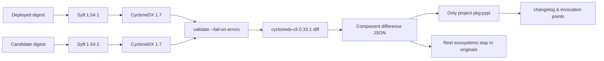

> "物有本末，事有终始。知所先后，则近道矣。" —— 《礼记·大学》

# Ignoring SBOM Diff? Your Project Might Have a Fatal Flaw!

*From “What’s inside the image” to “What changed between two digests”—a contract, a frozen ruler, and a signature humans must still do.*

Before we dive into the technicalities, let’s revisit a story that might feel oddly familiar. Thomas Edison once tested 1,600 materials for light bulb filaments—each failure was meticulously recorded. When asked about the "waste" of so many attempts, he replied: "Not at all. I now know which ones won’t work." This relentless attention to incremental details, this refusal to overlook any seemingly minor change, is what ultimately led to breakthroughs. Yet in software engineering, we often treat dependency updates as abstract numbers—3.1.6 to 3.3.1—without recognizing that each version shift could be the equivalent of Edison’s filament experiments. The story reminds us: in complex systems, the "small" changes are where fatal flaws hide.

The build was green. `pip check` inside the image was green. Someone read the upgrade notes. Then an FTP task broke: the data channel started demanding protected transmission, but the peer negotiated in plaintext. Looking back, the review materials had no trace of these four lines:

| Package | 3.1.6 | 3.3.1 |
| --- | --- | --- |
| SQLAlchemy | 1.4.54 | 2.0.51 |
| Paramiko | 3.5.1 | 5.0.0 |
| pandas | 2.1.4 | 2.3.3 |
| apache-airflow-providers-ftp | 3.14.0 | 3.15.2 |

These four lines aren’t folklore. On October 15, 2026, scanning public images `apache-airflow:3.1.6` and `apache-airflow:11b7aa7` (the latter is Airflow 3.3.1) on `linux/amd64`, Paramiko was **3.5.1 to 5.0.0**, pandas stopped at **2.3.3**, and the FTP provider’s behavior change introduced in **3.15.1** was present in **3.15.2**.

`pip check` answers: are these ingredients compatible? The changelog answers: what did the project choose to announce? The running container answers: what is actually installed on this machine? Three questions, three files. Signing with a green `pip check` for the third question is why SQLAlchemy 2 will still pass through next time.

This post only asserts one contestable judgment: **upgrade reviews require two valid ingredient lists and a subtraction, not just another version comparator script**. The format of these lists is CycloneDX 1.7 (ECMA-424). Syft generates them by scanning layers without booting candidate images. The subtraction uses a frozen `cyclonedx-cli`. Humans still need to sign Python lines and DAG calls. Calling CLI “industry standard” is akin to engraving “meter” on the ruler.

Read this and take three things away:

- **SBOM is an image digest’s ingredient list**, not an invoice, lockfile, or vulnerability report.
- **Comparing two lists only matters when “the running image will be replaced.”** A green `pip check` and CVE scan answer different questions.
- **Non-empty differences are success.** Build failures only happen when the list isn’t generated, is invalid, or the ruler’s version drifts.

Below, I’ll write it in the order someone learning would expect: first explain what an ingredient list is, then when to subtract, then why these three tools are used, and finally fall back to architecture, command shapes, a real scan, and pipeline conditions actionable today. The discovery sequence was reversed—first hit FTP, then hunt for industry names. Teaching order doesn’t need to repeat accident order.

## 1. Ingredient List: What Exactly Is CISA Referring To?

CISA is the U.S. Cybersecurity and Infrastructure Security Agency. It describes SBOM as software’s **ingredients list** in public documents. On July 29, 2026, it released *Minimum Elements for a Software Bill of Materials* with NSA, FBI, and international partners, replacing the 2021 NTIA baseline. That document still uses this metaphor.

A food label’s ingredients list doesn’t require you to trust the vendor’s verbal assurance that “everything inside is good.” It requires you to see: water, sugar, which preservatives. Software images are black boxes for ops. Without an ingredient list, you can only ask vendors, scan layers, and guess.

Three easily confused files:

| File | What it records | What question it answers |
| --- | --- | --- |
| Changelog | What the project chose to write in changelog | What the author wants you to know |
| Lockfile / Build Manifest | What a build **intended** to resolve | What is declared in the source tree |
| SBOM | What components are actually installed on a specific digest’s filesystem | What this machine will see after booting |

CISA’s minimum elements are a **field checklist**: name, version, hash, license, generator tool, generation context. It tells you what a qualified table should look like. It’s not university rules or a comparator. Australian universities, internal change processes, won’t automatically add a mandatory clause just because of this PDF. To align fields, reference it. To compare two Airflow images, still need generators and rulers.

> An ingredient list makes “what’s inside” a verifiable fact. It doesn’t decide which line will break tasks or patch them for you.

## 2. Why Ingredient Lists Exist and Why Subtraction Matters

Generating one SBOM answers “does this digest contain a specific library, what version?” Log4Shell and xz-utils asked that question. Upgrade reviews ask one more: **compared to the running image, what changed in the new one?** One list is inventory. The difference between two lists is the changelog review’s input.

Subtraction matters in four scenarios:

| Scenario | Specific Action | What Happens Without Lists |
| --- | --- | --- |
| Image Locking | A build is about to rewrite base image sha | Review starts from changelogs; provider minor versions slip through |
| Incident | Task behavior changes after a “minor version” | Post-incident layer scanning, not starting from component lines |
| Notice | “Does this library exist in what we run?” | First week spent asking vendors, not querying lists |
| Not applicable for this control | `pip check`, Trivy / Grype / Inspector | They each have roles; using them as “what changed” will sign again wrong |

Vulnerability scanners ask: are known CVEs present? Subtraction asks: how did component coordinates evolve between two releases. One CycloneDX can feed a scanner, or a diff tool. Roles shouldn’t be hardwired into the same build failure condition.

If someone on your team asks “we only need Airflow’s SBOM, what does xz have to do with us?”—the relation is in the question, not coverage. Syft scans the final filesystem; Debian `xz-utils` / `liblzma` in layers would appear as `pkg:deb` in BOM, not necessarily on Python abstract pages shown to reviewers. Today’s pipeline if it only produces Airflow SBOMs reliably answers **each Airflow digest**. To answer what mirrors across the organization have 5.6.0, needs same method covering other images and centralized digest search. The xz card is industry-wide question; pipelines first solve upgrade time’s second table.

## 3. Green Light Answers Wrong Question

`pip check` only looks at **this single environment**: are declared dependencies fully installed, do version ranges conflict? All pass is exit 0. New images can have SQLAlchemy 2, Paramiko 5, numpy 2 simultaneously if pip deems them compatible.

It won’t pull old images to compare. It won’t list “from 3.1.6 to 3.3.1 which went from x to y.” A brand-new, internally consistent major version upgrade is success to it.

Five whys stop at mechanism:

1. Why did FTP behavior change? Provider moved from 3.14.0 to 3.15.2; 3.15.1 added protected transmission by default.
2. Why didn’t review see it? Materials were changelogs and “pip green,” not diffs between two immutable images.
3. Why didn’t `pip check` block it? It checks if new image is internally consistent.
4. Why isn’t changelog sufficient? Core changelogs don’t own every provider’s transport defaults.
5. Why wasn’t machine-readable diff available then? Pipeline tags, writes sha into GitOps, but doesn’t make “old digest vs new digest” a required archive output.

> Consistency is a property within one image. Change is a property between two images. Signing a medical record with a thermometer doesn’t remove the illness.

## 4. Why Minor Versions Can Break Tasks

FTP has two connections: control channel for commands, data channel for file transfer. Protected data channel means encryption on both; protocol corresponds to `PROT P`. Provider **3.15.1** added this path by default after which peer still negotiated plaintext data channel and transmission broke.

Version numbers look like minor upgrades: 3.14.0 → 3.15.2. It doesn’t look as obvious as SQLAlchemy 1.4 → 2.0. Reviewers easily treat it as “just follow the upgrade.” Behavioral change happened at **3.15.1**; this image pair has **3.15.2**, already including that change. Don’t say “only 3.15.2 added protected transmission”;

Without component lists, review doesn’t start from this line. Tasks broke after the fact. This is how tribal knowledge remains engineering artifact: someone remembers “FTP had problems last time,” but pipelines can’t archive one line diff.

📌 Version number distance isn’t risk. Risk is in invocation point and peer side. One patch can change transport default; a major version jump might be completely inert for your DAG.

## 5. Industry-Wide Question: Log4Shell, xz, CISA 2026

December 2021, Log4Shell (CVE-2021-44228) made “do we have this library in what we run?” a national emergency. CISA advisory **AA21-356A**’s first requirement: inventory all assets using Log4j by version. It still maintains an public list of affected products because many owners can’t answer their own ingredient lists.

March 2024, xz-utils **5.6.0 / 5.6.1** found to contain backdoor (CVE-2024-3094). Ops question: which **images and releases** have these versions. Developer notebooks’ `requirements.txt` often list no xz—it’s in base images, system packages, others’ binaries.

Don’t write “having SBOM blocks supply chain poisoning” as historical fact. Narrower, but valid statement is: without ingredient lists, first week after notice spends asking “do we have it?” With list, question becomes JSON query.

CISA 2026 minimal elements added fields. It’s still not a diff tool. Three cards must remain separate:

| Thing | Role |
| --- | --- |
| CISA 2026 minimum elements | What fields a BOM should have |
| CycloneDX 1.7 / ECMA-424 | How to write this table |
| `cyclonedx-cli diff --component-versions` | List additions, deletions, modifications between two legal tables (tool capability not in ECMA正文) |

SPDX 2.2.1 is ISO/IEC 5962:2021, real standard. BuildKit can append SPDX with `--sbom=true`; default appends provenance, not SBOM. Choosing not to use SPDX isn’t because it “isn’t ISO.” Choose CycloneDX because reference CLI already does component version diffs. CycloneDX’s own ISO/IEC 27055 is still draft as of October 2026. Anyone who argued “CycloneDX is ISO, SPDX isn’t” in architecture committee was mistaken.

## 6. Why Not Write Your Own Comparator

Old approach has strong temptation: run candidate image, `pip inspect` or `pip freeze`, subtract two texts. It looks precise because pip itself reports installed versions. It also makes list generation dependent on **unreviewed code execution in candidate images**.

Information changes direction here. Image layers are frozen filesystems. Syft reads layers. `pip inspect` boots interpreter, trusts its printed JSON. Earlier path’s trust boundary is “scanner read files correctly.” Later path’s trust boundary is “candidate image voluntarily reports itself truthfully.”

| Approach | What It Actually Does | Why Drop |
| --- | --- | --- |
| Boot candidate, `pip freeze`, diff | Execute candidate, only sees Python, version comparator on own scripts | Executes unreviewed code; doesn’t see Debian or cargo |
| Self-write `pip inspect` parser | Same work, two private JSONs | Thursday script and Friday script will fork |
| Trivy / Grype / Inspector | Ask if known CVE is present | Leave as vulnerability policy, not upgrade diff |
| SPDX + self-written differ | Format is real standard | No existing component version CLI; subtraction back to own hands |
| Syft 1.54.1 + cyclonedx-cli 0.33.1 | Read layers, write 1.7, validate, list additions/deletions | Image remains unbooted; format ECMA-424; frozen versions make two Fridays comparable |

Reference nearby to prevent “most popular” becoming “most suitable”:

| Project | Role | Decision |
| --- | --- | --- |
| Syft | Container scanner, ~9,700 stars, BuildKit’s SBOM scan path | Adopted as generator |
| Trivy | Scan + vulnerability, ~38,400 stars | Vulnerability policy, not upgrade diff |
| cyclonedx-cli | Reference differ, 0.33.1, ~548 stars | Frozen; validate first |
| Docker Scout compare | Image-to-image comparison | Still experimental in docs, vendor service |
| sbom-utility diff | RFC 6902 patches | Docs themselves mark experimental |
| container-diff | Old image diff | Archival |
| cdxgen | Generate CycloneDX from source tree | Layer scan chooses Syft |
| GitHub dependency review | Compare PR lockfiles | Can’t see installed in images but not written in lockfile version |

Self-write a PEP 503 normalized + sorted Python diff could prove “we saw SQLAlchemy” within a week. It would also live in two repos and must boot image to execute. This script’s true identity is scouting. After scouting, local code should do three things: verify tool version strings, call validate and diff, project `pkg:pypi` into human-readable pages.

## 7. Architecture: Generate, Validate, Subtract, Project



Generation commands must hardcode scope. `--scope squashed` reads final filesystem, aligns with what processes see after boot. `all-layers` will recount packages buried by upper layers. Platform written as cluster nodes is `linux/amd64`. Digest must come from `RepoDigests`, with `@sha256:`. Local image ID sufficient for experiments but insufficient for cross-build release records.

```bash
export SYFT_FILE_METADATA_SELECTION=none

syft --quiet --scope squashed --platform linux/amd64 \
  -o "cyclonedx-json=old.cdx.json" \
  "registry.example/apache-airflow@sha256:<old>"

syft --quiet --scope squashed --platform linux/amd64 \
  -o "cyclonedx-json=new.cdx.json" \
  "registry.example/apache-airflow@sha256:<new>"

cyclonedx validate --input-file old.cdx.json --fail-on-errors
cyclonedx validate --input-file new.cdx.json --fail-on-errors
cyclonedx diff old.cdx.json new.cdx.json \
  --component-versions --output-format json \
  > cyclonedx-component-diff.json
```

`SYFT_FILE_METADATA_SELECTION=none` isn’t a taste issue. Syft defaults to writing thousands of `type: file`, versionless, often purl-less paths into BOM. In an uncropped scan from 3.1.6, 7714 components had 7190 files. `cyclonedx diff` later treats certificate path names as components; projection script exits with input error when no available versions. Turning off file metadata leaves only packages in BOM. Projection still skips residual `type: file`, logs them as `skipped_file_entries`.

🩸 When validation fails, don’t paste CLI stderr directly into build summary. Error lines may contain tokenized repo URLs. Only retain “validate failed” and a sanitized excerpt without `://` / `token` / `password`.

Install tools without `curl | sh`. GitHub’s linux/amd64 runner pulls frozen `syft_1.54.1_linux_amd64.tar.gz` and self-contained `cyclonedx-linux-x64`. Version checks fail on “almost right”:

```text
Syft must be exactly 1.54.1
cyclonedx-cli must be exactly 0.33.1
```

Floating `latest` makes Thursday’s evidence and Friday’s evidence incomparable. Incomparable evidence can’t explain a fault that already occurred.

## 8. JSON Output from the Ruler and What Local Code Shouldn’t Reimplement

Frozen `0.33.1` version line is `0.33.1+b3cfa4b0edc356dad07e0b6e7ab6da0a94af0246`. `diff --component-versions` JSON has no `modified` field. Same name under `removed` in old, `added` in new. Version change is coordinate switch.

```json
{
  "componentVersions": {
    "sqlalchemy": {
      "added": [
        {
          "type": "library",
          "name": "sqlalchemy",
          "version": "2.0.51",
          "purl": "pkg:pypi/sqlalchemy@2.0.51"
        }
      ],
      "removed": [
        {
          "type": "library",
          "name": "sqlalchemy",
          "version": "1.4.54",
          "purl": "pkg:pypi/sqlalchemy@1.4.54"
        }
      ],
      "unchanged": []
    }
  }
}
```

Facts easy to trip on during packaging:

- JSON’s **unchanged** components also exist. Text mode hides them. Counting only by text loses denominator.
- Key order unstable, unsuitable as byte-level golden file. Review report sorts itself and hashes CLI’s **raw stdout** with SHA-256. Originals archived verbatim. Review JSON is projection, not second fact.
- `purl` determines which section. Every purl starts with `pkg:pypi/` to count as Python. One `pkg:deb/` makes whole line leave Python table.
- 2024 issue #380: illegal BOM received empty diff or `ArgumentNullException`. Maintainer’s conclusion was input wasn’t valid CycloneDX. So order is validate, then diff.

Projection logic must follow CLI shape, not recheck version:

```python
def is_changed(entry: dict) -> bool:
    return bool(entry.get("added")) and bool(entry.get("removed"))

def is_python(entry: dict) -> bool:
    comps = list(entry.get("added") or []) + list(entry.get("removed") or [])
    if not comps:
        comps = list(entry.get("unchanged") or [])
    purls = [c.get("purl") or "" for c in comps]
    return bool(purls) and all(p.startswith("pkg:pypi/") for p in purls)
```

Exit code is contract. Non-empty diff is exit 0. Failures belong to: missing input (missing image, digest), extraction failure, write failure. Build summary must state: reviewer opens Python page; full CLI JSON is CycloneDX difference original.

## 9. A Real Scan Against Public Images

October 15, 2026, public image pair, `linux/amd64`, Syft 1.54.1, file metadata off, CLI 0.33.1. Skill path and pipeline projection give same digest for same CLI stdout. Two runs’ CLI stdout SHA-256 both are:

```text
5ee5fe7332d9121ba7b7d1c8c9d07edec319efba1445501a61f9d7eb0857a919
```

Python side:

| | Count |
| --- | --- |
| Changed | 190 |
| Added | 20 |
| Removed | 11 |
| Unchanged | 85 |

Other components: 57 changed, **503 added**, 2 removed, 158 unchanged. That 503 nearly all `uv` / `uvx` binaries’ **pkg:cargo** crate, not 503 Debian packages. Debian’s `libssl3` did change: `3.0.18-1~deb12u1` → `3.0.20-1~deb12u2`. Reading 503 as “base image added 503 system packages,” reviewer panics in wrong place.

Same scan shows: `cryptography` 42.0.8 → 50.0.0, `numpy` 1.26.4 → 2.5.1, `flask` 2.2.5 → 3.1.3, `apache-airflow` 3.1.6 → 3.3.1. Removed side includes `sshtunnel` 0.4.0, `sqlalchemy-jsonfield`. Added side includes `psycopg` 3.3.4. These lines are sorted alphabetically in full markdown; reviewer’s first page only lifts four directly related lines, projection not “report has only four lines.”

exit 0. Non-empty is success.

Review order need not reinvent each meeting:

1. Deleted Python packages: code still imports?
2. Major versions: read migration guides.
3. Provider: read that provider’s changelog.
4. Directly imported libraries: map to invocation points.
5. Transport and encryption libraries: test against real peer again.
6. Newly added transitive dependencies: who is parent dependency?
7. Other ecosystems: first check count, only open originals if anomalies.

## 10. The Half-Completed Section

CISA 2026 requires author signatures, SLSA provenance, and attaching SBOM as OCI referrer to image digest—none of which are this pipeline’s delivered capabilities yet. Today’s one attachment retained for 90 days proves only “that one diff stdout hash matches this page.” It doesn’t prove “the warehouse’s image still carries this list.”

Writing “we already have supply chain proof” as current state is another case of name mismatch. Now possessed: repeatable component difference calculation, and a language that no longer calls CLI standard.

## Immediate Actions

1. In image builds, print and hardcode `syft version` = `1.54.1`, `cyclonedx --version` starts with `0.33.1`. If mismatched, stop.
2. For old digest and new digest, generate CycloneDX each, environment variables with `SYFT_FILE_METADATA_SELECTION=none`, validate first, then diff. Originals and Python projection archived together.
3. Write build failure as “list, legal diff or frozen ruler not produced,” not “diff non-empty.”
4. Use SQLAlchemy, Paramiko, pandas, FTP provider these four lines for regression. Versions must be those scanned, not rumor.
5. Leave vulnerability scan to Trivy, Grype, or Inspector. Same diff doesn’t double as security policy.

Next worthy of standalone writing is making this SBOM a digest’s referrer, not just build log attachment. Before that, review still starts from this page, signature remains human’s.

*List the ingredients first, then compare their differences. A green check may answer another question; the signature becomes hollow.*
