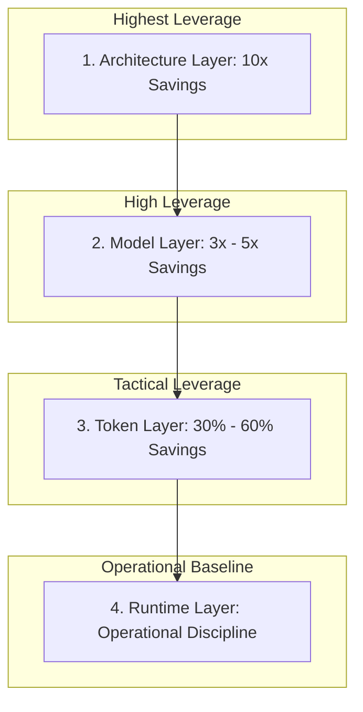
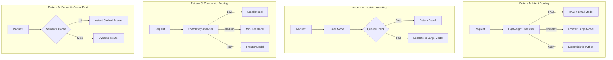
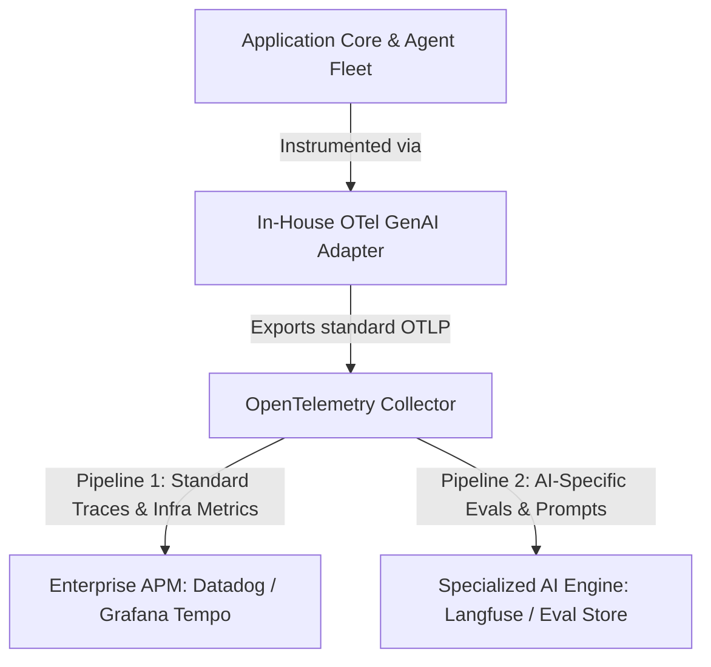
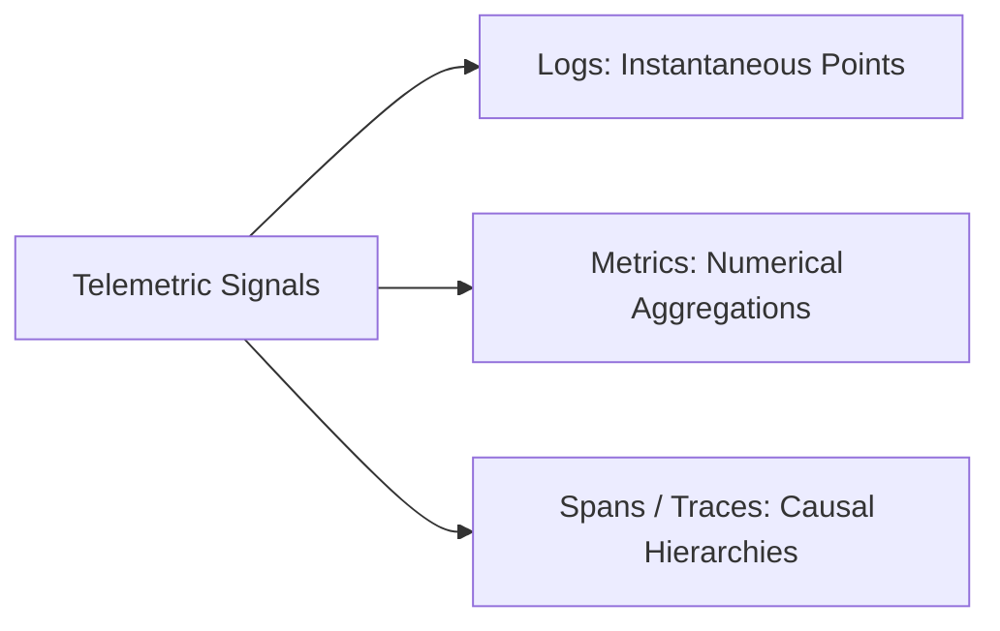

> "Cost optimization is the downstream byproduct of a rigorous evaluation system; without evals, down-ranking a model is just gambling with production reliability." — Production Engineering Maxim

# A Look Inside How Top Teams Balance AI Observability and Cost: Lessons from Silicon Valley

*Why replacing your frontier model saves pennies while causal tracing, deterministic guards, and evaluation loops save millions.*

Can you state, down to the cent, how much money your production AI agents burned last week purely on retried tool executions and ungrounded hallucinations?

If you are running multi-agent workflows, autonomous enterprise assistants, or Retrieval-Augmented Generation (RAG) pipelines in production, chances are your cloud invoice arrives as a single, opaque lump sum. You see a terrifying figure next to an API line item, but you cannot attribute which tenant, which prompt release, which tool failure, or which agentic loop drove the spike. When leadership demands a 40% reduction in AI operating expenditure, the instinctive reaction across most engineering teams is as predictable as it is disastrous: downgrade the model from a frontier engine to a budget alternative, compress the system prompt, and pray the error rate does not trigger a customer revolt.

I kept a note in my engineering journal about how high-throughput teams fall into this trap. They treat generative models like wishing wells: toss in a prompt, make a wish, and hope the output comes out fast and cheap. But an industrial platform is not a wishing well. It is a factory floor. If an executive chef builds a three-star restaurant, their job is not to stand at every burner flipping pans; their job is designing the kitchen workflow, sourcing reliable ingredients, setting station tolerances, and instrumenting the line so that when a dish goes out cold, they know whether the expeditor stalled, the broiler misfired, or the prep cook missed a step. When output fails in an engineering system, you do not beg the model to behave—you fix the telemetry, diagnose the bottleneck, and adjust the assembly line.

In this comprehensive architectural guide, we are going to dismantle the illusion of "cheap AI." We will build a production-grade observability and cost-attribution architecture from first principles. By the end of this piece, you will have a complete blueprint: you will know how to instrument OpenTelemetry GenAI spans across agents, tools, and retrievers; how to implement SDK-level PII sanitization before telemetry escapes your boundary; how to deploy deterministic and cascading model routers that slash spend by over 70% without sacrificing quality; and how to close the loop by automatically turning runtime trace anomalies into regression eval fixtures.

---

## The Fallacy of the "Cheap Model"

Here is the counterintuitive reality that blindsides teams moving from prototype to production: **a cheap model retrying three times in production is often substantially more expensive and unpredictable than a frontier model succeeding on the first attempt.**

When engineers evaluate model costs, they almost universally evaluate *unit cost per token*: input cost per million tokens ($/M) and output cost per million tokens ($/M). On paper, dropping from a frontier model at $3.00/$15.00 per million tokens to a lightweight model at $0.15/$0.60 per million tokens looks like an order-of-magnitude victory. Finance celebrates. Then the system hits real traffic.

The lightweight model fails to parse structured JSON on turn one. Your agent catches the schema validation exception and triggers an automatic retry, appending the error message back into the conversation history. Now the context has doubled. The model tries again, misinterprets an ambiguous tool schema, calls the wrong database endpoint, receives an unhelpful error, appends that to the prompt, and calls the tool again. By turn four, the lightweight model has accumulated 12,000 input tokens across repeated round trips, consumed hundreds of milliseconds of compute per hop, generated 800 reasoning tokens, and delivered an ungrounded hallucination that forces the customer to abandon the session.

The frontier model, by contrast, followed the system instruction precisely on turn one, executed the correct tool with valid arguments, and terminated the conversation cleanly in 1.8 seconds using 2,200 total tokens.

```
Scenario A (Budget Model with Retries): 
  Turn 1:  2,000 in +  150 out (JSON parse error)
  Turn 2:  4,150 in +  220 out (Wrong tool invoked)
  Turn 3:  6,370 in +  180 out (Malformed SQL generated)
  Turn 4:  8,550 in +  350 out (Final ungrounded answer)
  Total Input Tokens:  21,070 | Total Output Tokens: 900
  Cumulative Latency:  8.4s   | End Outcome: FAILED / POISONED

Scenario B (Frontier Model, Single Shot):
  Turn 1:  2,000 in +  280 out (Correct tool executed, grounded response)
  Total Input Tokens:  2,000  | Total Output Tokens: 280
  Cumulative Latency:  1.4s   | End Outcome: SUCCESS
```

If you measure cost purely as `cost_per_call`, Scenario A looks cheap on every isolated hop. But if you measure what actually matters to a business—**cost per successful task**—Scenario A is an operational catastrophe. It consumes more network overhead, saturates thread pools, inflates database read replicas through errant tool calls, frustrates users, and burns real capital on failures.

Cost optimization is not a negotiation with model vendors. It is an engineering discipline grounded in end-to-end distributed tracing, deterministic routing guards, and continuous automated evaluation.

---

## 第一步:成本必须可归因 (Step 1: Cost Must Be Attributable)

Optimizing a system without granular cost attribution is not engineering; it is superstition. If your billing alert fires and all you have is a consolidated month-to-date cloud invoice, you have no levers to pull. To make cost an actionable engineering constraint, you must enforce four foundational principles across your platform.

### 1. Granular Span-Level Accounting
Every single interaction with an external system—whether an LLM completion, an embedding generation, a vector index retrieval, or an API tool execution—must be wrapped in a discrete OpenTelemetry span. That span must capture:
- Exact input tokens (prompt tokens), output tokens (completion tokens), and cached token read hits.
- Specific model identifiers, including exact checkpoint dates (e.g., `claude-3-5-sonnet-20241022` or `gpt-4o-2024-08-06`), not just transient aliases.
- Granular execution duration (wall-clock latency and server-side processing time).
- Direct cost calculated at execution time, written into the span attributes rather than estimated post-hoc via batch log scripts.

### 2. Multi-Dimensional Attribution: Feature, Tenant, and User
Never allow an LLM call to execute in an anonymous context. Your telemetry adapter must stamp every outgoing request span with at least three non-negotiable dimensions:
- `app.feature`: Which business capability initiated this compute? (e.g., `claims_triage`, `policy_faq`, `underwriting_extraction`, `fraud_detection`).
- `app.tenant`: Which corporate customer, subsidiary, or geographic operating unit owns this workload? (e.g., `apac_enterprise_01`, `emea_retail_core`).
- `app.user_id` (or hashed actor id): Which individual end-user session triggered the transaction?

Without these three labels, you cannot answer basic operational questions: Is our largest enterprise client generating positive gross margins, or are their complex edge cases draining platform resources? Which product feature drove the 30% weekend token surge?

### 3. The North Star Metric: Cost per Successful Task
Discard `cost_per_call`. It is a vanity metric that actively incentivizes toxic engineering decisions (such as swapping in brittle, low-cost models that fail silently). Replace it with:

$$\text{Cost per Successful Task} = \frac{\sum \text{Total Cost of All Attempted Calls across Task Lifecycle}}{\mathbb{I}(\text{Task Verified Successful})}$$

If an agent executes six intermediate tool calls, burns 40,000 tokens, and ultimately times out or returns an ungrounded hallucination requiring human remediation, the task success is 0. That entire expenditure is classified as **wasted spend**. Tracking cost per successful task forces teams to optimize for end-to-end task completion rather than myopic token thrift.

### 4. Evals as First-Class Observability Citizens
In classical software engineering, you monitor latency, error rate (5xx), and throughput (RPS). In AI engineering, you must monitor a third dimension: **quality (grounding, semantic validity, constraint adherence)**.

Whenever you alter a prompt, swap a model, or tweak a retrieval hyperparameter (such as $k$ nearest neighbors), your CI/CD pipeline and runtime telemetry must evaluate the change against a holy trinity of first-class metrics:

| Evaluation Metric | Unit / Target | Engineering Meaning |
|---|---|---|
| **Accuracy / Grounding Rate** | % (e.g., $\ge 98.5\%$) | Did the model answer strictly using verified retrieved context without fabrication? |
| **P95 Latency** | Milliseconds | How long does the end user wait before the full response or first token streams back? |
| **Cost per Task** | USD ($) | How much total capital was consumed to drive the workflow to a terminal state? |

If you improve latency and drop cost by 50%, but your grounding rate slips from 99% to 92%, you have not shipped an optimization; you have introduced an unmonitored production defect.

---

## 按杠杆大小排序的手段 (Optimization Levers Ranked by Impact)

When teams decide to reduce AI infrastructure costs, they almost invariably start at the bottom of the leverage hierarchy: tweaking temperature, micro-editing system prompts, or scouring dictionaries for shorter synonyms. This is bikeshedding. True architectural cost reduction follows a strict leverage hierarchy where upstream structural decisions deliver order-of-magnitude returns.



Let us dissect each layer in order of actual financial impact.

### 1. 架构层 (Architecture Layer: Up to 10x Savings)
This is where you make the largest structural gains. The golden rule of AI cost reduction is: **the cheapest LLM call is the one you never make.**

- **Front-Door Deterministic Routing:** Over 60% of requests routed to general-purpose enterprise assistants do not require dynamic multi-step autonomous planning. A user asking "What is our excess for domestic baggage delay?" does not need an agentic planner to evaluate thirty permutations. A deterministic intent classifier or semantic cache can route this directly to an indexed FAQ lookup or a deterministic code path. The agent should be an escalation tier for the complex long tail, never the default front door.
- **Pruning Unnecessary Agentic Hops:** Every autonomous loop iteration represents a complete prompt replay. In an unconstrained ReAct loop, Turn 5 resends the entire conversational history, the system prompt, all tool definitions, and all previous tool outputs. Slashing an agent's average resolution from 6 hops to 2 hops via specialized deterministic sub-workflows cuts token volume by 75% instantly.
- **Semantic and Structural Caching:** Caching should exist at multiple layers of the stack:
  - *Raw Document Extraction Cache:* Never re-extract entities from a static 80-page insurance policy PDF twice. Hash the document payload (SHA-256) and cache the extracted structured schema in an operational datastore (DynamoDB, Redis, or PostgreSQL).
  - *Vector Search Retrieval Cache:* Cache frequent query embeddings and their retrieved context chunks.
  - *Semantic Request Cache:* For high-frequency query distributions, match query embeddings with a high cosine similarity threshold (e.g., $\ge 0.96$) to return pre-computed, pre-validated answers.

### 2. 模型层 (Model Layer: 3x to 5x Savings)
Once your architecture isolates the complex workloads, optimize the model tier allocated to each specific step.

- **Tiered Model Cascading (Small Model First):** Utilize lightweight models ($0.15/M) for classification, sentiment extraction, translation, and structured data extraction. Reserve frontier models ($15.00/M) exclusively for synthetic reasoning, complex multi-document reconciliation, and customer-facing synthesis.
- **Evaluation-Driven Down-Ranking:** Never down-rank a model based on intuition or vendor benchmarks. Construct an offline golden evaluation dataset matching your enterprise distribution. Prove statistically that the lightweight model satisfies your task constraints before flipping the routing flag in production.
- **Strict Structured Outputs and Output Token Budgets:** Output tokens are typically 3x to 5x more expensive than input tokens across all major model providers, and they dominate latency because generation is auto-regressive (token by token). By enforcing strict JSON schemas (via constrained decoding or instructor patterns) and setting hard `max_tokens` boundaries, you eliminate discursive conversational filler ("Sure, I would be happy to help you with that insurance query...") and save thousands of expensive generation tokens per minute.

### 3. Token 层 (Token Layer: 30% to 60% Savings)
At the prompt engineering level, systematic byte-level discipline yields dramatic savings across high-volume pipelines.

- **Prompt Caching Discipline:** Modern model APIs offer substantial discounts (often 50% to 90% off input pricing) for cached prompt prefixes that match across requests. However, prompt caching requires byte-exact prefix matching. The most common enterprise anti-pattern is injecting dynamic data—such as a current ISO timestamp, a request ID, or a user name—at the very beginning of the system prompt. Doing so invalidates the cache on every single call! Keep your system prompts, tool schemas, and invariant reference policies at the root of the context window, strictly isolated from dynamic session state.
- **Aggressive Tool Schema Pruning:** Providing an agent with 25 rich tool schemas inflates the system prompt by 3,000 to 5,000 tokens on every single turn. If an agent runs five hops, it processes 25,000 tokens purely reading tool documentation! Consolidate overlapping tools, break monolithic agents into focused micro-agents with 5 to 7 orthogonal tools each, and dynamically inject only the tool schemas relevant to the classified domain.
- **Context Compaction and Sub-Agent Isolation:** Long multi-turn conversations should not accumulate unbounded history. Implement sliding context windows with periodic deterministic summarization. Even better: execute isolated sub-tasks inside ephemeral sub-agents, returning only the terminal structured conclusion back to the primary orchestration thread.
- **High-Precision Reranking over High-Volume Retrieval:** Flooding a context window with 50 raw retrieved chunks hoping the model finds the needle is both expensive and error-prone (inducing "lost in the middle" hallucinations). Retrieve top-50 via hybrid search (BM25 + dense vectors), pass them through a lightweight cross-encoder reranker, and inject only the top-5 verified chunks into the generation prompt.

### 4. 运行层 (Runtime Layer: Operational Discipline)
Operational controls prevent transient spikes from becoming fiscal emergencies.

- **Batch APIs for Asynchronous Workloads:** Asynchronous workloads—such as overnight claim document extraction, batch compliance auditing, or synthetic evaluation generation—should run through provider Batch APIs, which offer an immediate 50% discount against standard on-demand pricing.
- **Per-Tenant Hard Quotas and Circuit Breakers:** Enforce explicit rate limits, maximum token allocations, and maximum step thresholds per tenant and per feature. When a rogue client script enters an infinite retry loop, your platform circuit breaker must trip before your corporate credit card does.
- **Streaming as Latency Camouflage:** Streaming (`stream=True`) does not save money, but it fundamentally transforms perceived latency. Users happily tolerate a 4-second total generation time if the first token paints within 400 milliseconds. This reduces the psychological pressure to swap in faster, lower-quality models simply to satisfy impatient stakeholders.

---

## 防失控的护栏(保险公司会特别在意) (Guardrails Against Runaway Costs)

In tier-one financial institutions and global insurance carriers, an unconstrained autonomous loop is treated as a severe security and operational risk. In an unmonitored environment, an autonomous agent caught in an infinite loop due to ambiguous tool responses can rack up tens of thousands of dollars in API charges while bombarding downstream production APIs with bogus mutations.

Every production agent runtime must enforce **The Invariant Triad of Hard Ceilings**:

```
┌────────────────────────────────────────────────────────┐
│           THE INVARIANT TRIAD OF HARD CEILINGS         │
├──────────────────────────┬─────────────────────────────┤
│ 1. MAX STEPS PER TASK    │ e.g., Hard cutoff at 8 hops │
├──────────────────────────┼─────────────────────────────┤
│ 2. MAX TOKENS PER TASK   │ e.g., Cap at 25,000 tokens  │
├──────────────────────────┼─────────────────────────────┤
│ 3. MAX REPEAT TOOL CALLS │ e.g., Max 2 identical calls │
└──────────────────────────┴─────────────────────────────┘
```

If any single constraint is violated, the orchestration runtime must immediately terminate the loop, set the span status to `Error`, record the violation attribute (`app.constraint_violation = True`), and route the session cleanly to a human operator or graceful fallback handler. This is not merely a financial cost guardrail; it is an availability and reliability boundary.

> 📌 **Takeaway:** Unconstrained agent loops are production outages waiting to happen; enforce hard ceilings on steps, tokens, and identical tool invocations at the runtime orchestrator level.

---

## 一句收尾 (A Single Closing Principle)

Before diving into the code and telemetry topology, fix this foundational mental model firmly in your mind:

> "Cost optimization is the downstream byproduct of a rigorous evaluation system; without evals, down-ranking a model is just gambling with production reliability."

Without an automated evaluation harness running continuously against production traffic distributions, you cannot safely swap a frontier model for a budget alternative. You cannot know whether quality dropped by 2% or 40%. Build your evaluation suites first; sustainable cost reduction will follow as an inevitable engineering consequence.

---

## 架构实战: 小模型优先，大模型后置 (Architectural Patterns: Cascading and Routing)

Let us move from theory to implementation. How do top engineering teams practically structure dynamic routing? There are four primary architectural patterns deployed in production.

### The Four Production Routing Patterns



- **Pattern A (Intent Classification + Routing):** A lightweight classifier examines the incoming user intent. Simple lookups route to determinism or cheap models; complex multi-hop reasoning routes to frontier models.
- **Pattern B (Model Cascading):** A lightweight model executes the task first. A deterministic validator (or schema checker) inspects the output. If the response passes validation, it returns immediately; if it fails, it escalates to a frontier model.
- **Pattern C (Complexity-Based Routing):** The system analyzes structural query metrics (token length, entity density, dependency requirements) and routes directly to Small, Medium, or Large models.
- **Pattern D (Semantic Cache + Routing):** The request checks an operational vector cache. If a high-confidence semantic match exists with pre-validated answers, it returns in 15ms at zero token cost; misses pass down to the dynamic routing layer.

### Managed vs. Self-Built Routing: The Cloud Reality
Cloud providers offer managed routing solutions, such as Amazon Bedrock Intelligent Prompt Routing, which dynamically balances requests across model families based on provider-managed performance predictors. 

When should you adopt managed provider routing versus building your own routing plane?

| Dimension | Managed Routing (e.g., Bedrock Intelligent Routing) | Self-Built Application Routing |
|---|---|---|
| **Operational Overhead** | Zero infrastructure to maintain; turnkey provider integration. | Requires maintaining classifier models, thresholds, and routing logic. |
| **Business Logic Awareness** | Blind to domain rules; operates purely on generic prompt features. | Fully integrates customer tier, claim value, regulatory policy, and user permissions. |
| **Fallback Control** | Restricted to supported models within that specific cloud ecosystem. | Unrestricted cross-provider fallbacks (e.g., Anthropic to OpenAI to local vLLM). |
| **Auditability** | Opaque decision criteria inside provider black box. | Fully transparent OpenTelemetry spans with explicit routing reason attributes. |

In highly regulated enterprise domains (such as underwriting or healthcare claims), a hybrid approach wins: self-built deterministic rules govern security, tenant entitlement, and auditability, while managed routers can be deployed within specific downstream sub-clusters.

### Production Routing Configuration
Rather than hard-coding model targets and thresholds directly in business logic, elite teams externalize routing topology into declarative configurations:

```yaml
# routing_policy.yaml
models:
  classifier: "claude-3-5-haiku-latest"
  small: "gpt-4o-mini"
  large: "claude-3-5-sonnet-latest"

routing:
  rules_first: true
  classifier_timeout_ms: 800
  default_route: large
  confidence_threshold: 0.85
  
  intents:
    greeting:
      route: small
    policy_faq:
      route: small
    policy_comparison:
      route: large
    complex_claim_analysis:
      route: large
    calculation:
      route: tool
      
  escalation:
    on_low_confidence: large
    on_invalid_output: large
    on_classifier_error: large
    on_safety_uncertainty: human_review
    
  limits:
    max_retries: 1
    max_input_tokens: 12000
    max_output_tokens: 1500
```

### Fully Worked Implementation: Production Classifier & Cascading Router
Below is a battle-tested Python implementation illustrating deterministic fast-paths, structured classification via Pydantic v2, and safe fail-closed escalation mechanics:

```python
import json
import os
import time
from typing import Literal, Optional
from pydantic import BaseModel, Field
from openai import OpenAI

client = OpenAI(api_key=os.environ.get("OPENAI_API_KEY", "<YOUR_API_KEY>"))
CLASSIFIER_MODEL = os.environ.get("CLASSIFIER_MODEL", "gpt-4o-mini")
SMALL_MODEL = os.environ.get("SMALL_MODEL", "gpt-4o-mini")
LARGE_MODEL = os.environ.get("LARGE_MODEL", "gpt-4o")

class RouteDecision(BaseModel):
    intent: Literal[
        "greeting",
        "policy_faq",
        "policy_comparison",
        "complex_claim_analysis",
        "calculation",
        "unknown",
    ]
    complexity: Literal["low", "medium", "high"]
    confidence: float = Field(ge=0.0, le=1.0)
    reasoning_summary: str

def classify_request(question: str) -> RouteDecision:
    """Use a small, cheap model strictly for intent classification."""
    response = client.chat.completions.create(
        model=CLASSIFIER_MODEL,
        messages=[
            {
                "role": "system",
                "content": (
                    "You are a routing classification engine for an enterprise insurance system. "
                    "Analyze the user query. Output strictly valid JSON conforming to the schema. "
                    "Do not answer the query. Confidence must be an objective probability."
                ),
            },
            {"role": "user", "content": question},
        ],
        response_format={"type": "json_object"},
        temperature=0.0,
        max_tokens=150,
    )
    raw_json = response.choices[0].message.content or "{}"
    return RouteDecision.model_validate_json(raw_json)

def answer_with_model(model: str, question: str) -> str:
    """Execute generation against the designated model target."""
    response = client.chat.completions.create(
        model=model,
        messages=[
            {
                "role": "system",
                "content": (
                    "You are a certified insurance technical assistant. "
                    "Ground your response strictly in factual policy terms. "
                    "If terms are ambiguous, explicitly state the ambiguity."
                ),
            },
            {"role": "user", "content": question},
        ],
        temperature=0.0,
        max_tokens=800,
    )
    return response.choices[0].message.content or ""

def handle_request(question: str) -> dict:
    start_time = time.perf_counter()
    cleaned_query = question.strip().lower()
    
    # Phase 1: Deterministic fast path (Zero LLM cost)
    if cleaned_query in {"hi", "hello", "hey", "good morning", "help"}:
        return {
            "answer": "Hello! I am your policy assistant. How can I assist with your coverage or claims today?",
            "route": "deterministic_rule",
            "reason": "greeting_fast_path",
            "latency_ms": round((time.perf_counter() - start_time) * 1000, 2),
        }
    
    # Phase 2: Intent classification with fail-closed mechanics
    decision: Optional[RouteDecision] = None
    try:
        decision = classify_request(question)
    except Exception as exc:
        # On classifier failure, fail closed to the frontier model
        decision = None
        classifier_error = str(exc)
    
    # Phase 3: Route arbitration
    if decision is None:
        route = "large"
        reason = "classifier_exception_fallback"
    elif decision.confidence < 0.85:
        route = "large"
        reason = f"low_confidence_escalation ({decision.confidence:.2f})"
    elif decision.intent in {"policy_comparison", "complex_claim_analysis", "unknown"}:
        route = "large"
        reason = f"complex_intent_{decision.intent}"
    elif decision.complexity == "high":
        route = "large"
        reason = "high_complexity_flag"
    elif decision.intent == "calculation":
        route = "tool"
        reason = "deterministic_calculation_dispatch"
    else:
        route = "small"
        reason = f"standard_intent_{decision.intent}"
    
    # Phase 4: Execution dispatch
    if route == "tool":
        # In production, dispatch to a sandboxed deterministic calculator
        answer = "[Deterministic Tool Execution]: Excess calculated according to schedule A."
    elif route == "small":
        answer = answer_with_model(SMALL_MODEL, question)
    else:
        answer = answer_with_model(LARGE_MODEL, question)
        
    elapsed_ms = round((time.perf_counter() - start_time) * 1000, 2)
    
    return {
        "answer": answer,
        "route": route,
        "reason": reason,
        "confidence": decision.confidence if decision else None,
        "latency_ms": elapsed_ms,
    }

if __name__ == "__main__":
    sample_query = "My laptop was stolen from a locked hotel room in Zurich. Can I claim under my standard baggage rider?"
    print(json.dumps(handle_request(sample_query), indent=2))
```

### The Real-World Economics: Modeling the Cost Delta
Let us mathematically prove the financial return of dynamic cascading routing versus monolithic frontier model routing across an enterprise workload of 100,000 monthly transactions.

Assume the following representative cost parameters:
- Monolithic Frontier Generation Cost: $0.020 per request average.
- Lightweight Generation Cost: $0.001 per request average.
- Lightweight Classifier Cost: $0.0002 per request average.

**Option A: Monolithic Frontier Architecture**
Every incoming query hits the frontier model:
$$\text{Total Cost} = 100{,}000 \times \$0.020 = \$2{,}000.00$$

**Option B: Intelligent Cascading Router**
- 10% of requests hit deterministic fast-paths (zero LLM cost).
- 90% pass through the lightweight classifier ($0.0002).
- Based on empirical enterprise distributions, 75% of classified requests route cleanly to the lightweight model ($0.001).
- 15% route or escalate to the frontier model ($0.020):

$$\begin{aligned}
\text{Classifier Cost} &= 90{,}000 \times \$0.0002 = \$18.00 \\
\text{Lightweight Generation} &= 75{,}000 \times \$0.0010 = \$75.00 \\
\text{Frontier Generation} &= 15{,}000 \times \$0.0200 = \$300.00 \\
\text{Total Cost} &= \$18.00 + \$75.00 + \$300.00 = \$393.00
\end{aligned}$$

$$\text{Net Savings} = \frac{\$2{,}000 - \$393}{\$2{,}000} = 80.35\%$$

Even after paying the classifier toll and accommodating escalations, the intelligent routing architecture delivers an **80% total expenditure reduction**. But keep this operational caveat firmly in mind: the classifier adds serial network latency (typically 150ms to 400ms). If your distribution of queries requires 80% frontier model processing anyway, adding a classifier actually *increases* your total bill and adds latency overhead! Dynamic routing only yields dividends when your query complexity follows a true Pareto distribution.

---

## 一、先讲现状(这本身就是加分项) (Current Reality of OpenTelemetry GenAI)

Now we arrive at telemetry. If you want to build durable observability, the industry consensus is OpenTelemetry (OTel). But here is the insider reality that separates staff engineers from junior practitioners:

**As of mid-2026, every single `gen_ai.*` attribute, span convention, metric, and event in the official OpenTelemetry registry still carries a "Development" (formerly experimental) stability marker.**

If you inspect a GenAI span in production today, the only attributes guaranteed to be **Stable** are:
- `error.type`
- `server.address`
- `server.port`

And those three were inherited directly from the core OpenTelemetry HTTP/RPC conventions, not created by the GenAI working group! 

Furthermore, on June 12, 2026, OpenTelemetry Semantic Conventions reached release `v1.42.0`. In that landmark release, all generative AI conventions—including OpenAI-specific conventions and Model Context Protocol (MCP) conventions—were formally deprecated in the core semantic conventions repository and migrated out to a dedicated, decoupled repository: `open-telemetry/semantic-conventions-genai`. Why did the technical committee do this? Because core semantic conventions require rigorous multi-year stabilization gates, whereas the generative AI ecosystem is moving at breakneck speed. Decoupling the repository allows the GenAI specification to iterate rapidly without blocking core OTel releases.

What does this mean for you as an enterprise architect? It means you **must never permit application business code to write raw `gen_ai.*` string literals directly.** If you scatter `span.set_attribute("gen_ai.usage.input_tokens", count)` across 50 microservices, you are one minor specification update away from a massive refactoring headache when the upstream working group renames an attribute.

You must insulate your systems using an **in-house OpenTelemetry Adapter Layer**. Your domain applications talk to your internal SDK adapter; if the OpenTelemetry committee migrates an attribute name tomorrow, you update a single constant in your adapter, and your entire production fleet remains compliant.

---

## 二、Span 树长什么样 (Anatomy of a Trace Tree)

What does a production trace look like during a real insurance claim triage workflow? Consider an autonomous assistant evaluating travel insurance coverage for a lost laptop:

```text
trace: conversation_id=conv_7f3a9b21 trace_id=4bf92f3577b34da684c1
└── invoke_agent  claims_triage_assistant             [4.21s]  $0.0341
    ├── execute_tool  lookup_policy                   [120ms]
    │     app.tool.args_hash=e3b0c442 app.tenant=zurich_ch
    ├── execute_tool  search_policy_documents         [340ms]
    │     retrieval.top_score=0.88  retrieval.k=5  retrieval.hits=5
    ├── chat  claude-3-5-sonnet-20241022              [2.10s]
    │     gen_ai.usage.input_tokens=8420  
    │     gen_ai.usage.cache_read.input_tokens=6100  
    │     gen_ai.usage.output_tokens=310
    │     app.cost_usd=0.0142
    ├── execute_tool  calculate_excess_deductible     [8ms]
    │     app.tool.args_hash=a591a6d4 app.irreversible=false
    └── chat  claude-3-5-sonnet-20241022  (final)      [1.40s]
          gen_ai.usage.input_tokens=9100  
          gen_ai.usage.output_tokens=180
          app.confidence=0.62  app.grounding_rate=0.91
          → app.routed_to_human=true  (reason: confidence < 0.70)
```

Study that final span carefully. Look at the last line: `app.routed_to_human=true`. 

By recording human escalation as a structured, queryable attribute on the terminal span, you transform what used to be a silent application fallback into a measurable, alertable business event. You can immediately build an alert in your APM: *"Alert if human escalation rate for tenant Zurich exceeds 8% over a 15-minute window."*

---

## 三、属性怎么埋(代码样例) (Attribute Instrumentation and Code Samples)

Let us look at how clean instrumentation is structured in Python using an adapter pattern. We avoid raw string literals, capture detailed token economics (including prompt caching and reasoning tokens), and compute operational costs directly at span closure.

```python
# telemetry_adapter.py
import os
from contextlib import contextmanager
from functools import wraps
import hashlib
import json
from opentelemetry import trace
from opentelemetry.trace import Status, StatusCode

tracer = trace.get_tracer("enterprise.genai.adapter", "1.0.0")

class GenAIAttrs:
    # Canonical OpenTelemetry Development Conventions (v1.42.0+)
    OPERATION        = "gen_ai.operation.name"
    REQ_MODEL        = "gen_ai.request.model"
    RES_MODEL        = "gen_ai.response.model"
    FINISH_REASONS   = "gen_ai.response.finish_reasons"
    CONVERSATION_ID  = "gen_ai.conversation.id"
    IN_TOKENS        = "gen_ai.usage.input_tokens"
    OUT_TOKENS       = "gen_ai.usage.output_tokens"
    CACHE_READ       = "gen_ai.usage.cache_read.input_tokens"
    REASONING_TOKENS = "gen_ai.usage.reasoning.output_tokens"
    TOOL_NAME        = "gen_ai.tool.name"

# Dynamic pricing registry ($ per token)
MODEL_PRICING = {
    "claude-3-5-sonnet-20241022": {
        "input": 3.00 / 1_000_000,
        "cache_read": 0.30 / 1_000_000,
        "output": 15.00 / 1_000_000,
    },
    "gpt-4o-mini": {
        "input": 0.15 / 1_000_000,
        "cache_read": 0.075 / 1_000_000,
        "output": 0.60 / 1_000_000,
    },
}

def calculate_cost_usd(model: str, input_tokens: int, cache_read_tokens: int, output_tokens: int) -> float:
    pricing = MODEL_PRICING.get(model, {"input": 0.0, "cache_read": 0.0, "output": 0.0})
    net_uncached_input = max(0, input_tokens - cache_read_tokens)
    cost = (
        (net_uncached_input * pricing["input"]) +
        (cache_read_tokens * pricing["cache_read"]) +
        (output_tokens * pricing["output"])
    )
    return round(cost, 6)

@contextmanager
def llm_span(model: str, conversation_id: str, *, feature: str, tenant: str, prompt_version: str):
    """Wrap an LLM invocation in a standard, decoupled GenAI span."""
    span_name = f"chat {model}"
    with tracer.start_as_current_span(span_name) as span:
        span.set_attribute(GenAIAttrs.OPERATION, "chat")
        span.set_attribute(GenAIAttrs.REQ_MODEL, model)
        span.set_attribute(GenAIAttrs.CONVERSATION_ID, conversation_id)
        
        # First-class attribution dimensions
        span.set_attribute("app.feature", feature)
        span.set_attribute("app.tenant", tenant)
        span.set_attribute("app.prompt_version", prompt_version)
        
        yield span

def record_llm_usage(span: trace.Span, response_obj):
    """Extract provider-agnostic usage metrics and compute span cost."""
    usage = getattr(response_obj, "usage", None)
    if not usage:
        return
        
    input_tokens = getattr(usage, "input_tokens", 0)
    output_tokens = getattr(usage, "output_tokens", 0)
    cache_read = getattr(usage, "cache_read_input_tokens", 0)
    reasoning_tokens = getattr(usage, "reasoning_tokens", 0)
    model = getattr(response_obj, "model", "unknown")
    
    span.set_attribute(GenAIAttrs.IN_TOKENS, input_tokens)
    span.set_attribute(GenAIAttrs.OUT_TOKENS, output_tokens)
    span.set_attribute(GenAIAttrs.CACHE_READ, cache_read)
    span.set_attribute(GenAIAttrs.REASONING_TOKENS, reasoning_tokens)
    span.set_attribute(GenAIAttrs.RES_MODEL, model)
    
    # Finish reasons must be an array of strings per OTel spec
    finish_reason = getattr(response_obj, "stop_reason", None) or "stop"
    span.set_attribute(GenAIAttrs.FINISH_REASONS, [str(finish_reason)])
    
    # Direct runtime cost calculation
    cost_usd = calculate_cost_usd(model, input_tokens, cache_read, output_tokens)
    span.set_attribute("app.cost_usd", cost_usd)
```

Take note of `app.prompt_version`. In production systems, **prompt modifications without corresponding application code changes are the single most frequent cause of untraceable quality degradation.** If your prompt engineering team updates a system prompt in a CMS or config bucket, and latency doubles or hallucinations spike, you cannot correlate the degradation unless `app.prompt_version` is stamped on every trace.

### 工具调用的 span (Tool Execution Spans)
Tools are where agents interface with reality—and where operations most frequently fail. Tool spans require specific instrumentation:

```python
# tool_instrumentation.py
IRREVERSIBLE_TOOLS = {"execute_settlement_transfer", "cancel_active_policy", "submit_regulatory_filing"}

def hash_tool_payload(payload: dict) -> str:
    serialized = json.dumps(payload, sort_keys=True)
    return hashlib.sha256(serialized.encode("utf-8")).hexdigest()

def traced_tool(feature: str, tenant: str):
    def decorator(fn):
        @wraps(fn)
        def wrapper(*args, **kwargs):
            tool_name = fn.__name__
            span_name = f"execute_tool {tool_name}"
            with tracer.start_as_current_span(span_name) as span:
                span.set_attribute(GenAIAttrs.OPERATION, "execute_tool")
                span.set_attribute(GenAIAttrs.TOOL_NAME, tool_name)
                span.set_attribute("app.feature", feature)
                span.set_attribute("app.tenant", tenant)
                
                # Security & Privacy: Record payload hash, never plaintext arguments
                span.set_attribute("app.tool.args_hash", hash_tool_payload(kwargs))
                
                # Audit flag for state-mutating operations
                if tool_name in IRREVERSIBLE_TOOLS:
                    span.set_attribute("app.irreversible_action", True)
                    
                try:
                    result = fn(*args, **kwargs)
                    span.set_status(Status(StatusCode.OK))
                    return result
                except Exception as exc:
                    # error.type is officially STABLE in OTel conventions
                    span.set_attribute("error.type", type(exc).__name__)
                    span.set_status(Status(StatusCode.ERROR, str(exc)))
                    raise
        return wrapper
    return decorator
```

Notice the `app.irreversible_action` boolean. In audit-heavy production environments, state-mutating tools (disbursing funds, modifying customer records) must be flagged in telemetry so security monitors can verify that human authorization tokens were present before execution.

---

## 四、PII 脱敏——在 SDK 层,不是后端 (PII Redaction at the SDK Layer)

In generative AI telemetry, capturing raw prompt content is both a debugging dream and a compliance nightmare. The OpenTelemetry GenAI specification designates content-capturing attributes as **Opt-In**:
- `gen_ai.input.messages`
- `gen_ai.output.messages`
- `gen_ai.system_instructions`
- `gen_ai.tool.definitions`

**Opt-In means that by default, compliant SDKs do not capture raw textual prompts or completions.** This default is exactly what security officers and risk committees demand. But when you are diagnosing subtle reasoning failures in staging or dedicated canary cohorts, engineers need to inspect message payloads.

🩸 **血泪提醒 (Warning):** Never rely on downstream collectors or backend APM storage filters to redact PII. Once sensitive data (passports, tax IDs, health records) hits the network wire or collector memory buffers, your compliance perimeter is breached. PII redaction must occur inside the application SDK memory space before spans serialize.

```python
# pii_redactor.py
import re
from typing import Dict, Any
from opentelemetry.sdk.trace import SpanProcessor, ReadableSpan

class RedactingSpanProcessor(SpanProcessor):
    """Custom OpenTelemetry SpanProcessor that strips or sanitizes PII 
    before spans are queued for network export."""
    
    CONTENT_ATTRIBUTES = {
        "gen_ai.input.messages",
        "gen_ai.output.messages",
        "gen_ai.system_instructions",
        "gen_ai.tool.definitions",
    }
    
    # RegEx patterns for deterministic identifiers
    PII_REGEX = re.compile(
        r"(?P<TAX_ID>\b\d{3}-\d{2}-\d{4}\b)|"  
        r"(?P<CREDIT_CARD>\b(?:\d{4}[- ]?){3}\d{4}\b)|" 
        r"(?P<EMAIL>[a-zA-Z0-9_.+-]+@[a-zA-Z0-9-]+\.[a-zA-Z0-9-.]+)"
    )

    def __init__(self, capture_content_enabled: bool = False):
        self.capture_content_enabled = capture_content_enabled

    def on_end(self, span: ReadableSpan) -> None:
        if not span.is_recording():
            return
            
        # Access mutable span attributes dictionary safely
        attributes: Dict[str, Any] = span._attributes  # type: ignore
        
        for attr_key in self.CONTENT_ATTRIBUTES:
            if attr_key in attributes:
                if not self.capture_content_enabled:
                    # Default safety posture: drop content attribute completely
                    del attributes[attr_key]
                else:
                    # Scrub PII in-place before serializing downstream
                    raw_text = str(attributes[attr_key])
                    attributes[attr_key] = self.scrub_pii(raw_text)

    def scrub_pii(self, text: str) -> str:
        # Step 1: Deterministic regex substitution
        scrubbed = self.PII_REGEX.sub(lambda m: f"<REDACTED_{m.lastgroup}>", text)
        # Step 2: In production, pass through a fast local Named Entity Recognition (NER) 
        # model or Presidio analyzer to scrub names, physical addresses, and locations
        return scrubbed
```

Three ironclad rules govern production PII management in AI telemetry:
1. **Default Off, Scoped On:** Content capture is disabled globally. It can be toggled on strictly per-feature or per-tenant via encrypted configuration flags for temporary diagnostic sessions.
2. **Isolated Storage Channel:** If prompt text is captured, it routes to an encrypted datastore with a short TTL (7 to 30 days) and dedicated KMS encryption keys. Access requires audit-logged human approval.
3. **Content-Addressable Hashing Over Plaintext:** You do not need to store raw prompt strings to reproduce an incident. Store the SHA-256 hash of the normalized prompt input alongside the deterministic model seed and temperature. If an issue occurs, replay the identical input hash within an isolated, access-controlled offline replay sandbox.

---

## 五、成本归因:维度设计才是难点 (Cost Attribution: Dimensionality Design)

While spans capture individual execution journeys, metrics give leadership and platform teams aggregated visibility. The standard OpenTelemetry metric instrument for token tracking is `gen_ai.client.token.usage`.

However, standard out-of-the-box dashboards aggregate tokens into a meaningless single aggregate sum. The engineering challenge is **dimensional design**:

```python
# metric_instrumentation.py
from opentelemetry import metrics

meter = metrics.get_meter("enterprise.genai.metrics", "1.0.0")

token_counter = meter.create_counter(
    name="gen_ai.client.token.usage",
    description="Measures generative AI token consumption across tenants and features.",
    unit="{token}",
)

def record_token_metric(input_tokens: int, model: str, feature: str, tenant: str, outcome: str):
    token_counter.add(
        input_tokens,
        attributes={
            "gen_ai.operation.name": "chat",
            "gen_ai.request.model": model,
            "gen_ai.token.type": "input",
            "app.feature": feature,         # Critical: identifies business domain
            "app.tenant": tenant,           # Critical: identifies client account
            "app.outcome": outcome,         # Critical: 'success' | 'failure' | 'abandoned'
        }
    )
```

Look at `app.outcome`. That single dimension is the watershed between operational visibility and financial blindness. 

With `app.outcome`, your data warehouse can generate three actionable operational tables:
1. **Spend by Feature:** Is automated claims triage consuming 70% of platform tokens while generating only 5% of resolved tasks?
2. **Spend by Tenant:** Is an enterprise client under a fixed-fee contract consuming 10x more frontier tokens than their SLA margins support?
3. **Waste Ratio (Cost on Failures):** What percentage of total monthly cloud expenditure was burned on requests that terminated in application errors or low-confidence human escalations?

If your waste ratio exceeds 12%, halt feature development and fix your agent reliability guardrails.

---

## 六、工具路线取舍 (Tooling and Architectural Trade-Offs)

Selecting the right observability and evaluation stack is a long-term architectural commitment. The following comparative decision matrix reflects current production trade-offs across tier-one environments:

| Tooling Strategy | Optimal Fit | Architecture Trade-Offs & Limitations |
|---|---|---|
| **Pure OTel + Existing APM**<br>*(Datadog / Grafana Tempo / Honeycomb)* | Organizations with deep existing APM investments requiring unified traces across legacy microservices and AI agents under strict data sovereignty. | Lacks out-of-the-box LLM evaluation playgrounds, prompt version management, and dataset curation. You must build custom dashboards and eval integrations. |
| **Langfuse (Self-Hosted or Cloud)** | Teams demanding integrated tracing, prompt management, user feedback tracking, and eval pipelines with full self-hosting guarantees. | Native OpenTelemetry compatibility, but smaller enterprise integration ecosystem than general-purpose APMs. Requires maintaining self-hosted PostgreSQL/ClickHouse. |
| **LangSmith** | Teams heavily standardized on the LangChain / LangGraph ecosystem prioritizing rapid onboarding. | Tight commercial coupling to vendor framework. Self-hosted deployment requires high-tier enterprise contracts. |
| **Arize / Phoenix** | Data Science and ML platform teams prioritizing embedding drift detection, UMAP cluster visualizations, and formal model evaluations. | Stronger focus on offline ML experimentation and evaluation; less cohesive as a unified distributed systems tracing backbone. |
| **Cloud Provider Native**<br>*(e.g., Bedrock Invocation Logging + CloudWatch)* | Pure-cloud environments operating inside strict IAM, VPC, and FedRAMP boundaries where compliance trumps tooling flexibility. | Cloud lock-in; poor cross-cloud visibility; minimal out-of-the-box prompt evaluation workflows; full-stack within provider IAM and VPC boundaries. |

### The Dual-Layer Architecture Strategy
For modern enterprise engineering teams, the optimal architectural blueprint is **The Decoupled Dual-Layer Model**:



1. **Foundational Layer (Standard OpenTelemetry):** All microservices, databases, and agents emit standard OTLP traces into an OpenTelemetry Collector. Your AI traces sit on the exact same distributed timeline as your backend billing services and core operational databases. When an agent experiences latency, you can see whether the root cause was a slow model generation or a lock contention in your PostgreSQL policy store.
2. **Evaluation & Management Layer (Specialized Engine):** The collector forks or filters trace events to an AI-native evaluation platform (such as self-hosted Langfuse) for prompt versioning, offline human annotation, and synthetic evaluation testing.

By keeping the instrumentation layer strictly vendor-neutral (OTel), you retain complete leverage. You can replace your APM or eval vendor overnight without modifying a single line of application source code.

---

## 七、让 trace 变成闭环(满分收尾) (Closing the Telemetry Loop)

Telemetry that terminates on a monitoring dashboard is an operational dead end. You build dashboards, glance at them during outages, and congratulate yourself on visibility. Real engineering maturity occurs when **runtime production traces feed directly back into automated evaluation suites.**

Every time an autonomous agent stumbles in production—whether a human reviewer overrides an automated decision, a confidence score registers below threshold, or an agent violates a runtime step ceiling—that execution trace represents gold. It is a real-world edge case that bypassed your testing gates.

```python
# eval_feedback_loop.py
from typing import Dict, Any

def should_escalate_to_eval(span_attributes: Dict[str, Any]) -> bool:
    """Determine whether a completed execution trace qualifies as an eval test case."""
    # Condition 1: Human operator overturned the agent's proposal
    if span_attributes.get("app.human_override", False):
        return True
        
    # Condition 2: Model self-confidence dropped below safe operational gate
    confidence = span_attributes.get("app.confidence", 1.0)
    if confidence < 0.70:
        return True
        
    # Condition 3: Runtime constraint violation (step ceiling or tool timeout)
    if span_attributes.get("app.constraint_violation", False):
        return True
        
    return False

def capture_eval_candidate(trace_id: str, span_attributes: Dict[str, Any], recorded_tool_fixtures: list):
    """Serialize production failure trace into a reproducible offline evaluation fixture."""
    eval_payload = {
        "trace_id": trace_id,
        "failure_reason": span_attributes.get("app.failure_classification", "unclassified"),
        "prompt_version": span_attributes.get("app.prompt_version", "unknown"),
        "input_messages": span_attributes.get("gen_ai.input.messages", []),
        "tool_fixtures": recorded_tool_fixtures,  # Mocked tool responses for reproducible replay
        "expected_behavior": "Pending human review / Golden annotation",
    }
    
    # Dispatch asynchronously to evaluation pipeline (e.g., SQS -> Eval S3 Bucket)
    enqueue_eval_queue(eval_payload)

def enqueue_eval_queue(payload: dict):
    # Operational queue implementation
    pass
```

> 📌 **Takeaway:** The acid test of an AI observability architecture is whether production failures automatically become regression test fixtures; without this automated feedback loop, your eval suites drift away from production reality within ninety days.

Recall our workbench analogy: when an assembly line produces a defective component, the factory manager does not simply discard the part and sweep the floor. They bag the defective unit, log the batch number, trace the machine calibration on that shift, and write a new quality-control test for the station. That is how telemetry turns from passive monitoring into active system hardening.

---

## 八、挑战问答 (Production Review Q&A)

When pitching this architecture to principal engineers, security architects, and financial controllers, expect aggressive pushback. Here are the precise engineering arguments for the five most common cross-examinations.

### Q1: "Can our budget tolerate full-volume 100% trace sampling across all LLM traffic?"
**Answer:** We do not perform naive 100% full-payload sampling. We enforce **tiered tail-based sampling**:
1. *Span Metadata (Timestamps, Tokens, Costs, Model IDs, Error Codes):* Sampled at **100%**. Metadata is minuscule (a few hundred bytes per span) and computationally trivial to store.
2. *Prompt & Response Text Payloads:* Default to **0%** in production for compliance and cost control.
3. *Tail-Based Anomaly Sampling:* We implement tail-based sampling at the OpenTelemetry Collector layer. If a trace completes with an HTTP error, an application exception, a low grounding score ($< 0.70$), or a human escalation flag, the collector retains **100%** of the trace context. For nominal, successful transactions, we sample a modest 1% to 5% baseline for trend benchmarking. You capture all the bad traces without paying to store the boring ones.

### Q2: "How do we correlate traces across distributed, multi-agent processes?"
**Answer:** Through standardized W3C Trace Context propagation. When Agent A delegates a sub-task to Agent B via an asynchronous message bus or RPC, it injects standard `traceparent` and `tracestate` headers into the transport metadata. Furthermore, we inject `gen_ai.conversation.id` as the cross-cutting business key. The W3C trace ID tracks the technical causal chain across operating processes, while `gen_ai.conversation.id` tracks the logical business lifecycle across user sessions.

### Q3: "You previously advocated for simple append-only JSONL logs and local content caches in your standalone financial QA tool. Why are you suddenly demanding OpenTelemetry here?"
**Answer:** Architectural choices must strictly reflect distributed system boundaries. In a single-process, synchronous CLI tool, causality is trivial: the execution stack is local, and appending structured JSONL records to a content-addressable disk cache provides 100% reproducibility with zero operational overhead. Adding OTel to a single-process batch script is unnecessary overhead.

However, in an enterprise platform, execution transcends process boundaries. An orchestration agent on Kubernetes delegates to a retrieval microservice, which queries a vector cluster, which calls an LLM provider, which triggers a webhook to an on-premises core system. The moment causal chains cross network and process boundaries, manual JSONL logging collapses. OpenTelemetry is not an overhead luxury here; it is the industry-standard substrate for distributed context propagation.

### Q4: "Given that the GenAI semantic conventions are still in Development status, aren't we setting ourselves up for technical debt by instrumenting now?"
**Answer:** That is precisely why we enforce an internal SDK Adapter layer. Application business logic never touches raw `gen_ai.*` strings. Furthermore, while attribute strings may undergo minor revisions, **the fundamental topological structure of tracing will not change.** The realization that an LLM call is a span, a tool execution is a child span, and costs must be attributed to tenants and features represents permanent systems design. Attribute strings are trivial configuration details; causal topology is architecture.

### Q5: "How do we objectively prove to leadership that our observability investment is paying off?"
**Answer:** We establish and monitor **Mean Time to Detection (MTTD) for Silent Degradation**. In traditional services, outages are loud: HTTP 500 status codes spike, and error rates trigger PagerDuty alerts. In generative AI, outages are quiet: the API returns HTTP 200 OK, but the model begins generating subtly hallucinated answers due to a poisoned vector index or an undocumented upstream model provider prompt modification.

We prove value by running scheduled **chaos evaluations**: deliberately degrading a retrieval index or switching to an uncalibrated test model in a staging environment, and timing how many minutes elapse before our telemetry alerts fire. If our observability framework catches silent quality degradation within 5 minutes instead of taking three weeks of customer complaints, the architecture has paid for itself.

---

## 最小心智模型 (The Minimal Mental Model)

To build intuition for engineers new to distributed tracing: what fundamentally is a span? Strip away the vendors, the marketing collateral, and the jargon:

**A span is a structured record of a discrete unit of work bounded by an explicit start time and end time.**

It is not a log entry. A log entry represents a single instant in time (`2026-10-08T01:22:14.120Z - Tool executed`). A span represents a **temporal interval** (`start: 01:22:14.120Z, end: 01:22:14.240Z, duration: 120ms`), explicitly aware of its parentage, its causal heritage, and its operational attributes.

Think of a trace as a distributed execution call stack recorded over a physical timeline:

```text
trace (Single complete user session)
└── span: invoke_agent claims_assistant           [0ms ────────────── 4200ms]  (Root Parent)
    ├── span: execute_tool lookup_policy          [40ms ── 160ms]              (Child)
    ├── span: chat claude-3-5-sonnet             [170ms ──────── 2300ms]      (Child)
    └── span: execute_tool calculate_excess       [2310ms ─ 2318ms]            (Child)
```

- **Trace:** The complete directed acyclic graph (DAG) representing the entire user journey.
- **Span:** A single node within the graph representing one phase of work.
- **Linkage Keys:** Every span contains its own `span_id`, a shared `trace_id` (proving which tree it belongs to), and a `parent_span_id` (identifying who invoked it). These three keys permit distributed collectors to reconstruct the execution tree even if spans arrive out of order from dozens of asynchronous machines.

---

## 一个 span 实际装着什么 (What a Span Actually Contains)

Here is the raw JSON schema of an instrumented tool execution span emitted to an OTel Collector:

```json
{
  "name": "execute_tool lookup_policy",
  "trace_id": "4bf92f3577b34da684c1a2d3e4f50123",
  "span_id": "00f067aa0ba902b7",
  "parent_span_id": "a3ce929d0e0e4736",
  "start_time_unix_nano": 1791422534120000000,
  "end_time_unix_nano": 1791422534240000000,
  "status": {
    "code": "STATUS_CODE_OK"
  },
  "attributes": {
    "gen_ai.operation.name": "execute_tool",
    "gen_ai.tool.name": "lookup_policy",
    "app.tenant": "zurich_ch",
    "app.feature": "claims_triage",
    "app.tool.args_hash": "c79a1f28b4d9",
    "app.rows_returned": 3
  }
}
```

Notice the attributes. A span duration tells you that a step was slow; **attributes explain why it was slow, how much it cost, and who initiated it.**

---

## 和 log / metric 的区别 (Distinction from Logs and Metrics)



To make your architectural reviews crystal clear, understand how the three observability pillars interact:

| Telemetry Signal | Question Answered | Underlying Structure | Real-World Production Example |
|---|---|---|---|
| **Log** | *"What happened at this precise instant?"* | An isolated, timestamped string event. | `14:22:14 [INFO] Invoked lookup_policy for customer 9012` |
| **Metric** | *"What is the macro trend over time?"* | Numerically aggregated counters, gauges, or histograms. | `p95_latency = 8.2s` across all claims agents over the last 10 minutes. |
| **Trace / Span** | *"In this specific transaction, where did the time and capital go?"* | Causal directed acyclic graph of temporal intervals. | *"In this specific 8.2s transaction, 6.4s were spent in the second chat call because retrieval returned 50 chunks instead of 5, inflating prompt tokens 4x."* |

**Only a trace answers the causal question of "why."** Metrics reveal the fire; traces locate the match.

---

## 为什么 agent 特别需要它 (Why Autonomous Agents Demand Spans)

Traditional web requests are predictable: an HTTP request hits a load balancer, executes an authentication middleware, hits a database query, renders a JSON response, and terminates in 4 hops. You can debug simple web services with structured logs if pushed.

Autonomous agents demolish this simplicity:
- **Dynamic Non-Deterministic Step Counts:** An agent might take 2 hops or 14 hops based entirely on runtime LLM reasoning.
- **Identical Repeated Tool Invocations:** An agent may invoke `search_policy` three times with subtly different query strings across multiple turns. In flat logs, these three invocations blur together indistinguishably. In a trace tree, each invocation sits cleanly under its respective conversational reasoning turn.
- **Dispersed Cost Accumulation:** An agent task's financial footprint is scattered across multiple distinct LLM calls, embedding queries, and external APIs. Spans allow you to sum the cost of the entire DAG cleanly at the root node.
- **Cross-Process Sub-Agents:** When an orchestrator delegates a sub-task to an asynchronous worker running in an isolated container, spans preserve the distributed causal context across the message queue.

---

## 代码里长什么样 (What It Looks Like in Code)

At the programming interface, creating a span is an idiomatic context manager pattern. Entering the block starts the clock, while exiting stops the clock and dispatches the recorded duration:

```python
# Minimal span context manager example
with tracer.start_as_current_span("execute_tool lookup_policy") as span:
    span.set_attribute("gen_ai.tool.name", "lookup_policy")
    result = lookup_policy(policy_id)       # Perform the underlying unit of work
    span.set_attribute("app.rows_returned", len(result))
# Exiting the 'with' block automatically finalizes timestamps and exports the span
```

The keyword `start_as_current_span` is load-bearing: any subsequent spans initialized within the dynamic execution scope of this block automatically establish this span as their causal parent. You do not manually thread parent-child identifiers through function arguments.

---

## 怎么决定"什么该是一个 span" (Deciding What Deserves a Span)

Do not instrument every private helper function. That creates telemetric noise and imposes CPU serialization penalties. Use this pragmatic engineering criterion: **If this operational step fails, times out, or charges money, do you need to isolate it on an executive incident call?**

- ✅ **Every LLM Completion:** Incurs heavy token costs and represents the highest latency contributor.
- ✅ **Every Tool / API Execution:** Incurs network I/O, external failure risk, and database mutations.
- ✅ **Every Retrieval Operation:** Directly impacts downstream grounding quality and token context volume.
- ✅ **The Root Agent Lifecycle:** Anchors the end-to-end task duration, cumulative cost, and business outcome.
- ❌ **Pure Local Compute Helpers:** String parsing, JSON formatting, or array sorting within memory. These should not be spans unless profiling proves they contribute significant latency.

---

## 落到你的项目上 (Applying This to Real Projects)

If you have previously implemented single-process agent pipelines using local JSONL logging or content-addressable caching, understand that you were already handcrafting primitive spans:
- Each line in your append-only log recorded an execution turn.
- It recorded elapsed latency, token consumption, and cached deterministic inputs.

The architectural divergence between a local append-only log and OpenTelemetry comes down to two structural capabilities:
1. **Explicit Causal Hierarchy:** Standard logs do not preserve parent-child DAG relationships natively across asynchronous execution loops.
2. **Cross-Process In-Band Propagation:** Local logs remain locked inside a single operating system container. When your agent delegates to external microservices, OpenTelemetry propagates distributed causality across the network boundary.

In a standalone single-process CLI, OpenTelemetry adds infrastructure overhead without substantial architectural gain. But the moment your architecture crosses process or machine boundaries, OpenTelemetry transforms from an optional luxury into an absolute engineering necessity.

---

## 一、词源与谱系 (Etymology and Genealogy of Distributed Tracing)

To articulate technical decisions with authority, an engineer must grasp the historical genealogy of distributed tracing. OpenTelemetry did not invent the span. 

### The Historical Timeline

```
2002 ── Pinpoint (Academic distributed debugging)
2004 ── Magpie (Microsoft Research - causal task trees)
2007 ── X-Trace (UC Berkeley - cross-network tracing)
2010 ── Google Dapper Paper (Formalized Trace, Span, Context Propagation)
2012 ── Zipkin Open Sourced by Twitter (Brought Dapper to Java/Open Source)
2015 ── Jaeger Developed at Uber (Go-based, CNCF Project)
2016 ── The Split: OpenTracing (CNCF API) vs OpenCensus (Google Telemetry SDK)
2019 ── The Merger: OpenTracing + OpenCensus = OpenTelemetry (May 2019)
2026 ── CNCF Graduation (May 2026) | GenAI Conventions v1.42.0 Split (June 2026)
```

### The Pre-Historic Era (2002–2007)
As monolithic systems were broken into distributed RPC clusters in the early 2000s, engineers encountered a crisis: single-server logs could no longer explain multi-service failures. Academic systems like Pinpoint (2002), Microsoft Research’s Magpie (2004), and Berkeley’s X-Trace (2007) explored recording causal transaction trees. But their terminologies were fragmented: some called it a "request track," others a "causal path."

### The Dapper Landmark (2010)
In 2010, Google published their seminal paper: *Dapper, a Large-Scale Distributed Systems Tracing Infrastructure*. Dapper formalized the vocabulary used across all modern systems: **trace**, **span**, **parent span ID**, and **in-band context propagation**. The authors chose the word "span" deliberately from its plain English meaning: *a span of time, a span of a bridge*—a bounded interval of active work. Dapper demonstrated that low-overhead, sampling-based tracing could run continuously across hyper-scale production infrastructure without degrading user request latency.

### The Open-Source Explosion and Fragmentation (2012–2019)
Twitter built and open-sourced **Zipkin** in 2012, bringing Dapper's architecture into the public domain. Uber followed in 2015 with **Jaeger**, written in Go. Concurrently, commercial APMs (Dynatrace PurePath, AppDynamics Business Transactions, New Relic) built proprietary probes, forcing customers into proprietary vendor lock-in.

Between 2016 and 2019, the industry splintered into two competing standards:
1. **OpenTracing:** A vendor-neutral API specification governed by the CNCF, deliberately defining only interfaces without reference SDK implementations.
2. **OpenCensus:** A Google-driven project that provided complete, high-performance language implementations and metrics collectors.

Engineers were caught in a standard war: library authors were reluctant to instrument their codebases against two competing, incompatible tracing standards.

### The Convergence: OpenTelemetry (May 2019 to Present)
In May 2019, OpenTracing and OpenCensus merged to create **OpenTelemetry (OTel)**. OpenTelemetry unified Tracing, Metrics, and Logging into a single standard API, standard SDKs across major languages, an open-source data collection pipeline (the OpenTelemetry Collector), and wire protocols (OTLP). Companion standards like the **W3C Trace Context Specification** standardized cross-process HTTP headers (`traceparent`, `tracestate`), guaranteeing that telemetry could cleanly traverse different languages, frameworks, and cloud providers.

---

## 二、所以 span 到底被谁定义 (Who Actually Defines the Span Specification)

When you talk about distributed tracing, be precise about which standard defines which component:

```
┌────────────────────────┬───────────────────────────────────────────┐
│ LAYER                  │ DEFINING SPECIFICATION / BODY             │
├────────────────────────┼───────────────────────────────────────────┤
│ Core Span & Trace Model│ Google Dapper (2010)                      │
├────────────────────────┼───────────────────────────────────────────┤
│ API & Data Model       │ OpenTelemetry Trace Specification         │
├────────────────────────┼───────────────────────────────────────────┤
│ In-Band HTTP Headers   │ W3C Trace Context Specification           │
├────────────────────────┼───────────────────────────────────────────┤
│ Wire Protocol          │ OTLP (OpenTelemetry Protocol via gRPC/HTTP│
├────────────────────────┼───────────────────────────────────────────┤
│ GenAI Semantic Keys    │ OTel Semantic Conventions (GenAI Group)   │
└────────────────────────┴───────────────────────────────────────────┘
```

OpenTelemetry's fundamental contribution was not the invention of the span concept, but the standardization of wire formats, API contracts, and naming conventions across the computing industry.

---

## 三、现在的行业状态(2026) (Industry Adoption and Status in 2026)

OpenTelemetry is no longer an emerging experiment. On **May 21, 2026, OpenTelemetry officially graduated from the Cloud Native Computing Foundation (CNCF)**, solidifying its role as the industry's default observability standard. The project encompasses contributions from over 1,200 organizations and more than 10,000 contributors.

Industry adoption surveys in 2026 reveal that **approximately half of all modern engineering organizations run OpenTelemetry in production**, with new enterprise cloud-native projects adopting OTel at rates exceeding 85%. Mainstream observability backends—from Grafana Tempo, Prometheus, and Jaeger to Datadog, Honeycomb, and New Relic—now natively ingest OTLP. The vendor moat has shifted away from proprietary host agents to advanced analytics, causal anomaly detection, and evaluation intelligence.

However, understand the **signal maturity breakdown**:

```
Traces  ────────► STABLE / GRADUATED (De-facto Global Standard)
Metrics ────────► STABLE / MATURE
Logs    ────────► APPROACHING MATURITY (Widespread Production Use)
Profiles ───────► PUBLIC ALPHA (OTLP Profiles Data Model, March 2026)
GenAI SemConv ──► DEVELOPMENT / EXPERIMENTAL (No Stable gen_ai.* keys)
```

This signal maturity distinction is the centerpiece of a mature architectural posture: **You can bet your platform infrastructure on core OpenTelemetry Tracing with complete confidence, but you must treat `gen_ai.*` semantic conventions as a moving target requiring an internal adapter layer.**

---

## 四、日常工作中如何落地应用与向上沟通 (Operational Execution and Executive Communication)

When presenting this strategy to executives or technical review boards, avoid reciting specifications. Frame your engineering judgment around **risk management, cost attribution, and architectural durability**:

> "Distributed tracing originated with Google’s Dapper in 2010 and was standardized by OpenTelemetry, which graduated from the CNCF in May 2026. Today, approximately half of production enterprise environments run OTel, and every major observability vendor natively ingests OTLP. At the instrumentation layer, OpenTelemetry has won; our vendor evaluation is strictly about who provides the best analytical backend.
>
> However, we must separate infrastructure maturity from generative AI maturity. While OTel core tracing is rock-solid, the GenAI semantic conventions remain in active Development status—not a single `gen_ai.*` attribute is marked Stable, and the working group recently split the conventions into a standalone repository to accelerate changes. 
>
> Therefore, our architecture makes a calculated bet: **we standardize our runtime on OpenTelemetry, but we insulate our business logic behind an internal SDK adapter.** We adhere to the standard where it is stable, and maintain a clean retreat where it is evolving. We don't guess our LLM spend—we attribute cost per successful task down to the tenant and feature level, and we turn every runtime production failure into an automated evaluation case before our customers even notice."

---

## 提炼通用法则 (Engineering Elevation: Transferable Principles)

### 原则: 代价必须显式写在运行时接口上 (Principle: Costs Must Be Made Explicit at the Interface Boundary)

- **Mechanism:** In classical microservices, execution cost is largely a fixed infrastructure overhead: CPU and RAM allocations do not spike by an order of magnitude based on the semantic nuance of an HTTP query body. In generative AI systems, execution cost is variable, unbounded, and tied directly to semantic runtime decisions. When an interface hides the cost of downstream execution behind an innocent synchronous method call, calling developers and orchestrating agents will treat the resource as infinite, leading directly to platform budget exhaustion.
- **Limit:** This principle applies specifically to non-deterministic, usage-billed components (LLM inference, heavy GPU pipelines, paid external API lookups). It should not be applied to deterministic, low-cost local computing utilities, where tracking micro-costs adds memory allocations and serialization drag without providing operational leverage.
- **Generalize:**
  > Generalize: Look at your system's three most frequently called internal APIs. Does the caller have any programmatic visibility into the computational or financial cost of their invocation before or immediately after making the call? If not, how can you surface execution weight (token count, query cost, cache status) directly in the client response contract tomorrow?

---

## A Door, Not a Wall

Observability is often misunderstood as passive instrumentation: building dashboards that sparkle in a network operations center. But dashboards are merely historical monuments to problems that have already disrupted your users.

When you treat AI observability as an engineering discipline, your telemetry stops being a passive ledger. It becomes the sensory nervous system of an adaptive factory floor. Traces attribute spend, routers protect margins, guardrails enforce safety, and failures become tests.

Now open your repository and look at your primary agent orchestrator: **If a customer session starts looping right now, which specific line of code trips the circuit breaker—and what metric will tell you how much that loop cost before the next billing cycle arrives?**
