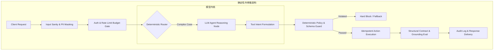

> “给人确定性。不轻易承诺，一旦承诺，就必须负责到底。”

# 多智能体总会“听话”吗？拆解忠实性与依据性，找到可靠性的真正边界

*在系统开始自主推理的时刻，传统的确定性可靠性全线崩溃；唯有在概率的宇宙中铸造确定性的外骨骼，才能守住工程交付的硬底线。*

在很多技术团队的架构方案汇报中，最容易让全场陷入狂欢的，莫过于画出一张张“多智能体协同（Multi-Agent System, MAS）”的拓扑图：规划者（Planner）、执行者（Worker）、代码编写者（Coder）、审计者（Critic）各司其职，彼此通过自然语言消息交织成网。方案听起来宛如一个全自动运转的高科技数字化虚拟公司，但真正把这套东西推向严监管、高并发生产环境（例如核心金融与保单理赔核算平台）的一线工程师心里都清楚：**默认答案永远是不该用；多 agent 是一笔要付的成本，得有具体理由才值。**

本文将深入工业级生产系统深水区，彻底拆解多智能体架构的成立边界、确定性失效的信号、传统可靠性范式的彻底崩塌，以及如何在非确定性模型之上构建“确定性外骨骼”；同时剖析依据性（Groundedness）与忠实性（Faithfulness）的微观区别，并奉上涵盖四层观测信号、代理指标监控、告警军规与金丝雀审计的完备工程防线。

---

## 真正成立的理由

当你坐在架构决策席上，面对将单一 Agent 拆解为多个协同 Agent 的提案时，你必须审视前提假设。在严肃工程实践中，唯有以下四个场景才真正值得付出多智能体的高昂代价：

1. **上下文隔离（最主要的一个）**  
   主 Agent 的 Context 是极其宝贵的稀缺资源。一个要翻 40 份文档才能得出一句结论的子任务，应该在它自己的窗口里烧完 Token，只把那句结论交回来。这不是为了所谓的“组织分工”，纯粹是为了**防止主线被噪音污染**。把海量原始检索段落灌入主窗口，不仅浪费算力，还会导致注意力弥散，让核心决策迷失在上下文中。

2. **并行化换延迟**  
   这项收益**只在“读多写少”的任务上成立**——例如同时查五个互不相干的数据源，然后汇总提炼。一旦子任务之间涉及协调写入或事务修改，并行就从性能优势瞬间蜕变为灾难性的分布式一致性泥潭。

3. **权限边界**  
   这条在金融与保险场景里最硬：能读客户个人隐私（PII）的那个 Agent，绝对不应该同时拥有外部网络调用权限。把权限在物理层面切开，每个 Agent 严格遵守最小权限原则，这是基础设施与架构级的防御，绝不是靠在 Prompt 里写两句弱约束能替代的。

4. **独立演进与独立评估**  
   每个 Agent 拥有自己的 Prompt 版本、自己的评估黄金集（Golden Set）以及自己的回归测试套件。不同业务团队可以分别独立认领和维护。这是**组织扩展**的理由，不是纯技术理由——但它在企业实际研发落地中，往往才是最真实、最具说服力的动因。

---

## 要付的代价(能主动讲出来才显得做过)

任何未经压力测试的多智能体狂热，都会在生产环境遭到现实的冷酷惩罚。在架构设计之初，就必须主动向管理层与团队算清以下五笔隐形代价：

- **错误复合**：单步 95% 的可靠性，串联五个 Agent 之后，整体成功率会迅速跌落至：  
  $$0.95^5 \approx 77.38\%$$  
  系统的整体脆弱性随着链条长度呈指数级恶化。
- **交接有损**：子 Agent 不知道主 Agent 知道的事，节点交接全靠一段摘要或 JSON 结构体，信息必然在压缩与跨上下文传递中丢失，细微语义偏差会被逐级放大。
- **Token 成本**：通信协议开销、多轮握手与系统角色引导，普遍会导致 Token 消耗飙升至单 Agent 的十几倍。
- **可观测性复杂度**：调用链路的 Trace 从一条直线变成一棵分支繁复的非对称拓扑树，排障定位难度直接上升一个量级。
- **评估难度**：非确定性叠加非确定性，导致系统陷入黑盒归因困境——当最终输出错误时，究竟是提取器的锅、校验器的错，还是最终聚合节点的偏见？

```
                                ┌─────────────────┐
                                │   User Query    │
                                └────────┬────────┘
                                         │
                                         ▼
                  ┌──────────────────────────────────────────────┐
                  │    Orchestrator: Can it be a Workflow?       │
                  └──────┬────────────────────────────────┬──────┘
                         │ YES                            │ NO
                         ▼                                ▼
              ┌────────────────────┐          ┌───────────────────────┐
              │ Deterministic DAG  │          │ Runtime Branching     │
              │ (State Machine)    │          │ (True Agent Needed)   │
              └────────────────────┘          └───────────┬───────────┘
                                                          │
                                        ┌─────────────────┴─────────────────┐
                                        ▼                                   ▼
                                Single Agent                        Multi-Agent
                                (Shared State)                      (Strict Isolation)
                                        │                                   │
                                [Default Choice]             [Only if: Context / Perms /]
                                                             [Parallel-Read / Independent Eval]
```

---

## 我用的判定标准

面对一个拆分需求，我有一套极其直接的工程检验红线：

> 📌 **判定标准**：**子任务能不能用一段话描述清楚，结果能不能用一段话交回来？** 不能，就说明交接会丢太多东西，必须留在单 Agent 里；**读多写少适合拆；需要协调写入，绝对不要拆。**

---

## 什么时候明确不该拆

在以下四类场景中，拆分多智能体非但不能带来收益，反而是纯粹的技术自嗨：

1. **任务其实是固定流程**：如果业务步骤是固定的 A 到 B 再到 C，那是状态机工作流（Workflow），必须用代码强制编排，绝不是 Agent，更不是多 Agent。
2. **子任务之间要频繁来回对齐**：当两个节点需要多轮双向协商才能收敛，通信与重试成本会瞬间吃掉全部收益。
3. **延迟预算紧的同步场景**：业务 SLA 严格限制在毫秒级或 1 至 2 秒内，多次 LLM 串行调用的网络开销与推理时延完全无法承受。
4. **还没把单 Agent 的 Eval 做好**：**没有评估体系就上多 Agent，等于在看不见的地方制造复杂度。** 这句话把所有狂热拉回到工程严谨性本身。

---

## 确定性失效的四个信号

在很多团队的架构评审中，常有一种将所有逻辑交由 Agent 接管的冲动。但工业级的共识是：**绝大多数情况下就该用确定性编排。Agent 只在一种情况下才挣得到位置——控制流本身无法在设计时枚举。**

确定性编排失效并真正需要 Agent 介入的四个信号如下：

1. **分支不可枚举**：输入空间高度开放，长尾情况无限。如果你写到了第 40 个 `if` 还在加，说明你正在用机械代码吃力地模拟认知判断。
2. **步数依赖中间结果**：要检索几轮、要不要换个查询词重来，完全取决于上一轮读到了什么。DAG 图在编译期画不出来，因为边的存在与否只有在运行时才能知晓。
3. **失败后需要换策略而不是重试**：确定性重试是针对瞬态网络波动的“再做一次同样的事”；而在语义解析受阻时，系统需要的是“这条路走不通，主动换个查询策略重来”。
4. **维护成本翻转**：每新增一类业务场景就要大幅修改编排代码并重新发布，规则库的代码增长速度已经远远快过了业务价值的增长速度。

这四条如果一条都不满足，就老老实实用 Step Functions 或硬编码工作流。

---

## 确定性赢在哪(这些是真实的、不是保守)

确定性编排从来不是所谓“保守陈旧”，而是在核心生产工程指标上具备无可匹敌的绝对优势：

- **逻辑可枚举且行为完全可单测**；
- **端到端延迟高度稳定可预测**；
- **计算与调用成本恒定有界**；
- **系统失败点定位清晰，无需复杂归因**；
- **具备完全的可审计性**：在合规与本地监管机构的要求下，“向审计员证明这个业务决定究竟走了哪条分支代码”是生死线。Agent 的链路虽然可以通过 Trace 记录，但其合规举证与解释成本要高出整整一个数量级。

---

## 我实际会用的形态:确定性外骨骼 + 模型内核

作为一线系统架构师，在日常工作中做系统设计最该强调这一点，因为这才是真正的工业级答案：



- **外层确定性**：死死拥有事务边界、重试与熔断机制、全局超时控制、访问权限隔离、全链路审计日志、幂等性保障以及分布式状态持久化。
- **模型只在节点内部做判断**：仅负责分类、属性抽取以及这一步该调用哪个外部工具。

> 📌 **核心心智模型**：**把 Agent 的自由度严格框在一个确定性的信封里——它能决定做什么，但不能决定边界在哪。** 放开 Agent 在沙盒内的选择权，但一切不可逆动作与资金修改必须穿过一道确定性的物理闸门。

---

## 两个方向都要走

架构演进绝对不是一锤子买卖，而必须维持双向演化通路：

- **确定性走向 Agent**：系统初期先用规则跑，**埋点记录人工操作员在哪里频繁偏离了规则**。等线上数据积累出充分的统计证据，证明分支确实爆炸了，再把那一段特定逻辑重构成 Agent。这样团队是拿实打实的证据做决策，而不是凭空追赶技术潮流。
- **Agent 沉淀为确定性**：反向的流动更加被行业低估。用 Agent 强大的灵活性去做**业务路径探索**；等系统在线上跑稳定了，通过日志聚类把 80% 的高频路径固化为硬编码确定性流程，Agent 仅退回到底层兜底长尾问题。这样改造后，系统的 Token 成本和 P95 延迟都会瞬间下降一个数量级。

> **Agent 适合用来“找”出流程，确定性编排适合用来“跑”流程。很多团队的问题是找完了还一直用 agent 在跑。**

---

## "AI-native" 的分界线

行业内很多人热衷于讨论“AI-native”，但两者的底层界限极其残酷：**不是看“系统里有没有 AI”，而是看模型是否直接参与了控制流的决策。**

| 维度 | AI-enabled 系统（传统叠加） | AI-native 系统（原生架构） |
|---|---|---|
| **模型所处位置** | 一个外围功能（摘要、分类、辅助推荐） | 处于中枢，决定系统下一步做什么 |
| **系统控制流** | 研发人员在设计时完全硬编码写死 | 运行时由模型动态推理产生 |
| **系统失败方式** | 显式抛出代码异常（如 500、NPE） | 看起来格式极其合理地做错事 |
| **移除模型后果** | 系统主体还能跑，只是少了个功能 | **系统直接不复存在，调度彻底瘫痪** |

架构检验试金石：**把模型拿掉，还剩什么？** 剩下一个少了功能的系统，就是 AI-enabled；什么都不剩，才叫 AI-native。

---

## "reliable" 在这里意味着什么

传统软件工程历经数十年构建的可靠性公理，在 AI-native 语境下全线瓦解：

| 传统软件假设 | AI-native 的客观现实 |
|---|---|
| 同样输入必产生同样输出 | 相同输入在温度采样下输出每次不同 |
| 失败会显式抛出报错异常 | 失败往往表现为流畅、自信却致命的错误输出 |
| 静态测试能够穷举逻辑分支 | 执行轨迹与分支在运行时才动态涌现 |
| 系统正确性是布尔值（True/False） | 正确性是一个连续的统计学概率分布 |
| 升级依赖是团队自主的主动决定 | 外部模型供应商可以在我方毫无知情的情况下改变底层行为 |

最后一条在金融与保险企业特别致命：**你的核心技术依赖会在你毫不知情时自己发生改变**。供应商微调模型对齐策略、版本热替换、甚至安全拒答策略收紧，这些都不是你发版的，但引发的业务事故全部由你承担。

因此，在 AI 时代，系统的可靠性必须被重新定义：

> **在一个本质上非确定、偶尔会自信地犯错的组件之上，构造出行为可预测、后果有界、失败可发现的系统。**

---

## 五个支柱(这就是企业级生产系统该有的完整架构)

要让概率组件承载起工业级关键业务，系统必须具备以下五大支撑柱：

```
┌────────────────────────────────────────────────────────────────────────┐
│                      AI-Native Reliability Pillars                     │
├───────────────────┬───────────────────┬────────────────────────────────┤
│ 1. 后果有界       │ 2. 正确性是统计量 │ 3. 失败必须可见                │
│ (Bounded Blast)   │ (Statistical QA)  │ (Active Observability)         │
│ • 事务物理隔离    │ • 告别布尔对错观  │ • 拒答率监控                   │
│ • 幂等闸门拦截    │ • 置信度方差分析  │ • 路径断言异常告警             │
│ • 步数/预算硬上限 │ • 持续 Eval 度量  │ • 强制引用率监控               │
├───────────────────┴───────────────────┴────────────────────────────────┤
│ 4. 优雅降级 (Graceful Degradation) : 规则兜底 / 人工回退 / 确定性拒答      │
├────────────────────────────────────────────────────────────────────────┤
│ 5. 面对漂移的韧性 (Resilience to Drift) : 模型 Pin / 生产金丝雀集      │
└────────────────────────────────────────────────────────────────────────┘
```

1. **后果有界**  
   最重要的一条。可靠性从来不是奢求模型永远不犯错，而是**让它犯错时也绝不造成不可逆损失**。不可逆动作（如资金扣划、数据物理删除）必须穿过确定性闸门，强制执行最小权限、幂等性校验、单次调用的步数与预算硬上限。

2. **正确性是统计量**  
   在工程讨论中提问“它能工作吗”没有任何意义。有意义的工程问题是：**“在这个数据分布上成功率是多少、方差有多大、失败集中在哪类输入切片上”**。因此，Eval 不是上线前跑一次就扔的单测，而是生产系统实时可靠性的度量工具本身。

3. **失败必须可见**  
   传统系统宕机会直接拉响报警；AI-native 系统坏了却会继续输出漂亮得体的文字。所以必须主动在代码中造信号：置信度分流、结构化校验、引用强制、路径约束断言、与基线的持续比对。**没有观测，你甚至不知道系统已经静默坏了三个月。**

4. **优雅降级**  
   当模型接口不可用或生成质量不达标时，系统退到什么通道？退到固定规则、退到人工座席、还是退到确定性的“抱歉我无法回答”。**一个只有满血正常路径的 AI-native 系统绝不配叫可靠系统。**

5. **面对漂移的韧性**  
   坚决 Pin 住模型版本快照，拒绝使用无版本绑定的通用 Alias；Prompt 作为核心代码严格版本化纳管；保留随时回滚配置的通路；全天候常态化运行生产金丝雀基线集以捕获漂移。

---

## 保险语境下再加一层

在严监管与核心金融场景下，可靠性拥有更严苛的第二层释义：**可被监管者信任**。  
决策证据链条必须清晰可追溯（调阅了哪些依据条款、经过了哪条逻辑分支）、人工复核专员在高风险点保留绝对的最终决定权、算法公平性完全可论证、客户个人信息与数据访问边界可随时接受现场审计。在合规风控标准下，无法白纸黑字举证的 Agent 系统，绝不允许跨入生产半步。

> 🩸 **血泪提醒**：切忌在系统内迷信任何所谓的“大模型自我反思（Self-Correction）”。缺乏确定性外部断言的纯模型内部循环，只会诱发更隐蔽、更难以察觉的自我欺骗与高阶胡说八道。

---

## 一句话工程原则版本

> “AI-native 意味着控制流是模型生成的，所以可靠性不能再靠穷举分支来保证。我的做法是：**把不确定性关在一个确定性的信封里**——模型自由决定做什么，但边界、权限、不可逆动作和预算由确定性层管死；然后用 eval 把正确性变成可测量的分布，用 observability 让静默失败变得可见。**可靠的 AI-native 系统不是不犯错的系统，是犯错也伤不到人的系统。**”

---

## 一、先把失败分类——不同类型要用不同信号抓

捕获 AI 系统的失败之所以极其艰难，是因为**你要检测的是一个没有任何异常抛出、没有报错堆栈、看起来完全正常的失败**。必须针对不同失效类型部署针对性探针：

| 失败类型 | 典型外部表现 | 传统监控能抓吗 | 生产破坏力 |
|---|---|---|---|
| **硬失败** | 网络超时、HTTP 500、JSON 解析失败 | ✅ 能（标准 APM 覆盖） | 低（有成熟重试与熔断机制） |
| **幻觉** | 凭空捏造一条根本不存在的保单赔付条款 | ❌ 完全看不见（文本语法极其流利） | 极高（直接导致理赔纠纷） |
| **检索退化** | 向量索引损坏，但模型基于空上下文大胆发挥 | ❌ 完全看不见（依然给出体面回答） | 极高（业务逻辑彻底失真） |
| **静默降级** | 供应商调整后台策略，长尾场景成功率骤降 8% | ❌ 完全看不见（延迟状态码无异样） | 高（业务价值悄然流失） |
| **能力边界外** | 遇到从未涵盖的新案型，极度自信地瞎猜 | ❌ 完全看不见 | 高（误导用户做出错误决策） |
| **路径漂移** | 最终给出的结果看似正确，但执行步数从 4 步暴涨到 11 步 | ❌ 极其隐蔽（常被误当成网络慢） | 中（算力 Token 成本失控） |
| **拒答膨胀** | 安全护栏过度收紧，把大量合规请求强行拦截 | ❌ **更隐蔽**（质量评分可能完全飘绿） | 极高（核心客户大面积流失） |

拒答膨胀极其阴险：**拒答率上升在所有常规质量指标上都不掉分**（因为系统没有给错答案），但实际的业务收益却在被过度敏感的风控闸门无声绞杀。

---

## 二、四层信号,按成本从低到高

要让上述隐性故障显形，必须由浅入深构建四道防线：

```
┌────────────────────────────────────────────────────────┐
│ 第四层: 采样审计与在线评估 (1-5% 流量, 高成本 LLM / 人工盲审) │
├────────────────────────────────────────────────────────┤
│ 第三层: 置信度多信号分流 (100% 流量, 毫秒级多特征加权评分)  │
├────────────────────────────────────────────────────────┤
│ 第二层: 运行时路径断言 (100% 流量, 动态图轨迹不变量拦截)    │
├────────────────────────────────────────────────────────┤
│ 第一层: 确定性契约与依据性校验 (100% 流量, 近乎零成本 CPU 正则) │
└────────────────────────────────────────────────────────┘
```

---

### 第一层:确定性校验(每一次请求都跑,近乎零成本)

能用代码硬逻辑判定的地方，绝不用模型打分。在出口网关处强制执行基于 Pydantic 的契约校验与业务不变量约束，这层能以微秒级耗时挡掉 30% 到 40% 的低级错误。

```python
from decimal import Decimal
from typing import List, Dict, Any
from pydantic import BaseModel, field_validator, model_validator, ValidationInfo

class Citation(BaseModel):
    doc_id: str
    text_segment: str
    page_number: int

class ClaimAssessment(BaseModel):
    policy_number: str
    covered: bool
    excess_amount: Decimal
    reasoning: str
    citations: List[Citation]          # 强制显式引用依据

    @field_validator("policy_number")
    def must_exist_in_context(cls, v: str, info: ValidationInfo) -> str:
        # 关键:保单号必须来自检索结果,不能是模型造的
        retrieved_ids = info.context.get("retrieved_policy_ids", set())
        if v not in retrieved_ids:
            raise ValueError(f"fabricated policy id: {v}")
        return v

    @model_validator(mode="after")
    def excess_within_policy_bounds(self) -> "ClaimAssessment":
        # 业务不变量:免赔额必须在该险种的法定区间内
        legal_bounds: Dict[str, tuple[Decimal, Decimal]] = {
            "HOME_COMPREHENSIVE": (Decimal("200.00"), Decimal("5000.00")),
            "AUTO_PREMIUM": (Decimal("100.00"), Decimal("3000.00"))
        }
        bounds = legal_bounds.get(self.product_code, (Decimal("0.00"), Decimal("10000.00")))
        if not (bounds[0] <= self.excess_amount <= bounds[1]):
            raise ValueError(f"excess amount {self.excess_amount} out of bounds {bounds}")
        return self
```

在此层之中，**引用强制（Grounding Check）** 是最值钱的手段：

```python
import re
from dataclasses import dataclass

@dataclass
class GroundingReport:
    grounding_rate: float
    unsupported: list[str]

def verify_grounding(answer: str, sources: list[str]) -> GroundingReport:
    claims = extract_atomic_claims(answer)        # 拆成可验证的原子断言
    unsupported = []
    for c in claims:
        # 先用便宜手段:字符串/数字必须能在 source 里找到
        if c.has_numeric and not numeric_present_in(c, sources):
            unsupported.append(c.text)
        elif not semantic_match(c.text, sources, threshold=0.72):
            unsupported.append(c.text)
            
    return GroundingReport(
        grounding_rate=round(1.0 - (len(unsupported) / max(len(claims), 1)), 4),
        unsupported=unsupported,
    )
```

`grounding_rate` 是我会放在看板最显眼位置的单一核心指标。**它掉了，基本等于检索坏了或模型开始信口胡编。**

---

### 第二层:运行时路径断言(每次请求,低成本)

把原本属于持续集成测试（CI）里的 Trajectory 轨迹断言直接搬到线上，作为**不阻断请求的轻量级在线观测**（涉及写操作的安全类断言除外，那些必须原地拦截）：

```python
RUNTIME_INVARIANTS = [
    Invariant("no_write_before_approval",
              lambda t: idx(t, "require_approval") < idx(t, "issue_payment"),
              severity="BLOCK"),            # 这条直接拦死，防止越权资金修改
    Invariant("retrieval_before_answer",
              lambda t: "search_policy" in t.tools_called,
              severity="ALERT"),            # 未查知识库直接下结论，记录告警
    Invariant("step_budget",
              lambda t: t.step_count <= 8,
              severity="ALERT"),            # 超过8步即判定为轨迹震荡
    Invariant("no_repeated_identical_call",
              lambda t: max(t.call_counts.values()) <= 3,
              severity="ALERT"),            # 单个工具连续调用超3次，判定为死循环
]
```

这层能精准抓到“输出结果看似正确，但执行过程已经严重损坏”——而这通常是**生产事故的前兆信号**，往往比大规模崩溃早出现整整几天。

---

### 第三层:置信度分流(每次请求,低成本)

关键是绝对不要只依赖模型吐出的 Logprob 单一信号，**必须将多个互补的弱信号加权合成**：

```python
def confidence(ctx) -> Confidence:
    signals = {
        "retrieval_top_score": ctx.retrieval.scores[0],        # 向量检索首位得分
        "retrieval_margin": ctx.retrieval.scores[0] - ctx.retrieval.scores[1], # 区分裕度
        "grounding_rate": ctx.grounding.rate,                  # 结构化依据率
        "self_consistency": ctx.n_sample_agreement,            # 采样3次的一致率(高风险跑)
        "ood_distance": distance_to_training_dist(ctx.input_embedding), # 偏离基线向量距离
        "step_anomaly": ctx.step_count / BASELINE_STEPS,       # 步数异常比率
    }
    score = weighted_average(signals)
    return Confidence(score, signals)   # 信号要全部完整留在 trace 里,不只留合成分
```

**低置信度，直接路由给人工**。这把“模型可能错了”从一个飘忽不定的技术质量隐患，彻底转化成了一个**可观测、可计数的业务事件**：低置信度分流率本身就是系统最坚挺的健康指标之一。

---

### 第四层:采样审计与在线评估(抽样,高成本)

- **LLM-as-a-judge 抽样**：仅对 1% 到 5% 的流量运行昂贵的裁判模型，绝不是全量盲跑；
- **人工审计**：每天固定抽查 20 到 50 条 Case，重点抽调处于低置信度区间以及高赔付金额的类别；
- **生产金丝雀集（Canary Suite）**：一组固定的复杂合成用例，每小时在真实生产 API 环境中完整跑一遍。这是检测供应商侧静默变更的最直接手段——**线上流量天天在变，但这组输入永远不变；只要它的得分掉了，就断定一定是系统内部发生退化或外部供应商改了模型。**

---

## 三、线上没有 ground truth 怎么办——代理指标

这是在架构评审中技术主管最常提问的一点。答案极其笃定：**用人的行为当标注。**

| 代理指标 | 说明 | 保险场景业务含义 |
|---|---|---|
| **人工推翻率** | 复核员改了 agent 的结论 | 最强的信号，直接近似线上真实错误率 |
| **编辑距离** | 人工对 agent 生成的草稿改了多少 | 质量的连续度量，比布尔值更加敏感细腻 |
| **升级率** | 会话主动转人工处理的比例 | 上升即代表系统能力边界在急剧收缩 |
| **客户二次联系率** | 同一客户或 case 7 天内再次进线 | 第一次交互未解决问题的最直接铁证 |
| **放弃率** | 用户在交互中途直接关闭跳出 | 流程卡顿或体验崩盘的直接体现 |
| **返工率** | 已归档的 case 被重新开启调查 | 存在隐藏逻辑疏漏或虚假赔付结论 |
| **拒答率** | 模型输出安全拒答或无法处理的比例 | 抓取外部 guardrail 是否过度收紧 |

**人工推翻率 + 编辑距离** 这一对是黄金组合，因为它们完全免费、连续产生、并且天然带有高质量标注——把被推翻的 Case 自动收集脱敏，便构成了你下一代 Eval 流水线的回归用例源头。这种正向循环流在工程持续迭代中至关重要。

---

## 四、告警怎么设才不会被无视

**绝对不要对单次请求告警。** 大模型系统单次波动是纯粹的噪音。

```yaml
alerts:
  - name: grounding_rate_drop
    metric: p50(grounding_rate)
    window: 1h
    condition: "< baseline_7d - 0.08"       # 相对过去7天基线,拒绝死板绝对值
    min_volume: 200                          # 样本不足200绝不触发误报
    severity: page

  - name: override_rate_spike
    metric: human_override_rate
    window: 24h
    condition: "> baseline_14d * 1.5"
    severity: page

  - name: canary_degradation
    metric: canary_task_success
    window: 3 consecutive runs               # 连续三次低于基线才告警,严格防抖
    condition: "< baseline - 0.05"
    severity: page                           # 这条最可能意味着供应商改了底层模型

  - name: refusal_rate_spike                 # 容易被遗忘的关键防御方向
    metric: refusal_rate
    condition: "> baseline_7d * 1.4"
    severity: ticket
```

三大军规牢记于心：**相对基线、要求最小样本量、按时间窗口聚合**。再加一条严格的分层机制——分为 Page（半夜呼叫）、Ticket（工单跟踪）、Dashboard（看板观察）三级，只有真正需要工程师立刻起床救火的硬性崩溃才允许触发 Page。

---

## 五、挑战问题与回答

**Q: “线上没有标注,你凭什么说准确率掉了?”**
> 分三路相互印证。一是**代理指标**——人工推翻率和客户二次联系率，这两个不需要人工打标且天然带有业务终局含义。二是**生产金丝雀集**，一组固定输入每小时跑一遍，它和线上流量的区别是输入永恒不变，得分变化只能来自系统内部。三是**抽样审计**，每天几十条由专家过目。三路互锁验证：如果只有线上代理指标下跌而金丝雀集平稳，那大概率是输入分布变了；若金丝雀集跌落，则是模型或底层检索发生退化。

**Q: “怎么区分模型变差了,还是用户问的东西变了?”**
> 这正是金丝雀集存在的理由。再加上**输入分布监控**：对输入做 Embedding，监控它相对历史基准分布的漂移（PSI 或分布距离），同时按意图类别拆分统计成功率。如果成功率的下降仅仅集中在某个新出现的特定类别上，那是输入分布漂移，需扩充语料；如果是全类别均匀下降，那一定是模型或检索出现故障。

**Q: “你的 guardrail 自己也是个模型,它错了怎么办?”**
> 承认这是个真问题。三条应对：第一，**Guardrail 优先采用确定性手段**，凡能用 Schema、数值区间、ID 存在性校验的绝不用模型。第二，Guardrail 必须有自己的 Eval 集，**单独度量它的漏报率和误报率**——漏报让风险穿透，误报让拒答率飙升，两端必须平衡。第三，**不可逆动作不依赖 Guardrail 的判断**，而是靠确定性的物理权限与审批闸门，Guardrail 只是外围的一道辅助打标层。

**Q: “LLM-as-judge 全量跑成本太高。”**
> 所以分层执行。确定性契约校验跑 100%，路径断言跑 100%（二者都是微秒级 CPU 计算，近乎零成本）；LLM Judge 只针对 1% 到 5% 的抽样流量跑，人工复核跑千分之几。抽样绝非均匀随机，而是**按业务风险分层抽样**：高涉案金额、低置信度、新客户、新案型的抽样权重拉高。另外 Judge 使用专用小模型即可，它做的是判别而不是复杂长链推理。

**Q: “告警太多团队就不看了,你怎么防?”**
> 这是我最在意的工程组织失败模式，因为它会让前面所有防御机制形同虚设。做法：只对聚合指标告警，绝不对单次低分告警；阈值严格锚定在相对动态基线上；强制设置最小样本量；划分三级报警严重度；**每个月定期审计告警的真阳性率，低于特定比例的告警规则必须直接降级或删除**。宁可少报几条，也绝不能让研发团队在麻木中学会忽略告警。

**Q: “trace 里全是客户 PII,怎么办?”**
> 在客户端 SDK 层做，绝对不能推到中心化后端再治理。写入 Span 缓冲前，本地 SDK 对 Input/Output 执行确定性脱敏与哈希，链路中只保留结构化元数据（Token 长度、引用 ID、置信度多维信号）与脱敏文本。若因排障必须查阅原文，走专门的双人审批短 TTL 存储。**默认不存原文**，在严监管标准下这是不可触碰的红线。

**Q: “你说‘坏了三个月才发现’,具体怎么避免?”**
> 故障能静默三个月不被发现，**唯一原因在于系统指标全是输出侧的**——只看延迟、HTTP 错误率、吞吐，那些在模型胡说八道时确实毫无异常。要彻底杜绝，就必须建立**独立于线上流量的客观参照系**（固定金丝雀集）与**独立于模型自评的业务参照系**（人工推翻率与编辑距离）。只要这两个参照物在跑，静默故障就不可能存活。

> **架构结论**：**生产级可靠性从来不是奢求系统永不出现故障，而是确保系统对故障的平均发现时间（MTTD）被严格压制在不可逆灾难发生之前。我会把 MTTD 当成一个和成功率并列的一等指标，并且定期做注入演练去验证它——故意降级检索质量或切换低参数测试模型，检验系统能否在 24 小时内全自动捕获报警。**

---

## 概念明辨：RAG 的三大境界与依据性 vs 忠实性

在日常架构对话与技术演进中，团队对基础概念的理解精度决定了系统最终的高度。

### RAG 认知的三个层级

- **普通工程师**：*“我有使用 LangChain 开发 RAG 系统的经验。”*（停留在拼装现成库代码）
- **Senior 工程师**：*“我基于特定业务场景构建了 RAG，调优了分块策略，利用混合检索优化了召回准确率。”*（聚焦于技术实现细节与局部优化）
- **Lead 架构师**：*“在决定采用 RAG 架构之前，我首先在业务链路上明确检索是否真正必不可少；接着在第一行代码编写前，定义出可度量的质量、P95 延迟、Token 成本以及安全合规硬指标。围绕这些目标设计召回策略、Agent 编排与工具权限边界，并在投产前把端到端的可观测性与 Eval 基础设施构建就绪。”*（从商业价值、系统边界、成本与风险全局统领）

```
                                RAG Architecture
                                       │
                     ┌─────────────────┴─────────────────┐
                     ▼                                   ▼
               Groundedness                         Faithfulness
       (Has support in context?)            (Free of distortion/extrapolation?)
                     │                                   │
       Is the claim anchored in the         Does it preserve the modality
       retrieved text?                      and constraints of the source?
                     │                                   │
          "Does evidence exist?"               "Is the logic twisted?"
```

### 依据性（Groundedness）与 忠实性（Faithfulness）的微观辨析

- **依据性（Groundedness）**：核心检验**生成的回答在检索到的证据文本中能否找到支撑材料**。它回答的是：*“输出内容是否有出处？”*
- **忠实性（Faithfulness）**：核心检验**生成的回答是否完全忠实于上下文证据，绝不引入自作主张的逻辑扭曲、条件删除或无事实根据的断言**。它回答的是：*“逻辑是否变形？是否把可能性说成了必然性？”*

#### 典型反例解析

例如保单条款原文写道：

> *“Coverage may apply subject to the conditions listed below.”（理赔可能适用，但严格受限于下述条件。）*

而 Agent 在输出中作答：

> *“Your claim is definitely covered.”（您的理赔申请在此条款下必定获得全额赔偿。）*

此时进行评估：即使 Agent 准确引用了该条款原文，**其依据性（Groundedness）得分看似合格，但忠实性（Faithfulness）已经彻底崩溃！** 它把原本极具法律约束力的或然条件语态（`may apply subject to`），擅自夸大为确定性承诺（`definitely covered`）。在金融与合规生产场景中，此类忠实性崩塌会直接给企业带来巨额赔偿诉讼。

---

## 生产级动态模型路由策略（Routing of Models）

没有任何单一模型能够同时满足最高的推理质量、极低的延迟与微薄的 Token 成本。构建工业级系统的核心能力之一，在于打造**基于规则、模型轻量分类与质量级联驱动的多级混合路由体系**：

```
                          Incoming Client Request
                                     │
                                     ▼
                       Deterministic Path Checking
                     (Schema, Cache, Simple Regex)
                                     │
                     ┌───────────────┴───────────────┐
                     ▼ Matches                       ▼ Misses
            Direct Execution             Lightweight SLM Classifier
             (Zero LLM Cost)            (Task, Intent, Risk Scoring)
                                                     │
                               ┌─────────────────────┼─────────────────────┐
                               ▼ Low Risk            ▼ Complex Task        ▼ High Risk Claim
                          Fast Small SLM           Advanced Reasoning     Deterministic
                          (e.g., 8B Class)         (e.g., Frontier LLM)   Controls + Human Gate
                               │                             │                     │
                               ▼ Output Validation Fail      │                     │
                               └──────────────► Cascading Escalation ──────────────┘
```

### 落地方法论

1. **能用代码解决的确定性场景绝不用大模型**：能走正则、匹配、缓存或查表的，在系统最外层直接处理并返回，Token 成本严格保持为零；
2. **轻量分类器前置甄别（Lightweight Classifier）**：对于需要 LLM 的请求，由延迟极低的轻量分类器评估意图、复杂度与潜在合规风险，分发至满足质量阈值且最具性价比的模型；
3. **级联升级策略（Cascading Approach）**：在输出能够被验证的场景，流量先由低成本小模型处理；一旦后置契约或依据性校验失败，请求无缝级联升级至大模型重试；
4. **核心高风险场景强制确定性控制**：涉及重大财产判定的流程，绝不单凭模型打分决定，强制要求确定性控制闸门和人工专家复核；
5. **路由策略的多维离线评估**：在黄金数据集上持续压测路由策略，严格度量：任务成功率、单请求成本、P95 延迟、级联升级率以及安全违规率。

> **模型路由的目标从来不是盲目追求让小模型处理 90% 的请求，而是在绝对满足既定业务质量、延迟 SLA 与安全合规红线的前提下，实现端到端总拥有成本的全局最小化。**

---

## 升维定律：确定性外骨骼与概率内核的分离定律

从一个具体的金融理赔系统，拉升到现代自适应软件工程的全局视角，我们可以抽象出一条可迁移的核心架构法则：

### 确定性外骨骼与概率内核的分离定律（The Law of Deterministic Exoskeleton Separation）

- **核心机制**：在一切由概率驱动的现代软件系统中，**业务正确性的最终防线绝对不能寄托于概率模型自身的内部对齐；系统的可靠性必须由包裹在其外部的、具备完全确定性状态机的物理外骨骼来严格承载。** 概率内核负责在发散的语义空间中进行认知理解与局部判断，确定性外骨骼负责掌控事务边界、计算资源预算、不可逆动作闸门与终审合规。任何试图在概率内核内部寻找确定性的架构方案，都会在复杂度突破阈值后遭遇数学上的必然崩溃。
- **适用边界**：适用于所有对对外商业承诺、法定义务合规、资金流动安全有严格要求的严肃工程系统。在纯娱乐对话、自由发散的灵感头脑风暴等不产生实际权责后果的场景中，该定律的约束厚度可适当放宽。

> 举一反三：审视你当前负责的系统——**如果明天底层大模型突然产生了一次不可理喻的严重幻觉，你的系统架构是否能确保在最坏情况下，这个错误也能被外部确定性代码牢牢拦截在内网中，绝不会给客户造成任何实际损失或引发监管风暴？**

---

## 结语：留下一个未合拢的切口

在系统控制流逐渐向 Agent 移交的今天，我们必须保持冷静的工程克制：**系统不会因为打上了“多智能体”的标签就天然具备高可靠性。在概率的海洋里，一线工程师最高阶的手艺，依然是为系统注入不容妥协的确定性。**

你的生产环境里，现在是否也有一个看似每天输出着体面文本、但实际上早已在长尾业务上静默降级了两个月的 Agent？你打算在明天的发布窗口里，部署哪一个固定输入的金丝雀探针，去第一次敲醒它的幻觉？
