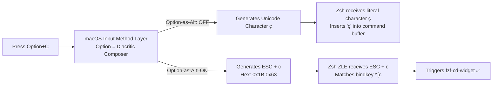
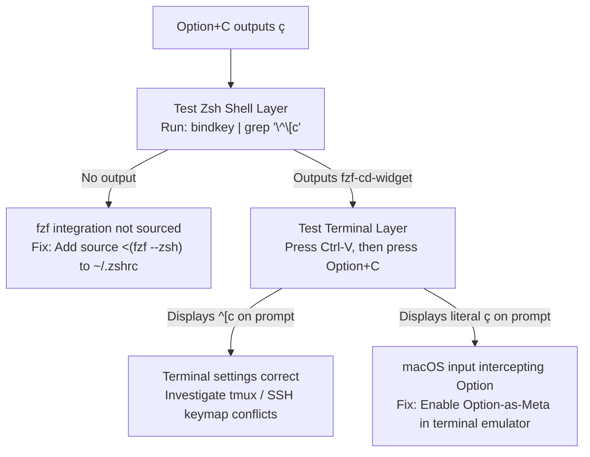
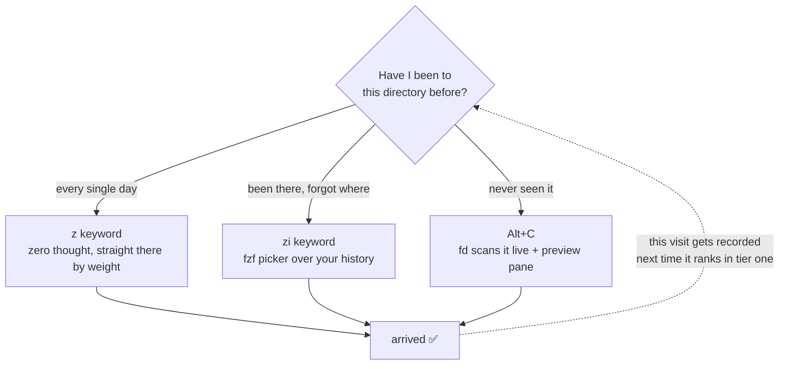

> "Goals tell you where you want to go. Systems determine what you actually do every day."

# fix macOS option key traps and rebuild your terminal with fzf and zoxide

*Debugging macOS terminal keystroke layers and building a modern fuzzy-navigation toolchain with fzf, fd, zoxide, and eza.*

86,400 seconds make up a daily cycle, and typing `cd ../../../` forty times a day consumes focus you never get back. Open your macOS terminal right now, run `bindkey | grep '\^\[c'`, and then press `Option+C`.

If your terminal outputs `ç` on your command prompt instead of popping open an interactive directory filter, you are suffering from a silent, multi-layer key-event translation bug that millions of developers hit without understanding why. 

By the end of this guide, you will understand the exact byte-level pipeline of terminal key translation, resolve the macOS Option key escape trap across every major terminal emulator, and deploy a drop-in `~/.zshrc` toolchain (`fzf`, `fd`, `zoxide`, and `eza`) that eliminates manual directory guessing forever.

---

## 🎯 Confession time: your `cd` and `ls` are two decades out of date

Let's start with an honest diagnostic question: How many times today have you typed `cd ../../../` like a blind operator navigating a dark room? How many times have you executed `ls -la` and squinted at a dense, uncolored wall of white text trying to locate one specific subdirectory?

Don't be embarrassed; we have all spent years doing it. We treat directory traversal as a minor inconvenience, but navigation overhead compounds across every terminal window you open. 

Goals tell you where you want to go in your repositories, but your shell systems dictate what you actually do every single day. Default Unix navigation relies on brute-force memory: you guess a path, type it out, hit tab, get stuck, run `ls`, and start over.

Modern shell workflows replace guessing with searching. When you assemble `fzf`, `fd`, `zoxide`, and `eza`, you stop typing static file paths entirely. You search intentions rather than paths. But before building this workflow, we must fix the single hardware-software collision point on macOS that breaks it on day one.

---

## Part 1: `Alt+C` — the shortcut 90% of fzf users never discover

Here is the immediate feature: once `fzf` is installed and integrated into Zsh, pressing `Alt+C` (which maps to `Option+C` on macOS) invokes `fzf-cd-widget`.

Instead of manual traversal, `Alt+C` scans all subdirectories under your current working directory, opens an interactive fuzzy-finder overlay, filters candidates in real time as you type keywords, and executes `cd` into your selected path the moment you hit `Enter`.

```text
Alt+C → Type "logs" → Highlight match → Enter → Current Directory: repo-alpha/dags/logs
```

It requires zero learning curve and zero path memorization. Yet the vast majority of developers who install `fzf` use it exclusively for searching command history (`Ctrl+R`), entirely unaware of this directory navigation shortcut.

To verify whether your shell keymap has registered this widget, execute:

```bash
bindkey | grep '\^\[c'
```

If your Zsh Line Editor (ZLE) keymap is configured correctly, Zsh will return:

```text
"^[c" fzf-cd-widget
```

If this command returns nothing or throws an error, your Zsh shell integration for `fzf` is missing or un-sourced. Verify that your `~/.zshrc` contains:

```bash
source <(fzf --zsh)
```

However, for macOS developers, having a valid `bindkey` entry inside Zsh is only half the battle. You can have `fzf-cd-widget` bound perfectly inside Zsh, hit `Option+C`, and still watch the character `ç` pop up on your command prompt.

---

## Part 1.5: You pressed `Option+C` on a Mac and got `ç`. That's not fzf's fault.

When pressing `Option+C` outputs `ç` on macOS, developers almost universally misdiagnose the failure. They assume `fzf` was installed improperly or that Zsh failed to bind the ZLE widget. They re-install packages, edit `.zshrc`, and grow frustrated.

**fzf is completely fine.** Your keystroke never reached Zsh in the first place.

### First, see how many layers one keystroke crosses

To understand why shortcuts break, we must trace how a physical key combination travels from macOS input hardware down to the pseudo-terminal (PTY) driver:



In standard POSIX terminal architecture, the `Alt` (or `Meta`) modifier key does not exist as an independent physical bitmask in standard ASCII streams. Historically, VT100-compatible terminals communicated an `Alt+<key>` modifier by prepending an ASCII **Escape byte (`0x1B`)** prior to the target character's ASCII byte.

Therefore, pressing `Alt+C` is expected to emit two raw bytes:
1. `0x1B` (ASCII ESC)
2. `0x63` (ASCII character 'c')

In Zsh keymaps, the notation `^[c` represents exactly this sequence (`0x1B 0x63`).

However, macOS defaults to treating the physical `Option` key as an international diacritic composer (for entering characters like `ç`, `é`, `ø`, and `—`). When you press `Option+C`, the OS-level macOS input subsystem intercepts the keypress and translates it into the single Unicode character `ç` (`U+00E7`). 

Because the terminal emulator receives `ç` directly from the OS, it sends `0x00E7` to the pseudo-terminal driver instead of `0x1B 0x63`. Zsh receives a literal character `ç`, finds no keymap matching `ç` to a widget, and inserts it into your prompt.

This is a **terminal emulator input mapping issue**, not a shell error. Separating these two layers saves hours of futile shell configuration.

### Test the two layers separately instead of guessing

When a terminal keybinding fails, stop guessing. Isolate the shell layer from the terminal layer using this diagnostic workflow:



### The `Ctrl-V` diagnostic shortcut

> Ctrl-V is the shortest path to truth in terminal key debugging because it prints raw bytes before any keymap interpretation occurs.

Zsh maps `Ctrl-V` to the `quoted-insert` ZLE command. Pressing `Ctrl-V` instructs Zsh to bypass keymap interpretation for the next keypress and print the exact raw byte string transmitted by the terminal emulator directly onto your prompt.

> 📌 **Takeaway:** when a shortcut misbehaves, press `Ctrl-V` and look at the raw bytes the terminal sent before you touch `.zshrc`.

1. Press `Ctrl-V` on your active terminal prompt.
2. Press `Option+C` immediately after.

- If your prompt displays `^[c`, your terminal emulator is correctly outputting `ESC + c`. The problem lies inside Zsh configuration, `tmux`, or a remote SSH session map.
- If your prompt displays `ç`, your terminal emulator is passing composed Unicode. You must change your terminal emulator settings.

### Where to change it, per terminal (macOS)

To ensure `Option+C` (and all `Alt`-based shortcuts) function correctly across macOS applications, configure your specific terminal emulator to transmit `Option` as `Meta` or `Esc+`:

| Terminal Emulator | Configuration Path | How Settings Take Effect |
|---|---|---|
| **Ghostty** | Add `macos-option-as-alt = true` in `~/.config/ghostty/config` | Press `Cmd+Shift+,` to reload config, or restart |
| **VS Code Terminal** | Add `"terminal.integrated.macOptionIsMeta": true` to `settings.json` | Applies to **newly created** terminals only — kill and reopen |
| **Warp** | Settings → Features → Terminal → enable *Use Option as Meta key* | Restart Warp |
| **iTerm2** | Profiles → Keys → set Left/Right Option key to `Esc+` | Immediate |
| **Terminal.app** | Settings → Profiles → Keyboard → check "Use Option as Meta key" | Immediate |

**A nicer Ghostty option**: that setting accepts `left` / `right` in addition to `true` / `false`. Setting `macos-option-as-alt = left` gives left-Option to Alt bindings while the right one keeps composing accented characters — the best of both worlds if you actually type both.

### One hidden Warp trap (learned the hard way)

Warp has no plain-text config file for this toggle. It lives in macOS defaults, under key names you can only find by digging through the app binary:

```bash
defaults write dev.warp.Warp-Stable Extra_Meta_Keys_Left  -bool true
defaults write dev.warp.Warp-Stable Extra_Meta_Keys_Right -bool true
```

🩸 **But you must fully quit Warp before writing them.** macOS preferences follow a "hold a copy in process memory, flush on exit" model (cfprefsd caching plus the app's own writeback). Write while Warp is running and the moment it quits it overwrites your change with its stale in-memory values — the command reports success and the setting silently vanishes. That's the worst class of failure to debug.

If there's a UI toggle, use the UI toggle. Don't race a running app for the same plist. This rule generalizes to every macOS app, not just Warp.

### Be honest about the cost

Once option-as-alt is on, **inside that terminal** you can no longer type `ç`, `é`, `ø`, `—`, or anything else that needs Option to compose. Your editor and every other app are unaffected.

For anyone writing code, this trade is nearly free — you'll hit `Alt+C` / `Alt+F` / `Alt+B` dozens of times a day and type an accented character in a terminal approximately never. If you genuinely need both, use the Ghostty `left` approach above.

---

## Part 2: Swap the engine — `fd` is the real speedup

fzf defaults to `find` under the hood, which is slow and happily drags `.git` and `node_modules` into your candidate list like uninvited guests. Swap in `fd` and you get an order-of-magnitude speedup, plus sane exclusions by default:

```bash
export FZF_ALT_C_COMMAND='fd --type d --hidden --exclude .git --exclude node_modules'
export FZF_DEFAULT_COMMAND='fd --type f --hidden --exclude .git'
export FZF_CTRL_T_COMMAND="$FZF_DEFAULT_COMMAND"
```

**A real cross-platform landmine**: on macOS, `brew install fd` gives you the `fd` command directly. On WSL/Ubuntu, `apt install fd-find` installs it as `fdfind` — a leftover Debian package-name collision. Add this fallback or your config will behave inconsistently across your two machines and you'll waste an afternoon debugging nothing:

```bash
command -v fd &> /dev/null || alias fd='fdfind'
```

---

## Part 3: Add a preview pane — stop selecting blind

Picking a file or directory by name alone is a guessing game. Add a live preview pane and you actually see what you're about to jump into:

```bash
# Directory preview: tree view via eza, falls back to ls
export FZF_ALT_C_OPTS="--preview 'eza --tree --level=2 --color=always {}' --preview-window right:50%"

# File preview: syntax-highlighted via bat
export FZF_CTRL_T_OPTS="--preview 'bat --color=always --line-range :100 {}' --preview-window right:60%"
```

Here's what that actually looks like — fuzzy search on the left, live preview on the right, so you see before you commit:

```text
┌─ Alt+C ────────────────────────┬─ preview (eza --tree) ──────────┐
│ > logs                         │ logs                            │
│                                │ ├── scheduler                   │
│   3/128 ───────────────────    │ │   ├── 2026-07-29              │
│ ▶ repo-alpha/dags/logs         │ │   └── 2026-07-30              │
│   repo-alpha/logs              │ ├── dag_processor_manager       │
│   v3/dags/prd/logs             │ └── dag_id=sync_job_to_sfec     │
│                                │                                 │
└────────────────────────────────┴─────────────────────────────────┘
   ↑ type to filter                  ↑ refreshes as the cursor moves
```

Once this is in place, `Alt+C` shows a live tree on the right as you browse directories, and `Ctrl+T` shows syntax-highlighted file content as you browse files. Your terminal quietly upgrades from "command line" to "lightweight IDE."

---

## Part 4: `zoxide` — the laziest possible upgrade

If fzf+fd is the "fuzzy search" camp, `zoxide` is the "too lazy to even search" camp. It's not an fzf config tweak — it's a different mental model entirely: **you don't search for the directory, the directory lines itself up waiting for you.**

```bash
brew install zoxide          # macOS
# or curl -sS https://webinstall.dev/zoxide | bash   # WSL

eval "$(zoxide init zsh)"    # add to ~/.zshrc
```

### Three commands, that's all you need

```bash
z <keyword>       # jump to the best match (covers 90% of cases)
zi <keyword>       # interactive mode, fzf picker over candidates
zoxide query -l    # list everything in the database (for debugging)
```

**The catch everyone hits first**: right after installing, `z xxx` will find nothing — the database starts empty. It only ranks directories by "frequency × recency" once you've actually `cd`'d (or `z`'d) into them a few times. That's not a broken install, it just hasn't been fed yet.

### The ideal division of labor

For directories you visit constantly (your `repo-alpha` project root, say), `z air` gets you there instantly — no fuzzy searching needed every time. For genuinely new, unexplored territory, fall back to `Alt+C` (the fd+preview version from Part 3) for one-off exploration. The two don't conflict — install both, let them cover different jobs.



Notice that dotted line — it's the whole point of running these together: **every time you use `Alt+C` to explore somewhere new, you're feeding zoxide at the same time.** The path you had to search for today becomes a one-keystroke `z` next week. It's a positive feedback loop: the longer you use it, the less work it takes.

---

## Part 5: `eza` — `ls` gets a renaissance

**Common mix-up first**: it's `eza`, not "eva" (no, not the anime). It's the actively-maintained community fork of the now-abandoned `exa`, written in Rust.

### One-line pitch

A colorized, icon-aware, git-status-aware replacement for `ls`.

### Three commands cover daily use

```bash
eza -la                # ls -la, with automatic color coding
eza --tree --level=2   # tree, capped at two levels so it doesn't flood your screen
eza -la --git          # shows git status (M/?/A) next to each file
```

### The one alias worth doing: replace ls outright

```bash
alias ls='eza --icons --group-directories-first'
alias ll='eza -la --icons --group-directories-first --git'
alias lt='eza --tree --level=2 --icons'
```

`--group-directories-first` is criminally underrated — mixing files and directories in one flat list slows down visual scanning more than you'd think. Add this flag and the difference is immediate.

### Deeper rabbit holes, pick what interests you

1. **`--git-ignore`**: `eza -la --git-ignore` auto-hides anything covered by `.gitignore`, so browsing a repo isn't flooded with `node_modules`/`.venv`
2. **`--sort` variants**: sort by modification time or file size — great for "what changed recently" or "what's eating my disk"
3. **Pairing with the fzf preview pane**: exactly what Part 3 already set up — `eza --tree` feeding straight into `FZF_ALT_C_OPTS` 

---

## The full config — paste into `~/.zshrc` 

```bash
# === fzf + fd + zoxide + eza terminal navigation stack ===

# fd fallback for WSL/Debian's package naming quirk
command -v fd &> /dev/null || alias fd='fdfind'
if command -v fd &> /dev/null; then
  export FZF_ALT_C_COMMAND='fd --type d --hidden --exclude .git --exclude node_modules'
  export FZF_DEFAULT_COMMAND='fd --type f --hidden --exclude .git'
  export FZF_CTRL_T_COMMAND="$FZF_DEFAULT_COMMAND"
fi

# Preview pane: eza if available, plain ls as fallback
if command -v eza &> /dev/null; then
  export FZF_ALT_C_OPTS="--preview 'eza --tree --level=2 --color=always {}' --preview-window right:50%"
else
  export FZF_ALT_C_OPTS="--preview 'ls -la {}' --preview-window right:50%"
fi

# Ctrl+T file picker preview, syntax-highlighted via bat
if command -v bat &> /dev/null; then
  export FZF_CTRL_T_OPTS="--preview 'bat --color=always --line-range :100 {}' --preview-window right:60%"
fi

# zoxide: only init if installed, avoids errors on machines without it
if command -v zoxide &> /dev/null; then
  eval "$(zoxide init zsh)"
fi

# eza replaces ls
if command -v eza &> /dev/null; then
  alias ls='eza --icons --group-directories-first'
  alias ll='eza -la --icons --group-directories-first --git'
  alias lt='eza --tree --level=2 --icons'
fi
```

---

## Cross-platform install cheat sheet

| Tool | macOS (brew) | WSL Ubuntu |
|---|---|---|
| fzf | `brew install fzf` | Clone the official repo (apt's version tends to lag) |
| fd | `brew install fd` | `apt install fd-find` (command is `fdfind`, needs an alias) |
| zoxide | `brew install zoxide` | `curl -sS https://webinstall.dev/zoxide \| bash` or apt |
| eza | `brew install eza` | `apt install eza` (needs a newer Ubuntu, or the official repo on older ones) |

---

## TL;DR

- **`Alt+C`** — for exploring directories you don't know yet
- **`z keyword`** — for arriving instantly at directories you already know
- **`eza`** — gives `ls` output eyes that actually work
- **Stack all three** — your terminal stops being something you memorize commands for and starts being something you search. Set it up once, keep the payoff forever.
- **One extra step for Mac users** — turn on option-as-alt in your terminal first, or `Alt+C` just hands you a `ç`. And when any keybinding misfires, hit `Ctrl-V` to see what bytes the terminal actually sent before you touch `.zshrc`.

Next time someone asks how you type so little and still ship so fast, just send them this post.
