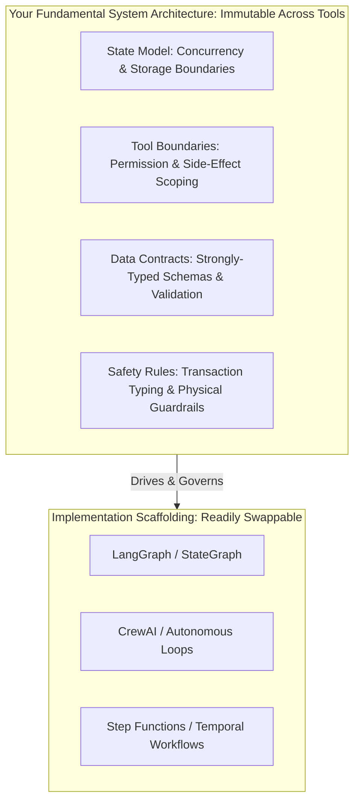
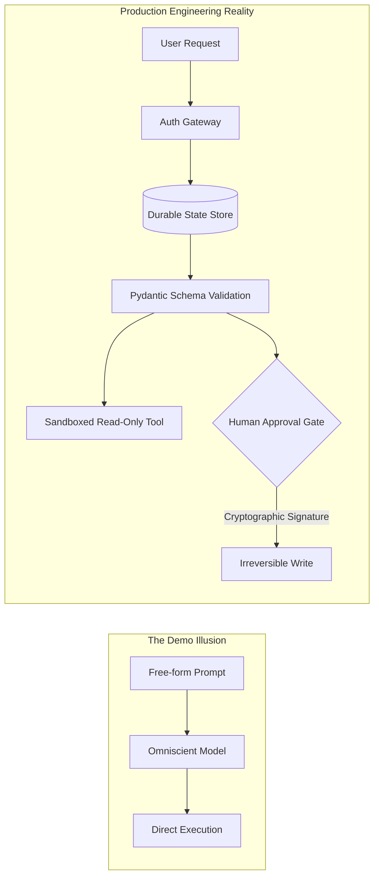
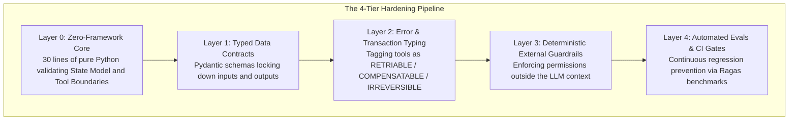
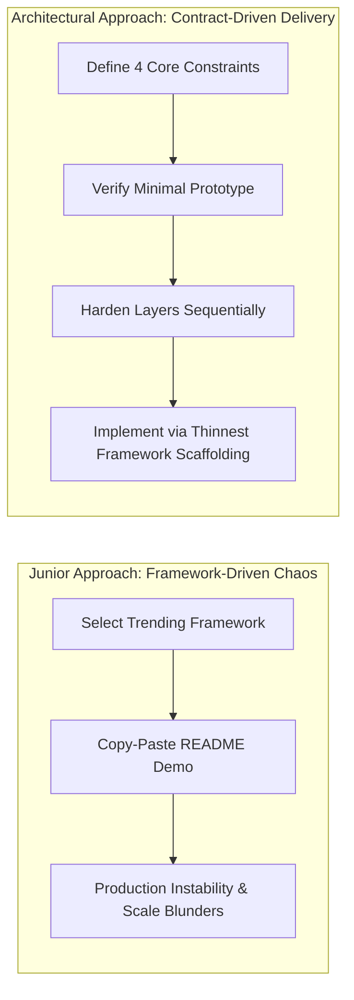
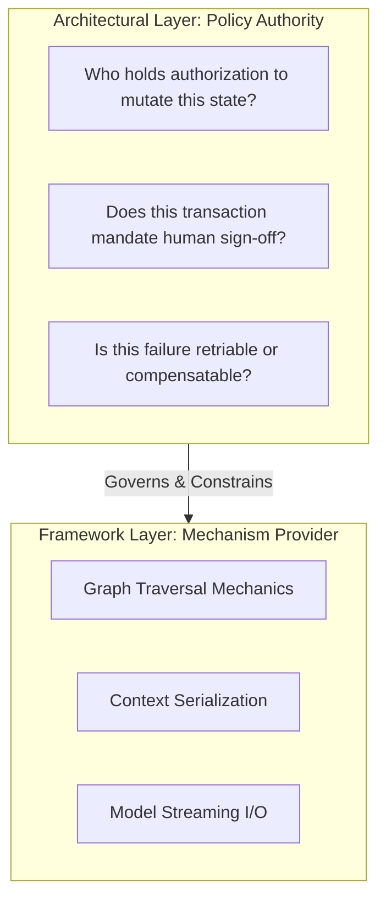

> "He who seeks the growth of a tree must strengthen its roots; he who desires the distance of a stream must dredge its source." — Wei Zheng, *Memorial to Emperor Taizong*

# Frameworks Are Not Architecture: Why Copy-Pasting AI Demos Amplifies Production Chaos

*From hollow scaffolding to the four pillars of engineering rigor — what separates senior architects from demo copy-pasters*

In 1982, the legendary American rock band Van Halen embarked on their massive, arena-filling world tour. Buried deep within their famously intricate, telephone-book-sized technical rider was an odd clause that quickly became the stuff of industry legend:

> "There will be no brown M&M's candies in the backstage area, upon pain of total show forfeiture with full compensation to the band."

For years, promoters, journalists, and spectators rolled their eyes, viewing it as the quintessential example of reckless rockstar entitlement and unhinged vanity. Decades later, frontman David Lee Roth revealed the cold, calculated systems engineering truth behind the candy clause.

Van Halen was the first band in rock history to tour with nine full eighteen-wheelers of heavy production gear, hanging nine tons of motorized lighting arrays, automated pyrotechnics, and massive power amplifiers directly from the ceiling rafters of municipal sports arenas. In an era when local safety standards varied wildly from town to town, a single structural miscalculation meant the ceiling could give way, sending tons of steel plunging into an audience of twelve thousand fans.

The brown M&M clause was never about candy. It was a rapid, low-friction **contract checkpoint**.

If Roth walked into the dressing room and spotted a single brown M&M, it proved beyond doubt that the local promoter had failed to read the contract with meticulous care. And if they hadn't read Article 126 regarding the candy, they almost certainly hadn't read Article 148 — which required specialized structural weight checks on the arena's load-bearing girders and dedicated high-voltage power grounding.

On one stop in Colorado, Roth indeed found brown M&Ms. He immediately shut down production and ordered a comprehensive structural audit. The inspection revealed that the local arena management had failed to reinforce the ceiling trusses; the rafters were already sagging under the deadweight and were on the verge of collapsing onto the concrete stage floor.

Shift your focus from that 1982 concert stage to the bleeding edge of modern generative AI systems engineering, and you will observe dozens of software engineering teams making the exact same catastrophic blunder.

Every single week, GitHub trending lists feature stunning, twenty-line Quickstart demos from frameworks like LangGraph, CrewAI, AutoGen, and LlamaIndex. Eager developers copy and paste the demo code into their local repositories, insert an API key, watch a few terminal logs scroll by as multi-agent bots effortlessly simulate market research, and rush to containerize it for immediate production rollout.

Three months later, real enterprise traffic hits the system: unconstrained loops burn thousands of dollars in token credits, unvalidated tool calls corrupt transactional databases, memory leaks crash worker nodes, and cascading failures leave the engineering team with zero forensic traceability.

Standing amidst the wreckage of their production system, developers invariably throw their hands in the air and complain: "This AI framework is completely unstable. It's full of bugs."

In every architectural board review and post-incident postmortem I lead, I find myself reiterating the exact same engineering maxim:
**"Frameworks are rented scaffolding; architecture is the load-bearing concrete you pour yourself. When you mistake a framework for an architecture, the framework simply acts as a high-gain amplifier of architectural debt."**

## What You Will Take Away

- **First-Principles Demarcation**: The fundamental divide between implementation frameworks and architectural contracts — and why frameworks can never make fundamental design decisions for you.
- **The Hollow Architecture Trap**: How naive copy-pasting of "happy-path" demos creates fragile, unmaintainable enterprise agents that disintegrate under edge cases.
- **The Amplifier Principle**: Mathematical and system dynamics explaining why frameworks replicate and scale underlying architectural chaos rather than eliminating it.
- **The "Harden Layers" Blueprint**: A battle-tested, four-tier engineering progression from zero-framework minimal prototypes to schema-locked, transaction-typed, evaluation-gated production pipelines.
- **Mastering Technical Interviews & Selection**: How to answer the universal "Why did you choose Framework X over Framework Y?" question like a Staff or Principal Architect.

## 1. Core Demarcation: Scaffolding vs. Load-Bearing Concrete

To junior developers, technical selection is simply picking the most fashionable open-source library. To seasoned architects, **frameworks and architecture belong to entirely different conceptual planes**.

### 1.1 What Is a Framework?

A framework is an **implementation tool**.

Whether you reach for LangGraph, CrewAI, LlamaIndex, or AWS Step Functions, their sole purpose is to provide developer convenience: syntactic scaffolding. They give you convenient state containers, graph-traversal dispatchers, tool-binding decorators, and event listeners. They are designed to save you from writing three hundred lines of boilerplate control loops.

### 1.2 What Is an Architecture?

An architecture consists of your **decisions on fundamental system realities**.

Regardless of which framework you use — and whether you migrate from LangGraph to plain Python or Step Functions next quarter — a framework cannot make any of the following four core decisions for you:

1. **State Model**: Where does conversation history, intermediate synthetic conclusions, iteration counters, and authorization context live? In-memory, Redis, or durable Postgres? Who is permitted to mutate which field? How are concurrent race conditions arbitrated?
2. **Tool Boundaries**: What can an agent invoke, and what is it strictly barred from touching? How are side effects and irreversible write operations physically contained? Who manages timeouts and retries?
3. **Data Contracts**: What data format is exchanged between components? What is the strict schema? Who handles deserialization and type rejection before passing payloads to downstream nodes?
4. **Safety Rules**: Which actions mandate human-in-the-loop sign-off? Which steps are flagged as idempotent, compensatable, or irreversible? Are guardrails enforced deterministically at the network gateway, or are they mere prompt suggestions?



| Evaluation Dimension | Implementation Framework | Core System Architecture |
|---|---|---|
| **Primary Purpose** | Accelerates code writing via prepackaged scaffolding | Ensures deterministic, reliable system behavior under stress |
| **Swappability** | High; can be refactored or replaced within weeks | Low; defines the permanent data lineage and topological boundaries |
| **Canonical Examples** | LangGraph, CrewAI, AutoGen, LlamaIndex | Durable state schemas, tool authorization boundaries, Sagas models |
| **Failure Mode** | Breaking API changes during dependency updates | Unconstrained write operations, data corruption, financial leakage |

📌 **Core Takeaway 1**: Frameworks provide syntax and orchestration mechanisms; what dictates whether your AI agent survives production is your architectural definition of state, tool boundaries, contracts, and guardrails.

> **Chapter Philosophy**: Frameworks are rented scaffolding; architecture is the concrete you pour. Scaffolding is dismantled when convenient; if the concrete fails, the building collapses.

## 2. The "Hollow Architecture" Trap: Why Demos Are Production Poison

Open-source quickstarts and tutorial demos are designed with an unavoidable conflict of interest: **they are optimized to "look like they work" in under three minutes**.

### 2.1 The Happy-Path Mirage

Consider the standard five-line demo featured on modern agent project READMEs:

```python
# The classic quickstart demo (Dangerous for production)
from demo_framework import Agent, Task

analyst = Agent(role="Financial Analyst", goal="Analyze market trends and execute orders")
trade_task = Task(description="Check market indicators and purchase 100 shares of AAPL", agent=analyst)
trade_task.run()
```

Why does this demo work flawlessly on a laptop? Because it operates in a fantasy world:
- It assumes the language model follows instructions with 100% adherence;
- It assumes zero network latency and perfect downstream API uptime;
- It completely bypasses tenant isolation, concurrency deadlocks, and idempotency checks;
- Most critically: it gives an unconstrained probabilistic model direct execution authority over financial transactions!

### 2.2 Constructing the Hollow Core

When an engineering team copies this demo into production and declares their architecture "complete," they have committed a fatal mistake: **they allowed a developer advocating an API to make their architectural decisions for them**.

The author of that quickstart was not building an enterprise risk system; they were demonstrating a developer-friendly syntax.

The result is a **Hollow Architecture**:
- From the outside, the system looks sophisticated, complete with colorful boxes on design slides;
- On the inside, there is no plan for state persistence, no strategy for compensating transactions, and no mechanism for intercepting unauthorized tool execution.



| Characteristic | The Copy-Pasted Demo | Production-Hardened Architecture |
|---|---|---|
| **State Management** | Arbitrary mutable dictionary, modified across threads | Explicit Pydantic schemas, immutable transitions |
| **Tool Execution** | Direct raw API keys exposed to prompt context | Read-only by default, side-effects isolated behind proxy gates |
| **Error Handling** | Unhandled stack traces, script aborts on failure | Explicit triage: retriable, compensatable, or manual review |
| **Telemetry** | Console prints or complete observability void | OpenTelemetry distributed traces tracking tokens, latency, cost |

> **Chapter Philosophy**: Demos are built to work once on a sunny day; architecture is engineered to endure ten thousand storms.

## 3. The Amplifier Principle: Why Frameworks Accelerate Chaos

In electrical engineering and control theory, the behavior of an operational amplifier is defined by a simple relationship:

$$	ext{Output}(t) = K 	imes 	ext{Input}(t)$$

Where $K$ represents system gain. When provided with a clean, low-distortion audio signal, the amplifier projects symphony acoustics across an auditorium. But if the input signal is corrupted by feedback and static noise, an amplifier does not magically clean it — it destroys the speakers in milliseconds.

### 3.1 Frameworks as High-Gain Amplifiers

**A framework is an amplifier, not a filter.**

- **If your fundamentals are solid**: your state schemas are strictly typed, error boundaries are explicitly defined, and tools are idempotent, a framework will dramatically accelerate your engineering delivery.
- **If your fundamentals are chaotic**: your prompts are informal wish lists, your state is an unvalidated free-form dictionary, and your tools have unbounded side effects, the framework will not resolve that confusion.

Instead, the framework will scale that architectural chaos across concurrent processes and runaway token consumption at machine speed.

### 3.2 Production Case Study: The Self-Reflective Infinite Loop

In a postmortem for an automated support system, a team implemented a multi-agent framework to handle claims triage. Because they relied on the framework's default agent coordination loop without establishing an external `max_iterations` counter or a strict schema contract, the primary agent and the reviewing agent fell into a recursive semantic disagreement:

```text
Agent A: "Claim approved under policy terms. Please review."
Agent B: "Received. Recommend formatting as formal legal memorandum before closing."
Agent A: "Formatting adjusted. Please verify again."
Agent B: "Almost acceptable, but missing a colon on line 4. Please regenerate."
```

Without an architectural termination contract, this loop ran unnoticed across hundreds of concurrent threads overnight. By 6:00 AM, the system had burned over $4,000 in redundant API tokens and triggered upstream rate-limiting that severed production integrations.

The framework did not cause the failure — **the framework faithfully amplified the absence of an architectural state limit**.

🩸 **Hard-Won Warning**: Never delegate loop termination or permission boundaries to an open-source framework's default settings. Frameworks do not pay your cloud bills; without explicit architectural constraints, multi-agent orchestration simply builds a faster highway to production collapse.

> **Chapter Philosophy**: On a foundation of quicksand, a more powerful crane merely causes the building to sink faster.

## 4. "I Start Small and Harden Layers": The Architectural Blueprint

In technical reviews and senior architectural interviews at tier-one organizations, the most respected answer to system design questions is four words:

> **"I start small and harden layers."**

This phrase reflects an understanding of system entropy and the discipline required to build reliable distributed software.



### 4.1 The Four-Stage Hardening Pipeline

#### Stage 0: The Zero-Framework Core (Start Small)
Before introducing LangGraph, Step Functions, or any dependency, write the absolute minimum control loop in raw Python. Prove that you understand your system's state transitions: What fields are mutated? Is the topology a simple Directed Acyclic Graph (DAG) or does it require controlled cycles? If you cannot make the state flow predictable in thirty lines of raw code, a framework will only obscure the defects.

#### Stage 1: Strongly-Typed Data Contracts
Eliminate raw dictionaries. Every input, output, and context payload passed between nodes must be governed by an explicit Pydantic model. If a model generates output missing a required key, the contract rejects it before downstream components execute.

#### Stage 2: Transaction Classification & Error Hardening
Every tool accessible to an agent must be classified into one of three transaction categories:
- **`RETRIABLE`**: Pure read-only operations with zero side effects (e.g., querying policy text, calculating amortization). Safe for automated exponential backoff retries.
- **`COMPENSATABLE`**: Operations with reversible side effects (e.g., placing a temporary authorization hold, drafting an unsent invoice). Reversible via automated Sagas rollback handlers.
- **`IRREVERSIBLE`**: High-consequence mutations (e.g., issuing refunds, executing securities trades, permanently dropping records). **These tools must be architecturally isolated behind mandatory human-in-the-loop approval gates.**

#### Stage 3: Deterministic External Guardrails
Never rely on prompt phrasing to enforce security: `"Please do not call the refund tool unless authorized."` Guardrails must be enforced in deterministic code at the API gateway layer, independent of the language model's reasoning.

### 4.2 Production-Grade Reference Implementation

The following code illustrates this architecture-first approach, operating completely independent of any specific orchestration library:

```python
from enum import Enum
from typing import Dict, Any, Optional
from pydantic import BaseModel, Field

class TransactionType(str, Enum):
    RETRIABLE = "RETRIABLE"         # Read-only; safe for automated retries
    COMPENSATABLE = "COMPENSATABLE" # Modifies state; supports Sagas rollback
    IRREVERSIBLE = "IRREVERSIBLE"   # High-consequence mutation; requires human approval

class ToolMetadata(BaseModel):
    name: str
    tx_type: TransactionType
    requires_approval: bool = False

class AgentAuditState(BaseModel):
    session_id: str
    tenant_id: str
    current_step: str = "INIT"
    iteration_count: int = 0
    max_iterations: int = Field(default=3, description="Hard anti-deadlock bound")
    payload: Dict[str, Any] = Field(default_factory=dict)
    approval_granted: bool = False

def secure_tool_dispatcher(
    state: AgentAuditState,
    tool_meta: ToolMetadata,
    tool_args: Dict[str, Any]
) -> Dict[str, Any]:
    """
    Architectural Tool Dispatcher: Enforces deterministic constraints
    independent of any LLM framework or runtime library.
    """
    # 1. Anti-Deadlock Hard Limit
    if state.iteration_count >= state.max_iterations:
        raise RuntimeError(f"Deadlock prevention triggered: exceeded max iterations ({state.max_iterations})")

    # 2. Irreversible Mutation Interception
    if tool_meta.tx_type == TransactionType.IRREVERSIBLE:
        if not state.approval_granted:
            return {
                "status": "SUSPENDED",
                "action": "AWAITING_HUMAN_APPROVAL",
                "reason": f"Tool {tool_meta.name} is IRREVERSIBLE. Mandatory human sign-off required."
            }

    # 3. Controlled Execution and State Advancement
    state.iteration_count += 1
    return {"status": "SUCCESS", "data": f"Executed {tool_meta.name} successfully."}
```

This dispatcher relies on no proprietary framework dependencies, yet it establishes the foundation of enterprise reliability: cycle bounding, transaction classification, and human-in-the-loop escalation. Whether you wire this into a LangGraph `StateGraph` or an AWS Step Function is an implementation detail.

> **Chapter Philosophy**: Architecture evolves through iterative hardening, not upfront tool selection. Never add another layer of scaffolding until the current floor has been verified by automated assertions.

## 5. Mastering Framework Selection in Architectural Interviews

In system design reviews and executive technical interviews, a standard question is:

> **"Why did you choose LangGraph instead of CrewAI or AutoGen for this project?"**

### 5.1 The Junior Answer (Anti-Pattern)

> "We chose LangGraph because it's backed by LangChain, trending on GitHub, supports cyclic state graphs, and has a very active Discord community."

**Reviewer takeaway**: This candidate evaluates technology by popularity and feature checklists rather than system boundaries. They are likely to introduce unvetted open-source debt directly into production.

### 5.2 The Principal Architect's Answer (Exemplary Standard)

> "I decide the architecture first — the state model, tool boundaries, data contracts, and which steps must be idempotent or human-reviewed. Only then do I pick a framework to implement it, because the framework is the easy part to swap.
>
> I start with the smallest possible setup to prove the state and data contracts are right, then harden each layer — schemas, error handling, evaluation — before adding the next.
>
> A framework applied over weak fundamentals just scales the mess faster."



### 5.3 Comparative Framework Suitability Matrix

| Framework | Implementation Strengths | Architectural Vulnerabilities | Hardening Recommendations |
|---|---|---|---|
| **LangGraph** | Cyclic state machines, persistent checkpointers, human approval nodes | State models often devolve into unwieldy, unvalidated global dictionaries | Decompose global payload states into strict sub-schemas with Pydantic |
| **CrewAI** | Multi-agent role-playing simulations, rapid collaborative pipelines | Fuzzy component boundaries; prone to infinite conversational loops | Strictly prohibit in transactional systems; enforce explicit iteration limits |
| **LlamaIndex Workflows** | Event-driven retrieval, knowledge-intensive document RAG | Heavy coupling to internal abstractions makes refactoring costly | Isolate strictly as a retrieval microservice behind standard REST/gRPC APIs |
| **Plain Python / Step Functions** | Zero third-party lock-in, auditable execution, rock-solid compliance | Requires writing your own loop mechanics and tool-dispatch boilerplate | The premier choice for mission-critical core banking and settlement ledgers |

📌 **Core Takeaway 2**: Interviewers and engineering leadership do not evaluate you on your familiarity with an open-source library's syntax. They evaluate whether you treat frameworks as disposable implementation details and possess the maturity to enforce system boundaries.

> **Chapter Philosophy**: Junior engineers seek answers from frameworks; Staff architects impose architectural rules on frameworks.

## 6. 🧭 Beyond the Framework: Lessons from the UNIX Philosophy

> **Generalize**: In computer science history, this distinction was settled decades ago by the UNIX philosophy: **"Separate policy from mechanism."** Mechanisms define *what capabilities exist*; policies define *what behaviors are permitted*.

Modern AI agent frameworks are **mechanism providers**. They provide graph dispatchers, token streaming, and state storage adapters.

Your architecture represents your **business policy**. It dictates which roles can mutate data, when money can move, and what evidence must exist before an answer is presented to a customer.

When you copy-paste demo code and declare the framework your architecture, you commit a fundamental engineering mistake: **you surrender your responsibility to define policy to an open-source tool that was only ever meant to provide mechanism**.



## Concrete Actions for Today

1. **This Afternoon**: Audit your existing agent repositories. Replace every raw, unvalidated `dict` used for state passing with a strongly-typed `TypedDict` or `Pydantic` model.
2. **This Week**: Inventory every external tool exposed to your agents. Classify each as `RETRIABLE`, `COMPENSATABLE`, or `IRREVERSIBLE`. Isolate all irreversible tools behind an external authorization check.
3. **Next Technical Review**: Challenge proposals that begin with framework selection. Require teams to present their state model, tool boundaries, and data contracts before approving any framework scaffolding.

## Coming Up Next

In our next technical deep dive, we will explore the transactional mechanics of autonomous systems: **"Distributed Transactions in Agentic Workflows: Implementing Resilient Sagas Models in LangGraph."** We will demonstrate how to design automated compensating rollbacks when multi-step agent chains experience runtime failure.

---

*Beginners marvel at the surface features of frameworks; architects respect the gravity of foundational contracts. Truly enduring systems do not rely on the novelty of their scaffolding — they depend on the quiet strength of the load-bearing concrete beneath.*
