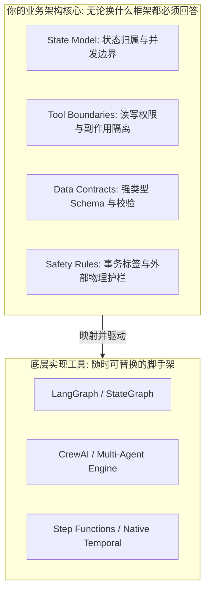
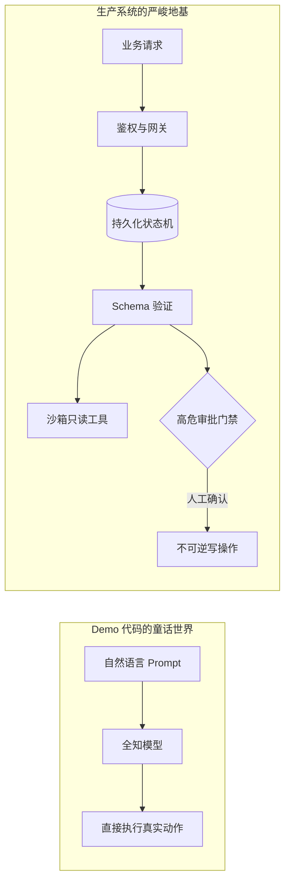
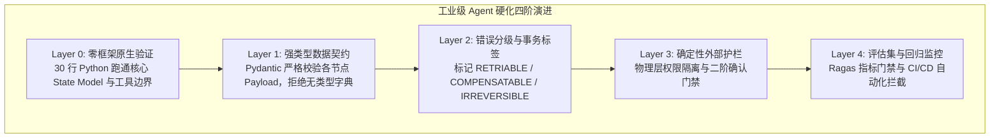
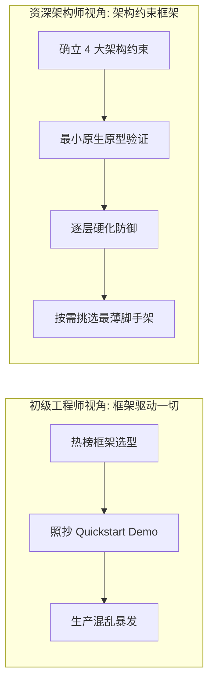
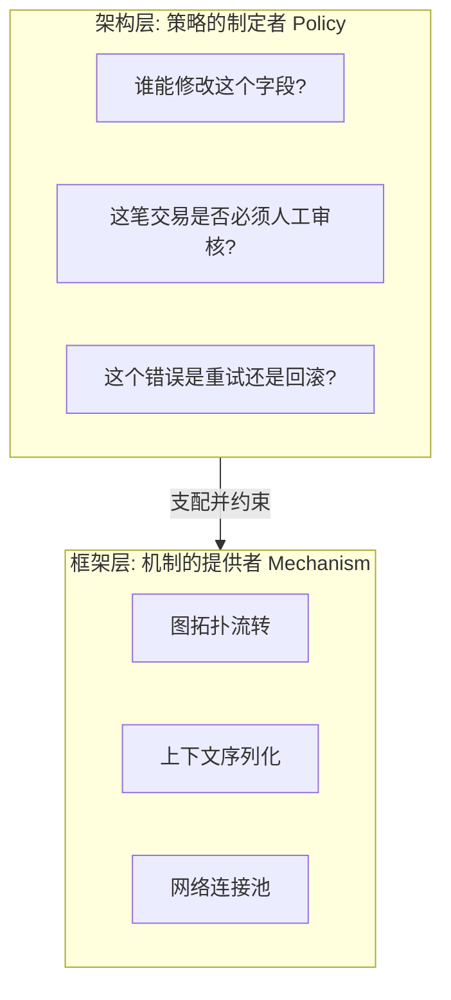

> “求木之长者，必固其根本；欲流之远者，必浚其泉源。” — 魏徵《谏太宗十思疏》

# 框架不是架构：为什么照抄 Demo 会成为 AI Agent 生产系统的千倍放大器？

*从空心脚手架到工业级四重约束——资深工程师与初级调用者在 Agent 选型上的分水岭*

1982 年，美国传奇重金属摇滚乐队范海伦（Van Halen）开启了他们规模空前的全球巡演。在长达数十页极其繁复的技术合同细则中，主唱大卫·李·罗斯（David Lee Roth）夹带了一条在圈内引发巨大争议的荒谬条款：

> “后台化妆间必须随时备有一碗 M&M 巧克力豆，且绝对不能出现哪怕一颗棕色的巧克力豆。一旦发现棕色豆子，演出立即取消，主办方必须无条件承担全额赔偿。”

彼时整个行业都对这条要求嗤之以鼻，认为这是顶流摇滚明星在成名后不可理喻的骄纵与耍大牌。然而，罗斯在多年后的自传中揭开了背后的工程实相：范海伦是历史上第一支将九辆重型卡车、整整九吨活动照明灯光悬吊在室内体育馆穹顶的超级乐队。在那个场地承重标准参差不齐的年代，一个微小的疏忽就会导致整个舞台悬梁坍塌，造成成千上万观众的伤亡。

罗斯的经济人真正设计的，是一个极简却致命的**系统契约检查点（Contract Checkpoint）**。如果在走进化妆间时看到碗里有棕色 M&M 豆，就证明当地承建方根本没有逐字逐句研读那份沉重的工程规范；这也意味着他们绝对没有认真核对重型电缆的接地保护、主舞台地板的载重限额，以及悬梁在九吨拉力下的力学安全系数。

有一次在科罗拉多，罗斯果然在后台碗里看到了棕色巧克力。他当即下令全员停工审查，结果令人倒吸一口冷气：当地承办方不仅没有加固顶梁，准备的滑轮组甚至承受不住五台重型功放的重量。如果当晚演出照常进行，价值数十万美元的设备将在数万名尖叫的乐迷头顶直接砸向地板。

把视角从 80 年代的摇滚舞台切回今天的生成式人工智能工程前沿，无数的研发团队正在犯下与那个倒霉承办方一模一样的致命错误。

在 GitHub 趋势榜上，LangGraph、CrewAI、AutoGen 或 LlamaIndex 几乎每周都在推出激动人心的 20 行 Quickstart 代码。年轻的工程师们把 Demo 源码复制粘贴到本地，换上自己的 API Key，看着终端里跳跃的几个彩色 Agent 欢快地完成了“市场竞品调研报告”，便激动万分地将其打包进 Docker 镜像，推向了线上生产环境。

然而三个月后，当真实业务流量汹涌而至：多 Agent 死锁循环、缺乏隔离的破坏性数据库删除、暴涨数千美元的 Token 账单，以及毫无追踪可言的黑盒调用排山倒海般袭来。

面对崩塌的生产系统，团队往往沮丧地抱怨：“这个框架太不成熟了，底层又出 Bug 了。”

而在所有的系统架构评审和 Code Review 中，我始终在敲黑板提醒一件事：
**“框架是租来的脚手架，架构才是自己浇筑的承重墙。把框架当成架构，框架就会沦为系统混乱的千倍放大器。”**

## 你将从本文获得什么

- **概念解构**：彻底厘清“框架（Framework）”与“架构（Architecture）”的边界，弄清楚哪些问题框架永远无法替你回答。
- **陷阱透视**：看穿照抄 Quickstart Demo 带来的“空心架构（Hollow Architecture）”本质，理解为什么它在生产环境下必然暴毙。
- **放大器定律**：从传递函数视角理解“框架放大混沌”的物理现实，告别试图靠引入新框架去解决老系统混乱的幻想。
- **硬化分层法则（Harden Layers）**：掌握从零框架极简内核，到 Schema 约束、错误分级、外部护栏与 Evals 的工业级交付范式。
- **面试与技术决策范式**：学会如何像硅谷/跨国金融机构的 Principal Architect 一样，高段位解答“框架选型”这一经典技术考核。

## 一、核心概念解构：框架是脚手架，架构是承重墙

在很多初级工程师的心智模型里，技术选型就是“挑一个厉害的框架”。但在资深架构师眼中，**框架与架构根本不属于同一个哲学维度**。

### 1.1 什么是框架？

框架（Framework）是纯粹的**实现工具（Implementation Tool）**。

无论是 LangGraph、CrewAI、LlamaIndex 还是 AWS Step Functions，它们的核心职责只有一个：**为你提供编写代码的脚手架（Scaffolding）**。它们提供了封装好的状态容器、图调度循环器、预制的工具绑定装饰器和事件总线，目的是帮助你在键盘上少敲几百行模板代码。

### 1.2 什么是架构？

架构（Architecture）是你在系统本质问题上做出的**全局决定（Decisions on Fundamentals）**。

无论底层使用什么框架，无论从 LangGraph 迁移到 原生 Python 还是 Step Functions，以下四大核心维度的决定，框架一个都替你做不了：

1. **State Model（状态模型）**：对话历史、中间结论、循环计数器、安全权限上下文究竟保存在哪？内存、Redis 还是持久化数据库？哪些节点有权修改状态的哪个字段？并发竞态如何加锁？
2. **Tool Boundaries（工具边界）**：Agent 究竟能调什么、绝对不能调什么？写操作和破坏性操作如何隔离？外部工具调用的超时与重试由谁接管？
3. **Data Contracts（数据契约）**：组件与组件、Agent 与 Agent 之间究竟传递什么数据格式？Schema 是什么？谁在进入下一阶段前做严格的反序列化与类型拦截？
4. **Safety Rules（安全护栏）**：哪些操作必须强制注入人工确认（Human-in-the-loop）？哪些动作打上了不可逆标签？护栏是在 LLM 内部祈求它遵守，还是在网关层外部死锁？



| 比较维度 | 框架脚手架（Framework） | 核心系统架构（Architecture） |
|---|---|---|
| **本质定位** | 解决“如何写得更快”的语法糖与调度工具 | 解决“系统如何可靠运行”的契约与状态决定 |
| **可替换性** | 极高，两个季度后可能随开源风向切换 | 极低，决定了系统的拓扑结构与业务数据血缘 |
| **典型代表** | LangGraph、CrewAI、LlamaIndex | 状态持久化方案、工具权限边界、Sagas 事务模型 |
| **故障影响** | 框架升级可能引发 API 废弃报错 | 架构缺失将直接导致生产数据破坏与账单失控 |

📌 **核心洞见 1**：框架只提供语法和编排机制；真正决定一个 AI Agent 系统能否在生产环境存活的，永远是你对状态模型、工具边界、数据契约与安全规则的架构定义。

> **本章哲学**：框架是租来的脚手架，架构是自己浇筑的承重墙；脚手架可以随时拆换，承重墙塌了万劫不复。

## 二、为什么“照抄 Demo”是生产落地的最大毒药？

开源项目的官方文档和 Demo 仓库，天生带有一个巨大的原罪：**它们是为了“看起来能跑（Look Like It Works）”而精心设计的**。

### 2.1 Demo 代码的 Happy Path 假象

翻开任何一个 Agent 框架的 Quickstart 示例，代码通常长这样：

```python
# 典型的快速演示 Demo 代码（生产禁忌）
from demo_framework import Agent, Task

agent = Agent(role="Financial Analyst", goal="Analyze stock and execute trades")
task = Task(description="Check market and buy 100 shares of AAPL", agent=agent)
result = agent.run(task)
```

这段 5 行的代码为什么能跑？因为它预设了一整套极其虚幻的“童话世界”：
- 它假定大模型的推理 100% 遵守语义，绝不会发生参数混乱；
- 它假定网络 0 延迟，下游交易 API 绝不超时，更不会返回 502 Bad Gateway；
- 它跳过了用户鉴权、租户隔离、并发死锁，以及最重要的——它直接允许大模型自主触发具有真金白银副作用的 `buy` 操作！

### 2.2 产生“空心架构”的机理

当你把上述代码复制进团队代码库，并宣布“我们的系统架构基于某某框架”时，你实际上做出了一个极具破坏性的举动：**你让写 Demo 的实习生或开源作者替你做了所有的核心架构决定**。

而开源作者在写这行代码时，脑子里想的根本不是企业级容灾，他只是在向全世界展示这个库的 API 接口有多简洁！

其结果就是系统长出了一个**“空心的架构（Hollow Architecture）”**：
- 外部看起来结构完整，架构图上画满了炫酷的节点与流转箭头；
- 剥开内部，状态是如何持久化的？空的。
- 工具出现超时怎么做重试和状态补偿？空的。
- Agent 产生幻觉调用了未授权工具谁来拦截？空的。



| 评估项 | 照抄 Demo 的空心系统 | 工业级生产就绪系统 |
|---|---|---|
| **状态传递** | 随意命名的 `dict`，随处自由读写 | 严格定义的 `TypedDict` / Pydantic，单向状态流 |
| **工具调用** | 模型直接拿到具有写权限的 API 密钥 | 仅暴露提取参数能力，网络隔离，外部网关代理执行 |
| **异常恢复** | 程序抛出未捕获异常崩溃退出 | 明确区分重试、补偿与人工介入三种错误级别 |
| **可观测性** | `print()` 打印或完全处于黑盒状态 | OTel 细粒度 Span 追踪输入/输出 Token、耗时与成本 |

> **本章哲学**：Demo 的最高目标是炫目地跑通第一遍，工程的最高目标是狼狈地抗住第一万次异常。

## 三、放大器定律：为什么框架会加速灾难？

在控制理论和信号处理中，存在一个基础公式：

$$	ext{Output}(t) = K 	imes 	ext{Input}(t)$$

其中 $K$ 是系统的放大增益（Gain）。如果输入的是清晰的基频信号，放大器能让美妙的音乐响彻整个音乐厅；但如果输入的本身就是刺耳的杂音，大功率放大器唯一的作用，就是在数毫秒内把所有扬声器的纸盆彻底震碎。

### 3.1 框架是一台无脑的高增益放大器

**框架不是过滤器，更不是净化器，框架是纯粹的放大器（Amplifier）。**

- **若地基扎实**：你的数据 Schema 严丝合缝，错误边界清晰定义，状态流转具备幂等性与可追溯性，那么框架能让你以数倍的开发速度，快速交付高可靠的自主智能体。
- **若地基混沌**：你的业务状态在字典里随心所欲地增删，工具没有做读写物理隔离，Prompt 里充斥着祈求模型“请务必准确”的情绪化标点，那么框架绝不可能帮你把混沌变成秩序。

相反，框架会以数千倍的速度、在多线程与分布式节点间，将这份混乱无限复制出去。

### 3.2 真实生产事故还原：失去边界的自反死锁

在某跨国金融团队的一次灾难复盘中，工程师为了实现“全自动客服工单分析”，直接使用了多 Agent 协作框架的默认对齐循环。
由于没有定义显式的 `max_iterations` 状态计数器，更没有在数据契约层限制单个 Agent 的回复格式，一个负责“初审”的 Agent 与一个负责“复核”的 Agent 因为标点符号的理解分歧，陷入了长达两个小时的互斥礼貌争论：

```text
Agent A: "我认为该保单符合条件，请确认。"
Agent B: "收到，但我建议将格式微调为正式公文，请您核对。"
Agent A: "已根据您的建议重新微调，请再次核验。"
Agent B: "整体很好，但第三行缺了一个冒号，建议补充后重新提交。"
```

整个过程在深夜悄无声息地并发运行了几百个实例。直到第二天清晨财务预警响起时，系统已经消耗了超过 4,000 美元的无谓 Token，并因触发下游微服务的 Rate Limit 导致真实用户的在线工单全部超时熔断。

这就是所谓的**“框架放大了混乱”**。没有状态约束和终止契约的架构，在多 Agent 框架的加速下，只会以更快的速度带你撞向悬崖。

🩸 **血泪教训**：永远不要把未经约束的自然语言循环交给外部框架代管。框架不会为你的账单和数据安全负责；缺少契约的地基上，任何漂亮的编排工具都是引爆生产灾难的高性能雷管。

> **本章哲学**：在泥潭之上，越强大的吊车只会让整座建筑沉没得越快。

## 四、“I start small and harden layers”——资深架构师的演进法式

在顶尖科技企业或全球金融机构的技术评审和总监级面试中，面试官最渴望听到的从来不是你罗列了多少个开源框架的最新名词，而是这句话：

> **“I start small and harden layers.”（我先以最小化原型起步，然后逐层固化系统。）**

这句话展现的不是某种话术，而是一名跨越过无数系统废墟的工程师所沉淀下来的敬畏心与工程成熟度。



### 4.1 四阶硬化演进法（The 4-Layer Hardening Pipeline）

#### 第一步：Layer 0——零框架极简内核（Start Small）
在引入 LangGraph 或任何重型框架前，先用最纯粹的原生 Python 字典或基础类，手动把核心状态流转写出来。验证业务到底需要几个状态？状态流转是单向的有向无环图（DAG），还是存在必要的环（Cyclic）？如果连 30 行原生代码都理不清状态的归属，任何框架只会把问题搅得更浑。

#### 第二步：Layer 1——强类型契约硬化（Schema Hardening）
全面废除在各个函数之间随意传递不可知 `dict` 的恶习。为每一个业务组件的输入输出定义严格的 Pydantic 模型。

#### 第三步：Layer 2——事务分类与错误硬化（Error & Idempotency Hardening）
这是区分架构师与初级工程师最关键的一道承重墙。系统中的每一个工具调用，必须在元数据中显式标注其物理事务属性：
- **`RETRIABLE`（可重试）**：无副作用的纯读操作（如查询保单状态、计算利率），网络抖动时可安全指数退避重试。
- **`COMPENSATABLE`（可补偿）**：带有轻微副作用但具备撤销接口的操作（如临时锁定额度、生成待支付凭证），失败时能触发补偿事务（Sagas）逆向释放。
- **`IRREVERSIBLE`（不可逆）**：产生不可逆现实后果的操作（如打款划扣、永久注销账户、对外发送具有法律效力的通知函）。**此类操作必须在架构层剥离大模型的自主权，强制挂起状态，等待外部人工确认（Human-in-the-loop）**。

#### 第四步：Layer 3——外部确定性护栏（Deterministic Guardrails）
不要在 Prompt 里哀求模型“请只有在得到授权时才调用打款工具”。权限校验必须物理下沉在 Agent 运行时外部的 API 网关或代理服务层。

### 4.2 工业级生产架构参考实现

下面是一段践行“先架构后框架、逐层加固”的生产级核心实现：

```python
from enum import Enum
from typing import Dict, Any, Optional
from pydantic import BaseModel, Field

class TransactionType(str, Enum):
    RETRIABLE = "RETRIABLE"         # 只读操作，无副作用，支持安全重试
    COMPENSATABLE = "COMPENSATABLE" # 可补偿操作，具备 Sagas 回滚能力
    IRREVERSIBLE = "IRREVERSIBLE"   # 破坏性不可逆操作，严禁自主执行

class ToolMetadata(BaseModel):
    name: str
    tx_type: TransactionType
    requires_approval: bool = False

class AgentAuditState(BaseModel):
    session_id: str
    tenant_id: str
    current_step: str = "INIT"
    iteration_count: int = 0
    max_iterations: int = Field(default=3, description="硬性防死锁上限")
    payload: Dict[str, Any] = Field(default_factory=dict)
    approval_granted: bool = False

def secure_tool_dispatcher(
    state: AgentAuditState,
    tool_meta: ToolMetadata,
    tool_args: Dict[str, Any]
) -> Dict[str, Any]:
    """
    架构级工具分发器：执行外部硬约束，脱离任何 LLM 框架独立运行
    """
    # 1. 防死锁硬约束
    if state.iteration_count >= state.max_iterations:
        raise RuntimeError(f"Deadlock prevention triggered: exceeded max iterations {state.max_iterations}")

    # 2. 不可逆操作物理熔断
    if tool_meta.tx_type == TransactionType.IRREVERSIBLE:
        if not state.approval_granted:
            # 挂起当前状态机，向外部安全通道抛出人工审计事件
            return {
                "status": "SUSPENDED",
                "action": "AWAITING_HUMAN_APPROVAL",
                "reason": f"Tool {tool_meta.name} is IRREVERSIBLE. Mandatory approval required."
            }

    # 3. 正常执行并推进状态
    state.iteration_count += 1
    # 模拟真实微服务调用
    return {"status": "SUCCESS", "data": f"Executed {tool_meta.name} cleanly."}
```

这段代码没有任何深奥的框架依赖，但它已经完整实现了状态隔离、防死锁计数器与不可逆操作的人工熔断。**这才是架构。** 至于后续是用 LangGraph 的 `StateGraph` 把这些函数连起来，还是用 AWS Step Functions 调度，只是敲键盘的工具差异。

> **本章哲学**：架构是演进出来的，不是选型选出来的；在每一层地基被自动化断言夯实之前，绝不盲目加盖下一层阁楼。

## 五、面试与技术决策实战：如何优雅地回答“框架选型”？

在技术方案评审会或高端技术面试中，一个极为经典的考核问题往往是：

> **“在当前的业务场景下，你们为什么选型了 LangGraph，而不是 CrewAI 或 AutoGen？”**

### 5.1 初级调优者的答法（负面教材）

> “因为 LangGraph 最近在 GitHub 上很火，它是 LangChain 官方出的，支持有向无环图和持久化，文档也比其他项目好，生态比较活跃，所以我们就选它了。”

**面试官心声**：这是典型的初级工程师视角。只看生态热度、只背功能清单，对框架与自身业务架构之间的映射关系完全缺乏深度思考，随时可能被下一个火热的开源玩具带进沟里。

### 5.2 资深架构师的标准答法（高分典范）

> “我在做技术选型时，始终坚持**先立架构决定，后选实现工具**。
>
> 在决定引入任何框架前，我必须先在白板上确定系统的四个本质要素：我们的状态模型（State Model）应该保存在哪、工具调用的副作用边界在哪里、各组件的数据契约（Data Contracts）由谁校验，以及哪些业务动作属于不可逆操作、必须被外部网关阻断。
>
> 只有当这些底座决定全部清晰后，我才会去评估框架。因为框架只是最后用来加速落地的脚手架，它是最容易被无痛替换的实现细节。
>
> 我始终遵循 **‘Start small and harden layers’** 的原则：先用最精简的原生代码跑通状态流转与契约校验，在每一层补齐类型约束、错误分级与评估门禁之后，再决定是否引入框架脚手架。
>
> **因为脱离了扎实工程地基的框架，唯一的作用就是以更快的速度把系统混乱规模化地放大。**”



### 5.3 主流开源框架在不同架构约束下的适用场景

| 框架工具 | 擅长的实现场景（脚手架优势） | 暴露的架构隐患（若无地基约束） | 架构师的加固建议 |
|---|---|---|---|
| **LangGraph** | 复杂状态机、循环重试、Human-in-the-loop 状态持久化 | 图节点过于松散，容易演变成巨型全局状态字典（God Dictionary） | 强制对 `StateGraph` 的全局 Payload 进行细粒度子模式拆解 |
| **CrewAI** | 基于角色扮演（Role-playing）的创意脑暴与流水线任务 | 角色间边界模糊，对话容易陷入无效互相赞美与死循环 | 严禁用于确定性事务系统；必须注入刚性最大迭代计数器 |
| **LlamaIndex Workflows** | 以文档检索与知识密集型 RAG 为核心的事件驱动管道 | 深度绑定其内部抽象，脱离其生态重构成本高 | 仅作为 Retrieval 层的内部插件，业务调度与状态独立在外 |
| **原生代码 / Step Functions** | 企业级高合规、强审计、强事务一致性的生产业务 | 初始开发耗时稍长，缺少现成的对话链模板代码 | 核心金融与结算系统的首选，把控制权 100% 掌握在自己手中 |

📌 **核心洞见 2**：在资深技术评审中，你对某个框架特定 API 的熟练程度毫无溢价；真正的架构成熟度，体现在你时刻有能力将框架剥离，并用系统工程的确定性契约驯服不确定的概率模型。

> **本章哲学**：高级工程师用框架，卓越架构师驾驭框架；前者向框架索取答案，后者给框架制定规则。

## 六、🧭 举一反三：从 UNIX 哲学看现代 Agent 架构

> **Generalize**：计算机系统设计经过半个多世纪的演进，最底层的智慧从未改变。经典的 UNIX 哲学有一条著名的铁律：**“提供机制，而不是策略（Separation of Mechanism and Policy）”**。机制（Mechanism）关注的是“能够做什么”，而策略（Policy）关注的是“应当怎么做”。

现代大语言模型框架，其本质就是**“机制的提供者”**——它们提供了调用大模型的管道、图遍历的算法和状态存储的接口。

而系统的安全、合规与稳定，完全取决于你的**“业务策略”**——什么样的数据能入库、什么时候必须人工签字、什么样的操作必须被熔断。

当你照抄 Demo 并试图让框架接管系统时，你犯下的核心架构罪行，正是**把属于你自己的“策略决定权”，拱手出卖给了一个只负责提供“调度机制”的开源工具**。



## 立刻可以做的事

1. **今天下午**：打开你现有的 Agent 代码工程，检索所有传递裸 `dict` 的上下文接口，用 `Pydantic` 或 `TypedDict` 将其全部重构成强类型定义，拦截非法字段注入。
2. **本周内**：拉取 Agent 注册的所有外部 Tool，建立一个只读清单，为每一个工具打上 `RETRIABLE`（可重试）、`COMPENSATABLE`（可补偿）或 `IRREVERSIBLE`（不可逆）的硬性分类标签，并在代码中阻断未授权的不可逆调用。
3. **下周启动**：在下一次技术评审或需求对齐时，坚决抵制“先选框架再写代码”的错误导向；先用 50 行原生代码把 State Model 和安全边界画透，确认地基无误后，再评估是否需要引入框架脚手架。

## 预告

下一篇特稿，我们将直击 Agent 分布式事务的深水区——**《Agent 状态机的事务与回滚：如何为 LangGraph 设计可恢复的 Sagas 分布式模型》**，拆解复杂长调用链路上，面对大模型幻觉崩溃时的原子性自愈与补偿设计。

---

*初学者迷恋框架的光鲜，资深者敬畏架构的厚重。真正经得起生产考验的系统从不依靠框架的繁华，它只是一组让混乱无处容身的静默契约。*
