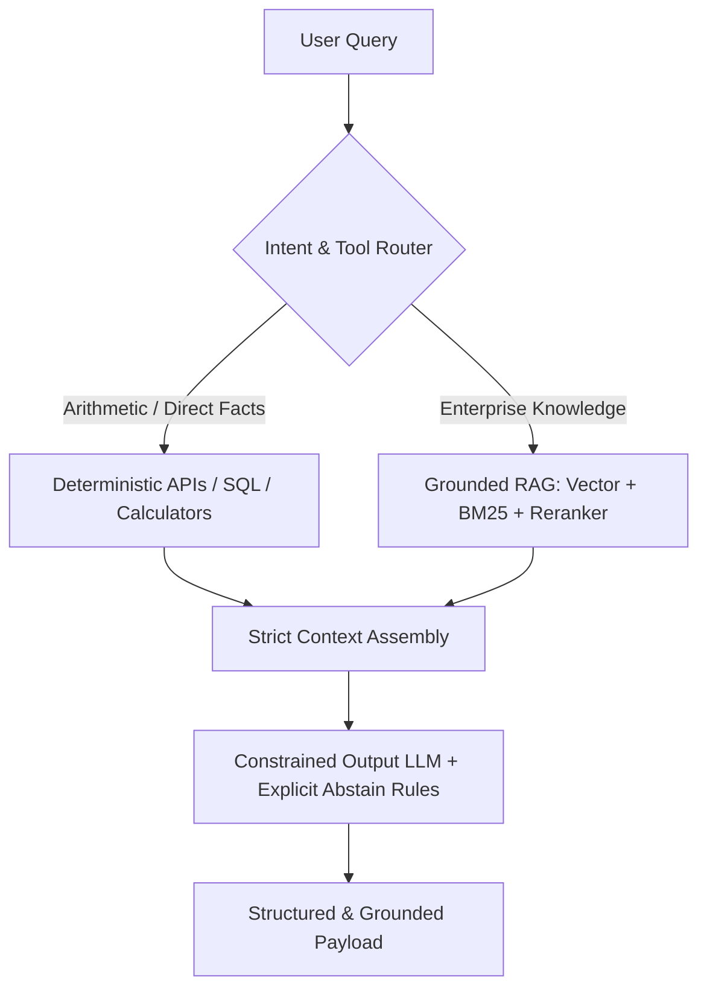
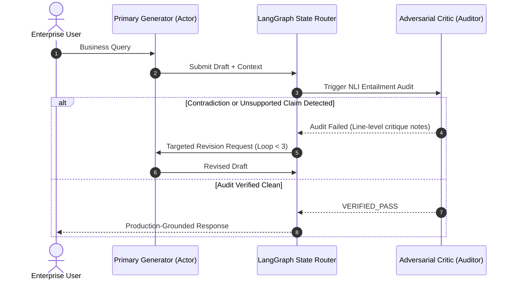
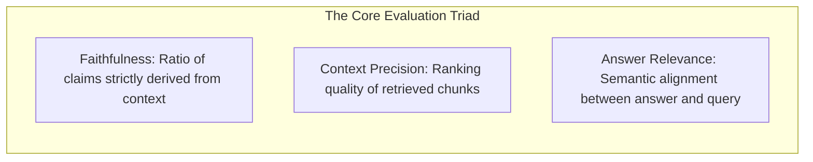
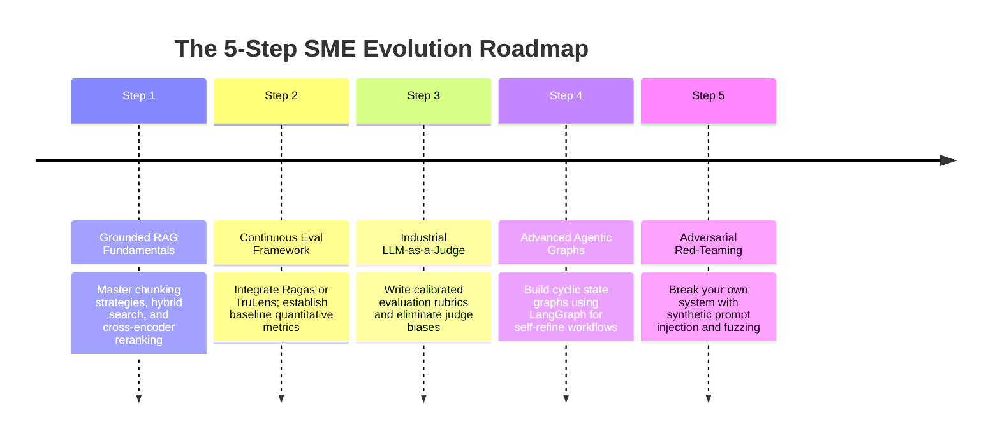
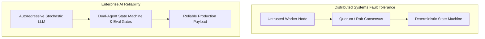

> "Whereof one cannot speak, thereof one must be silent." — Ludwig Wittgenstein, *Tractatus Logico-Philosophicus*

# Hallucination Isn't a Bug, It's a Feature: The Full-Lifecycle Systems Engineering Playbook

*From passive prompt wishing to three-tier defense architectures and automated Eval gates — a blueprint for becoming your team's SME on LLM reliability*

Along the snowy alpine frontier between Italy and Switzerland, an infantry squad once found itself trapped in a catastrophic blizzard. The passes were walled off by snowdrifts, radio communications were completely dead, rations were nearly exhausted, and the men were slipping into frozen despair. Just as the squad leader was preparing for the worst, a soldier rummaging through an abandoned outpost corner discovered an old, tattered parchment map. Although the handwriting was in an archaic Latin dialect that none of them could read, the meticulous topographical contours, mountain passes, and river forks were drawn with stunning precision. That map revived the squad's will to survive. Clutching the parchment, checking their bearings against the dim shadows of the ridges, and constantly adjusting their heading, the soldiers miraculously marched their way out of the frozen death trap after several grueling days.

Back at headquarters, the young commander framed the map as a sacred miracle relic of survival. Years later, he proudly presented it to a visiting master geographer. The scholar studied the Latin script, traced the contours, and turned to him with a wry smile:
"Captain, this isn't the Alps. This is an ancient map of a province in the plains of Austria and Hungary, hundreds of miles away."

Why did an entirely irrelevant, counterfeit map not lead the squad off a cliff, but instead steer them to safety?

Cognitive science and organizational behavior pioneer Karl Weick provided the foundational answer: When humans encounter chaos and existential unknowns, our deepest terror is not difficulty or danger — it is the void of directionlessness. The moment the human brain is handed an artifact that exhibits internal order, crisp structure, and apparent certainty, it seizes upon it with total conviction, finding an enormous psychological oasis of confidence.

Those soldiers survived because their boots fell on physical rocks and tangible snowbanks. The unyielding physical terrain served as a relentless, real-time feedback loop, forcing them to calibrate their actual course every ten paces. **Large language models, by stark contrast, possess no physical body, no sensory nerve endings, and no ontological connection to external reality.**

Whenever you prompt a frontier language model, the output it hands you is almost always **that Austrian map in the snowy Alps**.

As I recorded in my engineering notes on artificial intelligence and human cognition:
> "Common sense is the fundamental dividing line between human intelligence and AI. Models hallucinate because they lack common sense. The model implicitly assumes that every prompt is an equation waiting to be completed, whereas humans possess epistemic humility — self-aware humans know what they do not know. True common sense is what enables us to make sound decisions under incomplete information."

Autoregressive transformer decoders are mathematically conditioned on cross-entropy loss to reward one metric above all: linguistic fluency and token-level plausibility under human statistical distributions. The model does not feel the human embarrassment of confessing, "I actually do not know." When your prompt steps outside the support of its parametric memory manifold, the autoregressive engine cannot halt. It will generate an immaculate, persuasive, and beautifully formatted Austrian map with a 0.98 self-reported confidence score.

In a recreational chat window, a fabricated map is a harmless novelty. In high-concurrency enterprise finance, automated underwriting, or mission-critical orchestration, treating a stochastic distribution generator as a deterministic source of truth guarantees catastrophic system failure.

**Hallucination is not an accidental software bug; it is the fundamental generative nature of autoregressive probabilistic modeling.** Taming it cannot be achieved by whispering polite admonitions into a prompt. It requires building an unyielding, three-tier systems engineering defense across compile-time architecture, runtime multi-agent verification loops, and automated CI/CD evaluation gates.

## What You Will Take Away

- **First-Principles Framing**: The mathematical reality of autoregressive next-token prediction, cross-entropy objectives, and parametric memory limits.
- **Three-Tier Systems Defense**: A holistic architecture spanning compile-time physical bounding, runtime dual-agent critic loops, and production CI/CD evaluation pipelines.
- **Production-Ready Code & State Machines**: Concrete implementations using Pydantic structured schemas, LangGraph stateful auditor-actor loops, and Ragas-driven test assertions.
- **The SME Roadmap**: A 5-step implementation ladder covering grounded RAG, automated Evals, and adversarial red-teaming.

## 1. Root Cause: The Physics of Parametric Memory

Junior developers treat hallucination as an implementation defect waiting for a patch. Staff and Principal engineers understand that **hallucination is the core generative mechanism of autoregressive models — the exact same mechanism that powers their creative synthesis and linguistic fluency**.

### 1.1 The Autoregressive Objective Function

Every modern generative decoder optimizes a straightforward objective:

$$P(w_1, w_2, \dots, w_T) = \prod_{t=1}^T P(w_t \mid w_1, w_2, \dots, w_{t-1})$$

At step $t$, the transformer computes a probability distribution over its token vocabulary. Training via cross-entropy loss rewards *syntactic plausibility and statistical fluency under human distribution*, not *ontological veracity in physical reality*.

All learned facts are distributed as floating-point weights across billions of parameters — what cognitive architecture calls **Parametric Memory**. When queried, the model does not query an indexed database table; it traces a probabilistic trajectory through high-dimensional latent space.

When a query lands in a sparse region of that manifold, the model cannot simply halt execution. The autoregressive loop demands the next token. Mathematically, the path of least surprise (minimizing perplexity) is to sample the most fluent, authoritative-sounding tokens available. The resulting prose is persuasive precisely because the model is optimized for statistical fluency.

### 1.2 Information Directionality and Projection Boundaries

Systems architecture relies on the mental model of **Information Directionality**:

The model has no bidirectional sensory link to external reality. Prompts are projected into vector space; attention layers calculate self-attention; output tokens are projected back out. The model cannot know whether a policy actually exists; it only knows whether the token sequence reads naturally.

| Dimension | Traditional Software Bug | LLM Hallucination |
|---|---|---|
| **Root Cause** | Deterministic logic error, unhandled edge cases, null pointers | Mathematical nature of autoregressive sampling, parametric memory drift |
| **State Visibility** | Stack traces, reproducible memory dumps, deterministic control flow | Latent space weight activations, stochastic sampling, non-deterministic paths |
| **Mitigation Pattern** | Logic patches, boundary checks, regression unit tests | Physical context bounding, deterministic tool delegation, multi-agent audits |
| **Guarantees** | 100% regression prevention on tested inputs | Probabilistic error reduction bounded by system guardrails and eval SLOs |

📌 **Core Takeaway 1**: Hallucination is not a bug to be patched with prompts; it is an inherent property of next-token prediction. Mitigating it requires shifting factual grounding entirely out of parametric weights and into deterministic systems infrastructure.

> **Chapter Philosophy**: Reserve certainty for deterministic code; delegate fluency and synthesis to the model.

## 2. Prevention (System Design): Bounding Determinism at Compile Time

Because parametric memory is fundamentally untrusted for ground truth, the primary architectural duty is to strip the model of its mandate to guess facts.



### 2.1 Deterministic Tool Execution: Moving Compute Back to Code

Never allow an LLM to calculate interest rates, query transactional balances, or evaluate date ranges using its internal weights.

```python
from typing import Annotated
from pydantic import BaseModel, Field

class RefundEligibilityQuery(BaseModel):
    policy_id: Annotated[str, Field(description="Unique enterprise policy ID, e.g., POL-2026-X89")]
    region_code: Annotated[str, Field(description="ISO regional code, e.g., AU, US, CN")]
    incident_timestamp: Annotated[int, Field(description="Unix timestamp of the claim incident")]

def check_refund_eligibility_tool(query: RefundEligibilityQuery) -> dict:
    """Execute deterministic microservice lookup. Model only extracts arguments."""
    # Direct integration with core transactional accounting microservice
    return {
        "policy_id": query.policy_id,
        "eligible": False,
        "reason_code": "CROSS_REGION_EXCLUSION_SECTION_4",
        "official_ref": "https://internal.policy/doc/2026/section-4"
    }
```

Under this pattern, the language model functions strictly as a natural language parameter extractor. Deterministic business logic handles the state verification.

### 2.2 Grounded Retrieval-Augmented Generation (Grounded RAG)

Grounded RAG transforms the model from an unconstrained author into an evidence-bound summarizer.

Production-grade Grounded RAG differs from naive tutorial implementations across three layers:
1. **Structural Chunking**: Preserve hierarchical document trees (headings, parent sections) rather than cutting raw 500-token text slices.
2. **Hybrid Retrieval**: Combine dense semantic embeddings with sparse BM25 keyword matching to prevent catastrophic misses on product codes and exact clause numbers.
3. **Cross-Encoder Reranking**: Re-score the top 50 retrieved fragments down to the top 3 high-affinity evidence snippets, pruning irrelevant context that causes distraction.

Prompt isolation enforces this constraint:

```text
<system_directive>
You are an evidence-bound summarizer. You must strictly synthesize the answer based ONLY
on the verified context between <verified_context> and </verified_context>.
If the answer cannot be explicitly derived from the text, you MUST trigger the abstain rule.
Do NOT use prior knowledge or extrapolate beyond the provided text.
</system_directive>

<verified_context>
{reranked_context_chunks}
</verified_context>

<user_query>
{user_question}
</user_query>
```

### 2.3 Constrained Decoding: Logit Masking via Context-Free Grammars

Free-form Markdown allows the model to explore thousands of irrelevant token branches. Constrained decoding (via engines like Outlines, vLLM Guided Decoding, or provider Structured Outputs) enforces a Context-Free Grammar (CFG) directly at the logit level.

Tokens that violate the Pydantic schema are masked to probability $-\infty$ before sampling occurs.

```python
from pydantic import BaseModel, Field
from typing import List, Literal

class ClaimVerificationResponse(BaseModel):
    decision: Literal["APPROVED", "REJECTED", "INSUFFICIENT_INFORMATION"] = Field(
        description="Deterministic triage classification"
    )
    direct_quote: str = Field(
        description="Verbatim sentence extracted from verified context"
    )
    confidence_score: float = Field(
        ge=0.0, le=1.0, description="Self-assessed evidence alignment score"
    )
    missing_elements: List[str] = Field(
        default_factory=list, description="Missing evidence attributes if decision is unanswerable"
    )
```

### 2.4 Explicit Abstain Rules: First-Class Silence

Wittgenstein's dictum is an operational requirement: where the context lacks proof, the model must stay silent.

Unconstrained models hallucinate because traditional prompt framing assumes an answer is mandatory. In enterprise systems, give the model explicit authorization to fail safely:

> "If the verified context does not contain conclusive evidence to answer the user query, output the reserved token: `STATUS: ABSTAIN_NO_GROUNDED_DATA`. Outputting speculative commentary is classified as a critical system failure."

| Prevention Mechanism | Target Failure Mode | Latency & Compute Cost | Remaining Vulnerability & Solution |
|---|---|---|---|
| **Deterministic Tools** | Arithmetic, date math, real-time facts | Microservice I/O: 50-200ms | Malformed parameter extraction; enforce Pydantic types |
| **Grounded RAG** | Domain and proprietary policy drift | Vector search + rerank: 100-300ms | Retrieval recall misses; mitigate via hybrid BM25 search |
| **Constrained Decoding** | Free-form hallucinations, schema drift | Negligible runtime overhead | Semantic fabrications within valid fields; add length caps |
| **Explicit Abstain** | Speculative completion on missing data | Zero latency overhead | Over-abstention (false negatives); calibrate via Golden Evals |

> **Chapter Philosophy**: Never delegate to probability what deterministic code can solve; teach the model that silence is more valuable than plausible fiction.

## 3. Correction (Runtime Execution): The LangGraph Auditor-Actor Loop

Even with strict RAG and schema constraints, complex multi-hop synthesis can generate subtle conceptual distortions — claiming an exception applies universally when the text restricts it to specific dates.

Relying on a single model to "reflect on its own response" in the same conversational context fails due to **confirmation bias**. Once a model samples a token sequence, its internal attention weights reinforce that narrative.

### 3.1 The Auditor-Actor Separation Principle

Runtime correction requires **Auditor-Actor Separation** (breaking conversational symmetry):
- **Primary Generator (Actor)**: Ingests the query and retrieved context to formulate an initial draft.
- **Adversarial Critic (Auditor)**: Operates in an isolated context window. It receives only two documents: the raw retrieved source text and the generated draft. Its sole task is Natural Language Inference (NLI) — classifying each claim as *Entailed*, *Neutral*, or *Contradicted*.



### 3.2 LangGraph State Machine Implementation

The following implementation binds the generator and critic into a deterministic state graph:

```python
from typing import TypedDict
from langgraph.graph import StateGraph, END

class AgentAuditState(TypedDict):
    query: str
    context: str
    draft: str
    critic_verdict: str
    critic_notes: str
    revision_count: int

def generate_node(state: AgentAuditState) -> dict:
    """Actor node: generates initial draft from provided context."""
    prompt = f"Context: {state['context']}\nQuery: {state['query']}\nDraft answer:"
    draft = "According to Section 4, cross-regional refunds require prior regional approval."
    return {"draft": draft}

def critic_audit_node(state: AgentAuditState) -> dict:
    """Auditor node: verifies claim entailment against source text."""
    audit_prompt = (
        f"Source: {state['context']}\n"
        f"Draft: {state['draft']}\n"
        "Audit each claim. Output PASS if strictly entailed; else FAIL with notes."
    )
    if "prior regional approval" in state["draft"] and "prior regional approval" not in state["context"]:
        return {
            "critic_verdict": "FAIL",
            "critic_notes": "Claim mentions 'prior regional approval' which does not exist in source.",
            "revision_count": state["revision_count"] + 1,
        }
    return {"critic_verdict": "PASS", "critic_notes": "All claims grounded."}

def audit_router(state: AgentAuditState) -> str:
    """Conditional transition router."""
    if state["critic_verdict"] == "PASS":
        return "deliver_result"
    if state["revision_count"] >= 3:
        return "fallback_abstain"
    return "refine_draft"

def refine_node(state: AgentAuditState) -> dict:
    """Targeted refiner: removes ungrounded claims based on critic feedback."""
    return {"draft": "According to Section 4, cross-regional claims are strictly excluded from instant refunds."}

workflow = StateGraph(AgentAuditState)
workflow.add_node("generator", generate_node)
workflow.add_node("critic", critic_audit_node)
workflow.add_node("refiner", refine_node)

workflow.set_entry_point("generator")
workflow.add_edge("generator", "critic")
workflow.add_conditional_edges(
    "critic",
    audit_router,
    {
        "deliver_result": END,
        "refine_draft": "refiner",
        "fallback_abstain": END,
    }
)
workflow.add_edge("refiner", "critic")
runtime_app = workflow.compile()
```

🩸 **Hard-Won Warning**: Never allow the generator to audit its own draft within the same context window. The self-attention matrix will rationalize its prior hallucinations. The critic must run under an independent system prompt with its attention strictly locked to evidence verification.

> **Chapter Philosophy**: Separation of concerns is a foundational law of software engineering. From dual-engineer code reviews to multi-agent state graphs, true verification requires independent authority.

## 4. Operations (CI/CD & Evals): If You Don't Measure It, You Can't Ship It

Peter Drucker's management principle applies directly to AI systems: you cannot improve what you cannot measure.

Prompt engineering without continuous automated evaluation is software development without testing. Changing three lines in a system prompt and running two manual checks in a playground UI is a dangerous deployment practice.

### 4.1 Engineering Curated Golden Datasets

Moving beyond manual ad-hoc testing requires curated, version-controlled evaluation sets:
1. **Production Traffic Distillation**: Extract 200–500 recurring queries from production access logs and customer incident tickets.
2. **Ground Truth Context Pairing**: Bind each query to its verified, human-approved context snippet.
3. **Adversarial Negative Probes**: Dedicate 30% of the dataset to unanswerable queries designed to tempt the model into fabricating answers. Verify that the abstain contract triggers cleanly.

### 4.2 The Ragas Metric Triad

Modern automated evaluation replaces subjective impressions with quantitative metrics:



- **Faithfulness**:
  $$\text{Faithfulness} = \frac{|\text{Claims verified against context}|}{|\text{Total claims made in answer}|}$$
  This is the primary metric for tracking hallucination. In enterprise production, any deployment scoring below 0.98 represents unacceptable risk.
- **Context Precision**: Measures whether ground-truth evidence appears at the top of the retrieval rank list, mitigating "lost in the middle" attention degradation.
- **Answer Relevance**: Evaluates whether the model directly addressed the user's inquiry rather than dodging the question through excessive abstention.

### 4.3 Automated CI/CD Regression Gates with LLM-as-a-Judge

Integrate a frontier model (such as Claude 3.5 Sonnet or GPT-4o) into your CI pipeline as an automated evaluator with strict assertion thresholds:

```python
# test_rag_pipeline_regression.py
import pytest
from ragas import evaluate
from ragas.metrics import faithfulness, answer_relevance
from datasets import Dataset

# Curated golden evaluation dataset run inside CI runner
golden_dataset = Dataset.from_dict({
    "question": [
        "What is the cross-regional refund timeline?",
        "Can a customer claim compensation without official receipts?"
    ],
    "contexts": [
        ["Policy Section 4: All cross-regional claims must be routed through originating territory with no instant refund option."],
        ["Policy Section 9: Valid electronic or physical receipts are mandatory for all claim submissions."]
    ],
    "answer": [
        "Cross-regional claims must be processed through the originating territory; instant refunds are unavailable.",
        "No, valid receipts are mandatory for all claim submissions."
    ]
})

def test_hallucination_rate_regression():
    """CI Gate: block PR if faithfulness drops below production SLO."""
    eval_results = evaluate(
        golden_dataset,
        metrics=[faithfulness, answer_relevance]
    )
    
    score_faithfulness = eval_results["faithfulness"]
    score_relevance = eval_results["answer_relevance"]
    
    print(f"\n[CI Gate] Faithfulness: {score_faithfulness:.4f}, Relevance: {score_relevance:.4f}")
    
    assert score_faithfulness >= 0.98, f"Faithfulness degraded below 0.98 SLO! Score: {score_faithfulness}"
    assert score_relevance >= 0.90, f"Relevance degraded below 0.90 SLO! Score: {score_relevance}"
```

📌 **Core Takeaway 2**: Treat your hallucination rate as an SRE error budget. Deploying a model without automated CI evaluation gates is the equivalent of running unverified database migrations directly on production.

> **Chapter Philosophy**: Junior engineers evaluate prompts by qualitative feel; Staff architects evaluate them by automated CI regression curves and statistical confidence intervals.

## 5. Path to Subject Matter Expert: The 5-Step Transition

Transforming from an API consumer to your organization's Subject Matter Expert (SME) requires moving from theoretical knowledge to production systems implementation.



### 5.1 The Implementation Checklist

1. **Build a Grounded RAG Pipeline from Scratch**
   Avoid high-level wrappers for your initial build. Implement vector search, BM25 indexing, and reciprocal rank fusion manually. Observe firsthand how retrieval recall drops directly force the generator to hallucinate from parametric memory.
2. **Implement an Evaluation Framework**
   Integrate Ragas, TruLens, or LangSmith into your development repository. Transition team conversations from subjective assessments ("this output looks better") to objective engineering statements ("this prompt iteration raised Faithfulness from 0.91 to 0.98 while maintaining latency under 220ms").
3. **Master LLM-as-a-Judge Calibration**
   Design rubrics for automated evaluators. Learn to identify and neutralize evaluator biases: position bias, verbosity bias, and self-preference bias. Use reciprocal scoring to calibrate judge outputs against human baselines.
4. **Master Advanced Agentic Topologies**
   Move beyond simple linear chains. Master:
   - **Self-Refine**: Multi-pass targeted error correction.
   - **Tree of Thoughts (ToT)**: Branch exploration with proactive pruning of ungrounded reasoning paths.
   - **LangGraph State Graphs**: Stateful cyclic architectures with checkpointers and human-in-the-loop fallback nodes.
5. **Break Your Own Systems (Adversarial Red-Teaming)**
   The most capable SMEs are their own systems' most aggressive adversaries. Before shipping:
   - Construct prompt injection and delimiter evasion attacks;
   - Inject contradictory and false premises into queries;
   - Feed ambiguous inputs with missing constraints.
   Ensure your explicit abstain rules and constrained decoding boundaries hold under pressure.

### 5.2 Engineering Maturity Matrix

| Competency Dimension | Prompt Tinkerer | Senior AI Engineer | Principal SME Architect |
|---|---|---|---|
| **Hallucination Mental Model** | Treats it as poor model quality; swaps base models frequently | Treats it as an engineering challenge; attaches RAG and system guards | Analyzes it from probabilistic first principles; designs multi-tier defenses |
| **Mitigation Mechanisms** | Adds capitalized warning phrases to system prompts | Implements Pydantic schemas and standard vector RAG | Implements dual-agent critic graphs and deterministic tool boundaries |
| **Verification Strategy** | Manual testing with 3-5 queries in a web playground | Basic Python verification scripts run ad-hoc | Automated CI/CD gates running versioned Golden Datasets |
| **System Robustness** | Forces the model to always return an answer | Simple "if unknown, say you don't know" prompt rules | Explicit machine-readable abstain tokens with automated fallback routing |

> **Chapter Philosophy**: Beginners view models as an omniscient brain; senior engineers view them as functional components; SMEs view the entire architecture as a machine designed to control entropy.

## 6. 🧭 Beyond the Model: Reliability Lessons from Distributed Systems

> **Generalize**: In systems engineering, we have faced unreliable components before. Distributed protocols like Paxos, Raft, and PBFT (Practical Byzantine Fault Tolerance) operate under the assumption that network links drop packets, nodes crash, and participants report arbitrary states. A generative language model is simply an untrusted, stochastic node with high reasoning capability.

Taming hallucination does not require waiting for artificial general intelligence. It requires applying proven distributed systems principles: **never place absolute trust in an individual component; wrap it in deterministic state machines, independent consensus audits, and automated verification gates**.



## Concrete Actions for Today

1. **This Afternoon**: Audit your production system prompts. Replace emotional appeals like `PLEASE BE ACCURATE` with a machine-readable abstain token: `STATUS: ABSTAIN_NO_GROUNDED_DATA`. Add gateway alerts for this token.
2. **This Week**: Review your team's last 20 factuality-related bug reports. Convert them into a structured `golden_eval_v1.json` file to serve as your local assertion suite.
3. **Next Week**: Refactor your primary LLM endpoints from unconstrained text generation to Pydantic-enforced Structured Outputs, eliminating schema deviations at the decoding layer.

## Coming Up Next

In our next deep dive, we will explore advanced adversarial testing: **"Automated Red-Teaming in Practice: Using Mutation Fuzzing to Stress-Test RAG Boundaries."** We will build an automated red-team agent that generates edge-case queries to expose retrieval blind spots before your users find them.

---

*The power of generative models lies in their statistical creativity; the durability of enterprise software lies in its predictability. Staff engineers do not hope for perfection from probability — they build systems where errors have nowhere to hide.*
