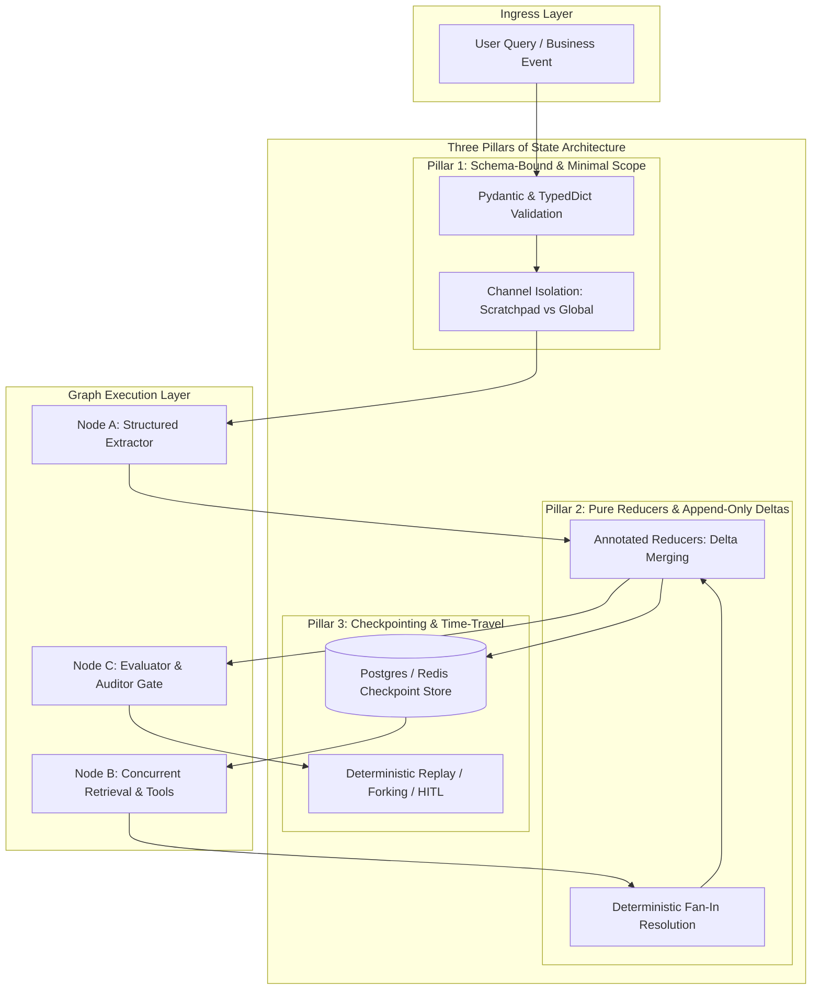
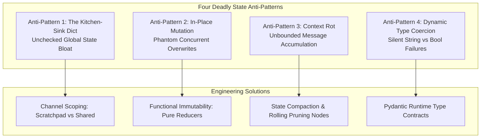

> "Between chaos and order lies a sharp boundary... When a complex feedback loop loses its structural constraints, minute perturbations do not remain localized; they cascade into unbounded entropy." — John Gribbin, *Deep Simplicity*

# State in an Agent Graph: Why Global Dictionaries Kill Production Agents

*From loose dictionaries to typed contracts, pure reducers, and durable checkpoints — architectural patterns for deterministic, resilient multi-agent graphs*

On July 20, 1969, Apollo 11’s Lunar Module *Eagle* was barely three minutes from the surface of the Moon. Neil Armstrong and Buzz Aldrin were hurtling downward through the thin lunar vacuum, thrusters firing to bleed off thousands of feet per minute of orbital velocity.

Just as Armstrong began scanning the crater-pocked terrain for a viable touchdown zone, a harsh yellow master caution light flashed on the Apollo Guidance Computer (AGC) display panel:

**Program Alarm 1202.**

Moments later, a second alarm pierced the tense cockpit: **Program Alarm 1201.**

Inside Mission Control in Houston, the flight loop fell dead silent. In the final, irrecoverable phase of lunar descent, neither astronaut recognized the codes. Down on Earth, guidance officers had only seconds to determine whether to abort the mission.

What had actually happened? A rendezvous radar switch had been bumped into the wrong position, flooding the primitive 2.048 MHz computer with thousands of spurious electrical interrupts per second, stealing 15% of its CPU capacity and threatening to swamp its tiny 4KB of RAM with noise.

If the AGC had been architected the way most AI agent graphs are written today—treating memory as an unbounded, mutable global dictionary where every incoming signal, sensor reading, and temporary event is dumped into a single shared heap—the computer would have crashed with an out-of-memory exception in under three seconds. The descent engine would have cut off in freefall.

Yet Apollo 11 did not crash. The descent engine fired steadily; attitude thrusters calibrated orientation every few milliseconds; and the *Eagle* landed on the Sea of Tranquility with 25 seconds of fuel remaining.

Why did a computer with less memory than a modern greeting card survive a catastrophic state flood?

Because MIT lead software architect Margaret Hamilton had engineered an unyielding state discipline: **Asynchronous Executive Scheduling with Strict Priority Isolation**.

In Hamilton’s architecture, state was never a global grab-bag. Tasks were partitioned into rigid priority tiers. Control of the descent engine and attitude thrusters lived in protected, high-priority state channels, while radar signals were relegated to temporary auxiliary queues. When the state buffers threatened to overflow, the operating system’s restart protector did not try to "accommodate everything." It ruthlessly purged the low-priority radar noise from memory while safeguarding the immutable state required to land the spacecraft.

Fifty-five years later, modern AI engineers command hundreds of gigabytes of VRAM and frontier transformer decoders. Yet, when stringing together multi-agent graphs, we routinely commit an architectural sin far more primitive than the one Hamilton solved in the 1960s:

We treat the Agent Graph's state as an omnivorous, mutable global bucket. We dump 40 pages of unchunked PDF tables, ephemeral scratchpad flags, unvalidated LLM output strings, and raw message arrays into a single untyped dictionary.

The moment concurrent fan-out branches or cyclic reflection loops execute, this unconstrained state bloats, races, and mutates invisibly—eventually triggering token exhaustion, context rot, and catastrophic infinite loops.

**Above stochastic probabilistic decoders, what separates a brittle demo from a resilient production system is never how much data you can pack into memory. It is how ruthlessly your state machine types, isolates, and constrains what flows across its edges.**

---

## What You Will Take Away

1. **State Is Not a Memory Bag; It Is the API Between Stochastic Nodes**: The LLM's internal token generation is stochastic; therefore, the state graph connecting nodes must be deterministic, strictly typed, and bound by compile-time and runtime contracts.
2. **In-Place Mutation Is the Original Sin of Agent Graphs**: In parallel fan-out/fan-in and cyclical graphs, mutating shared references guarantees race conditions and state corruption. Production architectures mandate pure reducers operating on append-only state deltas.
3. **From Black-Box Runs to Time-Travel Debugging**: Decoupling ephemeral node scratchpads from durable global state—and checkpointing state transitions at every tick—enables deterministic incident replay, rollback, and safe Human-in-the-Loop (HITL) intervention.

---

## 1. First Principles: What Does "State" Mean in an Agent Graph?

In classical automata and compiler design, a deterministic finite-state machine follows an unyielding transition formula:

$$\text{State}_{t+1} = \delta(\text{State}_t, \text{Input}_t)$$

where $\delta$ is a pure, predictable transition function. In an LLM-powered agent graph, however, the execution taking place inside any node is governed by a **probabilistic distribution**:

$$\text{Decision}_t \sim P_{\theta}(\cdot \mid \text{Prompt}(\text{State}_t))$$

If the input state $\text{State}_t$ is loose, unstructured, or silently corrupted by upstream side-effects, the non-determinism of the system compounds exponentially across every hop in the graph.

### 1.1 State Is the Minimal Sufficient Statistic

In production systems engineering, state is not an arbitrary dump of conversational history and tool payloads. From first principles:

> **State in an agent graph is the minimal sufficient statistic required to determine the next transition in the topology.**

This definition enforces two complementary constraints:
- **Sufficiency**: The state must carry every piece of validated evidence required by downstream nodes to execute their decision without guessing.
- **Minimality**: Any transient artifact, unparsed HTTP response, or node-local scratchpad variable must be strictly forbidden from polluting global memory.

| Architectural Dimension | Naive Global Dict ("The Grab-Bag") | Deterministic State Machine | Production Engineering Impact |
| :--- | :--- | :--- | :--- |
| **Data Container** | Loose Python `dict` | Strict `TypedDict` / Pydantic models | Catches missing fields and type mismatches at graph compile/invocation time. |
| **Mutation Pattern** | In-place overwrite (`state["k"] = v`) | Pure Reducers: returns delta increments | Eliminates parallel fan-out race conditions; makes state history auditable. |
| **Context Scope** | Monolithic: all nodes see everything | Channel Scoping: local scratchpad vs. shared state | Prevents context pollution and token exhaustion in downstream LLM calls. |
| **Observability** | Guessing via console stdout & logs | Immutable Checkpoints at every tick | Enables single-click deterministic replay of production failures in local sandboxes. |
| **Resilience** | Total graph crash on transient API failure | Resumes execution from the last persisted tick | Saves 80%+ of upstream token costs during retries; guarantees business SLA. |

### 1.2 Parnas Information Hiding Applied to AI Systems

In 1972, David Parnas articulated the foundation of modular software engineering in his landmark paper, *On the Criteria to Be Used in Decomposing Systems into Modules*:

> *"The connections between modules are the assumptions which the modules make about each other."*

This insight is vital for agent graphs. When Node D implicitly expects that Node B populated a secret temporary string field `_raw_doc_id` inside an untyped dictionary, an invisible temporal coupling is forged. The moment an engineer tweaks the system prompt in Node B three months later, Node D collapses silently.

**Robust state design demands rigorous information hiding. A node must only receive the precise context slice necessary to execute its function, and must emit only verified, typed state deltas.**

---

## 2. The Three Pillars of Production State Design

To engineer an agent graph capable of surviving high-concurrency production workloads, architects must build three defensive boundaries around the state layer.



### 2.1 Pillar 1: Schema-Bound & Minimal Scope (Typed Contracts)

Never allow unvalidated, raw external data into the shared state. Every field in the state schema must declare its concrete type, default initialization, and business boundaries.

```python
from typing import Annotated, List, Optional
from typing_extensions import TypedDict
from pydantic import BaseModel, Field
import operator

class EvidenceItem(BaseModel):
    """Rigidly typed evidence unit verified against source documents"""
    doc_id: str
    fact_text: str
    confidence_score: float = Field(ge=0.0, le=1.0)
    source_uri: str

class AgentState(TypedDict):
    # Immutable user intent
    user_query: str
    
    # Message channel: append-only evolution via operator.add; direct mutation prohibited
    messages: Annotated[List[str], operator.add]
    
    # Verified evidence collection with strict schema enforcement
    evidences: Annotated[List[EvidenceItem], operator.add]
    
    # State machine control flags
    current_phase: str
    retry_count: Annotated[int, operator.add]
    is_terminal: bool
```

**Architect's Litmus Test**: When designing any field in `AgentState`, apply three filters:
1. *Is this field read by at least two distinct nodes?* If only one node uses it, it is a local variable, not state.
2. *Can this field be deterministically computed from existing fields?* If so, derive it on the fly; do not persist redundant state.
3. *If the runtime crashes right now, is this field required to recover execution?* If no, it belongs in an ephemeral scratchpad channel.

### 2.2 Pillar 2: Pure Reducers & Append-Only Deltas

In traditional CRUD applications, state updates frequently rely on mutable commands: `UPDATE table SET status = 'ACTIVE'`. In an asynchronous agent graph with concurrent fan-out branches, however, mutable updates introduce catastrophic race conditions:

```
                  ┌───> [Worker A: Review Policy A] ───> state["status"] = "REJECTED"
[Parallel Router] ─┤
                  └───> [Worker B: Review Policy B] ───> state["status"] = "APPROVED"
```

When both workers execute asynchronously across distributed workers, which status wins? The outcome is dictated entirely by microsecond scheduling jitter (symmetry breaking). Such race conditions rarely manifest during local unit tests, but immediately corrupt live production decisions.

The enterprise solution is **Pure Reducers**.

Nodes are not permitted to mutate global state directly. Instead, nodes operate as pure functions that return a **Delta dictionary**:

```python
# ANTI-PATTERN: Dangerous in-place mutation
def dangerous_worker_node(state: AgentState):
    state["messages"].append("Processing finished")  # Mutates shared reference
    state["retry_count"] += 1                        # Race condition trap
    return state

# PRODUCTION PATTERN: Pure function returning deltas
def safe_worker_node(state: AgentState) -> dict:
    new_evidence = EvidenceItem(
        doc_id="DOC-9821",
        fact_text="Claimant has no prior hospitalizations before effective date.",
        confidence_score=0.99,
        source_uri="s3://insurance-vault/p9821.pdf"
    )
    # Returns only the incremental delta; the graph engine resolves concurrent merges via operator.add
    return {
        "messages": [f"Worker {state['current_phase']} completed successfully."],
        "evidences": [new_evidence],
        "retry_count": 1
    }
```

### 2.3 Pillar 3: Durable Checkpointing & Time-Travel Debugging

The distinction between a brittle prototype and mission-critical enterprise software is resilience: **when network drops, LLM rate limits, or downstream API timeouts strike, can the agent pause, recover, and resume without re-running expensive upstream nodes?**

By writing state diffs to an external Checkpointer (such as PostgreSQL, Redis, or DynamoDB) at every tick, the system unlocks three critical capabilities:

1. **Deterministic Incident Replay**: When a production run behaves unexpectedly, you do not need to guess what happened. Using the run's `thread_id` and `checkpoint_id`, you can spin up a local sandbox, load the exact state snapshot, and step through the failing node with absolute fidelity.
2. **State Forking & Speculative Execution**: Branch out from Checkpoint 3, swap the reasoning engine to a larger model, and compare output trajectories side-by-side without re-executing data ingestion.
3. **Safe Human-in-the-Loop (HITL)**: Before finalizing high-stakes financial transactions or publishing legal text, set `interrupt_before=["final_approval"]`. The workflow pauses gracefully, serializing its state to disk. A human underwriter inspects and approves the state payload, and calls `resume()` to complete the graph.

---

## 3. Production Architecture Pattern: LangGraph State Machine

Below is a battle-tested, minimal state machine architecture implementing typed contracts, conditional routing, pure reducers, and checkpoint persistence:

```python
"""
Enterprise Agent Graph State Management Pattern
Author: Todd Zhang (todzhang.com)
"""
from typing import Annotated, List, Literal, Optional
from typing_extensions import TypedDict
from pydantic import BaseModel, Field
import operator

from langgraph.graph import StateGraph, END
from langgraph.checkpoint.memory import MemorySaver

# 1. Rigid Domain Data Contract
class ClaimAssessment(BaseModel):
    claim_id: str
    approved: bool
    risk_score: float = Field(ge=0.0, le=1.0)
    reasoning: str

# 2. Complete State Machine Schema
class GraphState(TypedDict):
    claim_id: str
    # Audit trail: append-only channel enforced via operator.add
    audit_trail: Annotated[List[str], operator.add]
    assessment: Optional[ClaimAssessment]
    retry_count: Annotated[int, operator.add]
    status: Literal["PENDING", "VALIDATED", "AUDITED", "FAILED"]

# 3. Pure Function Nodes: Zero side-effects on external references
def validation_node(state: GraphState) -> dict:
    """Validates ingress payload and verifies factual prerequisites"""
    print(f"[*] Validating claim: {state['claim_id']}")
    return {
        "audit_trail": [f"Validation passed for claim {state['claim_id']}"],
        "status": "VALIDATED"
    }

def assessment_node(state: GraphState) -> dict:
    """Core evaluation node: generates structured assessment model"""
    print(f"[*] Assessing claim risk for: {state['claim_id']}")
    
    # Calculate business risk profile
    result = ClaimAssessment(
        claim_id=state["claim_id"],
        approved=True,
        risk_score=0.15,
        reasoning="Medical documentation matches verified policy terms."
    )
    return {
        "assessment": result,
        "audit_trail": [f"Assessment complete. Risk score: {result.risk_score}"],
        "status": "AUDITED"
    }

def circuit_breaker_node(state: GraphState) -> dict:
    """Fallback safety gate triggered by risk threshold violations"""
    print(f"[!] Risk threshold exceeded. Tripping circuit breaker.")
    return {
        "audit_trail": ["Circuit breaker tripped: routed to human review."],
        "status": "FAILED"
    }

# 4. Deterministic Conditional Routing Function
def route_audit_decision(state: GraphState) -> Literal["pass", "breaker"]:
    assessment = state.get("assessment")
    if not assessment:
        return "breaker"
    # Strict business gate: risk score above 0.50 immediately diverts to circuit breaker
    if assessment.risk_score > 0.50:
        return "breaker"
    return "pass"

# 5. Graph Topology Orchestration
def build_production_graph():
    workflow = StateGraph(GraphState)

    # Register nodes
    workflow.add_node("validator", validation_node)
    workflow.add_node("assessor", assessment_node)
    workflow.add_node("circuit_breaker", circuit_breaker_node)

    # Wire structural edges
    workflow.set_entry_point("validator")
    workflow.add_edge("validator", "assessor")

    # Wire conditional branching
    workflow.add_conditional_edges(
        "assessor",
        route_audit_decision,
        {
            "pass": END,
            "breaker": "circuit_breaker"
        }
    )
    workflow.add_edge("circuit_breaker", END)

    # Attach durable checkpointer
    checkpointer = MemorySaver()
    app = workflow.compile(checkpointer=checkpointer)
    return app

if __name__ == "__main__":
    graph = build_production_graph()
    
    # Thread context isolation
    config = {"configurable": {"thread_id": "TX-20261024-998"}}
    initial_input: GraphState = {
        "claim_id": "CLM-88319",
        "audit_trail": ["Transaction initialized by API ingress"],
        "assessment": None,
        "retry_count": 0,
        "status": "PENDING"
    }
    
    # Execute state machine
    final_output = graph.invoke(initial_input, config=config)
    print("\n--- [Execution Audit Trail] ---")
    for log in final_output["audit_trail"]:
        print(f"  > {log}")
    print(f"Final System State: {final_output['status']}")
```

---

## 4. Four Critical State Anti-Patterns in Agent Systems

Across dozens of architectural code reviews, four systemic anti-patterns consistently destroy production stability:



### Anti-Pattern 1: The Kitchen-Sink Dict (State Bloat)
- **The Symptom**: Dumping raw user sessions, unparsed 100-page PDFs, complete SQL database dumps, and ephemeral node flags into one monolithic dictionary.
- **The Failure**: State size explodes linearly with graph depth. When the entire dictionary is formatted into prompts for downstream LLM calls, token costs skyrocket and the model succumbs to "Lost in the Middle" attention degradation, ignoring core business rules.
- **The Solution**: Implement **Channel Scoping**. Strictly isolate the *Context Channel* (what the LLM reads) from the *Audit Channel* (what system telemetry persists).

### Anti-Pattern 2: In-Place Mutation & Phantom Overwrites
- **The Symptom**: Calling `.append()` or `del state["data"]` directly on shared dictionaries passed into node arguments.
- **The Failure**: Concurrent branches in parallel fan-outs produce non-deterministic race conditions and memory corruption. If an exception triggers a retry, the memory state is already poisoned, rendering rollbacks impossible.
- **The Solution**: Enforce **Functional State Updates**. Nodes must return delta dictionaries merged via pure reducers (`operator.add`).

### Anti-Pattern 3: Unbounded Context Rot
- **The Symptom**: In cyclical graphs (such as Self-Refine or Critic-Actor loops), every iteration unconditionally appends messages to an unpruned `messages` list.
- **The Failure**: After 4-5 iterations, the prompt exceeds context limits. More dangerously, failed reasoning from earlier attempts remains in the prompt, actively biasing the model to repeat its mistakes.
- **The Solution**: Introduce a **State Compaction Node**. Before looping back to a previous stage, a dedicated summarizer condenses the last three iterations into a structured summary and resets the working memory channel.

### Anti-Pattern 4: Dynamic Type Coercion Surprises
- **The Symptom**: Relying on Python's dynamic typing without explicit schemas. An upstream node produces an `int`, an intermediate prompt serializer converts it to `"1"`, and a downstream evaluator treats it as a boolean.
- **The Failure**: Silent logical inversion (e.g., `"False"` evaluates to `True` in boolean conditionals).
- **The Solution**: Enforce Pydantic schema validation at every graph boundary. Any schema violation aborts immediately, preventing corrupted payloads from traversing deeper into the graph.

---

## 5. Summary: The Staff Engineer's State Design Checklist

Before releasing any agent graph to production, audit your state architecture against this checklist:

- [ ] **Strict Schema Declaration**: Is your `State` fully specified using `TypedDict` or `Pydantic`, with every field annotated with explicit types and defaults?
- [ ] **Zero In-Place Mutation**: Are all evolving collections (messages, extracted facts, tool receipts) mapped to immutable reducers (e.g., `Annotated[..., operator.add]`)?
- [ ] **Minimal Sufficient Scope**: Have you removed every field from global state that is only consumed by a single node?
- [ ] **Concurrency Isolation**: Do all parallel fan-out nodes return independent deltas with zero shared memory contention?
- [ ] **Durable Checkpointing**: Is a persistent Checkpointer (Postgres/Redis) configured to enable deterministic incident replay by `thread_id`?
- [ ] **Active Context Compaction**: In graphs with loops, is there a designated compaction node preventing token bloat and context rot?

### Tomorrow Morning Action Items

1. **Audit Your `state.py`**: Search your codebase for state fields that are not read by at least two distinct downstream nodes. Downgrade them to local variables inside their respective functions.
2. **Eradicate `state.append()`**: Replace every in-place collection update with an immutable delta return paired with an explicit reducer.
3. **Hard-Code Guardrails on Conditional Edges**: In every routing function, add explicit assertions against `None` and out-of-bounds numerical values before dispatching execution to downstream nodes.

---

> **Aphorism**: Above stochastic, probabilistic language decoders, only a deterministic, constrained state machine can sustain production-grade reliability.
