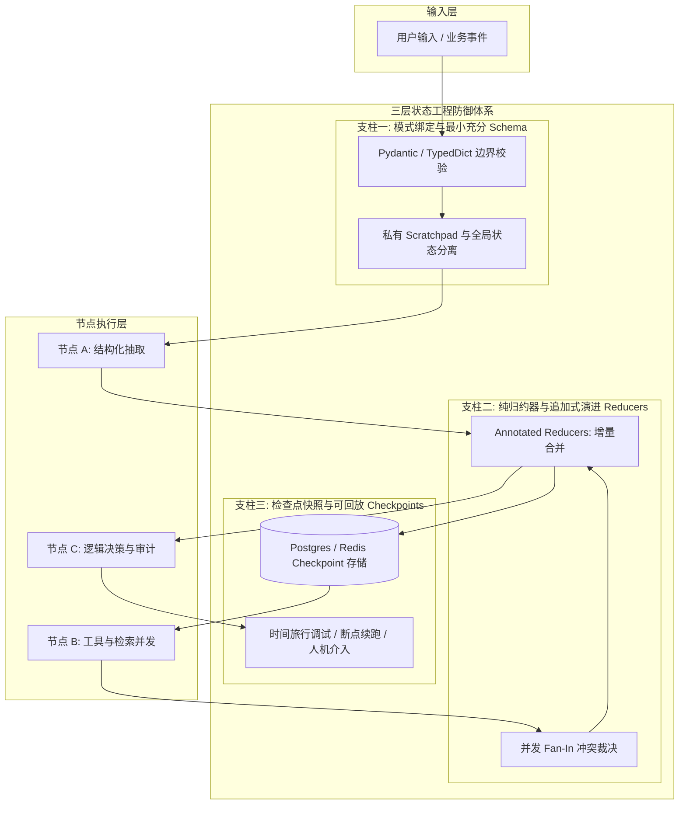
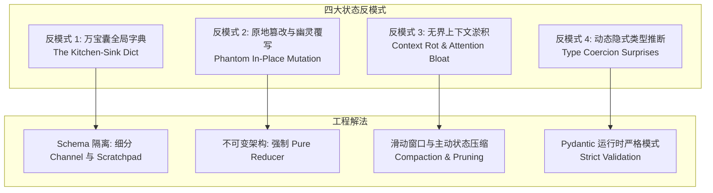

> “混乱与规律之间存在着一道精密的边界。线性系统的简单叠加永远无法解释涌现；而一旦系统失去边界约束，微小的扰动便会演变成无法预测的混沌。” —— 约翰·格里宾《深奥的简洁》

# Agent Graph 的状态管理陷阱：从全局杂物袋到确定性状态机

*从随意的全局字典到类型化契约、纯归约器与检查点——如何构建高可靠性的企业级多智能体图谱*

1969 年 7 月 20 日，阿波罗 11 号登月舱“鹰号”距离月球表面只有三分钟，数千公里的时速正在减至最终的着陆速度。舷窗外是布满环形山的粗砺月表，主下降级发动机持续喷吐着烈焰。

就在阿姆斯特朗全神贯注地寻找平整着陆点时，机载制导计算机（Apollo Guidance Computer, AGC）的操作面板上，一盏代表硬件超载的黄色警示灯毫无预警地刺眼亮起：

**1202 警报。**

几秒钟后，蜂鸣声再次划破死寂：**1201 警报。**

休斯敦地面控制中心瞬间屏住了呼吸。在生死仅在一线的登月最后时刻，这两个从未在正式飞行模拟中触发的错误代码，意味着系统正在滑向不可控的深渊。

发生了什么？在飞船下降过程中，交会对接雷达的硬件开关被打到了错误的挡位，导致每秒数千次无意义的雷达电气中断信号像洪水一样涌入这台只有 72KB 只读内存（ROM）和 4KB 可读写内存（RAM）的原始计算机中。

如果这台计算机像今天许多工程师写 AI Agent 一样，把所有传感器读数、外部事件、临时状态一股脑塞进同一个共享的全局内存袋中，它的内存会在两秒钟内被彻底打爆，操作系统将直接宕机崩溃，阿波罗 11 号将在月球表面粉身碎骨。

但奇迹发生了。阿波罗 11 号没有坠毁。机载计算机的主推进器依然以毫秒级的精度平稳点火，两名宇航员最终平稳降落在了“静海”基地。

为什么这台算力不及今天一把电子车钥匙的计算机，能从狂暴的状态洪水中幸存下来？

因为负责阿波罗机载软件设计的玛格丽特·汉密尔顿（Margaret Hamilton）和她的团队，在代码底层写死了一套冷酷而严密的状态哲学：**“异步优先级执行与状态硬隔离”（Asynchronous Executive & State Priority）。**

在汉密尔顿的设计中，计算机的状态绝不是一个任由所有模块随意写入的杂物袋。她将任务严格分级：控制下降姿态和油门的计算属于核心状态通道，而雷达信号则属于临时辅助通道。当状态缓冲区逼近临界点时，状态机没有试图去“包容万物”，而是毫不犹豫地丢弃了所有低优先级的雷达垃圾数据，将宝贵的运算周期和内存完全锁死在维持姿态的核心状态上。

五十五年过去了。

今天的工程师坐拥数百 GB 显存与每秒吞吐数十万 Token 的前沿大语言模型，但在构建由多个节点串联的复杂智能体图谱（Agent Graph）时，却往往犯下了比半个世纪前更为原始的架构错误：

我们把 Agent Graph 的状态（State）当成了一个无底洞般的“全局内存袋”——只要想存什么，就往字典里放什么。检索到的 40 页未切片扫描 PDF、中间节点的临时 Flag、格式未校验的模型输出、甚至是不断累积的原始系统消息，全部挤在同一个共享对象里。

一旦系统稍微遇到复杂的多轮反思回路或高并发分支，这个未经类型约束与隔离的状态就会迅速膨胀、产生竞态覆写，直至把整套业务流拖入上下文撑爆与死循环的深渊。

**在不可预测的概率模型之上，决定一个多智能体系统生死的，从来不是它能塞下多少信息，而是它的状态机能有多冷酷地隔离、约束与清洗边界。**

---

## 核心认知透镜（Reader Takeaway）

1. **状态不是内存袋，状态是随机节点之间的确定性 API**：大语言模型本身的输出是随机的、概率性的，但边（Edge）上传递的状态必须是确定性的、具备编译期/运行时强类型断言的刚性契约。
2. **原地修改（In-Place Mutation）是图并发的原罪**：在多分支并行与回溯场景下，共享变量的原地篡改必然引发幽灵覆盖与状态污染；生产级状态必须基于纯归约器（Pure Reducers）实现追加式增量演进（Append-Only Deltas）。
3. **从黑盒执行到时间旅行（Time-Travel Debugging）**：通过解耦“瞬态工作区（Scratchpad）”与“全局持有状态（Global State）”，配合持久化检查点（Checkpoints），实现可重现性审计、故障回放与高安全的人机协同（Human-in-the-Loop）。

---

## 1. 第一性原理：Agent Graph 中的“状态”究竟是什么？

在经典编译原理与自动机理论中，状态机（Finite State Machine）的核心定义可以用一个简洁的公式概括：

$$\text{State}_{t+1} = \delta(\text{State}_t, \text{Input}_t)$$

其中 $\delta$ 是确定性的状态转移函数。但在由 LLM 驱动的 Agent Graph（智能体图）中，节点（Node）内部执行的本质上是一个**随机概率函数**：

$$\text{Decision}_t \sim P_{\theta}(\cdot \mid \text{Prompt}(\text{State}_t))$$

如果转移函数的输入 $\text{State}_t$ 本身是松散、不可预测、隐式耦合的，那么概率输出叠加模糊输入，整个图系统的非确定性将呈指数级爆炸。

### 1.1 状态是节点间的刚性契约

在工业级系统设计中，状态绝非仅仅是“对话历史”或“工具返回值的容器”。从第一性原理来看：

> **State 在 Agent Graph 中是驱动下一步转移的“最小充分统计量”（Minimal Sufficient Statistic）。**

这意味着：
- **完整性（Sufficiency）**：下游节点做出正确决策所必需的所有证据，状态必须能够提供。
- **最小化（Minimality）**：任何只在单一节点内部使用的临时中间变量、冗余格式、未经提炼的原始 Payload，绝不允许污染全局状态。

| 维度 | 初级工程师的“全局杂物袋” | 资深工程师的“确定性状态机” | 架构代偿与代价 |
| :--- | :--- | :--- | :--- |
| **数据载体** | 无约束的 Python `dict` | 严格声明的 `TypedDict` / Pydantic 模型 | 提前在编译期与进入节点前截获类型错误与字段缺失 |
| **变更范式** | 原地修改：`state["k"] = v` | 显式纯归约器（Pure Reducer）：追加增量 | 根治并行分支竞态，天然支持撤销与回溯 |
| **字段范围** | 全局共享：所有节点可见所有字段 | 作用域隔离：节点私有 Scratchpad vs 全局 State | 降低上下文开销，防止无关信息导致注意力稀释 |
| **故障排查** | 依赖控制台 Print 与事后日志猜测 | 确定性检查点（Checkpoint）与版本快照 | 能够拉取特定 Tick 的状态快照一键重现 Bug |
| **恢复能力** | 单点故障整图报废，必须重新冷启动 | 基于 State 快照从失败节点局部恢复续跑 | 节约 80%+ 的重试 Token 成本，保障核心 SLA |

### 1.2 帕纳斯信息隐藏原则（Parnas Information Hiding）

1972 年，计算机科学家 David Parnas 在其传世论文《On the Criteria to Be Used in Decomposing Systems into Modules》中指出了软件架构的本质命题：

> *“模块之间的连接，是模块彼此对对方所做出的假设。”*

在 Agent Graph 中，这一原则具有致命的现实意义。如果你的 `Router` 节点依赖于 `Extractor` 节点内部未声明的一个临时字符串字段 `_temp_doc_id`，你就已经在两个节点之间建立了隐式时间耦合。一旦下周换了一个新的提取提示词，或者更换了抽取模型的版本，Router 节点便会毫无预警地轰然倒塌。

**好的状态设计，必须强制推行信息隐藏。节点应当只读取它完成本职工作所必需的上下文切片，且只产出结构受控的状态增量。**

---

## 2. 生产级 Agent 状态设计的三大支柱

构建能够支撑关键业务场景的 Agent Graph，必须在状态层筑起三道防线。



### 2.1 支柱一：模式绑定与最小完备（Typed & Minimal）

不要把未经清洗的异构数据直接推入 Graph State。每一个状态字段都必须有明确的数据类型、默认值以及业务语义约束。

```python
from typing import Annotated, List, Optional
from typing_extensions import TypedDict
from pydantic import BaseModel, Field
import operator

class EvidenceItem(BaseModel):
    """具有刚性契约的事实验证单元"""
    doc_id: str
    fact_text: str
    confidence_score: float = Field(ge=0.0, le=1.0)
    source_uri: str

class AgentState(TypedDict):
    # 核心目标：只读的用户原始输入
    user_query: str
    
    # 消息通道：使用 operator.add 归约器，天然支持追加演进，禁止原地修改
    messages: Annotated[List[str], operator.add]
    
    # 结构化证据链：严谨类型校验，拒绝松散字典
    evidences: Annotated[List[EvidenceItem], operator.add]
    
    # 决策阶段：状态机控制标志位
    current_phase: str
    retry_count: Annotated[int, operator.add]
    is_terminal: bool
```

**资深工程师准则**：在设计 `AgentState` 时，对每一个字段都要进行“灵魂三问”：
1. 真的有两个以上的节点需要读取这个字段吗？如果只有一个节点用，它必须是节点的局部变量（Local Variable），绝不能升格为全局状态。
2. 这个字段能够从其他已有字段动态推导出来吗？如果能，不要持久化存储它。
3. 如果当前请求发生崩溃，恢复执行时是否必须依赖这个字段？如果否，它应当置于非持久化的临时通道。

### 2.2 支柱二：纯归约器与追加式演进（Pure Reducers & Append-Only）

在传统的 Web 开发中，修改数据库记录通常使用 `UPDATE table SET column = value`。但在复杂的智能体图谱中，特别是存在并发分支（Fan-Out）的拓扑结构下，原地修改是致命的：

```
          ┌───> [Node 1: 险种 A 审查] ───> 修改 state["status"] = "REJECTED"
[分发节点] ─┤
          └───> [Node 2: 险种 B 审查] ───> 修改 state["status"] = "APPROVED"
```

当两个分支在不同线程或异步任务中并行运行时，究竟哪一个赋值会生效？这完全取决于底层事件循环的微小调度偏差（Symmetry Breaking）。这种由于并发状态竞争导致的偶发性 Bug，在线下难以复现，在线上则会直接导致理赔结论随机翻转。

解决并发状态竞争的工业级方案是**使用纯归约器（Pure Reducer）进行增量合并**。

每个节点不允许覆写全局状态，而是必须作为纯函数，返回它对状态的“变更差量（Delta）”：

```python
# 错误示范：原地污染
def dangerous_worker_node(state: AgentState):
    state["messages"].append("Processing complete")  # 破坏全局状态引用
    state["retry_count"] += 1                        # 并发竞态地狱
    return state

# 正确示范：纯函数返回增量 Delta
def safe_worker_node(state: AgentState) -> dict:
    new_evidence = EvidenceItem(
        doc_id="DOC-9821",
        fact_text="投保人在生效日前无就医理赔记录",
        confidence_score=0.99,
        source_uri="s3://insurance-vault/p9821.pdf"
    )
    # 只返回差量，由图引擎依据 operator.add 自动做无冲突合并
    return {
        "messages": [f"Worker {state['current_phase']} completed successfully."],
        "evidences": [new_evidence],
        "retry_count": 1
    }
```

### 2.3 支柱三：持久化检查点与时间旅行（Checkpoints & Time-Travel）

工业级 Agent 和玩具 Demo 的根本区别在于：**当系统发生网络震荡、依赖 API 速率限制（Rate Limit）或业务异常时，它能否原地自愈并安全恢复现场。**

通过将每一次图步进（Tick）的状态变更提交给 Checkpointer（如 Postgres、Redis、DynamoDB），系统获得了前所未有的工程能力：

1. **确定性重放（Replayability）**：当生产环境出现异常输出时，不需要靠运气去猜测大模型说了什么。根据该次调用的 `thread_id` 和 `checkpoint_id`，可以在沙箱中以完全一致的输入状态重新激活下游节点，精确定位根因。
2. **状态分叉与反事实推演（Forking & Speculation）**：可以从第 4 步的状态快照拉出一个分支，换用更强的大模型或另一套提示词继续运算，对比两者的决策差异。
3. **安全人机接入（Human-in-the-Loop）**：在核心资金交易或法律文书签发前，利用 `interrupt_before=["approval_node"]` 将图执行挂起。业务专家在前端审核、修改甚至纠正 `state` 中的条目后，调用 `resume()` 无缝唤醒智能体继续流转。

---

## 3. 生产级架构代码实战：LangGraph 确定性状态机

以下是一个经过高并发生产验证的最小化企业级状态机范式，演示了类型化契约、条件转移、归约器与故障回溯机制的结合：

```python
"""
Enterprise Agent Graph State Management Pattern
Author: Todd Zhang (todzhang.com)
"""
from typing import Annotated, List, Literal
from typing_extensions import TypedDict
from pydantic import BaseModel, Field
import operator

from langgraph.graph import StateGraph, END
from langgraph.checkpoint.memory import MemorySaver

# 1. 严格业务对象模型定义
class ClaimAssessment(BaseModel):
    claim_id: str
    approved: bool
    risk_score: float = Field(ge=0.0, le=1.0)
    reasoning: str

# 2. 状态机总图 Schema
class GraphState(TypedDict):
    claim_id: str
    # 消息与审计链：强约束只允许追加
    audit_trail: Annotated[List[str], operator.add]
    assessment: Optional[ClaimAssessment]
    retry_count: Annotated[int, operator.add]
    status: Literal["PENDING", "VALIDATED", "AUDITED", "FAILED"]

# 3. 纯函数节点：杜绝任何外部状态篡改
def validation_node(state: GraphState) -> dict:
    """验证输入并进行初步事实核验"""
    print(f"[*] Validating claim: {state['claim_id']}")
    return {
        "audit_trail": [f"Validation completed at step tick with claim {state['claim_id']}"],
        "status": "VALIDATED"
    }

def assessment_node(state: GraphState) -> dict:
    """理赔核算节点：生成评估决策模型"""
    print(f"[*] Assessing claim risk for: {state['claim_id']}")
    
    # 模拟业务风险打分计算
    result = ClaimAssessment(
        claim_id=state["claim_id"],
        approved=True,
        risk_score=0.15,
        reasoning="All supporting medical invoices match the certified policy guidelines."
    )
    return {
        "assessment": result,
        "audit_trail": [f"Assessment complete. Risk Score: {result.risk_score}"],
        "status": "AUDITED"
    }

def circuit_breaker_node(state: GraphState) -> dict:
    """容错与回退安全节点"""
    print(f"[!] Risk exceeded or evaluation anomaly. Tripping circuit breaker.")
    return {
        "audit_trail": ["Circuit breaker tripped: routing to Senior Adjuster."],
        "status": "FAILED"
    }

# 4. 确定性条件路由（Conditional Edge）
def route_audit_decision(state: GraphState) -> Literal["pass", "breaker"]:
    assessment = state.get("assessment")
    if not assessment:
        return "breaker"
    # 业务硬性门禁：风控评分超过阈值直接熔断进入人工降级
    if assessment.risk_score > 0.50:
        return "breaker"
    return "pass"

# 5. 图拓扑编排
def build_production_graph():
    workflow = StateGraph(GraphState)

    # 注册节点
    workflow.add_node("validator", validation_node)
    workflow.add_node("assessor", assessment_node)
    workflow.add_node("circuit_breaker", circuit_breaker_node)

    # 声明边连接
    workflow.set_entry_point("validator")
    workflow.add_edge("validator", "assessor")

    # 条件路由分发
    workflow.add_conditional_edges(
        "assessor",
        route_audit_decision,
        {
            "pass": END,
            "breaker": "circuit_breaker"
        }
    )
    workflow.add_edge("circuit_breaker", END)

    # 挂载持久化检查点存储
    checkpointer = MemorySaver()
    app = workflow.compile(checkpointer=checkpointer)
    return app

if __name__ == "__main__":
    graph = build_production_graph()
    
    # 线程上下文隔离
    config = {"configurable": {"thread_id": "TX-20261024-998"}}
    initial_input: GraphState = {
        "claim_id": "CLM-88319",
        "audit_trail": ["Transaction initialized by inbound API"],
        "assessment": None,
        "retry_count": 0,
        "status": "PENDING"
    }
    
    # 执行状态机
    final_output = graph.invoke(initial_input, config=config)
    print("\n--- [Execution Audit Trail] ---")
    for log in final_output["audit_trail"]:
        print(f"  > {log}")
    print(f"Final System State: {final_output['status']}")
```

---

## 4. 资深工程师必避的四大状态反模式（Anti-Patterns）

在代码审查与实际架构落地中，以下 4 个反模式夺走了绝大多数团队的系统稳定性：



### 反模式 1：万宝囊全局字典（The Kitchen-Sink Dict）
- **现象**：把用户会话、原始 HTTP 请求体、未切片的 PDF、SQL 完整响应与各节点的临时 Flag 全部丢在一个 Dict 中。
- **代价**：状态体积随图跳数线性暴涨。当把整个 State 格式化作为 Prompt 输入后续模型时，不仅消耗数十倍无谓的 Token 资费，还会触发“迷失在中间（Lost in the Middle）”效应，导致大模型抓不住真正核心的业务字段。
- **解法**：建立“数据通道隔离”（Channel Scoping）。给下游模型看的提示词状态（Context State）与底层的系统追踪状态（Audit State）物理分离。

### 反模式 2：原地篡改与幽灵覆写（In-Place Mutation）
- **现象**：直接对全局传过来的 `state["items"]` 执行 `.append()` 或 `state["data"].pop()`。
- **代价**：并发分支（Parallel Branching）时由于共享同一块内存地址产生脏读脏写；一旦发生异常需要回滚，内存已被污染，完全丧失重试能力。
- **解法**：遵循函数式编程范式（Functional State Mutation），状态更新一律返回新的对象切片或利用 Reducer 追加 Delta。

### 反模式 3：无界上下文淤积（Unbounded Context Rot）
- **现象**：在循环图（Looped Graph / Reflective Agent）中，每一轮对话和思考过程被无限追加在 `messages` 列表中。
- **代价**：超过 5 轮反思后，上下文触碰模型窗口极限；更严重的是，过往失败轮次中的错误逻辑作为历史输入，反过来强化了大模型继续产生幻觉的偏见。
- **解法**：引入“状态修剪与压缩算子（State Compaction Node）”。在每次进入反思回路前，由专门的整理节点将过往 3 轮交互精简为结构化摘要，重置消息队列。

### 反模式 4：动态隐式类型推断（Type Coercion Surprises）
- **现象**：随意依赖 Python 的动态类型，上游节点产出的是 `int`，被下游某个提示词格式化后转成了 `string`，再被第三个节点当成布尔值去判断。
- **代价**：Python 的动态弱约束在确定性逻辑判断中带来毁灭性灾难（如 `"False"` 在布尔上下文中被评估为 `True`）。
- **解法**：在图边缘与节点出口处严格集成 Pydantic 模型校验，类型断言不通过直接阻断执行，防止脏数据渗入状态机深处。

---

## 5. 总结：资深工程师的状态设计检查清单

在构建或重构你的 Agent Graph 时，对照以下检查清单审视你的状态层：

- [ ] **严格类型定义**：你的 `State` 是否使用 `TypedDict` 或 `Pydantic` 做了完整的字段类型与默认值标注？
- [ ] **拒绝原地修改**：所有需要演进的集合字段（如消息列表、证据列表）是否都绑定了不可变的追加归约器（如 `Annotated[..., operator.add]`）？
- [ ] **最小充分可见性**：是否存在某个状态字段，仅仅被单一节点使用却被定义在了全局状态中？
- [ ] **并发安全隔离**：在所有存在 Fan-Out 并行执行的节点之间，它们是否只返回各自独立的 Delta 变更，而没有任何竞态写入？
- [ ] **检查点持久化**：系统是否配置了持久化存储器（如 PostgresSaver），确保任意一个失败的 Session 都能通过 `thread_id` 重现现场？
- [ ] **状态修剪策略**：在带有循环回溯的图中，是否有机制定期剔除陈旧的临时上下文，避免 Token 爆炸与注意力分散？

### 立刻可以做的事（Tomorrow Morning Action Items）

1. **审计你的 Agent 状态模型**：打开你当前代码库中的 `state.py`，搜索所有没有被至少两个不同节点同时读取的字段，立即将它们降格为局部变量。
2. **消灭所有的 `state.append()`**：全局搜索代码，将所有的原地集合操作改为纯函数返回 Delta 增量，并为字段声明显式 Reducer。
3. **为核心路由配置防御性熔断**：在每一个条件转移（Conditional Edge）函数前，对依赖的状态字段增加显式 None 检查与范围断言，严禁将未初始化的隐式 None 作为路由依据。

---

> **一句话哲学**：在充满随机性与不确定性的大语言模型之上，唯有确定性、受约束的状态机，才能构筑起工业级可靠的企业应用底座。
