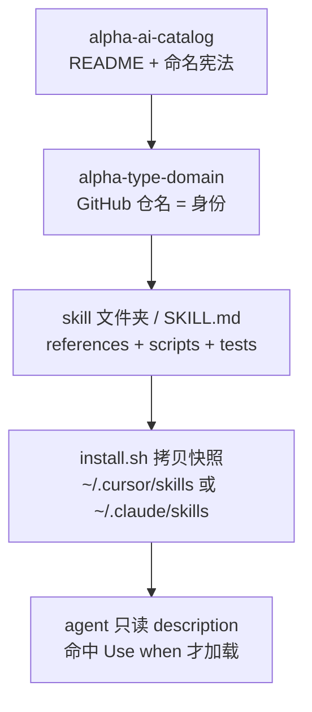

> “名定而实辨，道行而志通。” — 荀子《正名》

*从「这是工具清单」到「这是命名宪法」—— skill 会不会被加载，在仓名定下来的那一刻就开始了.*

一个失明的老人坐在一栋大厦的台阶边乞讨，旁边的纸板写着：「我是个盲人，请帮帮我。」路过的人很少回应。一个女孩子回身把纸板翻过来，写下一行字，然后离开。人们停下了，硬币落进老人跟前。长日将尽，老人摸到熟悉的鞋子，问她写了什么。女孩答：「同样的话，只是用了不同的语言。」她写的是：「这真是美好的一天，而我却看不见。」（摘自《故事课》）

同一个人，同一块纸板，同一个事实——变的只是上面那句话，而这就是「没人回应」和「人人掏钱」的全部差别。

在软件工程的语境下，这句话揭示了一个极其深刻的真相：**系统的行为往往不是由事实本身决定的，而是由你如何“描述”这些事实来构建的认知模型决定的。**

这种现象在复杂的软件工程，尤其是 AI Agent 的基础设施建设中，正以一种更隐蔽、更致命的方式上演。当我们构建 AI 工具目录（Catalog）时，如果我们仅仅把它当成一个“工具清单”，我们实际上是在用一种“没人回应”的语言在描述系统。而当我们把“命名”视为“宪法”时，我们实际上是在为机器和人类构建一套确定性的路由协议。

当我把团队的 AI 目录仓 clone 下来时，我的心理预期是看到一个功能完备的“工具仓库”：里面应该堆满了各种生成器、索引脚本、甚至是一份结构清晰的 `metadata.yaml` 或者 `catalog-info.yaml`（为了让 Backstage 之类的平台能自动抓取）。但我看到的景象却让我陷入了短暂的认知失调。

运行 `git ls-files`，输出结果极其简练，甚至有些荒诞：

```text
README.md
```

没有 Python 脚本，没有 CI 配置，甚至没有复杂的目录结构。Header 徽章上赫然写着：10 个仓、6 个 skills、3 个 MCP、1 个 agents、standard v1.0。然而，这个仓本身并不计入这 10。它不是一个“内容生产地”，它是一个“语义过滤网”。

**普通人的看法是：这是一个还没写完的索引页，或者是一个极其简陋的仓库。**

**资深工程师的洞察则是：最重要的 AI 仓可以完全没有代码，因为它承担着防止另外十个仓库变成“杂物抽屉”的重任。**

如果我们将目录仓库仅仅当成一份“工具清单”去阅读，我们实际上是在邀请自己进入一个高熵的系统。当你面对数百个甚至上千个碎片化的 AI 能力（Skills）时，人类的认知带宽（Cognitive Bandwidth）会迅速崩溃。如果所有的仓库都以“功能描述”为核心命名，那么每一次搜索都是在做全量的线性扫描。

而当一个仓库将“命名”视为“宪法”时，它是在做**预计算的语义过滤**。

仓库名不再是简单的标签，而是第一道硬性的“门禁”。它决定了用户（无论是人类开发者还是 Agent）在进入文件夹之前，是否应该继续消耗注意力。如果命名模糊，它就变成了一个“杂物抽屉”；如果命名精确，它就是一道高效的导航路标。真正的运行时逻辑并不在这些复杂的元数据里，而是在下一层：是在 skill 合同里的 `Use when` 约束中，以及在 CI 流水线中那份默默运行的 `check_skill.sh` 校验脚本里。

**如果你继续把目录仓库当成清单去读，你很可能会开错下一个仓，或者在运行时加载一个完全不匹配的 skill。**

通过本文，你将带走三usize核心的工程思维：

- **命名即身份，属性走 Metadata**：仓库名仅负责表达“身份”（Identity），而具体的“属性”（Properties）必须交给 topic 和 metadata 字段。不要试图把复杂的逻辑塞进一个名字里。
- **三份契约的错位对齐**：你要深刻理解“仓名”、“skill 安装名”以及“agent 触发词”这三份契约。它们看起来长得很像，但在系统架构中，它们炸开的维度完全不同：一个是人类的导航，一个是系统的依赖，一个是模型的意图。
- **语义预检机制**：在 Agent 真正打开 `SKILL.md` 深入了解细节之前，它（以及你）第一眼看到的只是 description 里有没有符合预期的 `Use when`。

下面我将按照这些概念对现有架构的有效程度进行深度剖析，不按我发现的顺序，只按它们对系统鲁棒性的贡献程度排序。


## 1. 四层，不要压成一层

在构建 AI 技能目录（Skill Catalog）时，很多团队最容易犯的错误就是试图将所有维度的信息“压”到一个文件中。这种做法初衷往往是追求简洁，但实际上它会导致严重的**语义冲突**：人类需要的检索信息、Git 需要的标识符、以及 Agent 需要的触发逻辑，全都挤在同一个字符串里，最终导致系统变得极其脆弱且难以维护。

为了避免这种“数字垃圾场”，我们需要将信息拆分为四个明确的物理层级。每一层都有其特定的“职责边界”：



### 四层架构的深度解析

1.  **目录层（The Governance Layer）**：以 `alpha-ai-catalog` 为核心。这里存放的是“命名宪法”和全局的 README。它的职责是回答**「这个系统里可以存在什么」**。它是面向人类（尤其是新加入的同事和评审人员）的，定义了全局的命名规范、分类逻辑和入库标准。如果这一层混乱，整个项目的标准就会迅速漂移。
2.  **仓名层（The Identity Layer）**：以 `alpha-type-domain` 为核心。这里强调的是**「这个东西在物理上在哪里」**。GitHub 仓名是系统的唯一身份标识，它决定了 `clone` 地址、CI/CD 流水线的触发逻辑、以及 Bookmark 的唯一性。这是面向机器和工程基础设施的层级。
3.  **Skill 内部层（The Content Layer）**：位于 `skill` 文件夹内。这里包含具体的 `SKILL.md`、脚本、测试用例和技术参考。这是技能的“实体内容”，包含了复杂的工程细节。它主要面向开发过程中的查阅，而不是给 Agent 直接读取的。
4.  **安装与运行时层（The Runtime Layer）**：通过 `install.sh` 将快照分发到本地环境（如 `~/.cursor/skills` 和/或 `~/.claude/skills`）。这一层的核心逻辑是**「如何让 Agent 感知它」**。这里包含了极简的描述信息和 `Use when` 触发词。这是为了解决 LLM 的上下文窗口（Context Window）限制：Agent 初始只读这些描述，只有在命中特定的触发词时，才会去加载更重的技能内容。

| 层级 | 核心实例 | 核心受众 | 故障影响（后果） |
| :--- | :--- | :--- | :--- |
| **目录层** | `alpha-ai-catalog` | 人、评审、新同事 | 找不到仓库，标准快速漂移，项目变成乱炖 |
| **仓名层** | `alpha-skills-airflow` | clone URL、GitHub topic | 所有 clone / CI / bookmark 路径断裂 |
| **Skill 名** | `alpha-skills-airflow-develop` | 安装目录、`name:`、manifest | 本机已装副本继续用旧名触发，导致版本冲突 |
| **触发词** | `Use when creating a new DAG` | Agent 路由逻辑 | 该加载的不加载，不该加载的全读进上下文，导致模型“幻觉”或上下文溢出 |

### 核心原理：信息单向性（Information Unidirectionality）

理解这四层架构的关键在于理解**信息单向性**。每一层都在基于自己的假设，对同一串逻辑字符进行不同的“重写”：

*   **在人脑子里**，语义是抽象的「Airflow 技能」；
*   **在 Git 里**，语法是唯一的 `alpha-skills-airflow` 仓名；
*   **在 Agent 里**，它是基于语义匹配的 `Use when...` 描述。

如果你试图拿“仓名”去当 Agent 的 slash command，或者拿“Skill 文件夹名”去当 GitHub 的全局检索词，就会产生严重的耦合。这种耦合会导致你为了优化 Agent 的识别能力而不得不去修改仓库名称，从而破坏了工程上的路径规范。**正确的做法是：让每一层独立演进。**

> 目录回答「可以存在什么」。Skill 合同回答「这次该不该开口」。

## 2. 命名标准是可执行规则，不是文案

在构建复杂的 AI 工程体系时，最容易被低估的成本就是“认知熵增”。当你的仓库目录开始充斥着 `skill-v2-final-fix`、`mcp-test-temp` 或者 `agent-data-sync` 时，你实际上是在用人类的记忆去弥补系统设计的缺失。为了防止这种“数字垃圾场”的形成，我们必须建立一套极其严苛、甚至有些“刻板”的命名规范。

这里的核心逻辑只有一条公式：

```text
alpha-<type>-<domain>[-<qualifier>]
```

这不仅仅是一个建议，它是系统的**硬约束**。任何不符合以下规则的命名，在进入生产环境前都应该被拦截：

- **全小写规范**：所有的字母必须小写。这不仅是为了视觉上的统一，更是为了兼容各种底层文件系统、URL 路由以及 CLI 命令，避免因大小写敏感导致的路径解析错误。
- **连字符连接**：禁止使用下划线（`_`）或驼峰命名法（`camelCase`）。连字符是构建清晰语义的最佳选择，它在视觉上更易于快速扫描。
- **段数限制**：名字最多只能包含四个逻辑段。过长的名字往往意味着职责模糊，如果一个仓库需要用五个以上的连字符才能描述清楚，说明它可能承担了过多的功能。
- **长度红线**：最好短于 30 个字符。在 IDE 的文件树或 CI/CD 的日志输出中，过长的名字会造成严重的信息截断。
- **类型封闭性**：`type` 字段必须严格来自我们定义的封闭词表。这是为了保证自动化检索的确定性。
- **领域唯一性**：`domain` 必须是系统的规范名称，而不是框架或工具的名称。我们要描述的是“业务逻辑的归属”，而不是“技术栈的堆砌”。

为了确保这些约束能够落地，我们定义了如下的类型词表：

| type | 干什么 | 现役 | 空位 |
| --- | --- | --- | --- |
| `skills` | skill 包 | airflow / api / claude / dbt / onehelp / snowflake | |
| `mcp` | MCP server | airflow / jira / servicenow | |
| `agents` | agent | devops | |
| `evals` | 评测套件 | | 预留 |
| `prompts` | 共享 prompt | | 预留 |
| `lib` | 共享代码 | | 预留 |
| `infra` | 部署 / IaC | | 预留 |
| `template` | 仓脚手架 | | 预留 |

**为什么要预留“空位”？**

我们之所以在词表里预留大量的空位，本质上是在为未来的工程决策“提前买单”。每一个新定义的 `type` 往往都意味着一套全新的权限模型、一套新的监控指标、以及一整套新的代码规范。如果我们允许团队成员随意发明第九种 `type`，那么每次新增功能时，我们都必须重新组织会议来讨论这个“新物种”的归属。通过预留，我们将复杂的决策前置到了规范制定阶段，从而在执行层面实现“免开会”。

当新同事试图发明一种新的 `type` 时，我们首先要进行一次逻辑拆解：**它是新身份，还是旧身份上的一个属性？**

例如，`deprecated`（已废弃）、`v2`（版本迭代）、“拥有团队”等，本质上都是**属性**而非**身份**。属性写进名字里，是命名方案走向死亡的第一步。一旦属性进入名字，第一次改名就会教导团队“以后别再改了”，因为任何微小的状态变化都会导致仓库路径的变动。属性应该通过 GitHub Topic（如 `skills` / `mcp` / `agents`）负责检索，或者通过组织自定义属性（Owner、生命周期等）来管理。

这里应用了一个非常硬的**奥卡姆剃刀原则**：名字只负责回答「这是谁」。其余任何信息——无论是它的历史、它的状态、还是它的复杂程度——都不是名字的职责。

这和“女孩改纸板”的逻辑是高度一致的。仓名不是对它装了什么的描述，而是读者工具（无论是人，还是脚本）能够拿去路由的那串字符。如果你的名字里包含了 `deprecated` 或 `v2`，它们并不提供任何可以路由的有效信息——它们讲的是这个仓库的履历，而履历应当属于元数据（Metadata）层。如果你的脚本在寻找 `alpha-skills-data`，它是不可能自动发现 `alpha-skills-data-v2` 的，除非你写了复杂的模糊匹配逻辑，而模糊匹配正是系统复杂度的源头。

**标准化的执行链路**

为了确保所有人都能遵循这一套逻辑，我们把“加仓流程”固化在 README 里。每一个新仓库的创建必须遵循以下严格的原子步骤：

1. **按公式起名**：确保符合 `alpha-<type>-<domain>[-<qualifier>]`。
2. **打匹配 Topic**：将仓库关联到正确的全局检索标签。
3. **在 Catalog 加条目**：在全局目录中注册。
4. **改 Header 计数**：更新相关的统计维度。

特别注意第 3 步：页面本身已经从传统的“纯文字描述”改成了 `### [repo]` 标题块。如果流程正确但文案过时了，这反映出一种经典的失败模式——**手维护目录的失败，往往不是因为意外，而是因为缺乏可强制执行的规范。**

> 名字一旦开始扛生命周期，命名方案就已经死了。

## 3. 考古：八个仓为什么在一天里改完名

在软件工程的长期演进中，命名往往是技术债最隐蔽的堆积地。当一个项目从“几个人的工具”变成“全公司的基础设施”时，最初为了快速迭代而采取的随意命名，往往会演变成一种严重的“命名熵增”。

为了治理这种熵增，我们专门安排了一次大规模的“重命名手术”。

### 24 小时的命名“大清洗”

时间回溯到 2026 年 8 月 31 日。当时我们的目录仓（Directory Repository）落地时，呈现出一种极其混乱的“左右分裂”状态：左侧是团队理想中的标准命名规范，而右侧则是过去几个月里，由于各种历史原因、临时需求或认知偏差而留存下来的“活foss”（旧名字）。

到了 9 月 1 日，我们决定进行一次近乎“外科手术式”的清理：在短短 24 小时内，将所有相关的八个仓位全部切到标准名。这次行动最终由 commit `a645e90` 正式收尾。

在这次手术中，我们不仅在“修名字”，更是在“校准认知”。例如，我们明确否决了 `alpha-skills-alphapi` 这个提议。原因有两个：第一是它存在明显的“口吃”现象（重复的音节或冗余的词汇）；第二是它犯了架构设计上的典型错误——它把“框架”当成了“领域”。在命名上，如果你的名字包含了实现框架的信息，那么这个名字就失去了描述业务边界的能力。

最终，它被规范为 `alpha-skills-api`。

### 命名中的“病灶”：一份标准化的对照表

为了让团队理解为什么要改，我们梳理了这八个仓位在修改前存在的具体“病灶”。这些病灶并非简单的拼写错误，而是对系统可预测性的破坏：

| 旧 GitHub 名 | 现标准名 | 被修掉的“病灶” |
| :--- | :--- | :--- |
| `alpha-airflow-skill` | `alpha-skills-airflow` | **类型（Type）位置不对**。不符合“前缀-类型-子类型”的扫描逻辑。 |
| `alpha-claude-skills` | `alpha-skills-claude` | **同上**。导致在工具中检索时，结果分布碎片化。 |
| `alpha-dbt-sqlfluff-skills` | `alpha-skills-dbt` | **维度过载**。五段式命名过长，且过度暴露了底层实现细节（SQLFluff），违反了抽象原则。 |
| `alphapi-skills` | `alpha-skills-api` | **前缀不规范**。破坏了 `alpha-<type>` 的全局检索规则。 |
| `alpha-onehelp-skills` | `alpha-skills-onehelp` | **类型词（Type）置后**。导致在按类型过滤时，这些项目往往会被漏掉。 |
| `alpha-snowflake-skills` | `alpha-skills-snowflake` | **类型词（Type）置后**。同上。 |
| `alpha-jira-mcp` | `alpha-mcp-jira` | **类型词（Type）置后**。同上。 |
| `servicenow_mcp` | `alpha-mcp-servicenow` | **规范缺失**。完全没有 `alpha-` 前缀，且使用了下划线，破坏了命名空间的一致性。 |

### 从“临时状态”到“生产标准”的飞跃

在完成这八个核心仓位的更名后，我们紧接着处理了另一个关键的工程细节：**拆掉脚手架**。 

我们移除了一系列带有 `proposed`、`live` 或 `Clone as` 字样的脚手架。为什么要这么做？因为在生产环境中，一个仓库要么是“存在的”，要么是“不存在的”。带有这些后缀的脚手架虽然在早期探索阶段很有用，但在大规模部署时，它们会增加认知负担。现在，每一个仓库都已经具备了使用标准名直接 `clone` 的能力，这标志着我们从“实验室阶段”正式跨入了“标准化生产阶段”。

### 核心洞察：两份契约的异步演进

在这次改名过程中，有一个极其关键的技术决策：**我们故意保留了一种不对称性。**

> **仓名改的是克隆地址。Skill 名改的是已经装到别人电脑上的触发器。**

这句话揭示了我们在处理架构变更时，对“契约（Contract）”的深刻理解。一个软件系统往往存在多重契约，它们往往是异步演进的：

1.  **远程契约（Remote Contract）**：这是 GitHub 上的仓库名。它是用户从网络上获取代码的“克隆地址”。
2.  **本地契约（Local Contract）**：这是用户机器上安装后的 Skill 名称。它是用户机器上配置文件里的一个 Key，是触发执行时的“触发器”。

当我们修改 GitHub 仓库名时，我们只是修改了远程契约。由于用户还没有执行新的 `clone`，这个变动对他们目前的运行环境来说是“静默”的。这种操作的爆炸半径极小。


而在用户机器上，`~/.cursor/skills/<old-name>` 是一个已经建立的、强耦合的契约。如果我们要强行修改这个名字，所有用户的本地环境都会立即崩溃。 

因此，我们采取了“先改远程，后引流”的策略：

- 仓库改名后，用户在下次 `clone` 或更新时，会获得新的标准路径。
- 至于旧的 `alpha-airflow-skill`，它会保留在 `install.sh` 里的遗留项中，作为一种“墓碑”提醒用户：*“这是一个过时的项，请手动卸载它。”*

这并不是逻辑上的前后矛盾，而是为了保证系统平滑过渡而设计的**两份契约按各自的节奏演进**。


### 谁在“阅读”你的名字？

最后，我想分享一个关于命名的一点思考：**并不是所有的名字都需要被“阅读”。**

在复杂的系统中，名字的成本来自于它被“读取”的频率。那些被 CI 系统、Clone URL、Topic 检索或自动路由逻辑频繁读取的名字，每一处都是一台正在运行的机器。如果你给这些“有读者”的名字起了一个模糊的名字，你就是在给机器下达错误的指令。

相反，那些只有人类在脑子里记忆、不需要任何自动化逻辑去解析的名字，才是那些可以随着时间流逝而逐渐“漂移”的。


通过这次考古，我们发现：**规范化的命名，本质上是在为“机器”建立清晰的路由协议。**

## 4. 真运行时：`Use when` 和 `check_skill.sh`

在构建生产级 Agent 系统时，我们必须面对一个核心挑战：如何让 LLM 在成百上千个可选的工具中，精准地找到那个“对的”工具，同时又不把过多的无关信息塞进它的上下文窗口？

为了解决这个问题，我们为所有核心技能（如 Airflow 工作流、API 调用等）构建了一套高度标准化的骨架。这种标准化不仅仅是代码风格的统一，更是一套关于“发现机制”与“执行逻辑”的工程协议。

### 发现规则：从目录结构到本地快照

在我们的技能仓中，`install.sh` 遵循极其严格的发现规则：**只有顶层目录中包含 `SKILL.md` 的文件夹，才会被识别为合法的技能单元。**

一旦识别成功，系统会将该技能的快照拷贝到本地环境，例如 `~/.cursor/skills` 和/或 `~/.claude/skills`。这里有一个关键的工程细节：**我们坚持使用“拷贝”而非“符号链接（Symlink）”。**

这种选择背后有深层的架构考量：
1. **状态隔离与一致性**：由于 Cursor 和 Claude 等不同的 AI 客户端可能会同时扫描相同的技能路径，使用符号链接可能会导致在某些工具更新时，另一个工具的上下文状态发生非预期变化。拷贝确保了每个工具在安装时获得的是一个静态的、确定的快照。
2. **更新语义明确**：由于是物理拷贝，拉取更新的操作必须通过显式的“重装”流程完成。这避免了在 Agent 任务执行过程中，底层文件内容因外部同步而发生“静默变异”，确保了任务执行的原子性。
3. **多客户端共存**：虽然 Cursor 也会扫描 `~/.claude/skills`，但由于我们采用了独立的快照机制，即便两边都安装了同样的技能，它们也互不干扰。

在安装路径旁边，还会配套生成 `<name>.install.json` 配置文件，用于记录元数据。

### CI 中的“硬合同”：`tests/check_skill.sh`

工程化的核心在于将“愿望清单”转化为“硬性合同”。在我们的 CI 流水线中，`tests/check_skill.sh` 承担着守门人的职责。它不要求 README 里的描述文字多么优美，它只检查是否符合 Agent 能够解析的结构要求：

```bash
[ "$NAME" = "$FOLDER" ] || fail "name: '$NAME' must match the folder name '$FOLDER'"
printf '%s' "$NAME" | grep -Eq '^[a-z0-9]+(-[a-z0-9]+)*$"
  || fail "name: must be lowercase letters, digits and single hyphens"

printf '%s' "$DESC" | grep -qi 'use when'
  || fail "description: should say when to use the skill ('Use when ...')"
[ "${#DESC}" -le 1024 ] || fail "description: longer than 1024 characters"

[ "$LINES" -le 500 ] || fail "SKILL.md is $LINES lines (cap $MAX_LINES)"
```

这段脚本强制执行了以下关键约束：
- **路径对齐**：技能名称必须与文件夹名称完全一致。这是为了确保 Agent 在解析工具调用路径时，能够建立确定性的映射关系。
- **命名规范**：强制要求使用小写字母、数字和单个连字符（kebab-case）。这不仅是为了兼容不同操作系统的文件系统，也是为了防止在某些复杂的 Shell 表达式中产生解析歧义。
- **路由指令**：描述字段（Description）必须包含 `Use when`。这是 Agent 决策的核心——它不是在读“这个工具能做什么”，而是在匹配“用户现在的需求是否符合这个工具的适用场景”。
- **长度上限**：描述字符不得超过 1024 个，`SKILL.md` 总行数限制在 500 行以内。这是一个关键的**上下文预算（Context Budget）**控制。
- **静态检查**：所有的 `.py` 文件必须能够被正确解析，所有的 `.sh` 脚本必须通过 `bash -n` 语法检查。这意味着我们拒绝任何可能在运行时崩溃的“烂代码”。
- **禁令**：严禁在文档中写入 “AI Instructions / System Use Only”。这类标注对人类是提示，对 Agent 则是干扰噪声，它们不属于任何功能性的描述。

### 从部落知识到工程产物：上下文税的权衡

这一套复杂的校验逻辑，本质上是在划定“部落知识”变成“工程产物”的那条分界线。目录结构定义了仓库的边界，CI 合同定义了 Agent 的发现能力，而这些规则共同防止了 decommission（废弃）的上下文被错误地塞进 develop（开发）的九套模板中。

我们对 `SKILL.md` 500 行的上限要求不是出于审美，而是出于对 **“上下文税（Context Tax）”** 的深刻认知。在 LLM 的世界里，上下文不仅是成本问题，更是“注意力分配”问题。如果你把所有的操作手册（Manual）全部塞进发现文档（Discovery Document）里，Agent 在尝试定位工具时，其注意力会被海量的细节稀释，从而导致漏掉关键的 `Use when` 指令。

因此，我们的架构遵循以下层级逻辑：
1. **Description 是路由表**：极其精炼，只负责告诉 Agent “什么时候该选我”。
2. **SKILL.md 是目录**：提供必要的结构概览和核心参数，帮助 Agent 理解技能的边界。
3. **References 才是手册**：包含复杂的、长尾的、甚至是冗长的操作细节。只有当 Agent 确定选定了某个技能后，才会按需加载对应的 `references/` 内容。

这种按需加载的策略是刻意为之的。我们宁愿让 Agent 在某些复杂场景下因为“找不到足够细节”而报错，也不愿让它在每一个简单任务中都因为“加载了过多的无关信息”而产生幻觉。


> description 是路由表。SKILL.md 是目录。references 才是手册。把三者写进同一份文件，就是在交上下文税。


## 5. 一个 skill 里真正值钱的红线

在构建复杂的分布式系统时，工程师往往容易陷入“模板陷阱”：我们花费大量精力去完善一个看起来非常完美的脚手架，以为只要提供了足够多的示例，团队就能高效协作。但现实往往相反——在高度复杂的生产环境中，模板往往是过时的，而真正支撑系统稳定运行的，是那些不可逾越的“红线”（Red Lines）。

以一个生产级 Airflow 技能包（Skill Package）为例。一个真正具备生产价值的技能，其核心竞争力不在于它提供了多少功能，而在于它定义了清晰的边界。我们不仅要告诉开发者“怎么做”，更要清晰地规定“绝对不能怎么做”。

在技能的 Frontmatter 中，`name:` 字段必须与文件夹物理路径严格对齐。这看似是琐碎的规范，实则是为了确保自动化工具（如扫描器、索引器或监控系统）在解析元数据时，能够建立起唯一的逻辑映射。此外，`description` 的撰写逻辑也必须遵循“先功能，后场景”的原则：首先清晰说明这个技能“做什么”，其次说明它在什么“特定场景”下适用，最后必须包含“负向路由”——例如明确标注「如需删除相关 DAG，请遵循 decommission 标准流程」。

**为什么负向路由比正向说明更值钱？** 因为在工程实践中，最昂贵的成本往往来自于“错误的操作”。一个明确的“禁止操作路径”能有效防止开发者为了追求快速交付而采取破坏性的捷径，从而避免产生难以追踪的“僵尸管道”或配置污染。

进入技能内核，红线的重要性远超模板。一个成熟的工程标准应当具备如下的硬性约束：

| 红线 | 为什么是红线 | 风险对冲机制 |
| :--- | :--- | :--- |
| **禁止在 DAG 文件中调用 `Variable.get()` 或 `get_param()`** | Airflow 3 的解析机制要求 DAG 文件必须是“静态”的。在解析期（Parse Time）执行数据库查询或复杂的逻辑运算，会导致调度器（Scheduler）频繁阻塞，进而引发心跳丢失或 UI 响应缓慢。 | 必须在运行时（Runtime）通过 Jinja 模板渲染，或在操作算子中动态获取。 |
| **禁止将 schedule 写死在 DAG 内，按环境变量分支处理** | 调度逻辑不应是静态的配置。将 cron 表达式视为变量会导致解析期状态不一致。复杂的调度变动应由外部配置系统或环境变量驱动。 | 使用配置中心或环境变量注入，确保 DAG 定义的纯净性。 |
| **凭证严禁进入 `KubernetesPodOperator.env_vars`** | 环境变量在 Kubernetes 的 Pod Spec 中是可见的。一旦进入 metadata DB 或被日志系统采集，敏感凭证将面临泄露风险。 | 必须通过 Secret 挂载或特定的凭证管理器（如 Vault）动态注入。 |
| **测试框架必须对齐 pytest，禁止使用 `DagBag` 进行单元测试** | 为了保证仓库内测试逻辑的一致性。`DagBag` 往往在模拟真实解析过程时引入了过多的副作用，导致测试结果不可靠。 | 强制要求使用 pytest 配合 Mock 对象，对逻辑层进行隔离测试。 |
| **`.airflowignore` / `.ciignore` 对应行必须注释** | 文件系统的存在并不代表 DAG 会被加载。如果忽略文件未被正确处理，可能会导致 CI 检查覆盖不足或生产环境加载冗余文件。 | 必须确保代码仓库中的物理状态与 Airflow 扫描状态完全同步。 |

除了这些硬性的技术红线，命名规范本身就是系统“宪法”的下游体现。我们对 DAG 的命名有着严苛的分类逻辑：`ingestion_*`、`sync_*_to_*`、`move_*_to_*`、`analytics_*` 以及 `admin_*`。

这种命名体系的核心逻辑是：**仓名定义“身份”，dag_id 定义“意图”**。仓名告诉系统这是一个 Airflow 技能包，而 `dag_id` 则必须清晰地传达管道的本质属性——它是属于数据摄入、数据同步还是数据分析。两套词表一旦混用，系统的可观测性将瞬间崩塌。当你在监控看板上看到成百上千个管道时，清晰的意图识别是快速定位故障的唯一手段。

与之配套的 API 包同样遵循这一套“合同精神”。例如在构建配套的 API 服务时，`deploy` 路径必须强制走网关并配合密封密钥（Sealed Keys）；而 `postman-smoke` 探测端点时，则必须从 OpenAPI 文档自动发现，严禁将任何硬编码的凭证写入 `smoke.json`。此外，我们强调**远程技能（Remote Skills）**的概念：`configs-repo-setup` 不应该在本地仓库中进行 vendoring（直接打包引用）。

为什么要坚持远程拉取？因为 vendoring 会创造出“影子依赖”。一旦你在本地存了一份副本，你实际上就承担了维护这份副本过期、版本冲突和安全漏洞的责任。通过从配置仓拉取远程技能，我们确保了所有团队在同一时刻使用的是经过验证的、最新的“合同”副本，而不是各自维护的、随时可能变质的“本地副本”。

最后，dbt 的实践最能暴露“仓名 / 技能名 / 本机目录”这三张皮之间的逻辑冲突。当 Catalog 记录的是 `alpha-skills-dbt`，但本地仍残留着 `dbt-sqlfluff-skills` 的旧路径时，两套现实就会在部署和协作中打架。在这种情况下，核心承诺必须回归到数据源头：

1.  **不猜 Alias**：永远使用 Snowflake 的 `DESCRIBE` 命令来构建列的归属图，而不是依赖 dbt 里的逻辑名称。逻辑名称是易变的，而物理描述是真实的。
2.  **量化一致性**：在修改完任何逻辑后，必须通过 `COUNT + EXCEPT` 的组合操作来证明行集的一致性。这不仅是验证数据对不对，更是验证数据流的“完整性”。

需要警惕的是，`dag-test` 只能证明你的代码能够 lint 且能够编译，它并不能证明最终的逻辑结果是等价的。在处理高并发、高价值的数据管道时，这种“虚假的安全感”往往是生产事故的温床。


> **模板是例子。红线是合同。例子过期时，听合同。**

在构建生产级系统时，我们要做的不是提供一个“好用的模版”，而是建立一套“不可逾越的红线”。当技术细节不断迭代、工具链频繁更迭时，唯有这些基于底层机制（如 Airflow 解析原理、K8s 权限模型、数据一致性原理）构建的红线，才能成为系统长久稳定的压舱石。

## 6. 目录自己已经在漂移

维护 README 的技术债，其代价往往是隐性的。它不会像内存泄漏或数据库死锁那样在监控面板上报警，而是随着时间的推移，逐渐在团队的认知中产生裂缝。这种“信息不对称”的代价现在就能被量化，而不需要等到明年发生真正的大规模生产事故。

我们可以通过以下几个维度，观察到目录信息正在发生的“熵增”现象：

| 漂移现象 | 暴露的底层问题 | 潜在的技术后果 |
| :--- | :--- | :--- |
| **加仓说明仍在引用过时的 `<tr>` 标签** | 脚手架（Scaffolding）架构已拆解，但迁移文案未同步更新。 | 导致新入职工程师或 Agent 在错误的路径上浪费大量调试时间，甚至由于操作错误导致环境污染。|
| **dbt 条目标题写 09-11，徽章写 08-31** | 计数与日期完全依赖于“人肉同步”。| 破坏了元数据的可信度。当自动化工具开始依赖这些字段作为逻辑判断时，会产生难以追踪的随机错误。|
| **词表里的 evals / prompts / lib / infra / template 全空** | 预留占位符本身是正确的，但它在缺乏约束的情况下变成了“垃圾桶”。| 开发者会将空位视为「可以随意开仓」的信号，导致目录结构迅速坍塌，变成无序的堆放区。|
| **平台仓（集群、镜像、GitOps）不在目录里** | 存在两套并行的命名世界，尝试用高层级的 Catalog 去管理底层的基础设施。| 职责边界模糊。Catalog 应该关注业务逻辑的编排，而非基础设施的原子状态，强行耦合会导致维护成本呈指数级上升。|
| **本地旧 clone 名依然残留** | 目录宣称处于 Live 状态，但磁盘/文件系统仍保留着 Legacy 的残余。| 产生“幽灵状态”。在多环境切换或自动化脚本运行时，可能会误操作到已废弃的资源。|

在项目初期，我们曾讨论过引入类似 Backstage 的 `catalog-info.yaml` 生成器来自动化维护目录。但在实际落地中，我们发现目前仍主要依赖手动维护的 Markdown 文件。从工程实践的角度看，对于目前仅有的十个仓位来说，遵循“奥卡姆剃刀原则”是合理的：**手动维护的复杂度尚在可控范围内，引入一套复杂的自动化生成系统反而可能带来更高的维护成本。**

然而，这种权衡也带来了一个关键的代价：**Stale（陈旧）成为了一个已知的故障点，而非突发的事故。** 我们必须承认一个残酷的工程事实：**目录的正确性目前没有任何自动化测试手段。**

在架构设计中，我们遵循第一性原则：
- **Skill 合同**（Skill Contracts）拥有严格的校验机制，通过 CI 确保逻辑的正确性。
- **目录描述**（Directory Description）仅作为人类和 Agent 的辅助导航。

因此，我们目前的治理策略是：依靠评审流程确保「仓该叫什么」，依靠 CI 确保「Skill 能不能被发现」。

为了在复杂的仓库森林中建立清晰的认知模型，我们将现役的十个仓位按职责划分为三个核心维度，而不是简单的字母表排序：

- **skills（技能层）**：这是给 Agent 提供“操作手册”的地方。它包含了 DAG 定义、API 规范、dbt 模型、变更单流程、Snowflake 查询逻辑，以及最重要的——编辑器的护栏（Guardrails）。它告诉 Agent：*“如果你要修改这个业务，你应该遵循哪些逻辑路径？”*
- **mcp（Model Context Protocol，上下文协议层）**：这是给 Agent 连接“真实世界”的接口。它对应的是九套 Airflow 工作流、Jira 工单系统和 ServiceNow 实例。它不是逻辑，而是能力。它告诉 Agent：*“如果你需要与外部系统交互，这里是你的手柄。”*\n- **agents（入口层）**：这是组装好的排障与交互入口。它们通常是只读的、最低权限的，旨在通过 Teams 或编辑器直接对接用户需求。它告诉 Agent：*“如果你需要处理具体的任务，从这里开始。”*

这里有一个非常关键的架构区分：**MCP 和 Skill 绝对不是同一种东西。**

- **Skill 是装进编辑器里的程序**：它属于“内省式”的逻辑，是业务逻辑的具象化。
- **MCP 是跑在别处的接口**：它属于“外延式”的连接，是系统能力的暴露。

我们在 Catalog 中使用 `type` 字段强行把它们切开，核心目的就是为了防止一种常见的工程陷阱：**让「再开一个 AI 仓吧」变成同一种 PR。** 如果不进行类型隔离，所有的 AI 相关资源都会堆积在同一个维度下，最终导致 Catalog 失去检索意义，变成一个无法导航的“数字垃圾场”。

> 没有测试的标准，只会在下一次加仓时被打破。

|  |
| --- |

### 💡 技术深度：为什么“描述”比“定义”更难维护？

从软件工程的角度看，我们面临的是**描述性元数据（Descriptive Metadata）与规范性元数据（Prescriptive Metadata）的对立**。代码和合同是规范性的，它们是系统的“真理源”，可以通过静态分析和单元测试来验证。而 Markdown 目录是描述性的，它是我们为系统构建的“认知模型”。

描述性元数据的漂移本质上是**认知模型与物理实体的解耦**。当我们在 README 里写下“点击 A 按钮执行 B 任务”时，这个动作在代码层面可能是动态生成的，在物理层面可能是异步触发的。由于描述性元数据缺乏“强一致性协议”，它会随着系统的快速迭代而产生“语义漂移”。

我们目前采取的“按职责分类”而非“字母排序”的策略，实际上是在试图通过**语义对齐**来降低这种漂移带来的认知成本。通过将 `skills`、`mcp` 和 `agents` 强行解耦，我们实际上是在为 Agent 构建一套**确定性的路由表**。即使某个具体的 Skill 描述稍微有些陈旧，只要它的 Type 属性正确，Agent 就不会在“如何处理逻辑”和“如何调用外部接口”这两个维度上发生混淆。 

这种做法的代价是：每当一个新的业务组件出现，我们必须先思考它属于哪种模型，而不是简单地把它塞进目录。这增加了一点点开发时的心智负担，但它换取了系统在扩展到一百个仓库时，依然能够保持可导航性的基础能力。


|  |
| --- |

### 🛠️ 认知模型对齐：Skill vs. MCP 的决策矩阵

为了让团队成员（以及未来的 AI 开发者）更清晰地理解这种划分，我们可以参考下表来判断新功能的归属：

| 特征 | Skill (技能层) | MCP (协议层) |
| --- | --- | --- |
| **核心本质** | 业务逻辑的封装 (Logic) |
| **执行位置** | 运行在编辑器插件或工作流内部 |
| **交互对象** | 编辑器状态、本地数据、特定 API |
| **典型内容** | dbt 模型、SQL 模板、DAG 定义 |
| **Agent 视角** | “我该怎么做这个任务？” |
| **典型内容** | Jira、ServiceNow、Airflow 调度 |
| **Agent 视角** | “我该去哪里找这个数据/工具？” |

通过这种清晰的划分，我们避免了“AI 仓位”的泛滥。每一个新仓位的加入，都必须明确回答它在认知模型中的位置，而不是仅仅作为一个新的文件夹存在。


> 没有测试的标准，只会在下一次加仓时被打破。


|  |
| --- |

### 🧭 总结与后续观察

目录的漂移不是简单的文字过时，它是**系统复杂性超越人类认知带宽**的信号。当我们发现 README 开始变得难以维护，或者目录中的描述与实际操作产生偏差时，这正是我们需要引入更强约束（如更严格的 Schema 校验或自动化同步脚本）的时刻。


目前，我们通过**语义分类**来换取**认知清晰度**。这在初期是有效的，但随着仓库数量从 10 走向 100，我们可能需要从“手动维护的描述”转向“自动生成的映射”，但在那之前，保持类型上的严谨隔离是我们防止系统崩溃的第一道防线。


|  |
| --- |

**思考题**：
*如果你的仓库在一年后被完全由 Agent 驱动的操作接管，现在的这套目录分类，能让它准确地找到正确的工具吗？*"


## 一张表收住

在复杂的工程实践中，最危险的敌人往往不是技术上的不可行，而是“看似合理的直觉”。当一个系统从“几个人的小工具”演变成“支撑整个组织的生产力底座”时，任何基于个人经验的命名、任何基于习惯的逻辑编排，最终都会变成系统熵增的源头。

为了避免这种“数字垃圾场”的产生，我们必须建立一套极其严苛、甚至有些刻板的**契约思维**。这张表，就是我们对 AI 目录系统最基础的契约定义。它不是在规定你“怎么写”，而是在定义系统如何“理解”你的产物。


| 问题 | 错误答案 | 合同上的答案 |
| --- | --- | --- |
| 这是什么仓？ | 「一个 AI 工具集」 | `alpha-<type>-<domain>`，type 来自封闭词表 |
| 逻辑在哪？ | 「在 catalog 里」 | 在被索引的仓；catalog 只立法 |
| 为什么仓名和 skill 名可以不同？ | 「历史包袱，该修」 | 两份契约，爆炸半径不同 |
| Agent 怎么选 skill？ | 「看文件夹名」 | 只看 description 的 `Use when` |
| 新仓叫 `alpha-mcp-jira-deprecated` 行吗？ | 「挺清楚的」 | 不行。生命周期不是身份 |
| 为什么不用生成器？ | 「还没做完」 | 十个仓选手维护；stale 用评审补，不用再造平台 |

### 深度解析：为什么“直觉”是工程上的毒药

**1. 从“描述性命名”转向“坐标系命名”**
很多同学第一反应是给仓库起一个好听的名字，比如“高性能 AI 工具集”。这在人类的认知里是清晰的，但在机器的检索逻辑里，这是**语义模糊**。我们的契约要求 `alpha-<type>-<domain>`。这里的 `<type>` 必须来自封闭词表，是为了确保所有的工具都能被准确地映射到能力图谱上。这就像是地图上的经纬度，而不是地标的名字。只有进入坐标系，自动化路由才能真正生效。

**2. 逻辑的“唯一事实来源”（Source of Truth）**
“逻辑在 catalog 里”是一个极其危险的陷阱。如果你把业务逻辑写在目录索引里，那么这个目录就变成了一个**脆弱的中间层**。一旦目录更新延迟、或者某些逻辑变更没同步到目录，整个系统就会产生偏离。**真正的逻辑必须在被索引的仓库中**。Catalog 的职责是“立法”——它定义规则、提供入口、建立索引；而仓库则是“执法”——它承载具体的代码和逻辑。这种解耦，保证了逻辑的一致性。

**3. 爆炸半径与契约分离**
这是一个非常高级的工程考量：**为什么仓名和 Skill 名可以不同？** 很多时候，我们习惯于“名字必须对齐”，但实际上，它们服务的对象不同。
- **仓库名**是给人类看的，它是工程上的物理实体。
- **Skill 名**是给 Agent 看的，它是逻辑上的能力抽象。
如果你为了追求“对齐”而强行修改仓库名，可能会触发下游大量的 CI/CD 配置变更、路径变更或权限重构；而修改 Skill 名可能只需要改动一行 Description。我们必须识别出不同维度的**爆炸半径**，并针对不同的爆炸半径制定不同的修改契约。

**4. 语义检索 vs 物理结构**
“看文件夹名”是基于人类视觉习惯的思维。但对于 Agent 来说，它处理的是向量和语义描述。我们强制要求 Agent 只看 `description` 中的 `Use when`，是为了**解耦物理存储结构与语义检索逻辑**。这样做的好处是：无论你的仓库内部文件夹怎么嵌套（为了方便人类维护），Agent 都能基于最核心的“适用场景”来做决策。这赋予了系统极高的灵活性。

**5. 身份（Identity）与状态（State）的本质区别**
这是很多新手容易掉进去的坑。`alpha-mcp-jira-deprecated` 这个名字听起来很清楚，因为它包含了“状态”（已废弃）。但在系统设计中，**身份是不可变的，状态是可变的**。如果一个仓库的身份里包含了它的状态，那么当这个仓库从“废弃”转回“可用”时，你就必须去改仓库名。这涉及到镜像仓库重定向、Git 历史混乱等一系列复杂的运维噩梦。正确的做法是：身份定义在名称里，状态定义在元数据（Metadata）中。

**6. 成本模型：人机协作的权衡**
“为什么不用生成器？”这是一个关于**维护成本**的经典讨论。构建一个全自动的生成平台，意味着你需要维护一套复杂的自动化流水线、复杂的校验逻辑以及对各种变数的容错处理。相比之下，如果目前只需要 10 个仓的选手维护，那么“人工评审 + Stale 处理”的成本远低于“自动化平台”的建设成本。我们不追求技术的“炫技”，我们追求的是**工程上的最优性价比**。当人力成本在可控范围内时，不要用复杂的工程复杂度去对抗简单的流程问题。

## 立刻可以做词的事

如果你的 AI 工具目录（Catalog）已经开始出现“语义模糊”或者“功能重叠”的迹象，那么最核心的治理逻辑不是去删减内容，而是建立一套**确定性的路由协议**。在进入复杂的架构重构之前，以下五个操作是能够立刻产生效能、且成本最低的“手术第一刀”。

### 🏗️ 执行清单：从“堆砌”到“治理”

1. **开展全量的“状态一致性”审计**
   不要在混乱的基座上继续盖楼。首先打开你们现有的目录页，逐一核对三个核心指标：
   - **Header 计数**：前端展示的工具数量是否与后端实际可用的仓库（Repo）数量对齐？
   - **实际仓数**：是否存在“幽灵工具”？即那些在文档里有名字，但实际仓库已被删除或权限失效的条目。
   - **更新日期**：标记出超过 3 个月未更新的条目。如果一个工具的维护状态不明，它就是目录中的“噪音源”。
   *操作准则：* 对不上的条目先进行高亮标记，记录偏差原因，在彻底对齐之前，禁止任何新功能的入库。

2. **强制执行“元数据前置”协议**
   从下一份新工具的 PR 开始，要求开发者必须在提交前完成两项核心元数据定义：
   - **`type=`**：必须从预定义的词表（如 `script`、`api_client`、`llm_chain`、`data_processor`）中选择一个。
   - **`domain=`**：必须明确所属系统（如 `devops`、`data_science`、`frontend_infra`）。
   *技术逻辑：* 如果写不出这两项，说明这个工具的定位还不清晰。在 AI Agent 检索工具时，`type` 决定了它属于哪一类能力，而 `domain` 决定了它在哪个业务边界内生效。缺乏这两项，Agent 就会在庞大的搜索空间中盲目“试错”。

3. **建立“映射一致性”的命名规范**
   这是一个极易被忽视的细节：在修改 GitHub 仓库名称时，必须同步检查本地配置。例如，如果你使用了 Cursor 或 Claude 的 Skills 功能：
   - 检查 `~/.cursor/skills` 和 `~/.claude/skills` 中的安装名。
   - **原则**：只改仓库名而不改 Skill 名是合法的（因为它们是映射关系）；但如果两头同时改，必须视为一次“重命名迁移”而非简单的更新。
   *原理分析*：AI 识别工具往往依赖于名称的语义一致性。如果仓库叫 `Data_Cleaner`，但 Skill 里还叫 `Old_ETL_Tool`，这种映射断裂会导致 Agent 产生严重的认知偏差。

4. **重构描述逻辑：从“说明书”转向“路由指南”**
   写新 Skill 时，严禁直接堆砌功能点。要求遵循以下结构：
   - **`<description>` (200 字以内)**：核心逻辑必须包含 `Use when`（明确的触发场景）和**一句负向路由**（例如“不要在处理生产环境数据时使用此工具”）。
   - **`<references/>`**：提供深度文档链接。
   *深度思考*：Agent 在处理任务时，会优先读取 `description` 作为第一层过滤。如果你的描述写得像“全功能说明书”，Agent 往往会因为语义重叠而误选工具。**先写手册（Manual）来规范逻辑，再写路由（Routing）来引导 Agent。**

5. **显式标记“遗产系统”（Legacy Marking）**
   如果本地目录中仍保留旧版本的工具或过时的命名，不要试图通过删除来解决所有问题（有时为了兼容性必须保留）。
   - **操作**：在名称前缀加上 `[legacy]` 标签。
   - **评审准则**：在任何技术评审中，严禁将旧名称作为现行标准的参考。这能有效防止“技术债继承”，确保 AI 不会不断推荐那些已经被功能替代的“僵尸路径”。

### 🔍 治理对比：从“数字垃圾场”到“精准路由”

为了更直观地理解上述操作的威力，对比以下两个工具条目的差异：

| 维度 | ❌ 垃圾场模式 (Digital Landfill) | ✅ 生产级模式 (Production-Ready) |
| :--- | :--- | :--- |
| **名称** | `DataProcessor` | `[ETL] Data_Cleaner_v2` |
| **Type/Domain** | 无 |
| **核心描述** | “用于处理各种数据的工具，支持多种格式，功能强大。” | “**Use when**: 需要对原始日志进行去重和格式化转换。**Do NOT use** for real-time streaming data.” |
| **路由权重** | 低（语义模糊，容易误选） | 高（清晰的触发边界和负向约束） |
| **状态** | 未标记更新时间 |	ag |

### 核心逻辑：纸板与路由的本质区别

**纸板没有变，变的只是上面那句话。**

你们维护的那份 Catalog 的 `README` 文件，本质上就是那块**纸板**：它是为了给人看的，人人都读得懂，人人都往上写字。而读者真正要拿去做事的东西——一个能被 Clone 的名字、一条能被 Agent 匹配的 `Use when`——这些东西必须待在机器能路由到的地方。

*清单告诉你有什么。宪法告诉你什么可以存在。*

> 📌 **本节要点**：目录治理的核心不是内容扩容，而是建立“元数据前置”和“负向路由”，让 AI 在海量工具中拥有确定性的筛选能力。


**那么，在你的目录里，有多少个条目其实根本不具备“路由能力”？**
