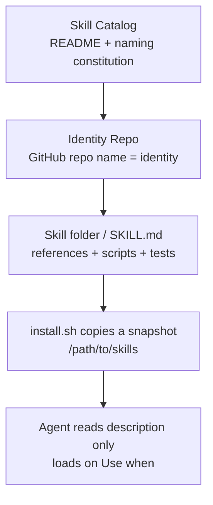
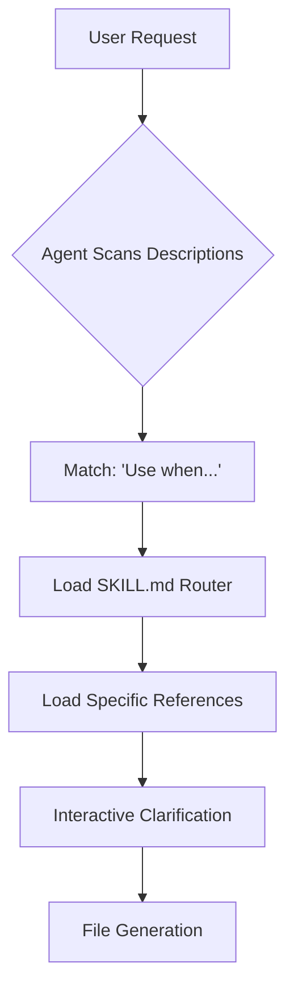

> "Once names are fixed, realities can be distinguished; once the Way is practiced, intentions can get through." — Xunzi, *Zhengming* (Rectifying Names)

# Beyond the Graveyard of Models: Architecture by Identity

*From a list of AI repos to a constitution the installer and the agent both obey.*

I once read a story about a blind man sitting on a building's steps with a cardboard sign that read: "I am blind, please help me." People walked by, largely indifferent to the statement of fact. Then, a young girl stopped. She didn't change the man's situation, but she flipped the sign over and wrote a different line. She left the sign there and walked away. 

When the man eventually felt the familiar texture of her shoes and asked what she had written, she replied: "The same words, just a different language." 

She had written: "This is a beautiful day, and I cannot see it." 

People began to stop. They began to give. The facts hadn't changed—the man was still blind, the day was still beautiful—but the *language* used to describe the reality had shifted from a passive statement to an active identity. It moved from a piece of information that required no action to a narrative that demanded a response.

In the world of AI systems architecture, we are currently drowning in statements of fact. 

We build catalogs of models, indices of skills, and registries of agents. We treat these as

## 1. Four layers. Do not flatten them.

When building agentic architectures, there is a strong temptation to "flatten" the identity of a tool or a skill. The goal is usually simplicity: you want a single name that represents the capability, whether you are looking at it in a UI, a git repository, or an LLM's context window. However, flattening identity is a form of technical debt. It forces disparate system boundaries to share the same semantics, which inevitably leads to friction when one boundary's requirements conflict with another's. 

In a production system, "identity" is not a static property; it is a relational one. A skill's identity changes based on the consumer. To solve for this, we must maintain a strict four-layer hierarchy where each layer serves a specific architectural purpose and owns a specific set of metadata. 



By separating these concerns, we ensure that changes in one domain do not cause cascading failures in others. For example, a change to the human-readable description of a skill should not force a rename of the underlying repository, which would break CI/CD pipelines and local clones.

| Layer | Example | Consumer | Blast radius if you rename it |
| --- | --- | --- | --- |
| Catalog | `skill-catalog` | humans, review, new joiners | people cannot find the repo; the standard drifts |
| Repo name | `airflow-skill-repo` | clone URL, GitHub topic | every clone, CI pin, and bookmark breaks |
| Skill name | `airflow-dev-skill` | install path, `name:`, manifest | copies already on laptops keep triggering under the old name |
| Trigger | `Use when creating a new DAG` | agent routing | the right skill stays cold; the wrong one dumps its templates into context |

This structure enforces what I call information directionality. Each boundary rewrites the same underlying characters—the fact that a specific set of scripts exists for Airflow—under its own unique assumptions and constraints. 

Consider the friction points of a flattened model:
- **In the human head**, the meaning is a semantic cluster: "The Airflow skill pack." We group it by functionality and intent.
- **In Git**, the syntax is a unique resource locator: the repo name. It must be unique, grep-able, and stable enough to be pinned in a configuration file.
- **In the local filesystem**, the syntax is a path and a manifest: the skill folder. This is where the code actually lives and where it is mounted or symlinked during a developer's local runtime.
- **In the Agent**, the syntax is a semantic trigger: the "Use when" description. The LLM doesn't care about your repo name or your folder structure; it only cares about the boundary where the tool's capability meets the user's intent.

If you attempt to use a repo name as a slash command, you often find it too broad or too cryptic for an LLM to reason about effectively. Conversely, if you use a long, descriptive skill folder name as your GitHub topic, you create a maintenance nightmare for repository discovery. By respecting these four layers, you allow each system to consume the information it needs in the format it requires, without forcing a one-size-fits-all identity that satisfies no one.

> The catalog answers what is allowed to exist. The skill contract answers whether this turn should speak.

## 2. The naming standard is executable, not copy

We often treat naming conventions as "style guides"—documents humans read to decide how a repository *should* look. That is a fundamental architectural mistake. A style guide is a suggestion that relies on human willpower; a naming standard is an interface that relies on machine enforcement. In a high-velocity engineering organization, a name is not a description; it is a routing key. If a human can't parse it, the machine can't route it.

To achieve this, we use a single, rigid formula for all new components:

```text
alpha-<type>-<domain>[-<qualifier>]
```

This isn't a set of suggestions. These are the hard rules:
- **Lowercase only**: No exceptions for PascalCase or camelCase. Consistency in casing is the easiest thing to grep.
- **Hyphens only**: Underscores are for variables; hyphens are for paths and URIs. We want our names to be URL-friendly and CLI-friendly.
- **At most four segments**: We want to avoid deeply nested, overly specific names that become unreadable at a glance.
- **Under 30 characters**: If you can't fit the identity into 30 characters, your identity is likely too complex.
- **Closed Vocabulary**: The `type` must come from a strictly defined list. 
- **Canonical Domains**: The `domain` must be the canonical system name (e.g., `snowflake`), not the framework or the specific team name that might change in six months.

| type | For | In production | Empty on purpose |
| --- | --- | --- | --- |
| `skills` | skill bundles | airflow / api / claude / dbt / onehelp / snowflake | |
| `mcp` | MCP servers | airflow / jira / servicenow | |
| `agents` | agents | devops | |
| `evals` | eval suites | | reserved |
| `prompts` | shared prompts | | reserved |
| `lib` | shared code | | reserved |
| `infra` | deploy / IaC | | reserved |
| `template` | repo scaffolds | | reserved |

The empty rows in this table are intentional. They are not "to be filled." They are reserved to prevent vocabulary drift. If a team feels the need to invent a ninth type, the first question must be: *Is this a new identity, or is it just an attribute hanging off an old one?* 

We must distinguish between **Identity** and **State**. 

- **Identity** is who the thing *is*: `alpha-agents-devops`.
- **State** is what the thing *is doing* or *where it is in its lifecycle*: `deprecated`, `v2`, or `owner_team`.

When you encode an attribute like `v2` into the name, you are making the name a statement of history. If you then move to version 3, the name is now factually incorrect, forcing a rename of the repository, the CI pipelines, and the permissions. This is a failure of naming. Attributes belong in organization-level custom properties or GitHub topics—places where the metadata can live without polluting the primary identifier. 


Occam's razor is strict here: the name answers "who is this." Nothing else is the name's job. If the name has to explain *why* it exists or *how* it works, it has failed.

That is the trick the girl played with the cardboard. In the story I've noted, she didn't change the content of the plea; she changed the language used to convey it. A repository name is not a description of what it contains; it is the string the reader's tooling can route on. We are moving the "description" into the topics and the "state" into the properties, leaving the name as a pure, executable path. 

Currently, our "add-a-repo" checklist in the README follows this logic:
1. Name it by the formula.
2. Add the matching topic.
3. Append a catalog entry.
4. Bump the header counts.

Note that Step 3 still explicitly says "copy an existing `<tr>` row." This is the correct process, but the prose in our documentation is stale. The catalog is a hand-maintained artifact, and the friction of updating the text is where the system breaks down. The failure mode isn't a lack of rules; it's the fact that we are still using human-readable prose to manage a machine-readable system. We need to move toward a state where the catalog is a byproduct of the naming, not a manual entry in a markdown file.


> The moment a name starts carrying lifecycle, the naming scheme is already dead.

## 3. Archaeology: why eight repos were renamed in a day

On 2026-08-31, our repository catalog reached a tipping point. We published a new standard that placed conventional, predictable names on the left and the still-live legacy names on the right. By the following day, September 1, the transition was complete: all eight target repositories had moved. The programmatic closure of this initiative was finalized in commit `a645e90`, which officially rejected the proposed `alpha-skills-alphapi` in favor of `alpha-skills-api`. We rejected the former because it "stutters"—it repeats the prefix unnecessarily—and, more critically, it prioritizes the framework identity over the functional domain. In a scalable architecture, the domain must always be the primary identifier.

| Old GitHub name | Standard name | Disease that got cut |
| --- | --- | --- |
| `alpha-airflow-skill` | `alpha-skills-airflow` | type not in segment two |
| `alpha-claude-skills` | `alpha-skills-claude` | same |
| `alpha-dbt-sqlfluff-skills` | `alpha-skills-dbt` | five segments; implementation detail in the identity |
| `alphapi-skills` | `alpha-skills-api` | prefix is not `alpha-<type>` |
| `alpha-onehelp-skills` | `alpha-skills-onehelp` | type last |
| `alpha-snowflake-skills` | `alpha-skills-snowflake` | type last |
| `alpha-jira-mcp` | `alpha-mcp-jira` | type last |
| `servicenow_mcp` | `alpha-mcp-servicenow` | underscore; not even `alpha-` |

Following this cleanup, two additional repositories were onboarded to the new standard: `alpha-agents-devops` on 09-10 and `alpha-mcp-airflow` on 09-21. Once the entire fleet answered to its standard naming convention, we executed a final sweep to tear out the `proposed` / `live` / `Clone as` scaffolding that had accumulated during the transition period. These were artifacts of the migration process, no longer necessary once the destination was reached.

However, we purposefully maintained a specific asymmetry in the rollout: while the GitHub repository names were moved, the local skill installation names were not—at least, not yet. This distinction is rooted in the concept of the "contract." 

When a developer interacts with a tool locally, such as `~/.cursor/skills/<old-name>`, they are interacting with a persistent contract on someone else's laptop. We do not own that local state, and breaking it would mean breaking their workflow. In contrast, renaming a GitHub repository is a much cheaper operation; it affects the discovery layer—how a developer finds the repo in a list, how a CI pipeline parses a string to identify a target, or how a search index routes a query. These are "soft" contracts. 

By allowing the local paths to remain as legacy entries while the remote repository names move forward, we are managing a deliberate, intentional asymmetry. The remote identity (GitHub) and the local state (the local directory) are two different entities that move at different velocities. Later, as `alpha-skills-airflow` grew its own `develop` / `decommission` / `image-deps` metadata on its own clock, the old `alpha-airflow-skill` remained as a legacy entry in `install.sh`. This serves as a persistent reminder to the user to uninstall the old version. 

This is not a contradiction of engineering logic; it is the reality of managing distributed state. Nobody flipped a cardboard here. The rename program was executed because those names had "readers"—CI systems, clone URLs, and topic search engines—each one a tool that routes based on the name. A name is a routing instruction. The names that had no readers are the ones we allowed to continue drifting. We chose to prioritize the parts of the system that actually *do* something with the information.

> A repo rename breaks clone URLs. A skill rename breaks triggers already installed on other machines.

## 4. The real runtime: `Use when` and `check_skill.sh`

In production environments, there is a significant architectural gap between "having a tool available" and a system actually "knowing" how and when to invoke it. For our skill architecture, the standard skill packs—such as our workflow orchestrator and API integrations—don't just exist as static folders; they adhere to a shared structural skeleton that enables automated, deterministic discovery. 

The `install.sh` script operates on a fundamental rule: a top-level folder is only recognized as a valid skill if it contains a `SKILL.md` file. Once identified, the system doesn't simply create a shortcut to the source. Instead, it takes a snapshot of the skill, copying the data into `~/.editor/skills` and/or `~/.llm/skills`, positioned alongside a `<name>.install.json` file. 

We specifically choose **copies over symlinks**. While symlinks are a common shortcut for managing paths, they introduce significant brittleness in complex, multi-environment setups. By pulling and re-installing the skill data, we ensure that the skill environment is isolated and immutable once installed. This prevents the agent's local environment from shifting unexpectedly if the source repository changes, which is a common cause of non-deterministic behavior during multi-step generation processes. However, because the primary IDE scans both `~/.editor/skills` and `~/.llm/skills`, this can lead to duplicate listings in the UI. We have to manage this deliberately, sometimes opting to install to only one side depending on the specific requirements of the local environment.

This leads us to the "Contract." We don't rely on a human-readable README to tell the agent how to behave; we rely on a machine-enforced validation script: `tests/check_skill.sh`. This is the "law" of the repository. If a skill fails this check, it effectively ceases to exist for the agent. 

```bash
[ "$NAME" = "$FOLDER" ] || fail "name: '$NAME' must match the folder name '$FOLDER'"
printf '%s' "$NAME" | grep -Eq '^[a-z0-9]+(-[a-z0-9]+)*$' \
  || fail "name: must be lowercase letters, digits, and single hyphens"

printf '%s' "$DESC" | grep -qi 'use when' \
  || fail "description: should say when to use the skill ('Use when ...')"
[ "${#DESC}" -le 1024 ] || fail "description: longer than 1024 characters"

[ "$LINES" -le 500 ] || fail "SKILL.md is $LINES lines (cap $MAX_LINES)"
```

The logic here is rigorous. The naming constraint (`[a-z0-9]+(-[a-z0-9]+)*`) isn't just an aesthetic choice; it ensures compatibility with shell globbing and prevents collisions in filesystem paths. The `Use when` requirement in the description is arguably the most critical part of the contract. It serves as the primary heuristic for the agent's router. If the description is merely a "what it does" summary, the agent will struggle to decide the correct moment to invoke it. We also enforce a hard limit of 1024 characters on the description and a 500-line cap on the `SKILL.md` file.

Further down the pipeline, the script validates the internal topology of the skill to prevent "context leakage":
- Every file in `references/*.md` must be explicitly linked from `SKILL.md`.
- References are forbidden from linking to external URLs outside the skill's scope.
- Every file in `scripts/` and `assets/` must be mentioned in the documentation.
- Python scripts must be parsable; shell scripts must pass `bash -n`.
- **Crucially, there are no "AI Instructions / System Use Only" blocks.**

We strictly ban these blocks because they frequently lead to prompt contamination. When you include system-level instructions inside a skill file, you risk the agent confusing the *how* of the specific task with the *how* of the general system behavior. We want a clean separation of concerns: the system knows how to be an agent; the skill knows how to perform a specific task. 

This process represents the transition of "tribal knowledge" into a verifiable artifact. The catalog tells you what a repository *is* (its identity), but the contract defines how an agent *finds* it and how a decommission task is prevented from accidentally pulling in nine different "develop" templates into its context.

To visualize the execution, the trigger chain must be predictable and speakable:



1.  **The User Intent:** A user asks to sync a DAG from a warehouse into an archive system.
2.  **The Discovery Phase:** The agent scans the available skill descriptions.
3.  **The Routing Hit:** `alpha-skills-workflow-develop` triggers because it matches the `Use when creating or scaffolding a new DAG` clause.
4.  **The Context Load:** The agent reads the short `SKILL.md` router, then pulls in the specific matching `references/` file.
5.  **The Interaction:** The agent asks for the type, source, target, and schedule, proposes names, waits for confirmation, and finally generates the files.

This is "On-Demand Loading" by design. If we shipped a "fat" skill containing every possible template, the agent's context window would be flooded with noise. A "Decommission" task should never have to see the "Develop" templates. The 500-line cap on `SKILL.md` is a hard context budget. It's not a style choice; it's a mechanism to ensure the agent maintains high "attention" on the relevant data. When we talk about a "context tax," we are referring to the degradation of LLM performance as the irrelevant information density increases. Every token added to the prompt—whether it's a redundant template, an unrelated configuration, or a bloated description—competes for the model's attention.\n
> The description is the routing table. `SKILL.md` is the table of contents. `references/` is the manual. Writing all three into one file is a context tax.

## 5. The lines inside a skill that are actually expensive

Take the `alpha-skills-airflow-develop` package as a primary case study. One of the first architectural requirements we enforce is that the frontmatter `name:` must exactly match the directory name. This isn't merely a stylistic preference; it's a requirement for grep-ability and reducing the cognitive load of navigating a high-volume monorepo. 

Furthermore, the description of any skill must explicitly define what the skill does, when to use it, and—crucially—when *not* to use it. For example, if a task involves deleting a DAG, that logic belongs in a decommission workflow, not in this skill pack. This practice of "negative routing" is a deliberate engineering choice. It is far more effective to prevent a developer from misusing a tool than to write three hundred words of positive prose trying to explain the nuances of correct usage. By defining the boundaries of the tool upfront, we reduce the surface area for implementation errors.

Once a skill is loaded into the environment, the "Red Lines" take precedence over the templates. These are the non-negotiable governing contracts of the repository:

| Red line | Why it is a red line |
| --- | --- |
| No `Variable.get()` / `get_param()` in DAG files | Airflow 3 mandates that these must not be called at parse time; runtime values must be injected via Jinja. Calling these at the top level forces the scheduler to reach out to the metadata database on every heartbeat, which can cause significant latency and scheduler starvation. |
| Schedule is hardcoded, branched on an env var | Cron expressions are static; they are not dynamic Variables. Branching on an environment variable during the parse phase leads to non-deterministic behavior where the scheduler may see different schedules depending on the environment's state at the moment of import. |
| Credentials must not land in `KubernetesPodOperator.env_vars` | Any value placed in `env_vars` is rendered into the Kubernetes pod spec and persisted in the Airflow metadata database. This makes secrets visible via `kubectl describe` or in logs. Secrets must be handled via K8s secrets or a dedicated secret manager. |
| Tests are pytest, not `DagBag` | We have standardized on `pytest` to match the repository's existing test contract. `DagBag` testing often requires a full environment load and can be flakey; `pytest` allows us to isolate the logic of the operator or the task function, leading to faster, more reliable CI cycles. |
| The matching lines in `.airflowignore` / `.ciignore` must be commented out | A file existing on the disk is not a loaded DAG. If a file is intended to be ignored by the loader, it must be explicitly handled by the ignore files, not left in a state that creates ambiguity for the loader's intent. |

The five DAG families are downstream of this same constitution: `ingestion_*`, `sync_*_to_*`, `move_*_to_*`, `analytics_*`, and `admin_*`. The repository name establishes the broad category (the "skill pack"), while the `dag_id` prefix defines the specific functional domain. We maintain a strict separation between these two vocabularies to ensure clarity in ownership and monitoring.

The `alpha-skills-api-develop` package applies the same contract to a different chain. It scaffolds `alphapi-*` services, manages the `deploy` walk for gateway and sealed secrets, and includes `postman-smoke` to discover endpoints from OpenAPI specs and fail the run if a credential is committed in `smoke.json`. Notably, `configs-repo-setup` is not vendored; the installation pulls it from the central configs repo. This is a "remote skill" pattern, ensuring the local tree never holds a stale copy of configuration logic.

The dbt section is where the friction between repository name, skill name, and the folder on disk is most visible. For instance, the catalog lists `alpha-skills-dbt` with two skills—sqlfluff and Data Vault—yet some environments still point to the legacy `alpha-dbt-sqlfluff-skills` path. During code reviews, we talk standard names and only edit the legacy paths on disk where they persist as technical debt. 

The promise remains unchanged: build a column-ownership map from a Snowflake `DESCRIBE` command—never guess an alias. You must prove the row set with a `COUNT + EXCEPT` pattern before running a `dag-test`. It is a critical distinction to remember: `dag-test` proves that the code lints and compiles; it does not prove that the data is equivalent to the source.

> Templates are examples. Red lines are the contract. When an example ages, obey the contract.

## 6. The catalog is already drifting

The cost of maintaining a hand-curated README as a source of truth is becoming painfully visible. When documentation is decoupled from the actual state of the codebase, it doesn't just become "out of date"; it becomes a liability that misleads the very people trying to move fast. We are seeing the classic symptoms of documentation rot where the friction of updating the text exceeds the perceived risk of leaving it alone.

The following table highlights the specific ways our catalog is drifting. Each of these isn't just a typo; it’s a failure of synchronization between the engineering reality and the human-readable narrative:

| Drift | What it exposes | Engineering Impact |
| --- | --- | --- |
| Add-a-repo still says copy a `<tr>` | Scaffolding was removed; the checklist was not rewritten | New repos are initialized with broken boilerplate, leading to "it works on my machine" friction during onboarding. |
| dbt row says 09-11 in the title and 08-31 on the badge | Counts and dates are a human sync | Erodes trust in the registry; developers stop checking the docs and start guessing the current state. |
| evals / prompts / lib / infra / template are empty | Reservation is correct; people will treat empty slots as "open anything" | The catalog becomes a "graveyard of intent"—space is reserved for features that don't exist yet, creating a false sense of progress. |
| Platform repos (clusters, images, GitOps) are not in the catalog | Two naming worlds; do not let the catalog govern infrastructure | Creates a bifurcated mental model where "infrastructure" and "application" are governed by different rules, increasing cognitive load. |
| Old clone names still sit on disk | The catalog says live; the laptop says legacy | The source of truth is split between the file system and the registry, leading to potential "ghost" deployments or confusion over ownership. |

When we first conceptualized this, the goal was a Backstage-shaped `catalog-info.yaml` generator. That approach would have treated metadata as code—declarative, versioned, and programmatically enforced. What actually shipped, however, was a single Markdown file. For a small footprint of ten repos, Occam's razor suggests that a Markdown file is the simpler path. But that simplicity comes with a specific tax: staleness is now a known fault rather than an emergency incident. 

We have to be clear about our first principles here. The catalog itself has no automated test. It is a human-centric document. However, the *skill contract* does have a test. This is a critical distinction in our architecture: 

- "What may this repo be called?" is a human review question. It’s a matter of naming conventions and aesthetics. 
- "Can an agent discover this skill?" is a CI question. If the machine-readable contract is broken, the build fails.

We are deliberately choosing to let the catalog remain a "soft" record while hardening the "hard" contracts that the agents actually consume. 

To keep our heads straight, we need to distinguish the ten live repos by their functional duty rather than their alphabetical order. This helps us understand what an agent is actually *doing* when it interacts with our stack:

- **skills**: These are the "how-to" instructions. They teach an agent how to navigate and manipulate your specific repository. This includes DAG definitions, API schemas, dbt models, change records, Snowflake specifics, and editor-level guardrails. If an agent needs to know the nuances of our custom deployment logic, it looks here.
- **mcp**: These give an agent "hands" on real-world systems. This is the Model Context Protocol implementation that provides the bridge to the outside world—specifically our nine Airflow slices, Jira, and ServiceNow instances. 
- **agents**: These are packaged, read-only troubleshooting entries. They provide the least-privilege path for an agent to engage with a problem via Teams or the editor without granting it broad permissions to the underlying infra.

It is vital to remember that an MCP server and a Skill are not the same category of entity. A Skill is a program installed into the editor's immediate context; it’s a localized piece of knowledge. An MCP server is an interface that runs somewhere else—a service that the agent calls out to. 

We split them by `type` in the catalog for a very specific reason: to prevent the "let's open another AI repo" PR from being submitted twice. By clearly demarcating the "hands" (MCP) from the "instructions" (Skills), we ensure that we aren't building redundant bridges to the same systems. 

> A standard with no test will be broken by the next add-a-repo pull request.

We accept that the Markdown catalog will drift. We manage that by ensuring the underlying contracts—the things the agents actually execute—are shielded by CI and rigorous testing.

## One table to hold the rest

In high-scale systems, the difference between a

## Do this today

1. **Audit your catalog page.** Do not treat this as a passive check. Open your own catalog and perform a manual reconciliation: verify the header counts against the real repository list and check every single updated date. You are looking for "drift." If the catalog says a repo was updated last week but the git history says a month ago, that is a failure in your system of record. Mark every mismatch before you attempt to open a new repository. You cannot build a reliable system on top of decaying data.

2. **Mandate metadata on new-repo PRs.** On the next new-repository Pull Request, require one line of metadata first: `type=` (which vocabulary row it belongs to) and `domain=` (which system it serves). This isn't just documentation; it is the routing key. If you cannot fill both fields, the name is not production-ready. It means the skill is still too amorphous for the router to handle reliably, and it risks pulling in irrelevant noise during inference.

3. **Sync your local environment.** This is a common point of failure in development workflows. Before you rename a GitHub repository, search `~/.cursor/skills` and `~/.claude/skills` for the current install name. If you change the repository name but leave the old skill name in your local configuration, you have created a broken link. Changing the repository and the skill name simultaneously is a migration—a high-effort, high-risk operation. Doing one without the other is a technical mistake that leads to "ghost" skills in your local environment.

4. **Write descriptions as a contract.** When you author a new skill, write a description of under 200 words first. This serves as the abstract. It must explicitly contain a `Use when` clause and, crucially, one negative route (a statement on when *not* to use it). Only after this is defined do you write the `references/`. The rule is: manual first, router second. The agent will treat the entire manual as its home page; if the manual is weak or missing, the router is just a guess.

5. **Label legacy clones.** If a legacy clone name is still on disk, label it clearly as `legacy`. Do not allow it to masquerade as the current standard during a review. If you do not explicitly mark it as deprecated, the team will eventually treat the old behavior as the default, leading to behavioral drift where the AI starts favoring old patterns simply because they were the first ones it encountered.


The cardboard did not change; the sentence on it did. This is a crucial distinction in system design. Your catalog's README is the cardboard: it is a public surface that everyone can read, and everyone feels they have the right to scribble on. It is the low-fidelity layer of the system. However, what the user—and more importantly, the agent—actually needs to act on is the high-fidelity instruction: a name they can clone, or a `Use when` clause that an agent can match. That specific, actionable data must live where a machine can route on it. If the actionable logic is buried in prose but missing from the metadata, the system will fail to navigate it.

*A list tells you what exists. A constitution tells you what is allowed to exist.*
