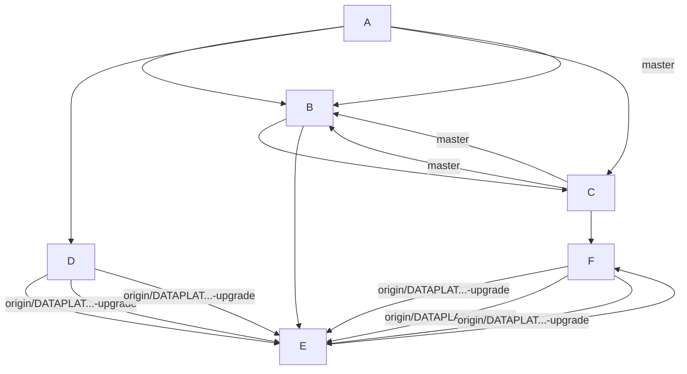

# Git 差集命令背后的机制与高效使用

在 Git 中，理解其内部机制对于提高操作的准确性和效率至关重要。以下是一些关键点和技巧，可以帮助你避免常见的坑和误解。

## 一、Git 命令解析

就像爱迪生一一测试耐热材料一样，在 Git 中，我们也要深入理解每个命令背后的机制。例如，`git log` 按「可达性(reachability)」遍历提交图，并输出提交列表。它按照历史提交的顺序列出每个提交的信息。

## 二、本地分支 `master`

本地分支 `master` 所指向的提交(一个 commit-ish)。在 Git 中，一个 commit-ish 可以是任何指代提交对象的标识，比如分支名、标签名或具体的提交哈希。

### `git log`
`git log` 按「可达性(reachability)」遍历提交图，并输出提交列表。它按照历史提交的顺序列出每个提交的信息。

### `master`
本地分支 `master` 所指向的提交(一个 commit-ish)。在 Git 中，一个 commit-ish 可以是任何指代提交对象的标识，比如分支名、标签名或具体的提交哈希。

### `..`
双点范围操作符。在 `git log` 中，它表示从一个提交到另一个提交之间的所有提交。例如，`master..origin/...upgrade` 表示从 `master` 到 `origin/...upgrade` 之间的所有提交。

### `origin/...upgrade`
远程跟踪分支(remote-tracking branch)，即上次 `git fetch` 时抓下来的远端状态**快照**。这表示本地仓库中保存的远端 `...upgrade` 分支的状态。

### `--oneline`
等价于 `--pretty=oneline --abbrev-commit`，即「短 SHA + 提交标题」一行一条。这种格式使得输出更简洁，更容易阅读和理解。

分支名 `DATAPLATCORE-1265-airflow-2.11.2-upgrade` 本身没有语法含义，只是团队命名约定：**Jira ticket 号 + 任务描述**(把 Airflow 升到 2.11.2)。这种命名方式可以让团队成员在不打开 Jira 的情况下，快速了解分支的目的和用途。好的分支名让 `git log --oneline` 的输出自带上下文，这也是一种工程素养。

## 二、`..` 的精确语义

在 Git 中，`..` 操作符用于定义两个分支或提交之间差异的集合。具体来说，表达式 `A..B` 可以解释为：**从 B 可达的提交** 减去 **从 A 可达的提交**。这可以进一步等价于 `B ^A` 或 `B --not A`。

图示：



- `master..origin/...` → 输出 `F E D`(升级分支上的新工作)
- `origin/.....master` → 输出 `C`(master 上有、分支还没合并进来的东西)

这里有一个重要的细节需要注意：**顺序反了结果完全不同**，这是最常见的误用。具体来说：

1. **这不是「diff」，而是「提交集合的差」。** 如果你想要查看文件内容的差异，你应该使用 `git diff`，并且需要使用三点模式（见第四节）。
2. **默认逆时序输出**（最新提交在最上面），而不是拓扑顺序。若要按拓扑顺序输出，需要使用 `--topo-order` 选项。
3. **若两者已完全合并，输出为空** —— 空结果本身就是有用信号。

为了更好地理解这些概念，假设 `master` 分支和 `origin/DATAPLAT...-upgrade` 分支在某次合并之后完全相同。在这种情况下，执行 `master..origin/DATAPLAT...-upgrade` 和 `origin/DATAPLAT...-upgrade..master` 都将不会输出任何内容，这表明两个分支之间没有差异。

另外，如果我们对 `master` 分支和 `origin/DATAPLAT...-upgrade` 分支之间的差异感兴趣，我们可以使用 `git log master..origin/DATAPLAT...-upgrade` 命令来查看 `origin/DATAPLAT...-upgrade` 分支上新合并的提交。这将显示从 `origin/DATAPLAT...-upgrade` 分支上新合并的提交，而不会包含 `master` 分支上的提交。

总之，理解 `..` 操作符的精确语义对于有效地使用 Git 来管理分支和跟踪提交历史非常重要。通过掌握这些细节，你可以更准确地了解两个分支之间的差异和新合并的工作内容。

## 三、深入一层：`^` 与 `--not`，才是真正的底层原理揭秘

`..` 只是语法糖。`git log` 的本质是「**从若干起点出发做图遍历**」，这是 `git` 的核心机制之一，理解这一点是掌握 `git log` 的关键。

- 不带前缀的 ref = **正向起点**(include)：表示从这些起点出发遍历所有可达的提交。
- 带 `^` 前缀的 ref = **排除点**(exclude)：表示从这些起点出发遍历所有可达的提交，并且排除这些起点的父提交和它所能到达的所有提交。

所以 `B ^A` 读作：从 B 开始往下走，凡是 A 也能走到的提交，全部剪掉。

验证：

```bash
$ git log --oneline master..origin/DATAPLATCORE-1265-airflow-2.11.2-upgrade
$ git log --oneline origin/DATAPLATCORE-1265-airflow-2.11.2-upgrade ^master
# 两者输出完全一致
```

**为什么要知道底层写法？** 因为 `^` 可以任意组合，而 `..` 不行。这让你能够灵活地进行更复杂的提交筛选。比如：

```bash
# 「在 feature 上，但既不在 master 也不在 develop 上」的提交
$ git log --oneline feature ^master ^develop

# 「在 B 或 C 上，但不在 A 上」的提交
$ git log --oneline B C ^A
```

`..` 只能表达「一减一」，即两个起点之间的差异。而 `^` 能表达「多减多」，即多个排除点的组合。这是从「会用」到「懂」的分界线。

> **Shell 提示**：在某些 shell（尤其 zsh 的部分配置、Windows CMD）里 `^` 需要转义或加引号。写 `'^master'` 最稳妥，或者干脆用 `--not master`。

理解了这个底层机制，你就可以灵活运用这些工具，而不仅仅是记住几个命令行参数的用法。

## 四、`...` 的两副面孔（最大的坑）

**同一个 `...` 符号，在 `git log` 和 `git diff` 里是两套语义。** 这是 Git 设计上公认的历史包袱。**理解这一点是避免常见错误的关键。**

### 4.1 `git log a...b` = 对称差(symmetric difference)

集合表达：`(a ∪ b) - (a ∩ b)`，即**两边各自独有的提交都列出来**。

等价底层写法：

```
D---E---F b
/
A---B---C a
```

```bash
a...b ≡ a b --not $(git merge-base --all a b)
```

具体来看，当分支 `a` 和分支 `b` 有分叉点时，`git log a...b` 会列出两个分支独有的提交。

```bash
D---E---F b
/
A---B---C a

# git log a...b → C F E D (两边独有的全给)
# git log a..b → F E D (只给 b 独有的)
git log a...b → C F E D
```

配 `--left-right` 才真正好用：

```bash
# 指示提交在哪个分支上，左或右。
git log --oneline --left-right --graph 
master...origin/DATAPLATCORE-1265-airflow-2.11.2-upgrade
# < abc1234 只在 master 上
# > def5678 只在该分支上
```

### 4.2 `git diff a...b` = 「b 相对于 merge base 的内容差异」

等价于：

```bash
# 忽略 a 在分岔后的所有变化，只看 b 这条线干了什么。
git diff $(git merge-base a b) b
```

即：**忽略 `a` 在分叉后的所有变化**，只看 `b` 这条线干了什么。

对比 `git diff a..b`（等同于 `git diff a b`）：那是**两个端点快照的直接对比**，会把「a 上新增的东西」显示成 b 里的「删除」——这通常不是你想要的。

举个例子：

```bash
# 直接对比 a 和 b 之间的差异
$ git diff master..origin/DATAPLATCORE-1265-airflow-2.11.2-upgrade

# 只看 b 相对于 merge base 的差异
$ git diff master...origin/DATAPLATCORE-1265-airflow-2.11.2-upgrade
```

### 4.3 实战结论（背下来）

在实际工作中，你会经常用到这些命令。记住以下口诀：

```bash
# 想看「这个 PR 引入了哪些提交」—— log 用两点
$ git log --oneline master..origin/DATAPLATCORE-1265-airflow-2.11.2-upgrade

# 想看「这个 PR 改了哪些代码」—— diff 用三点
$ git diff master...origin/DATAPLATCORE-1265-airflow-2.11.2-upgrade

# 想看改了哪些文件 + 增删行数
$ git diff --stat master...origin/DATAPLATCORE-1265-airflow-2.11.2-upgrade
```

**记忆口诀：`log` 用两点看提交，`diff` 用三点看代码。**

在 GitHub / GitLab 的 PR 页面展示的正是 `diff` 的三点语义——这就是为什么你在 PR 里看不到 master 上别人的改动。

## 五、输出为空说明什么

严格含义：**B 可达的提交集合 ⊆ A 可达的提交集合**。用 Git 术语说就是 **B 已经是 A 的祖先(ancestor)**，即 B 已被完全合并进 A。

对应的现实情况：

| 情况 | 说明 |
| --- | --- |
| B 已合并进 A | 最常见：PR 已 merge |
| A 与 B 指向同一提交 | 刚 fetch 完、完全同步 |
| B 比 A 旧 | 分支创建后没提交过新东西 |

当输出为空时，这通常意味着 B 是 A 的祖先。但是，在脚本中进行条件判断时，不要依赖于「log 输出空不空」，而应该使用这两个更精确的工具：

```bash
# 退出码 0 表示是祖先（即已合并），1 表示不是
exit_code=$(git merge-base --is-ancestor origin/DATAPLATCORE-1265-airflow-2.11.2-upgrade master)
echo $exit_code
```

或者，你可以使用以下命令来计数：

```bash
test "$(git rev-list --count master..origin/DATAPLAT...upgrade)" -eq 0
```

> ⚠️ **重要陷阱**：空输出**不代表两边内容相同**。如果分支是通过 **squash merge** 或 **rebase** 进 master 的，SHA 全变了，`master..branch` 可能**非空**，但代码内容其实一模一样。

**「提交集合」和「文件内容」是两个正交的维度。** 下一节将展开解释这一概念。

## 六、为什么出现了「明明已经在 master 上」的提交

**根因**：Git 的提交身份是哈希（SHA-1/SHA-256），这个哈希覆盖了 **parent 指针、tree、作者、committer、时间戳、提交信息** 等多个字段。因此，只要其中任何一个字段发生变化，SHA 值就会随之改变——即使 diff 内容完全一致。

因此，「相同的改动」在 Git 眼里也可能是两个毫无关系的提交对象。制造这种「双胞胎」的操作包括：

| 操作 | 发生了什么 |
| --- | --- |
| `cherry-pick` | 换了 parent，生成新的 SHA 值 |
| `rebase` | 整条线重新播放，导致全部新 SHA 值 |
| squash merge | 将 N 个提交压缩成 1 个全新提交 |
| `git am` / patch 邮件流 | 从 diff 重建提交 |
| `--amend` / 改 commit message | 即使内容不变，SHA 也会改变 |

### 6.1 解药：`--cherry-mark` / `--cherry-pick` / `--cherry`

Git 用 **patch-id**（对 diff 内容做规范化哈希，忽略行号偏移与上下文）来识别「等价提交」。

```bash
# 标记等价提交：= 表示两边都有(等价)，+ 表示真正独有
$ git log --oneline --left-right --cherry-mark master...origin/DATAPLAT...upgrade

# 直接过滤掉等价提交，只剩真正独有的
$ git log --oneline --left-right --cherry-pick master...origin/DATAPLAT...upgrade

# --cherry 是常用组合的简写 ≈ --right-only --cherry-mark --no-merges
$ git log --oneline --cherry master...origin/DATAPLAT...upgrade
```

注意：这些选项**只在三点对称差 `...` 下有意义**（需要两边都遍历才能配对），与两点 `..` 一起使用则没有效果。

### 6.2 patch-id 的局限（边界意识）

1. **merge 提交没有 patch-id** → 需要配 `--no-merges`
2. cherry-pick 时**解决过冲突**导致内容不同 → patch-id 不匹配，仍算独有
3. 空提交（无 diff）无法配对

### 6.3 另一条排查路径

```bash
# 按提交信息关键字全库搜
$ git log --oneline --all --grep='DATAPLATCORE-1265'

# 查某个提交存在于哪些分支上
$ git branch -a --contains <sha>

# 追溯 cherry-pick 来源(前提：当初用了 git cherry-pick -x)
$ git log --oneline --grep='cherry picked from'
```

**工程建议**：团队约定 `cherry-pick` 一律加 `-x`，它会在 commit message 里留下 `(cherry picked from commit <sha>)`，这样日后排查成本直接降低一个数量级。

## 七、三个必须记住的坑

在处理 Git 分支时，有几个常见的陷阱需要特别注意，以避免不必要的麻烦。

### 1. `origin/xxx` 是缓存，不是实时远端

远程跟踪分支只在执行 `git fetch` 或 `git pull` 时才会更新。如果你没有先执行 `git fetch`，你看的可能是几天前的世界。例如：

```bash
$ git fetch -p origin # -p / --prune 顺手清理已删除的远端分支
```

`-p` 参数非常重要，它会在 `git fetch` 时顺手清理已经被删除的远端分支。如果不使用 `-p`，你可能会在本地看到已经不存在的分支，这可能会导致你基于一个不存在的分支进行操作。

**经验法则：** 在需要实时获取远端分支的状态时，务必先执行 `git fetch`。否则，你看到的可能是过时的信息。

### 2. `master` 用的是**本地** master

本地分支 `master` 的状态可能与远端分支 `master` 存在差异。如果你的本地 `master` 分支很久没有更新，可能会多列出一堆「其实已经在远端 `master` 上」的提交。例如：

```bash
$ git log --oneline origin/master..origin/DATAPLATCORE-1265-airflow-2.11.2-upgrade
```

为了确保你对比的是实际的远端分支状态，建议在命令中明确指明远端分支，例如使用 `origin/master` 而不是 `master`。**经验法则：** 在进行分支进度判断时，两端都使用 `origin/` 前缀，这样可以排除本地状态的干扰。

### 3. 名字歧义与 `--` 分隔符

分支名中如果包含特殊字符（如 `.`），通常不会有太大问题，但如果同时存在同名的 tag 和 branch，Git 的解析优先级可能会让你困惑。例如，假设你有一个名为 `2.11.2` 的分支和一个名为 `2.11.2` 的 tag，Git 可能会默认解析为 tag 而不是 branch。为了消除歧义，你可以使用全称 ref 或者 `--` 分隔符：

```bash
$ git log --oneline refs/heads/master..refs/remotes/origin/DATAPLAT...upgrade
```

或者使用 `--` 明确表示「后面是路径，不是 ref」：

```bash
$ git log --oneline master..origin/DATAPLATCORE-1265-airflow-2.11.2-upgrade --
```

通过这些方法，可以有效避免分支名和 tag 名之间的歧义，确保 Git 正确解析你想要的引用。

这些常见的 Git 陷阱在日常开发中很容易被忽视，但一旦踩进坑里，处理起来却非常麻烦。通过牢记这些规则，你可以大大减少这些问题的发生，提高开发效率。

## 八、进阶变体：升级你的武器库

在 Git 的日常使用中，掌握一些高级命令和别名可以大大提高工作效率。以下是几个常见的 Git 命令，可以帮助你更深入地理解和操作分支和提交的历史。

### 基本操作
首先，让我们看看一些简单的命令来统计分支之间的提交数量和比较状态：

```bash
# 只数数量
# 命令解释：获取 master 分支和 origin/DATAPLATCORE-1265-airflow-2.11.2-upgrade 分支之间的提交数量
$ git rev-list --count master..origin/DATAPLATCORE-1265-airflow-2.11.2-upgrade

# 一次拿到「领先/落后」两个数字(左边=落后，右边=领先)
$ git rev-list --left-right --count master...origin/DATAPLATCORE-1265-airflow-2.11.2-upgrade

# 带图、带 ref 装饰
$ git log --oneline --graph --decorate master...origin/DATAPLATCORE-1265-airflow-2.11.2-upgrade

# 自定义格式：短SHA + 日期 + 作者 + 标题
$ git log --pretty='%h %ad %an %s' --date=short master...origin/DATAPLATCORE-1265-airflow-2.11.2-upgrade

# 顺带看每个提交改了哪些文件
$ git log --oneline --name-status master...origin/DATAPLATCORE-1265-airflow-2.11.2-upgrade

# 只看动了 Airflow 依赖的提交(路径过滤)
$ git log --oneline -- path/to/requirements.txt path/to/Dockerfile path/to/constraints.txt master...origin/DATAPLATCORE-1265-airflow-2.11.2-upgrade

# 忽略 merge 提交，看「真实」工作
$ git log --oneline --no-merges master...origin/DATAPLATCORE-1265-airflow-2.11.2-upgrade

# 与当前分支的上游做比较(通用写法，@{u} = @{upstream})
$ git log --oneline @{u}...HEAD
```

### 值得写进 `~/.gitconfig` 的别名

通过将这些常用的 Git 命令添加到 `.gitconfig` 文件中的别名，可以大大提高工作效率。

```ini
[alias]
# 待 push / 待 pull
ahead = log --oneline @{u}..HEAD
behind = log --oneline HEAD..@{u}
# 领先/落后计数
ab = !git rev-list --left-right --count @{u}...HEAD
# 分支相对 master 引入了哪些提交
new = "!f() { git log --oneline --no-merges ${2:-origin/master}..$1; }; f"
# 这个分支改了哪些代码(PR 视图)
pr = "!f() { git diff --stat ${2:-origin/master}...$1; }; f"
# 过滤 cherry-pick 重复
real = "!f() { git log --oneline --left-right --cherry-pick --no-merges ${2:-origin/master}...$1; }; f"
```

这些别名可以帮助你快速执行常用的 Git 操作，提高工作效率。例如，`ahead` 和 `behind` 别名可以帮助你快速查看当前分支与上游分支的领先和落后情况；`new` 别名可以帮助你查看分支相对于 `origin/master` 引入了哪些新的提交；`pr` 别名可以帮助你查看某个分支相对于 `origin/master` 的代码变更；`real` 别名可以帮助你过滤重复的 `cherry-pick` 提交。

## 典型使用场景

在日常的开发和维护过程中，`git` 工具提供了很多有用的命令，可以有效地辅助我们的工作。以下是几个典型使用场景，展示了 `git` 在这些场景中的威力。

### 代码审查前

在进行代码审查之前，你可能希望确认这个升级分支到底引入了哪些具体的提交。你可以使用 `git log` 命令来查看这些提交的记录。具体命令如下：

```bash
# 查看分支引入的提交记录
$ git log --oneline base..head
```

通过上述命令，你可以先从骨架上了解分支的修改情况，然后再深入查看具体的代码修改内容。

### 编写 PR 描述或 Release Note

当你需要编写一个 Pull Request 的描述或 Release Note 时，`git log` 命令可以帮你快速整理提交记录。通过 `git log --oneline --no-merges` 命令可以获取简洁的提交记录，然后稍作整理即可使用。

```bash
# 查看分支提交记录（去掉合并记录）
$ git log --oneline --no-merges base..head
```

### 判断是否需要 Rebase

在分支合并前，你可能需要判断分支是否落后于主线。可以通过反向检查的方式确认这一点。具体命令如下：

```bash
# 检查分支是否落后于主线
$ git log origin/master..origin/upgrade
```

如果上述命令返回了非空结果，说明分支确实落后于主线，需要进行 `rebase` 操作。

### CI 排错

当遇到持续集成（CI）构建失败的问题时，你可以通过 `git` 命令确认某个修复提交是否真的在分支上。为了防止被 `rebase` 操作误导，可以使用 `--cherry-pick` 参数。具体命令如下：

```bash
# 确认修复提交是否在分支上
$ git log --cherry-pick --oneline base..head
```

通过上述命令，你可以准确地判断出修复提交是否在分支上，避免因 `rebase` 操作导致的错误信息。

### 发版前的双重检查

在版本发布前，你需要确保分支和主线之间的差异。可以通过 `git rev-list` 命令来查看双向差距。具体命令如下：

```bash
# 确认分支与主线的双向差距
$ git rev-list --left-right --count origin/master...origin/release
```

通过上述命令，你可以快速了解分支和主线之间的双向差距，从而更好地进行版本发布的准备工作。

## 十、自测清单：能答出来就算出师

这份清单是为了检验你是否真正掌握了 `git` 差集命令背后的机制。每个问题都对应一个核心概念，如果你能准确回答这些问题，说明你已经能够熟练地使用这些命令来解决实际问题了。

| # | 问题 | 答案 |
| --- | --- | --- |
| 1 | `A..B` 的等价底层写法? | `B ^A` / `B --not A`；`^` 可多重组合，例如 `B ^C ^D`，表示排除 C 和 D；而 `..` 不支持这种组合方式，只能用于两个点之间的简单差集 |
| 2 | 输出为空说明什么? | B 可达的提交全被 A 包含，即 B 已是 A 的祖先。但是**不代表内容相同**(例如 squash/rebase 场景下，SHA 值可能不同) |
| 3 | `git log a...b` 与 `git diff a...b` 语义相同吗? | **不同**。`git log a...b` 对应的是对称差，即两个方向的共同提交；而 `git diff a...b` 是「b 相对 merge base」的差异。注意 log 需要两个点，而 diff 需要三个点 |
| 4 | 为什么出现了明明已在 master 的提交? | 这可能是因为 cherry-pick / rebase / squash 等操作产生了新的 SHA。使用 `--cherry-pick` (基于 patch-id) 过滤可以解决这类问题 |
| 5 | `--oneline` 的短 SHA 会重复吗? | 理论上可能；Git 会根据仓库对象规模自动加长以保证唯一性。如果你需要固定 SHA 长度，可以使用 `core.abbrev` 配置 |

## 小结

在 Git 中，理解其内部机制对于提高操作的准确性和效率至关重要。以下是一些关键点和技巧，可以帮助你避免常见的坑和误解。

- `..` = 差集，`...`（在 log 中）= 对称差，底层都是 `^` / `--not` 的图遍历
  - 举例来说，如果你想要找出两个提交之间的不同，可以使用 `..`。例如，`git log v1..v2` 会列出从版本 v1 到 v2 之间所有的提交。
  - 而 `...` 则用于找出两个分支上没有共享的提交，例如 `git log branch1...branch2`，会列出仅存在于 branch1 或 branch2 中的提交。
- **log 两点，diff 三点** —— 一句话避开最大的坑
  - 使用 `git log` 和 `git diff` 时，一定要明确它们的参数，例如 `git log branch1..branch2` 和 `git diff branch1 branch2` 分别用于查看从 branch1 到 branch2 的提交历史和具体差异。
  - 正确使用这些参数可以避免很多操作上的困扰。
- 提交身份 = 哈希，**内容相同 ≠ 提交相同**；`--cherry-pick` 是 patch-id 层面的解药
  - 提交的哈希值基于其内容、作者信息和时间戳等生成，即使内容相同，提交信息也可能不同。
  - 使用 `--cherry-pick` 可以选择性地应用补丁，只根据 patch-id 而不是整个提交历史。
- 动手前永远先 `git fetch -p origin`，否则结论再漂亮也是基于过期缓存
  - 在执行任何操作之前，确保获取最新的远程分支信息，使用 `git fetch -p origin` 可以清理不再存在的远程分支。
  - 这样可以避免基于过时信息做出决策。

把 Git 当成一张有向无环图，把这些命令当成图查询语言，很多困惑会瞬间消解。

## 附录：顺手记一笔 —— 编辑器里删到文件末尾

排查完 Git，回到编辑器继续干活。在 LazyVim(以及任何 Vim / Neovim)里，把光标放在起始行，Normal 模式按：

```vim
:dG
```

`d` 是删除操作符，`G` 跳到最后一行，组合起来就是**从当前行删到文件末尾**(按行删除)。

几个变体：

| 命令 | 作用 |
| --- | --- |
| `dG` | 当前行 → 文件末尾 |
| `:.,$d` | Ex 命令写法，同上 |
| `VG` 然后 `d` | 想先看到高亮选区再删 |
| `dgg` | 当前行 → 文件开头 |
| `d}` | 删到当前段落/块结尾 |
| `D` 或 `d$` | 只删到**行尾**，保留该行 |
| `"_dG` | 删除但不污染无名寄存器(黑洞寄存器) |

删错了 `u` 撤销。顺带一提，`d` + 动作 的组合思路和 Git 的范围语法有点异曲同工：**都是「操作符 + 范围」的正交设计**，学会一个维度就能自由组合。

例如，假设你在一个文件中需要删除从当前行到文件末尾的内容，只需输入 `dG` 即可。同样的，如果需要删除从当前行到文件开头的内容，输入 `dgg` 即可。

此外，`VG` 跟着 `d` 可以看到高亮选区再进行删除，这在批量处理时非常有用。如果只是想删除当前行到行尾的内容，可以使用 `D` 或 `d$`。

Vim 的设计思路与 Git 的范围语法有异曲同工之妙，都是「操作符 + 范围」的设计理念。理解这一点可以帮助你更高效地使用 Vim 编辑器。

### 黑洞寄存器

有时候，你可能希望删除内容而不希望它污染无名寄存器，这时可以使用 `"_dG`。这种做法特别有用，尤其是在你进行大量编辑操作但又不想在无名寄存器中积累大量历史内容时。

总之，熟练掌握 Vim 的组合键和寄存器操作可以极大地提升你的编辑效率，使其成为你日常工作中不可或缺的工具。
