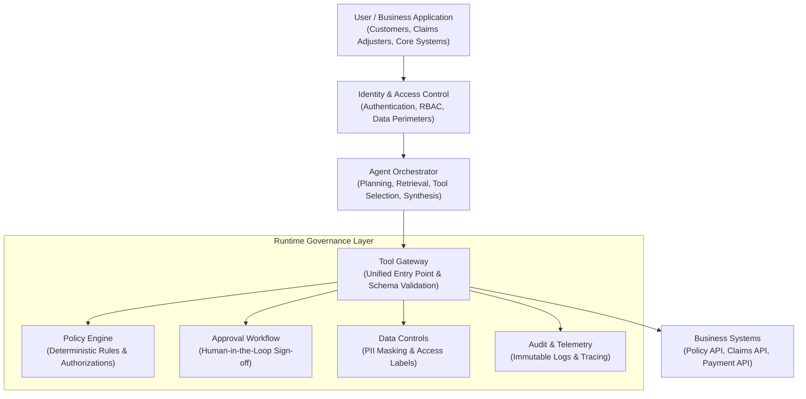
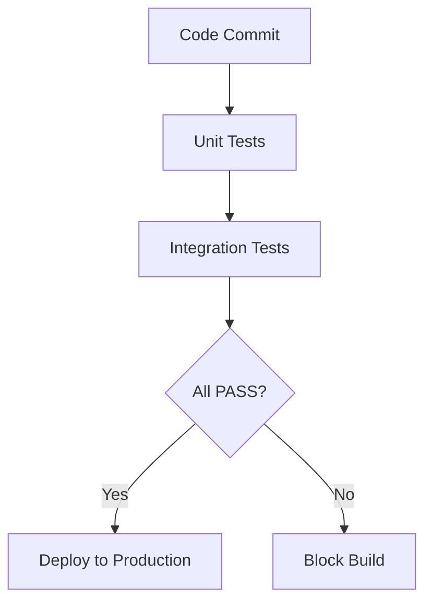
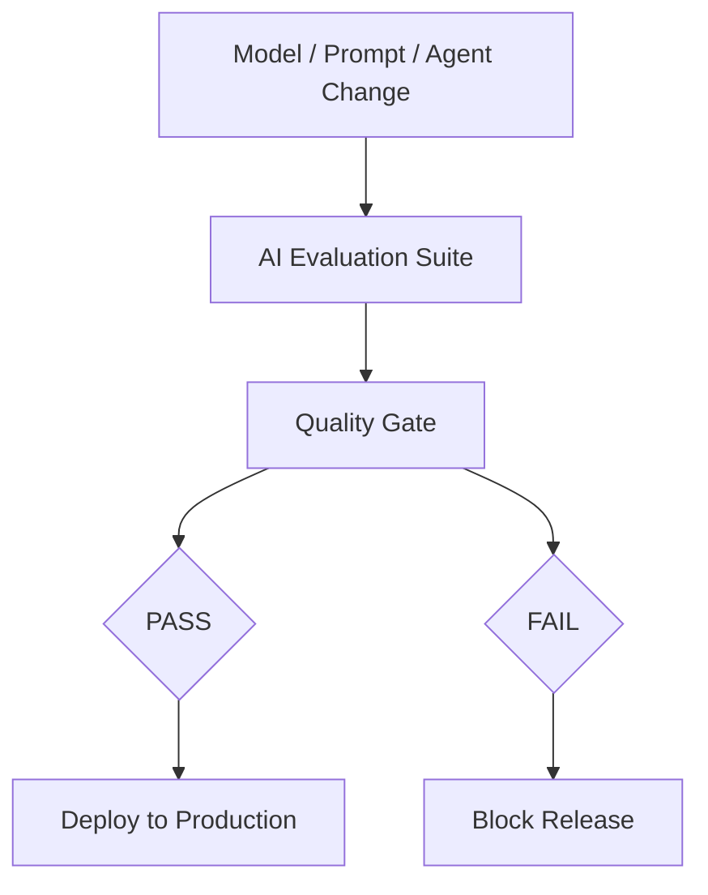
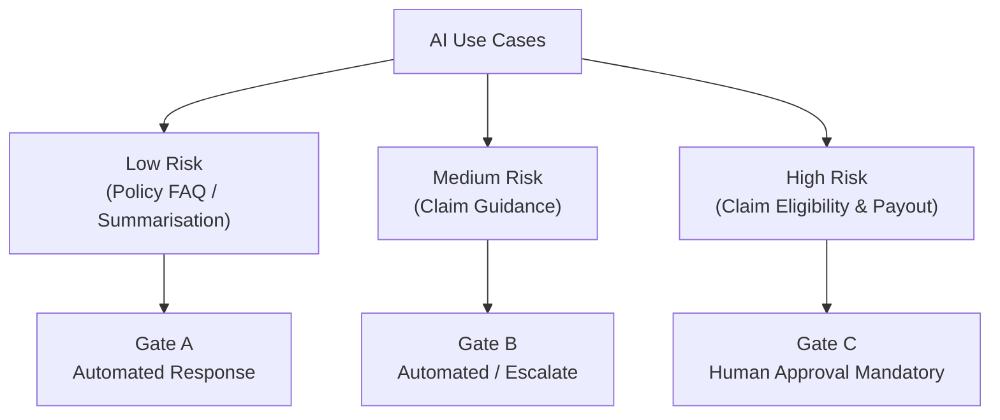
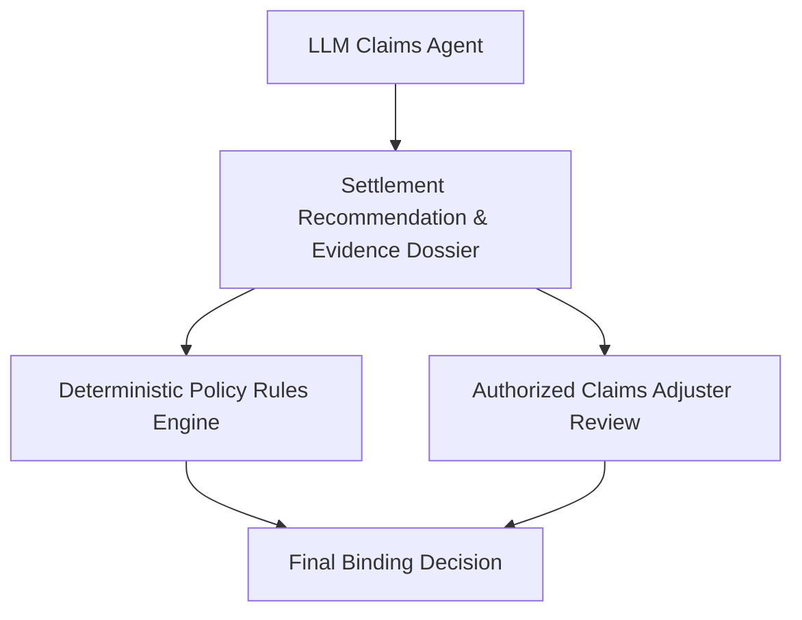
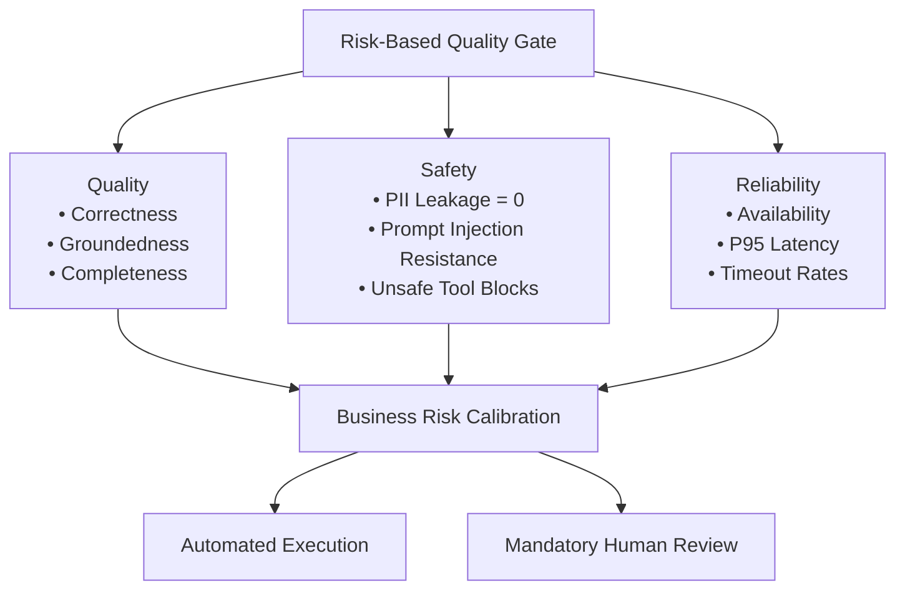
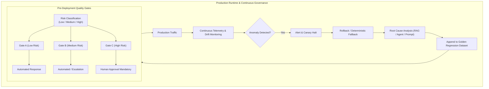
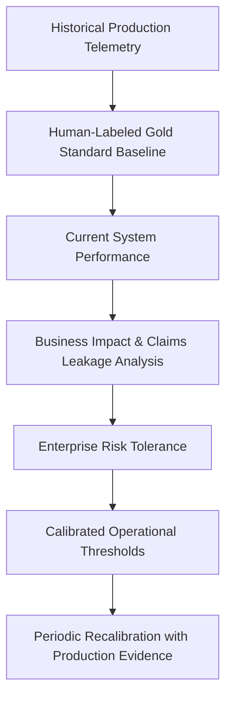
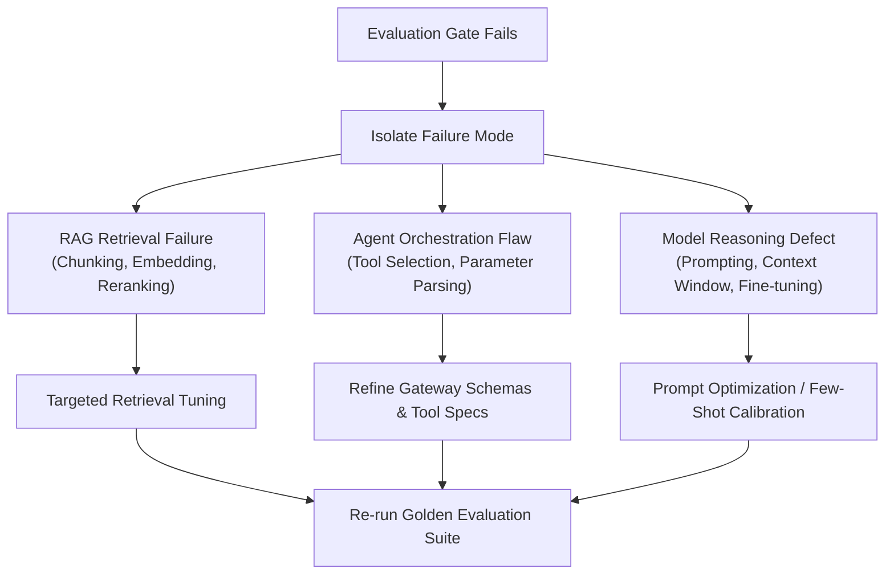
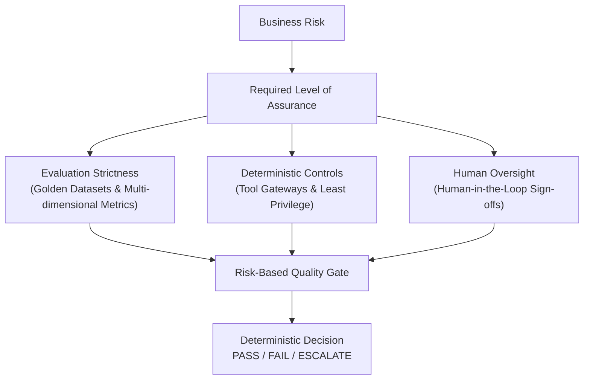

*Power without boundaries is a flood; power within boundaries is an engine. The true art of AI engineering lies not in unleashing the model, but in architecting its constraints.*

> **[Enterprise Context & Pseudonym Note]**
> In the production-grade architectures and engineering practices discussed throughout this article, **Aegis** (derived from the mythical shield symbolizing robust underwriting and uncompromising risk governance) is a fictional corporate pseudonym used by the author to represent a global Tier-1 multinational financial and insurance enterprise (Fortune Global 100 carrier). This preserves commercial privacy and regulatory boundaries while delivering an unvarnished blueprint of top-tier AI-native systems engineering in high-concurrency, strictly regulated production environments.

## Agent Governance

For an LLM AI developer, **Agent Governance Options** is a paramount architectural discipline. The real challenge is not whether you know how to attach a simple guardrail to an agent, but rather: **when an AI can autonomously choose tools, access sensitive insurance data, invoke business APIs, and execute state changes, how do you guarantee it acts strictly within explicit authorization and risk boundaries?**

> Once, Thomas Edison methodically tested thousands of heat-resistant materials while developing the incandescent electric light bulb. He never viewed unsuccessful trials as mere failures; each one was an essential data point bounding the solution space. His relentless experimentation proved that discipline and learning from failure ultimately reveal the viable path.

Just as Edison bounded his experimental domain, in Agent Governance we must systematically learn from system edge cases and failure modes, ensuring AI operates exclusively within well-defined permissions and risk envelopes.

I recommend mastering Agent Governance across five essential dimensions: **Degree of Autonomy**, **Access Control**, **Runtime Interception**, **Human Approval**, and **Governance Architecture**.

---

## 1. First Principles: What Does Agent Governance Actually Govern?

Traditional software applications execute business workflows explicitly written and hardcoded by software engineers. In contrast, an AI Agent dynamically decides what step to take next, which tool to invoke, and how to interpret returned tool results based on runtime user intent.

Consider an insurance policyholder asking:

> *"My laptop was stolen. Am I covered under my policy?"*

An autonomous Agent might execute the following workflow:

1. Query customer identity and policy details.
2. Retrieve relevant policy clauses and endorsements.
3. Query prior claims history.
4. Assess whether the submitted evidence is sufficient.
5. Explain applicable coverage terms to the customer.
6. If conditions appear met, attempt to initiate a claim file or update the claims administration system.

Step 5 primarily involves **information generation**; Step 6 ventures directly into **state-modifying business transactions**. Robust governance ensures the Agent never mistakenly approves a claim, mutates core policy records, or disburses funds due to an erroneous model inference.

Industry cloud provider security guidance explicitly notes that agent autonomy, tool invocation, persistent memory, and multi-system permissions compound and amplify traditional application security risks.

---

## 2. Four Autonomy Tiers: From Read-Only to Controlled Execution

This is the clearest classification model to present during architecture and design reviews:

### Level 1 — Read-Only Assistant
- **Risk Level**: 🟢 Low
- **Scope**: The Agent can only read authorized documentation, retrieve policy records, and answer questions. It cannot alter any business state.
- **Example**: Explaining theft coverage terms and enumerating deductible conditions.

### Level 2 — Recommend and Draft
- **Risk Level**: 🟡 Limited Business Impact
- **Scope**: The Agent generates claims summaries, prefills draft forms, and suggests next actions, but cannot directly submit high-impact transactions.
- **Example**: Preparing a draft claim dossier awaiting adjuster review and confirmation.

### Level 3 — Bounded Execution
- **Risk Level**: 🟠 Controlled Autonomous Execution
- **Scope**: The Agent executes pre-authorized, low-impact, reversible operations subject to deterministic permission gates and business rules.
- **Example**: Updating claim triage tags, scheduling callback appointments, or sending pre-approved template notifications.

### Level 4 — High-Impact Execution with Approval
- **Risk Level**: 🔴 High Risk
- **Scope**: Operations involving financial disbursements, claim rejections, underwriting bindings, or significant regulatory obligations. The Agent collects evidence and generates recommendations, but cannot execute without explicit, authorized human sign-off.
- **Example**: Formulating a settlement payout proposal, finalized only after an authorized claims manager signs off.

> **LLM AI Developer Criterion**: Never aim to maximize agent autonomy. Instead, enforce **Least Required Autonomy**—granting only the minimum operational authority necessary to fulfill the business goal safely.

---

## 3. Technical Governance Options

In production architecture reviews, engineering leaders evaluate how governance mechanisms are enforced across system boundaries:

| Governance Option | Operational Mechanism | Limitations & Considerations |
| :--- | :--- | :--- |
| **1. Prompt-level guardrails** | Defining behavioral rules and boundary instructions within the System Prompt. | Models can misunderstand or bypass instructions; vulnerable to jailbreaks and prompt injection. Cannot serve as a security perimeter. |
| **2. Application-level validation** | Validating inputs, parameters, and business state in application code. | Easily fragmented, duplicated, or inconsistently enforced if each agent handles validation independently. |
| **3. Tool gateway** | Centralizing all tool calls through a unified API gateway managing identity, RBAC, parameter validation, and telemetry. | Must guarantee no execution path allows an agent to bypass the gateway and access backend microservices directly. |
| **4. Policy engine** | Using deterministic policy engines (e.g., OPA/Cedar) to evaluate whether an action is permitted. | Requires maintaining externalized rule sets, permission contexts, and policy versioning lifecycles. |
| **5. Runtime interception** | Intercepting agent requests across execution phases to enforce `allow`, `deny`, `warn`, or `escalate`. | Demands tight, reliable integration hooks into the agent orchestration runtime. |
| **6. Human approval** | Mandating human-in-the-loop confirmation before high-risk operations can be executed. | Approval must occur strictly before state changes take effect, supported by complete explanatory context and audit trails. |
| **7. Monitoring and audit** | Immutably logging tool invocations, policy evaluations, failures, security events, and model versions. | Detective control only; investigates incidents post-hoc but cannot prevent an unauthorized execution in real time. |

> **Core Principle**: Never isolate governance inside prompts. Critical constraints must reside in deterministic control planes that can be systemically enforced, logged, and audited.

*(Note: Emerging frameworks such as Microsoft's Agent Control Specification (ACS, 2026) define standardized interception hooks across input, model pre/post-call, tool pre/post-call, and final response stages. While valuable as reference patterns, architectural implementation must align with enterprise-specific security requirements.)*

---

## 4. Recommended Enterprise Architecture: Centralized Policy, Distributed Enforcement

For a Tier-1 financial and insurance enterprise like Aegis, the architectural standard is **Centralized Policy, Distributed Enforcement**—governance policies are authored and maintained centrally, but enforced deterministically along every execution path.



The defining strength of this architecture is **architectural containment**: the Agent possesses zero pathways to bypass the governance layer. Even if an LLM emits a syntactically valid `approve_claim` invocation, the system independently validates caller identity, claim lifecycle status, entitlement scope, business rules, and required approvals.

**The model believing an action is appropriate never equals system permission to execute it.**

---

## 5. How Governance Policies Are Actually Enforced

Consider an Agent attempting to invoke the following tool call:

```json
{
  "tool": "approve_claim_payment",
  "arguments": {
    "claim_id": "CLM-10428",
    "amount": 12000
  }
}
```

The governance layer executes sequential validation checkpoints rather than trusting model-supplied parameters:

| Checkpoint | Validation Question |
| :--- | :--- |
| **Identity** | Is the calling user or agent service principal securely authenticated? |
| **Authorization** | Does the caller hold explicit entitlements to access this claim and initiate payments? |
| **Business policy** | Does the claim status, coverage limit, and underwriting policy satisfy deterministic rules? |
| **Risk policy** | Does the payout amount ($12,000) exceed automated approval thresholds, mandating escalation? |
| **Parameter validation** | Are `claim_id`, `amount`, currency, and payload structures validated against strict schemas? |
| **Approval** | Has an authorized claims officer granted documented approval for this specific transaction? |
| **Audit** | Are caller credentials, target parameters, policy outcomes, and timestamps immutably logged? |

The governance layer resolves to four deterministic outcomes:
- **`Allow`**: Validation succeeds; execution proceeds to the backend system.
- **`Warn`**: Execution proceeds, but emits elevated telemetry or warnings; reserved exclusively for non-security boundaries.
- **`Deny`**: Execution is terminated immediately.
- **`Escalate`**: Execution pauses; the transaction is routed to an authorized human approval queue.

For unauthorized financial transfers, data leakage, or business rule violations, soft warnings are forbidden. If a core authorization or policy check fails or times out, the system must **fail-closed** (default deny), preventing partial failures from letting unauthorized actions slip through.

---

## 6. Three Critical Questions Engineering Leaders Will Ask

### Q1: Why isn't a system prompt sufficient for governance?
> **Answer**: System prompts are behavioral guidance for stochastic models, not deterministic security perimeters. LLMs can misinterpret complex constraints, and retrieval pipelines (RAG) are susceptible to indirect prompt injection. Critical authorizations, data boundaries, and transactional checks must be enforced by backend identity layers, tool gateways, and deterministic policy engines.

### Q2: How do you govern a multi-agent system?
> **Answer**: In a multi-agent topology, each agent possesses distinct behavioral profiles and capabilities. Governance requires standardized inter-agent communication protocols, immutable shared state tracking, scoped per-agent service credentials (least privilege), and centralized observability. This prevents privilege escalation, runaway execution loops, or cross-agent unauthorized actions.

### Q3: How do you balance autonomy with safety?
> **Answer**: We establish a risk-proportional execution model. Low-risk, read-only tasks operate with high autonomy and streamlined automated checks. As operational risk escalates (e.g., state-altering or financial operations), the system progressively constrains autonomy via deterministic business rules, strict tool gateways, and mandatory human sign-offs.

---

## 7. The Architecture Narrative: Professional Articulation

When presenting Agent Governance architecture to technical leadership, articulate the solution using this structured narrative:

> *"I approach agent governance as an architectural and runtime enforcement challenge rather than relying solely on prompt-level instructions or model-side guardrails.*
>
> *First, I categorize agents and discrete operations by their business impact, reversibility, and regulatory exposure. A read-only policy clarification assistant must operate under an entirely different entitlement profile than an agent authorized to modify claim statuses or initiate payments.*
>
> *Second, I enforce least-privilege access through an identity-aware tool gateway backed by deterministic policy evaluation. Every sensitive tool invocation is independently verified prior to execution—validating caller authorization, argument schemas, business constraints, and requisite approvals.*
>
> *Third, I introduce runtime governance across critical lifecycle interception points: prior to model invocation, before and after tool execution, and before returning the final response. Depending on operational risk, the system deterministically allows, denies, warns, or escalates. All critical controls fail closed.*
>
> *Finally, I embed auditability, continuous evaluation, telemetry, and release gates into the agent lifecycle. We begin with bounded autonomy and expand operational boundaries only when empirical evaluation proves our controls are resilient.*
>
> *The foundational principle is clear: **The model may recommend an action, but the system independently determines whether that action is authorized and safe to execute.**"*

---

# Risk-Based Quality Gates: From Model Testing to Production Governance

Mastering **Risk-Based Quality Gates** represents the critical leap from merely "evaluating an LLM" to executing **production-grade enterprise AI governance**.

For an insurer like Aegis, the governing principle is straightforward:

> **Do not hold every AI request to a uniform, arbitrary benchmark. Instead, define differentiated quality, safety, human oversight, and release gates calibrated to the business risk of the underlying decision.**

---

## 1. What Is a Quality Gate?

In traditional software CI/CD:



In production AI systems:



At its core, a Quality Gate represents:

> **A predefined set of non-negotiable criteria that must be satisfied before transitioning to the next phase.**

For example:
```text
Correctness       ≥ 90%
Groundedness      ≥ 95%
Safety            ≥ 99%
P95 Latency       ≤ 3 sec
Cost / request    ≤ $0.05
```

If all criteria are met: `PASS → Deploy`. Otherwise: `FAIL → Block`.

---

## 2. Why Must Quality Gates Be Risk-Based?

Consider two core AI agents deployed within Aegis:

### AI Agent A: Policy Clarification Assistant
> *"Summarize my policy coverage in plain English."*

If Agent A occasionally omits a secondary clause, the business risk is generally low and easily rectified.

### AI Agent B: Claims Adjudication Agent
> *"Evaluate whether this claim qualifies for immediate payout under the policy."*

If Agent B erroneously adjudicates a non-covered incident as covered:
- Direct financial loss from unauthorized payouts
- Regulatory penalties for non-compliant settlements
- Customer harm and systemic exposure
- Long-term reputational damage

Applying an identical quality gate across both agents is fundamentally flawed. **Agent B demands an exponentially stricter quality gate.**

---

## 3. A Concrete Aegis Example: Claims Assistant

Suppose Aegis deploys an AI Claims Assistant capable of handling four operational use cases:

| Use Case | Operational Risk Tier |
| :--- | :--- |
| **Policy FAQ** | 🟢 Low |
| **Policy Summarisation** | 🟢 Low |
| **Claim Guidance** | 🟠 Medium |
| **Claim Eligibility / Settlement Recommendation** | 🔴 High |

Rather than applying a single, undifferentiated threshold (`Accuracy ≥ 90%` across all workloads), we construct tiered gates:



---

## 4. Gate A: Low Risk (Policy FAQ)

*Example: "What does my travel insurance policy say regarding baggage delays?"*

Operational criteria:
```text
Correctness       ≥ 90%
Groundedness      ≥ 95%
Safety            ≥ 99%
P95 Latency       ≤ 4 sec
```

- **Execution Mode**: Automated response permitted.
- **Oversight**: No per-transaction human sign-off required.

---

## 5. Gate B: Medium Risk (Claim Guidance)

*Example: "Based on my incident report and policy, can I file a storm damage claim?"*

This response directly influences customer legal actions and formal claim filings:
```text
Correctness       ≥ 95%
Groundedness      ≥ 98%
Safety            ≥ 99.5%
Critical Facts    = 100%
```

- **Execution Policy**:
  ```text
  No Evidence → No Speculation → Escalate to Human Adjuster
  ```
- **Oversight**: Automated response for high-confidence paths; automated escalation for ambiguous or edge-case claims.

---

## 6. Gate C: High Risk (Claim Eligibility & Settlement)

*Example: "Should Aegis approve this commercial property claim for $50,000?"*

Here, automated generation cannot directly commit enterprise funds:



Gate C evaluation criteria:
```text
Critical factual accuracy    = 100%
Policy grounding             = 100%
PII violations               = 0
Unsafe tool actions          = 0
Tool authorization           = 100%
Human approval               = Mandatory
```

> **Crucial Takeaway**: High-risk AI does **not** mean "the machine learning model must be 100% accurate." It means **the system is architected so that even when the model hallucinates or makes mistakes, it cannot directly produce catastrophic or irreversible business damage.**

---

## 7. The Leadership Distinction: Model Accuracy vs. System Resilience

During technical architecture reviews, leaders often challenge:

> *"Are you saying high-risk AI demands 100% model accuracy?"*

**Never answer "Yes."** Absolute accuracy in probabilistic models is unattainable in production.

Instead, respond:

> *"No. For high-risk use cases, I never rely on model accuracy alone. I combine calibrated evaluation thresholds with deterministic business rules, least-privilege tool gateways, and mandatory human-in-the-loop sign-offs."*

```text
Model + RAG + Rules + Authorization + Guardrails + Human-in-the-Loop = Production Enterprise AI
```

---

## 8. Risk-Based Gates Are Multi-Dimensional

A common anti-pattern is reducing risk gates to a single scalar (e.g., `Low = 90%`, `High = 99%`). Production frameworks are inherently multi-dimensional:



Quality, safety, reliability, and business impact collectively determine whether an agent deployment or runtime invocation proceeds.

---

## 9. Business Economics in Quality Gates

Assume we evaluate a candidate model upgrade for production:
- **Baseline**: Model A
- **Candidate**: Model B

Offline benchmark results:

| Metric | Model A (Production) | Model B (Candidate) | Variance |
| :--- | :--- | :--- | :--- |
| **Correctness** | 94% | **97%** | +3% |
| **Groundedness** | 97% | **98%** | +1% |
| **Safety** | 99.7% | **99.8%** | +0.1% |
| **P95 Latency** | 2.0s | 2.8s | +40% |
| **Unit Cost** | $0.04 | **$0.09** | **+125%** |

Superficially, Model B delivers higher accuracy. However, compute costs surge by 125% and latency increases by 40%.

- **For Low-Risk FAQ (10M queries/day)**:
  - Model A cost: $400,000 / day
  - Model B cost: $900,000 / day
  - Additional operational expenditure: **+$500,000 / day**
  - *Verdict*: **FAIL** — Marginal quality gains do not justify substantial cost inflation.
- **For High-Risk Claim Triage**:
  - A 3% improvement in accuracy prevents millions in claim leakage and litigation exposure.
  - *Verdict*: **PASS** — Quality gains vastly outweigh incremental compute overhead.

**A Quality Gate is a business policy translated into engineering criteria.**

---

## 10. The Peril of Aggregate Scores: Why Segmentation Is Mandatory

Suppose an agent evaluation suite reports:
```text
Overall Accuracy = 96%
```

On paper, this appears outstanding. But segmented by operational domain:
```text
Low-risk Policy FAQ            99%
General Claim Guidance         97%
Claim Eligibility Triage       91%
High-Value Complex Claims      82%
```

Evaluating solely against an unsegmented threshold (`Overall ≥ 95%`) grants a false **PASS**. In production, an 18% error rate on high-value claims represents an unacceptable business liability.

Quality gates must enforce **hierarchical segmentation**:
```text
Overall Accuracy              ≥ 95%
AND High-Value Claims         ≥ 99%
AND Safety Violations         = 0
AND PII Leakage               = 0
```

---

## 11. Principles to Champion Within Your Team

When guiding engineering teams, establish two fundamental architectural tenets:

1. *"We reject a single global AI quality threshold."*
2. *"We define quality gates segmented by risk tier and failure mode."*

---

## 12. Failure Modes Demand Independent Gates

Suppose overall quality reaches 96%, but exhibits a 4% hallucination rate.

In generic documentation retrieval, occasional minor hallucinations may be tolerable. In **insurance policy coverage interpretation**, a 4% hallucination rate can trigger widespread compliance violations and contractual disputes.

Overall score and critical failure rates must pass simultaneously:
```text
Overall Correctness            ≥ 95%
AND Critical Hallucination     < 0.1%
AND PII Leakage                = 0
AND Unsafe Tool Calls          = 0
```

---

## 13. Hard Gates vs. Soft Gates

Production AI pipelines balance rigid security requirements with operational trade-offs:

### Hard Gates (Non-Compensatory)
Violations result in an immediate build break or blocked execution:
- PII leakage > 0
- Unsafe tool invocation > 0
- Critical policy hallucination > 0

### Soft Gates (Compensatory / Trade-offs)
Permits managed engineering trade-offs:
- Latency fluctuations within acceptable bands
- Incremental token cost
- Stylistic fluency variations

```text
Safety Violation  → Absolute Blocker (Hard Gate)
Latency Increase  → Managed Engineering Trade-off (Soft Gate)
```

---

## 14. Architecture Blueprint: End-to-End Governance & Feedback Loop



---

## 15. Leadership Question 1: Who Determines the Risk Level?

> *"How do you determine whether an AI use case is low, medium, or high risk?"*

**Never answer**: *"The engineering team decides."*

**The correct stance**:
> *"Risk classification is an enterprise cross-functional decision uniting Engineering, Product, Information Security, Legal/Compliance, and Business Owners."*

Risk is evaluated through standard risk matrices:
$$\text{Risk} = \text{Impact} \times \text{Probability}$$

Key evaluation criteria:
- **Financial exposure**: Maximum automated transaction value.
- **Customer impact**: Potential for unfair denial of benefits or customer harm.
- **Regulatory & privacy exposure**: Compliance with insurance regulations and data privacy statutes.
- **Operational reversibility**: *Can the AI's action be cleanly reversed without business damage?*
  - Generating an explanation → Reversible.
  - Disbursing a $100,000 claim payout → High impact and largely irreversible.

---

## 16. Leadership Question 2: What If the Overall Score Passes but One Critical Metric Fails?

> *Example: Overall Score = 97%, but Safety Score = 98% (Required: 99.9%).*

**The answer**:
> *"It fails immediately. I implement non-compensatory gates for critical risk dimensions. High factual accuracy cannot compensate for data leakage or safety violations."*

```text
95% Accuracy + Critical Safety Flaw ≠ 90% Average (PASS)
95% Accuracy + Critical Safety Flaw = CRITICAL BLOCKER (FAIL)
```

---

## 17. Leadership Question 3: Who Sets the Thresholds?

> *"Why is the threshold set to 95% instead of 90%?"*

**The answer**:
> *"Thresholds must derive from business risk tolerance and empirical baselines, never arbitrary assumptions."*

Establish thresholds through systematic calibration:


---

## 18. Leadership Question 4: What Happens When a Gate Fails?

Never stop at *"we abort deployment."* A robust engineering response specifies root-cause remediation workflows:



If degradation occurs in **production runtime**:
1. Automated alert triggers on metric divergence.
2. Canary deployment halts immediately.
3. Traffic rolls back to the previous stable release or falls back to deterministic rule paths.
4. Failure traces are converted into reproducible regression test cases in the golden dataset.

---

## 19. Leadership Question 5: Do Risk-Based Gates Slow Down Innovation?

> *"Yes—if implemented as manual bureaucracy. My goal is to build automated gates proportional to risk."*

- **Low-risk workflows**: Automated evaluation directly triggers automated CI/CD deployment. Experimentation accelerates without friction.
- **High-risk workflows**: Automated evaluation is coupled with structured security reviews, deterministic business constraints, and controlled canary rollouts.

**Risk-based governance accelerates low-risk innovation while concentrating rigorous controls precisely where business impact warrants them.**

---

## 20. Scenario Walkthrough: Accuracy +4%, Latency +20%, Cost +50%

> Leader asks: *"Your candidate model improved accuracy from 94% to 98%, but latency rose 20% and cost jumped 50%. Would you deploy it?"*

Avoid simplistic binary answers ("Yes, because accuracy improved" or "No, because cost rose").

The senior engineering response:
> *"It depends strictly on the risk tier and business unit economics.*
>
> *If this powers a **high-risk claims adjudication workflow**, the 4% accuracy gain can prevent hundreds of thousands of dollars in claims leakage, regulatory fines, and legal disputes. The additional compute cost is negligible compared to the business value preserved.*
>
> *If this powers a **low-risk policy FAQ assistant**, a 4% accuracy boost delivers negligible incremental utility while burdening the enterprise with substantial compute overhead. In that scenario, I would reject deployment or route queries through a tiered model router.*
>
> *Ultimately, the gate is an enterprise business decision expressed through calibrated engineering metrics."*

---

## 21. The Executive Summary for Engineering Leadership

When asked by executive leadership: *"How would you establish risk-based quality gates for our enterprise AI agents?"*—deliver this comprehensive synthesis:

> *"I avoid applying a single global quality threshold across heterogeneous AI use cases.
>
> In an enterprise insurance ecosystem like Aegis, I first classify use cases based on potential customer, financial, regulatory, privacy, and reputational impact—evaluating whether actions are reversible and whether human oversight is present. A policy clarification assistant represents low risk, whereas a claim payout recommendation is inherently high risk.
>
> Next, I establish differentiated quality gates for each risk tier across multiple dimensions: correctness, groundedness, retrieval quality, task completion, safety, latency, and unit economics.
>
> Crucially, critical safety metrics serve as non-compensatory hard gates: zero PII leakage, zero unauthorized tool invocations, and zero critical policy hallucinations must pass regardless of aggregate scores.
>
> For high-risk workloads, I couple strict automated evaluation with deterministic business rules, least-privilege tool gateways, mandatory human-in-the-loop sign-offs, and staged canary rollouts. I enforce segmented evaluation rather than relying on overall averages, ensuring high-value transactions are never obscured by routine FAQ benchmarks.
>
> Finally, these gates form an integrated feedback loop within CI/CD and production monitoring. Changes must pass offline evaluation gates before release, followed by canary verification. Production regressions are continuously fed back into our golden datasets to prevent recurrence.
>
> The governing philosophy is simple: **Risk dictates the required burden of evidence and control, and the Quality Gate translates that risk policy into measurable engineering criteria.**"*

---

## 22. The Core Philosophy



As an LLM AI developer, your primary mandate is not simply boosting model accuracy from 95% to 97%. Your true responsibility is:

> **Determining the precise level of empirical evidence required for each business scenario; establishing when an AI is permitted to act autonomously; enforcing when it must be halted or escalated to human oversight; and automating those requirements into resilient production gates.**

This marks the transition from basic AI model experimentation to **AI Systems Engineering, Risk Engineering, and Production Governance**.

Articulating the entire lifecycle—`Risk Classification → Multi-Dimensional Evaluation → Deterministic Controls → Human Oversight → Deployment Gates → Production Telemetry Feedback`—demonstrates the difference between an engineer who merely prompts models and an architect who builds enterprise-grade AI production platforms.
