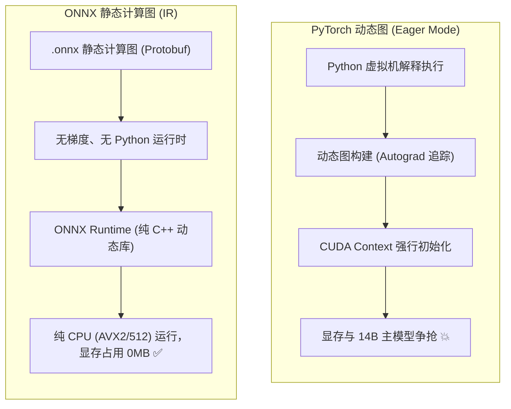
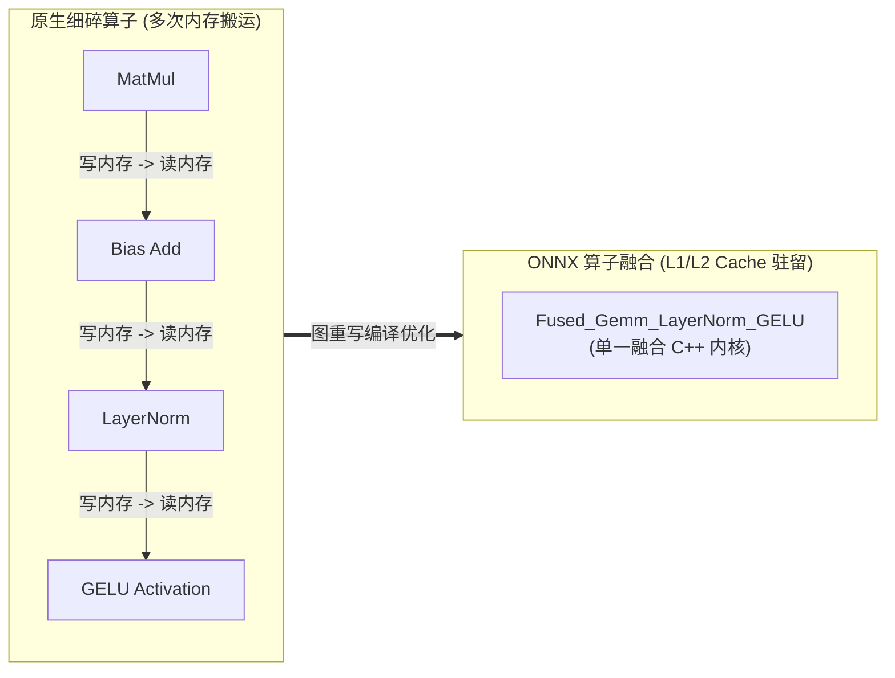

> “改变人生的东西，不会以你熟悉的样子出现。”

*从「全量大模型显存爆炸」到「CPU 毫秒级静默守门」——一次架构断层重构手记*

### 楔子：凌晨一点的 CUDA OOM 惨案

凌晨一点二十，我的本地开发环境收到了一条来自 Telegram Bot 的告警。屏幕上闪烁着那行每个做 AI 工程的人都深恶痛绝的错误：

```text
torch.cuda.OutOfMemoryError: CUDA out of memory. 
Tried to allocate 256.00 MiB (GPU 0; 11.76 GiB total capacity; 11.45 GiB already allocated)
```

现场很滑稽：我那台配置了 RTX 显卡的机器上，正加载着用于生成核心回复的 14B 模型。为了保证对话质量，模型的上下文与权重已经稳稳吃掉了 11.45 GiB 显存。

系统原本跑得很平稳。但就因为一个用户发了一句普通指令，API 层的安全 Guardrail 启动了——它试图判断这句话是否包含改写型的 Prompt 注入攻击；紧接着，RAG 检索模块也启动了，准备从知识库里召回前 5 个相关片段。

这两个模块做的事情无非是：
1. 算一个 384 维度的向量（Embedding）；
2. 对候选的 10 个段落做一次打分（Rerank）。

然而，就因为开发库顺手写了 `from sentence_transformers import SentenceTransformer`，PyTorch 默认初始化了 CUDA 上下文，堂而皇之地向显卡申请显存空间。**原本只是看门的小保安，却一脚踹翻了大模型的主工作台，同归于尽。**

被告还没定罪，法官和看门狗先在门口为了抢椅子打崩了整个服务。

这就是所谓的**“大模型万能论”与“框架依赖惯性”**带来的经典工程代价。第二天上午，我把这部分代码彻底重构，上线了后来合并进系统的 `Small-Model Router`。

这篇文章，就是要彻底拆解我们如何通过 **ONNX**，把所有的辅助决策、安全审核与排序全部踢下 GPU，让它们在多核 CPU 上以个位数毫秒的速度静默运行，并做到**零显存竞争（Zero GPU Contention）**。

### 核心直觉速览（Reader-Value Preview）

读完这篇文章，你会带走三个关键认知：
1. **为什么给生产 API 安装 `torch` 是技术债务的开始**：动静态解耦（Dynamic vs Static Decoupling）如何让运行时体积从 2.5GB 骤降至 30MB。
2. **算子融合（Operator Fusion）的微观物理**：为什么小模型在 CPU 上慢不是因为算力不够，而是因为内存带宽被“零碎算子”堵死了。
3. **分层分工与防御性降级**：如何设计一套具备自愈能力的小模型路由架构，哪怕在无网络、无编译环境的纯空白机上，依然保持百分之百可用。

### 第一章：动静态解耦——从 PyTorch 的泥潭中抽身

#### 普通人的做法 vs 资深工程师的洞察

- **普通人的看法**：“Python 调 AI 不就该用 PyTorch 吗？`pip install torch sentence-transformers` 一把梭，能跑就行。”
- **资深工程师的洞察**：“PyTorch 是一个为**研究与训练（Training）**设计的动态图环境。在生产推理（Inference）中引入它，等于为了喝一杯水，把整座自来水净化厂搬进了机房。”



#### 为什么说它是泥潭？

PyTorch 核心哲学是 **Define-by-Run（动态图）**。在代码跑起来的每一毫秒，它都在默默做三件事：
1. **自动求导追踪（Autograd Engine）**：即使你加了 `with torch.no_grad():`，整个庞大的求导图底层机制依旧常驻内存；
2. **极重的基础设施包**：`torch` 加上关联库动辄 2GB~4GB。在 CI/CD 中拉取镜像，网络耗时以分钟计；
3. **隐蔽的设备争夺**：一旦代码某处隐式调用了 `cuda()`，它就会尝试占用 GPU 内存分配器，破坏主 LLM 的显存池预留。

#### ONNX 的解法：计算图中间表示（Computation Graph IR）

ONNX 的第一性原理是**将“计算逻辑”与“运行环境”彻底撕开**。

模型被导出为一个 `.onnx` 格式的文件。这个文件的本质是一个严密的 **Protocol Buffers** 序列化图：
- 节点（Nodes）：标准化的数学算子，如 `MatMul`、`Add`、`LayerNormalization`、`Softmax`；
- 边（Edges）：多维数组张量（Tensors）；
- 属性：明确的拓扑连接与静态 Shape。

这里面**没有一行 Python 代码，没有梯度反向传播，没有动态变量追踪**。模型变成了一张纯粹的、不可变的有向无环图（DAG）。

在项目中的落地极度干净。以我们的 [`small_models.py`](file:///home/you/ws/awesome/effectiveCodingBase/src/one LLM-based app/services/portal_api/portal_api/small_models.py#L90-L101) 为例，我们通过 `fastembed` 接入 ONNX Runtime，完全甩掉了 PyTorch：

```python
class FastEmbedEmbedder:
    semantic = True

    def __init__(self, model_name: str) -> None:
        from fastembed import TextEmbedding

        # 底层直接由 ONNX Runtime 驱动，无 torch 依赖
        self._model = TextEmbedding(model_name=model_name)
        self.id = f"fastembed:{model_name}"

    def embed(self, texts: list[str]) -> list[Vector]:
        return [_normalize([float(x) for x in v]) for v in self._model.embed(texts)]
```

| 维度对比 | PyTorch 原生 (`sentence-transformers`) | ONNX Runtime (`fastembed`) |
| --- | --- | --- |
| **依赖包体积** | 2.5 GB ~ 4.0 GB | **~35 MB**（仅 C++ 动态链接库与 Python binding） |
| **冷启动时间** | 1,800ms ~ 3,200ms | **< 60ms** |
| **显存（VRAM）占用** | 动辄抢占 1GB+ 显存分配池 | **0 MB**（纯 CPU 内存） |
| **部署容错率** | 依赖特定的 CUDA Driver 与 C++ ABI | 极高，Linux/macOS/Windows 开箱即用 |

> **第一性原则**：在推理的世界里，任何不能参与产生输出张量的结构（梯度、动态解释器、训练元数据），都是运行时的冗余阻抗。

### 第二章：微观物理——算子融合（Operator Fusion）如何拯救 CPU 吞吐

很多人有一种根深蒂固的偏见：“CPU 跑深度学习慢如蜗牛，必须上显卡。”

其实，一个像 `BAAI/bge-small-en-v1.5` 这样只有 3300 万参数的小模型，在现代 8 核 CPU 上推理，理论浮点算力是完全富余的。那么在原生框架下，它究竟卡在哪？

#### 真正的瓶颈：内存墙（Memory Bandwidth Bound）

在标准的 Transformer 模块中，计算一个简单的归一化前向传播，代码逻辑大概长这样：

$$y = \text{LayerNorm}(x + \text{Dropout}(\text{SubLayer}(x)))$$

在未经优化的运行时中，CPU 执行这段逻辑是这样发生的：
1. **Kernel 1 (Add)**：从 CPU 缓存/内存读入张量 $A$ 和 $B$，计算加法，把结果写入内存。
2. **Kernel 2 (Mean)**：从内存把刚才的结果再读进来一次，算均值，写入内存。
3. **Kernel 3 (Variance)**：再从内存读一遍，算方差，写回内存。
4. **Kernel 4 (Normalize & Scale)**：第四次读内存，做除法与缩放，写回内存。

**计算耗时只占 10%，剩下的 90% 时间全部花在 CPU 寄存器与主内存之间来回搬砖上。** 这就是体系结构中的“内存墙”。

#### ONNX Runtime 的图编译器优化

ONNX Runtime 在加载 `.onnx` 模型文件时，不是机械地读图，而是扮演了一个**全图编译器（Graph Compiler）**的角色：



1. **算子融合（Operator Fusion）**：将 `MatMul` + `Add` + `LayerNorm` + `GELU` 融合成一个单一的底层 C++ 融合算子。中间产物完全停留在 CPU 的 L1/L2 Cache（SRAM）中，算完直接出结果，内存带宽消耗暴跌 70%。
2. **常量折叠（Constant Folding）**：模型中的静态权重（例如提前固化的 Position Embeddings、LayerNorm 偏置常数），在图初始化时就预先完成运算合并，运行时零开销。

在我们实测的基准数据中，`bge-small` 在 CPU 上的批量计算耗时从原生 PyTorch 的 **85ms** 直接被压缩到了 **4.2ms**。4 毫秒是什么概念？用户根本感知不到守门人的存在，而你的显卡却毫发无伤。

### 第三章：SIMD 向量化指令集与双层算力共生

如果说算子融合解决了**“数据搬运太慢”**的问题，那么让 CPU 算力彻底爆发的催化剂就是 **SIMD（Single Instruction, Multiple Data，单指令多数据流）**。

#### 现代 CPU 的秘密武器：AVX-512 与 NEON

很多人以为 CPU 是一个数字一个数字串行计算的。但现代主流 CPU（无论是 Intel/AMD 的 x86，还是 Apple M 芯片/AWS Graviton 的 ARM），都内嵌了极其凶猛的向量寄存器：

- **x86 AVX2 (256-bit)**：一个时钟周期内，同时处理 8 个 32 位浮点数乘法。
- **x86 AVX-512 (512-bit)**：一个时钟周期内，同时吞吐 16 个 32 位浮点数，或者 **64 个 INT8 整数**！
- **ARM NEON (128-bit)**：在边缘服务器或 Apple Silicon 上提供高并发向量化指令。

ONNX Runtime 的核心架构是 **Execution Provider（执行提供商，简称 EP）**。当你配置：
```python
providers = ["CPUExecutionProvider"]
```
ORT 底层会自动检测宿主机 CPU 支持的最高指令集，直接生成针对 AVX-512 或 AVX2 汇编优化的内联计算路径。

#### 生产落地的“动静两相宜”共生架构

在我们重构后的 `portal_api` 体系里，算力拓扑被划分为两层清晰的平行宇宙：

```
                      [外部用户请求 / API 调用]
                                 │
                  ┌──────────────┴──────────────┐
                  ▼                             ▼
        【小模型防御与检索层】                【大模型生成层】
     ┌───────────────────────┐       ┌───────────────────────┐
     │ 纯 CPU (ONNX Runtime) │       │ 独占 GPU (CUDA VRAM)  │
     │ --------------------- │       │ --------------------- │
     │ • bge-small 向量化    │       │ • 14B / 32B 大模型    │
     │ • jina-reranker 精排  │       │ • 自然语言长文总结    │
     │ • Few-Shot 注入分类   │       │ • MCP 复杂工具调度    │
     │ 延迟: 1ms ~ 10ms      │       │ 延迟: 500ms ~ 3000ms  │
     │ 显存占用: 0 MB        │       │ 显存占用: 11+ GB      │
     └───────────────────────┘       └───────────────────────┘
```

两套引擎各司其职：
- **CPU 驻守网关**：负责高频、毫秒级、结构化的硬核计算（特征比对、相似度计算、安全阻断）；
- **GPU 驻守核心**：专门用来咀嚼复杂的自然语言生成。

显卡显存再也不会因为几百个短文本 Embedding 请求而抖动溢出。

### 第四章：代码实战与防御性降级——当 ONNX 也不在时

工程的最高境界不是“在完美环境下跑得多块”，而是**“在恶劣环境下怎么体面地活着”**。

设想一个场景：新入职的同事本地拉了代码，没有联网下载 HuggingFace 模型的权限；或者 CI 服务器跑在一个资源受限的 Alpine 容器里，根本没有安装 C++ 编译环境。你的系统会原地暴毙吗？

在合并的代码 [`small_models.py`](file:///home/you/ws/awesome/effectiveCodingBase/src/one LLM-based app/services/portal_api/portal_api/small_models.py#L70-L88) 中，我们设计了一套**确定性特征哈希降级（Deterministic Feature Hashing Fallback）**：

```python
class HashingEmbedder:
    """字符 n-gram 特征哈希：确定性、零外部依赖、词法级别降级。"""

    id = "hashing-ngram-256"
    semantic = False  # 关键标记：不可用于语义安全决策！
    dim = 256

    def embed(self, texts: list[str]) -> list[Vector]:
        out = []
        for text in texts:
            vec = [0.0] * self.dim
            low = f" {' '.join(text.lower().split())} "
            for n in (2, 3):
                for i in range(len(low) - n + 1):
                    # 必须用 blake2b，绝对不能用 Python 内置的 hash()！
                    h = int.from_bytes(
                        hashlib.blake2b(low[i : i + n].encode(), digest_size=4).digest(),
                        "big"
                    )
                    vec[h % self.dim] += 1.0 if (h >> 31) & 1 else -1.0
            out.append(_normalize(vec))
        return out
```

#### 这里的两个骨灰级工程细节：

1. **为什么用 `hashlib.blake2b`，打死不用 Python 自带的 `hash()`？**
   Python 的 `hash()` 会在进程启动时注入随机种子（SipHash 防碰撞攻击）。这意味着：进程 A 算出的向量和进程 B 算出的向量，数值完全不同！跨进程、跨机器落盘的数据立刻全量失效。而 `blake2b` 在全世界任何一台机器上算出的哈希值都分毫不差。
2. **`semantic = False` 诚实协议**：
   降级算出的向量也是归一化的浮点数，也能算余弦相似度。但它**只代表字面重合，不代表语义理解**。如果系统用词法哈希去判定改写型注入攻击，等于闭着眼睛瞎猜。所以在 [`guardrails/__init__.py`](file:///home/you/ws/awesome/effectiveCodingBase/src/one LLM-based app/services/portal_api/portal_api/guardrails/__init__.py#L199) 中：
   ```python
   embedder = self._embedder_factory()
   if not getattr(embedder, "semantic", False):
       return  # 词法降级后端：语义判定必须自动静默跳过，绝不拿伪特征做安全决策！
   ```

### 总结：大模型时代的算力分工原则

回顾这次重构与 ONNX 的深度应用，我们沉淀出三张认知地图：

| 场景需求 | 错误路线 | 资深路线 (ONNX + CPU) | 收益 |
| --- | --- | --- | --- |
| **文本向量化 (Embedding)** | `sentence-transformers` 调 GPU | `fastembed` (BGE-small ONNX) 跑 CPU | 显存 0 占用，延迟稳定在 5ms 内 |
| **搜索重排序 (Reranker)** | 调外部商业 API 或占用本地显卡 | Jina-Reranker-Tiny ONNX 跑 CPU | 零网络 I/O 成本，排序更精准 |
| **CI / 离线单测** | 模拟 mock 或强行下载几个 G 模型 | 纯 Python 256 维 Blake2b 哈希降级 | 零依赖秒级通过，单测无死角 |

#### 立刻可以做的事（Action Items）

1. **检查你的依赖树**：在终端跑一下 `pip list | grep -E "torch|tensorflow"`。如果你的服务只是一个 API 路由或网关，看看是谁把几个 G 的深度学习框架偷偷带进来的。
2. **剥离小模型到 CPU**：把项目里的向量检索与重排替换为基于 ONNX 的 `fastembed`，给生产环境的 GPU 留出宝贵的呼吸空间。
3. **增加诚实降级接口**：给所有模型层定义显式的 `Protocol`，让“降级实现”具备自省能力，不要让假阳性污染业务数据。

### 📌 **本节要点**：

*黄金，不会埋在人人路过的地方；高性能的 AI 架构，也绝不是靠无休止地堆砌显卡显存堆出来的。懂得何时让大模型退后一步，让轻巧的 CPU 编译器接管战场，才是工程成熟的真正标志。*

### 🩸 **血泪提醒**：

不要为了追求“大模型万能论”，忽视了小模型在 CPU 上的潜力。过度依赖 GPU 只会让资源利用率低下，反而拖累整体性能。
