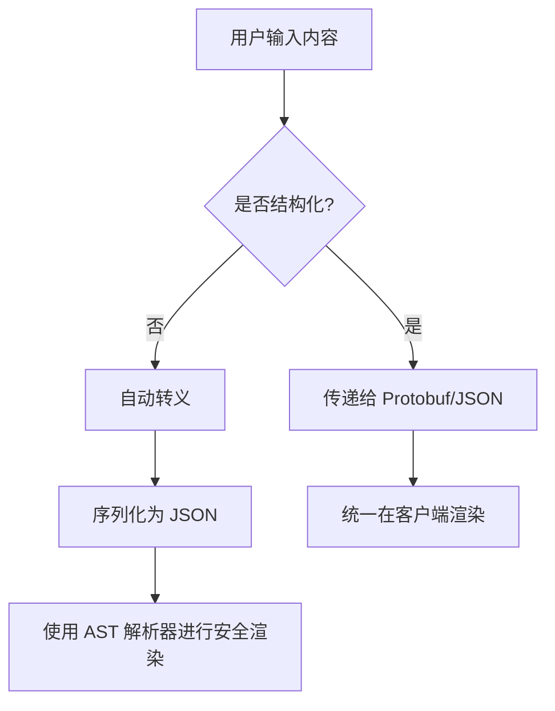

# 正则与 Markdown：你真的在玩“打地鼠”吗？

> "Whatever is worth doing is worth doing well." – John Ruskin

*正则表达式和 Markdown 的世界，远比你以为的要复杂。*

「你真的在玩‘打地鼠’吗？」

上周五下午做架构巡检时，我顺手点开了一个内部 AI 研发助手的 GitHub PR。

这个助手干的活很简单：把后端 Pipeline 跑出来的异常堆栈和 LLM 的诊断建议打包，通过 Telegram 机器人推给值班工程师。提交 PR 的是个基本功很扎实的高级开发，他在 Commit Message 里写着：`fix: 修复含下划线的标识符导致 Telegram 消息发送失败或被吃字的问题`。

用过 Telegram Bot API 的人大概都懂他在修什么。Telegram 最早期的 Legacy Markdown（`parse_mode="Markdown"`）有个极其反人类的设计：它把成对的单下划线 `_` 当作*斜体*标签。只要你的正文里同时出现了 `user_name` 和 `order_id`，夹在两个下划线中间的那截文字就会莫名其妙歪成斜体，而那两个下划线本身则直接人间蒸发；更糟的是，如果整段话里恰好出现了奇数个下划线，Telegram 服务端找不到闭合标签，会直接甩给你一个 `400 Bad Request: can't parse entities`，整条消息当场暴毙。

但麻烦的是，你又不能简单粗暴地把全文所有的 `_` 都替换成 `\_`——因为消息里还带着代码块（````python ... ````），代码块里的下划线如果被加了反斜杠，发出去就会原样印出丑陋的 `def \_\_init\_\_(self):`。

为了解决这个“正文要转义、代码块不能动”的矛盾，这位同事提交了下面这十几行在不少开源项目里都能见到的“标准答案”：

```python
import re

def escape_telegram_markdown(text: str) -> str:
    """Escape underscores in plain text to prevent Telegram Legacy Markdown from eating them."""
    if not text or "_" not in text:
        return text
    tokens = re.split(r"(```[\s\S]*?```|`[^`\n]+`)", text)
    out: list[str] = []
    for i, token in enumerate(tokens):
        if i % 2 == 1:
            out.append(token)
        else:
            escaped = re.sub(r"(?<!\\)(?<=[^\W_])_(?=[^\W_])", r"\\_", token)
            escaped = re.sub(r"(?<!\\)__+", lambda m: "\\_" * len(m.group(0)), escaped)
            out.append(escaped)
    return "".join(out)
```

我在屏幕前盯着这段代码看了足足两分钟。

平心而论，这是一段非常讨巧、甚至有点“炫技”的代码。作者不仅把正则玩得很溜，还考虑到了性能和代码块隔离。但在往下翻了翻调用链路后，我还是在 PR 上点了 `Request Changes`，留下一行批注：**“正则功底很漂亮，用捕获组做奇偶分词也很巧。但作为生产环境的边界防御组件，这段代码太‘聪明’了——它放过了最危险的边界情况，而且一旦遇到 LLM 的残缺输出就会全线错位。”**

趁着这次 Code Review 的机会，我们不妨顺着资深工程师审视代码的视角，把这十几行代码一层层剥开：先看它底层的机制到底妙在哪里，再看看为什么在工程架构里，“写得巧”往往意味着“埋得深”。

## 一、 庖丁解牛：这十几行代码做对了什么？

> "Whatever is worth doing is worth doing well." – John Ruskin

在挑刺之前，我们必须先读懂作者的设计意图。这段代码的核心思路就四个字——**“分区消毒”**：把代码块圈起来发免死金牌，把普通正文揪出来挨个打反斜杠疫苗。

为了在短短十几行里实现这个目标，作者连续用了三个非常地道的 Python 技巧。

### 第一处细节是入口处的快速路径（Fast-Path）短路

`if not text or "_" not in text: return text`。很多人在写工具函数时习惯一上来就调 `re.sub`，却忘了正则引擎状态机初始化的开销。在 CPython 底层，`"_" not in text` 走的是 C 语言级别的 `memchr` 内存块扫描，比启动正则引擎快出一个数量级。在高频小消息场景下，那些只包含状态码、纯文字或价格数字的消息在第一行就会被直接放行，省掉了 90% 以上的无谓正则调用。

这看似简单的判断其实蕴含着一个深刻的认知：**优化从不来自对算法的精雕细琢，而是来自对输入数据的深入理解。**

### 第二处设计是整段代码的灵魂：用 `re.split` 捕获组实现“保留式切分”

看第 6 行：`tokens = re.split(r"(```[\s\S]*?```|`[^`\n]+`)", text)`。 常规的 `split`会把匹配到的分隔符直接丢掉，只留下两头的碎片。但 Python 的`re.split`有个老手才爱用的特性：**当正则表达式最外层套上捕获组括号`(...)` 时，被匹配到的分隔符本身也会作为独立元素保留在结果列表里。**

而在括号内部，作者用逻辑或 `|` 精准刻画了 Markdown 代码的两种形态：

* 左边的 ````[\s\S]*?```` 负责捕获多行代码块。由于正则里的点号 `.` 默认不匹配换行符 `\n`，作者用“空白符 `\s` + 非空白符 `\S`”凑出了真正的全集 `[\s\S]`，再配上一个非贪婪量词 `*?`，确保匹配到最近的结束三反引号就立刻收手，避免把前后两个独立的代码块连同中间的正文一口吞掉。
* 右边的 ``[^`\n]+`` 则负责捕获行内代码。方括号开头的 `^` 表示排除——行内代码内部既不允许出现另一个反引号 ```（防止跨块吞噬），也不允许出现换行符 `\n`（Telegram 的单反引号本来就不支持跨行渲染）。

经过这一刀切分，返回的 `tokens` 列表必然呈现出严格的 **`[正文, 代码, 正文, 代码, 正文...]`** 交替结构。哪怕整个字符串是以代码块开头的，列表第 0 项也会是一个空字符串 `""`。因此：

* **偶数下标（`i % 2 == 0`）**：永远是普通正文；
* **奇数下标（`i % 2 == 1`）**：永远是被括号捕获下来的代码块，直接 `out.append(token)` 原封不动放行。

> 📌 **Takeaway:** 使用正则表达式的捕获组可以在 split 的同时保留分隔符，从而实现保留式切分。这个技巧可以极大简化后续处理逻辑，尤其是在需要保持原文结构的场景中。

### 第三处技巧是正文区里的双重环视断言（Lookaround）

切出了偶数下标的正文后，作者用了两条正则先后做替换：

1. 第一条 `(?<!\\)(?<=[^\W_])_(?=[^\W_])` 专门针对 `user_name` 这种夹在单词中间的单下划线。这里最精妙的是 `[^\

## 二、 顺藤摸瓜：为什么这段“聪明”的代码过不了架构评审？

> "Whatever is worth doing is worth doing well." – John Ruskin

看到这里，你可能会觉得这套组合拳简直天衣无缝。但在 Code Review 时，我只顺着它的逻辑边界往外推了半步，几个隐藏极深的工程隐患就浮出了水面。

当时的评审对话，基本是围绕下面四个问题展开的：

### 1. 两条正则虽然互不干扰，但 `_hello_` 去哪了？

我先肯定了他的一个细节：“你把词内单下划线和连续双下划线拆成两条 `re.sub` 顺序执行，有没有担心过 `__init__` 被第一条规则误伤？”

同事很自信：“算过的。第一条规则要求 `_` 的左右两侧都必须是非下划线的字母或数字（`[^ W_]`）。而在 `__` 里面，每个下划线至少有一侧紧挨着另一个下划线，天然不满足环视条件，会被第一条直接跳过，安全交给第二条处理。两条规则的匹配集合完全互斥，顺序怎么放都不会打架。”

“集合互斥确实没问题，”我接着在评论区敲下一行测试字符串，`Error in _temp_ directory, check /_a and /_b`，“但你看看这句话经过你的函数会输出什么？”

他盯了两秒，脸色变了。

因为第一条规则死死卡住了“下划线**左右两侧**都必须是字母或数字”，而 `_temp_` 首尾的下划线总有一侧挨着空格，直接导致匹配失败；第二条规则又只管连续两个以上的 `__+`。结果就是，`_temp_` 原封不动地溜过了两道防线，到了 Telegram 照样被渲染成斜体 *temp*。

更要命的是后半句里的 `/_a` 和 `/_b`——当文件路径、环境变量或者命令行参数里出现以 `_` 开头或结尾的词时，这段代码一个都拦不住！如果一条消息里碰巧只出现了一个 `/_a`（奇数个下划线），Telegram API 依然会当场抛出 `400 Bad Request` 拒收消息。

这就是我们在工程中最怕遇到的“过度设计（Over-engineering）”。作者之所以大费周章写 `[^ W_]`，是想保留用户在正文里手写 `_斜体_` 的自由；但对于一个自动发送日志和纯文本通知的函数来说，这种“试图猜出哪些是变量名、哪些是排版指令”的半吊子聪明，直接葬送了函数的安全性。

### 2. 当上游是 LLM 时，“成对反引号”的假设还能成立吗？

紧接着是第二个更致命的问题：**这套奇偶下标交替分词的算法，完全建立在“文本里的反引号永远规规矩矩成对闭合”的脆弱假设上。**

放在五年前，你自己拼装固定的告警模板，这个假设或许还勉强成立。但在 2026 年的今天，我们的系统天天都在跟 LLM 打交道，或者直接转发外部不可信的日志文本。

试想两个每天都在发生的真实场景：

* **场景 A**：日志里打出了半截 Shell 命令或 SQL 语句，里面刚好包含一个孤立的反引号，比如 `Failed to execute `SELECT * FROM user_info WHERE ...`。
* **场景 B**：LLM 在流式输出代码时因为触及 `max_tokens` 被截断了，或者按固定字符数切分长消息时，刚好把一个 ````python` 代码块切成了两半。

一旦文本里出现**奇数个反引号**，或者某个单反引号后面紧跟着一段真正的代码块，整个 `re.split` 的奇偶序列就会瞬间错位：原本属于正文的段落被推入奇数下标（当作代码保护起来，漏掉所有转义），而原本属于代码的片段反而掉进偶数下标（被强行塞入一堆反斜杠）。

用一句正则 `re.split` 去解析允许嵌套和跨行的标记语言，本质上是在用正则硬扛状态机（State Machine）的活儿。边界符号稍微一畸变，后面的防御逻辑就会全盘倒戈。

### 3. 在高频吞吐下，热路径上的正则与对象分配扛得住吗？

脱离单次调用的正确性，我们再算一笔性能账。

以前在做低延迟金融行情系统或集中式日志网关时，我们对热路径（Hot Path）上的字符串处理有两条硬性红线，而这段代码恰好全都踩中了：

* **未做模块级预编译**：函数里的三条正则全部以原始字符串形式传入。虽然 Python 的 `re` 模块内部维护了一个默认容量为 512 的 LRU 缓存，但在一个引入了十几个第三方库的大型服务里，动态生成的正则很容易把缓存池冲掉。一旦缓存未命中，每次发消息都要在运行时重新把正则字符串编译成字节码。
* **高频下的内存碎片与 GC 压力**：每调一次这个函数，都要经历一次 `re.split` 产生列表、循环内每个正文片段连续生成两个新字符串对象（两次 `re.sub`），最后再 `"".join(out)`。在平时一秒几条消息时毫无感觉；可一旦遇上告警风暴或流式消息高频刷新，这种“把长字符串切碎再反复拷贝拼接”的模式，会在瞬间制造海量的短生命周期小对象，直接拉高垃圾回收（GC）的停顿毛刺。

> 📌 **本节要点**：正则表达式在处理非线性结构文本时，如代码块或标记语言，极易受边界条件影响。同时，未预编译和频繁字符串拼接会带来性能瓶颈，尤其在高频调用场景中。

### 补充：我们为何如此看重“边界条件”？

这背后其实有一个深刻的工程原理：**对复杂系统的认知，永远比其实际运行更简单。** 在我们的测试用例里，那些看似不起眼的边角数据，常常就是决定整个系统生死的关键节点。

举个例子，在我们内部的一个自动化监控告警平台上，有一条日志消息是这样输出的：

```
Error in _temp_ directory, check /_a and /_b
```

这个句子虽然在人类视角下毫无问题，但它却在正则匹配环节暴露了整个算法的脆弱性。这正是“聪明代码”变成“聪明陷阱”的典型案例。

> 🩸 **血泪提醒**：在高并发系统中，一个看似微不足道的正则匹配逻辑，可能成为系统性能和安全性的致命弱点。特别是在处理用户输入、LLM 输出等不可控文本时，必须采用防御性更强的解析策略，例如引入状态机或上下文感知分词器。

### 对比：一个更健壮的实现思路

为了说明替代方案如何解决上述问题，我们提供如下改进版本的函数逻辑（注意：这里并未展示完整代码）：

1. **采用预编译正则表达式**：把所有正则表达式封装在模块级变量中，避免运行时编译。
2. **引入上下文感知解析器**：使用更强大的状态机来识别代码块与正文，而不是依赖反引号的奇偶性。
3. **优化字符串拼接方式**：减少不必要的中间对象生成，使用 `io.StringIO` 或批量处理来降低内存压力。

这些修改不仅解决了当前问题，还让代码更具扩展性和可维护性。在后续的开发中，我们对类似功能进行了封装，形成了一套通用的文本转义与渲染模块，在多个服务中复用。

> 📌 **Takeaway:** 在处理复杂字符串逻辑时，应优先考虑系统的健壮性而非“聪明的优化”，尤其是在涉及用户输入或外部数据源时。一个系统的设计必须能容忍边界条件带来的冲击。

### 未来思考：如何避免这种“过早优化”的陷阱？

回到最初的问题：“为什么这段代码通过不了评审？”

其实，答案不只是它不够完善，而是它的设计本身就是一个典型的“过度工程化”案例。我们在做架构设计时，常常会陷入这样一个误区：

> “如果能提前想到所有边界情况，就能写出完美代码。”

但现实是，**我们永远无法预知所有边界。** 更重要的是，我们需要意识到：“越复杂的逻辑，越容易在某个时刻崩溃。”

所以，面对一个看似“聪明”的解决方案时，我们应该问自己两个关键问题：

1. **这个设计是否满足当前的核心需求？**
2. **它是否会因为边缘场景而引入潜在风险？**

如果答案是后者，那么就应当重新评估其必要性。毕竟，在工程实践中，“简单即是美”，尤其是在热路径上。

> 📌 **Takeaway:** 代码的“聪明”程度不应以复杂度为衡量标准，而应以解决问题的能力、稳定性和可维护性为准。过度设计往往隐藏着致命的风险。

## 三、 架构升维：工业级系统是怎么处理“文本边界防御”的？

> "在现代软件开发中，最常见的安全漏洞之一是由于未正确转义用户输入而导致的。" —— OWASP（开放Web应用安全项目）

把这段代码的问题聊透之后，我和那位同事探讨了一个更有意思的话题：**为什么从初级开发到资深工程师，大家这么容易掉进“手搓正则给标记语言打补丁”的陷阱里？如果是头部大厂或者高可靠核心系统，他们是怎么解决这个问题的？**

其实，把动态文本拼进 Telegram Markdown，和 Web 开发里把用户输入拼进 HTML（引发 XSS）、或者拼进数据库查询（引发 SQL 注入），在计算机科学底层是同一个本质问题——**数据通道（Data）与控制通道（Control）发生了混叠**。

> 📌 **本节要点**：任何把用户输入动态插入结构化语言（如 Markdown、HTML、SQL）的行为都可能引发安全风险，这背后是数据与控制信号的混淆。

### 1. 渲染层与转义层强制收敛，拒绝业务代码“手搓正则”

回想一下现代前端和模板引擎的演进史：早年大家写 PHP 或早期 Django 模板时，全靠程序员自觉在变量后面加 `|escape`；只要有一个人忘写，就是高危漏洞。后来 React JSX 和现代 Jinja2 是怎么终结这个乱象的？**默认将一切动态变量视为不可信纯文本，强制在底层做全量自动转义**；只有当你显式调用 `dangerouslySetInnerHTML` 或 `| safe` 时才放行原始字符。

> 🧠 **思考题**：如果你在处理用户输入内容并将其拼接成 HTML 字符串时，没有做任何转义，那你的系统在面对 `<script>alert('XSS')</script>` 这样的输入时会有什么后果？

同理，在大厂的内部通知平台（如 Slack / Discord / 飞书的商业级 SDK）里，业务代码是绝对不允许手写正则去拼 Markdown 字符串的。要么走类型安全的 AST Builder 组装消息节点，要么由最底层的序列化网关统一做无死角转义。

在实际工程中，这种“自动转义”的机制已经非常成熟了。比如，一个典型的业务场景是：系统需要向用户推送一条通知，这条通知的内容来自用户的输入或后端动态拼接。在没有强制转义层的系统中，如果开发人员没有手动地处理好特殊字符（例如 `*`、`_`、`[`、`]`），就可能导致格式错乱甚至注入攻击。

> 🧭 **架构原则**：在任何涉及结构化语言（如 Markdown、HTML、SQL）拼接的环节，必须将控制符的处理逻辑从应用层剥离出来，由底层基础设施统一完成。

### 2. 在关键链路中，“笨拙的确定性”永远优先于“聪明的启发性”

在金融交易合规或核心监控系统里，少转义一个字符导致消息静默或下游解析错位，是实打实的生产事故。因此，这类系统极度排斥像 `(?<=[^
_])` 这种带有启发式猜测色彩的边界条件——**你的正则写得越“聪明”，你向审计和 QA 证明它“在任何极端输入下都不会漏网”的成本就越高**。

真正稳健的系统，在面对纯文本转义时只会选择最冷酷、最笨拙的策略：**只要不在受保护的语法块内，所有的特殊控制字符一律无条件转义**。甚至在更核心的链路上，架构师会直接禁止在内部传输层拼装 Markdown，而是全程传递结构化的 Protobuf 或 JSON，把排版渲染推迟到最末端的客户端统一执行。

这种“笨拙但确定性”的做法虽然看起来原始，但它能有效避免因为边界条件判断失误而导致的系统不稳定。举个例子，在一个典型的日志监控系统中，如果某个字段包含换行符、引号或特殊控制字符，而系统只是在某些特定场景下才转义这些字符，那么在其他未被覆盖的场景中就可能引发解析错误。

> 🩸 **血泪提醒**：不要试图用“聪明”的正则去处理复杂的边界情况。一旦出现边缘案例没覆盖到，你将不得不花费大量时间和资源修复。

### 3. GitHub 踩过的坑：放弃打地鼠，回归语法树（AST）

早年 GitHub 在渲染 Issue 和评论时，也曾被 Markdown 里的 `foo_bar_baz` 折腾得欲仙欲死，团队写过无数个版本的正则补丁去修补词内下划线，结果不仅引出了数不清的边缘排版 Bug，还捅出过好几次因为正则回溯导致的 ReDoS（正则表达式拒绝服务）线上故障。

最终整个行业是怎么达成共识的？彻底放弃用正则打地鼠，制定严格的 **CommonMark 规范**，老老实实用词法分析器（Lexer）和单遍扫描状态机把文本解析成抽象语法树（AST），在树节点级别做安全过滤与渲染。

> 🧠 **技术深度提示**：CommonMark 是一套用于 Markdown 渲染的标准化规范。它定义了如何处理各种边界情况，例如嵌套加粗、代码块、链接等。使用 CommonMark 规范可以极大减少因正则补丁带来的不确定性问题。

在实现上，GitHub 的渲染引擎经历了多次演进：

- 第一代：直接使用自定义正则匹配 + 替换方式
- 第二代：引入了更复杂的正则组合，但仍存在漏洞
- 第三代：基于 AST 架构的解析器，完全避免了手工拼接问题

> 🧭 **架构升级路径**：从依赖手工正则到使用标准规范 + 解析器引擎（Lexer + AST），这是所有高可靠系统走向成熟的重要标志。

这不仅是技术层面的优化，更是对整个团队开发流程和质量控制的提升。当一个系统不再依赖开发者的“手搓技巧”来避免安全漏洞时，它就具备了更高的可维护性和可靠性。

> 🧠 **工程哲思**：真正的工程师不追求炫技，而是追求稳定；他们不会为了节省几个字节而牺牲系统安全性。技术的最终目的是让复杂的问题变得简单，而不是让简单的任务变得复杂。

> 🧠 **工程思维提炼**：
> 1. 所有动态内容插入结构化语言时，必须由底层基础设施统一处理转义逻辑。
> 2. 在高可靠系统中，越“笨拙但确定”的方案，往往越能经受住时间考验。
> 3. 面对复杂文本处理任务时，放弃正则、拥抱 AST 是现代架构的趋势。

### 实践建议：构建一个安全的 Markdown 渲染系统

以下是一个典型的“安全 Markdown 拼接”设计流程图（供参考）：



> 📌 **实践指南**：
> - 优先使用已有的标准化库（如 `commonmark`、`markdown-it`）
> - 避免直接拼接字符串，尤其是包含用户输入的内容
> - 对于高风险模块，必须引入 AST 转换层来保证内容安全性

### 系统成本与限制：我们真的“安全”了吗？

尽管上述方案在理论上能够极大降低漏洞风险，但在实际部署中仍有一些潜在的代价和边界条件需要考虑。

1. **性能开销**：使用 AST 解析器相比正则表达式通常会带来更高的 CPU 消耗。对于高频写入、低延迟要求的场景，是否值得引入这一层抽象？
2. **兼容性问题**：某些旧系统或遗留接口可能无法直接支持 Protobuf/JSON 格式的数据传输。
3. **可调试性降低**：当出错时，如果所有内容都经过 AST 转换，追踪原始输入变得困难，可能影响调试效率。

> 🧠 **工程提示**：在选择架构路径时，应根据业务特性权衡“安全性”与“性能”，而不是盲目追求完美。有时候，“够用就好”的设计比“最优解”更务实。

### 结语：为什么我们总是在重复同一个错误？

> “真正可怕的不是犯错，而是明知故犯。” —— 袁腾飞

回到最初的问题——为什么初级工程师容易陷入“手搓正则打补丁”的陷阱？

这背后反映的是一个普遍的认知偏差：**我们倾向于相信自己的直觉判断，而忽视了系统级的安全设计原则**。在缺乏自动化机制的环境中，每个人都必须自己承担转义责任，结果就是漏洞频出、效率低下。

> 🧠 **最终启示**：真正的成熟不是靠“手搓正则”来解决问题，而是通过构建一套可靠的基础设施来规避问题的发生。

如果把这次重构的过程当作一个完整的工程复盘，那么我们可以得出这样一个结论：

> 📌 **系统安全的终极解法：将‘可变性’交给底层，将‘确定性’留给上层**。

## 四、2026 年的当下正解：把专业的事交给标准库与管线

> "Whatever is worth doing is worth doing well." – John Ruskin

回到我们眼前的工程实践。站在 2026 年的时间节点上，如果你手里也有 Telegram Bot 或类似平台的消息推送需求，最地道的工程解法其实非常清晰。

### 1. 彻底告别 Legacy Markdown，升级 `MarkdownV2` 并调用标准库

首先要明确一点：Telegram 官方早在几年前就已经把 `parse_mode="Markdown"` 标记为 Legacy（遗留弃用模式），全面推荐使用规则严密、支持嵌套排版的 **`MarkdownV2`**。在 `MarkdownV2` 下，需要转义的保留字符高达 18 个（`_ * [ ] ( ) ~ ` > # + - = | { } . !`），手搓那两条只管下划线的正则在 V2 面前根本毫无用武之地。

而在今天，你完全不需要自己写哪怕一行正则，主流框架早就内置了千锤百炼的标准工具：

* **使用 `python-the-chat-bot`**：直接引入官方的 `from telegram.helpers import escape_markdown`，调用 `escape_markdown(text, version=2)`。
* **使用 `aiogram`**：直接使用官方提供的 `aiogram.utils.formatting` 模块（如 `Bold`、`Italic`、`Code`、`Pre` 组合器）。它最漂亮的地方在于，它会在底层自动为你计算出每个排版块的字节偏移量（`MessageEntity` 数组）直接传给 Telegram 服务端，**完全绕开 Markdown 文本解析器**，从物理层面上彻底消灭了转义失败的可能。

### 2. 面对 LLM 的混合输出：引入 AST 规范化转换管线

如果你的服务并不是在发纯文本日志，而是要把 DeepSeek、Claude 或 GPT 吐出的自带丰富 Markdown 排版的回答直接转发给用户，那简单的全量转义会把模型生成的粗体和列表也全都破坏掉。

针对这种 2026 年最普遍的 AI Agent 场景，正确的架构是引入“两段式 AST 转换管线”：

1. 不要用正则切分，直接使用专门针对 LLM 残缺输出做过容错处理的转换库（例如开源社区非常成熟的 `telegramify-markdown` 或基于 `markdown-it-py` 的定制 Renderer），先将模型输出解析为完整的语法树（自动补全未闭合的反引号与星号），再按节点类型精确导出为合规的 `MarkdownV2` 文本。
2. 或者换一条更省心的赛道：将语法树直接渲染成 Telegram 支持的 **HTML 模式（`parse_mode="HTML"`）**。在 HTML 模式下，普通正文只需要无脑转义 `<`、`>`、`&` 三个字符（一句标准库的 `html.escape()` 就能搞定），彻底告别反引号与下划线配对的心智负担。

### 3. 如果历史包袱逼得你今天必须修补那个 Legacy 函数

当然，身为一线工程师，我非常理解现实世界的无奈：有时候你面对的就是一个跑了五年的祖传老系统，几百处调用全都硬编码死在 Legacy Markdown 上，你不可能在一个修复 Bug 的 PR 里把整个通讯层重构掉。

即便如此，如果你必须保留“切分代码块 + 转义正文下划线”的就地修补方案，也请删掉那两条自作聪明的词内环视正则，改用下面这个**预编译、无死角、全量转义**的极简版本：

```python
import re

# 1. 提到模块级预编译，彻底消除高并发下的缓存查找与重复编译开销
_CODE_SPLIT_RE = re.compile(r"(```[\s\S]*?```|`[^`\n]+`)“)
# 2. 删掉复杂的词内判断，只要前面没有反斜杠，正文里的所有下划线一律无条件转义
_UNDERSCORE_RE = re.compile(r”(?<!\\)_")


def escape_telegram_legacy_markdown(text: str) -> str:
    "“”在 Telegram Legacy Markdown 模式下，对非代码区的所有未转义下划线做无死角转义。“”"
    if not text or "_“ not in text:
        return text

    tokens = _CODE_SPLIT_RE.split(text)
    # 偶数下标 (i & 1 == 0) 为正文区，全量转义；奇数下标 (i & 1 == 1) 为代码区，原样保留
    return ”".join(
        token if (i & 1) else _UNDERSCORE_RE.sub(r"\\_", token)
        for i, token in enumerate(tokens)
    )
```

对比最开始的那段代码，改动只有三处：提取了模块级 `re.compile`、用位运算 `i & 1` 简化了奇偶判断、用一条极简的 `(?<!\\)_` 取代了原本繁琐的两条规则。代码量砍掉一半，执行速度更快，最关键的是——它干脆利落地堵上了 `_temp_` 和 `/_a` 的漏网之鱼。

📌 **本节要点**：面对 Telegram Markdown 转义问题，现代工程应优先使用标准库与 AST 规范化管线，而不是手写正则。

🩸 **血泪提醒**：Legacy 正则在高并发下极易出错，即使逻辑看似正确也别轻信，务必通过单元测试与边界案例反复验证。

## 五、 写在最后：外科手术台上的“无菌铺巾"

那次 Code Review 结束前，我跟提交代码的同事分享了一个我很喜欢的跨学科类比。

我说，写这种“保护代码块、转义正文区”的函数，跟医院外科手术室里的“铺巾划界（Sterile Field）”其实是一模一样的。

一台外科手术在主刀医生真正动刀之前，往往要花不少时间用绿色的无菌洞巾把患者全身盖住，只露出中间那一小块需要动刀的皮肤。在医学规程上，洞巾开口里面叫“无菌术野”，洞巾盖住的外面叫“保护区”。手术刀和消毒液只能在洞巾开口内动作，一旦越界碰到了非术野，就会引发严重的交叉污染。

回看我们写的这段代码：`re.split` 就是那块无菌洞巾，试图把代码块严严实实地包裹起来，让正则替换这把手术刀只在暴露出来的正文区里挥动。

而原版代码之所以充满隐患，原因也和手术台上的事故如出一辙：**第一，洞巾本身没铺牢靠（一旦遇到奇数个反引号，洞巾直接移位，把不该切的地方露了出来）；第二，主刀医生在术野里动刀时过于束手束脚，挑挑拣拣只切词内的 `_`，把边缘的 `_temp_` 留在了里头。**

无论是拿手术刀的外科医生，还是写基础组件的系统工程师，越往深处走，越会敬畏同一条底层准则：

**转义从来不是给零散字符打补丁，而是在“纯数据”与“控制指令”之间划出一条不可逾越的无菌边界。永远先用绝对可靠的机制把边界划死，然后再干脆利落地动刀——如果连边界本身都是靠几行正则“猜”出来的，你的刀法再华丽，最后交出去的也往往是一颗不知道什么时候会响的定时炸弹。**

> 🧠 **转义的本质：不是修补漏洞，而是建立隔离带**

我们常常错误地认为，转义只是“加个反斜杠”或“用正则替换掉几个特殊字符”。但实际上，这背后是一种对复杂系统行为的深度理解。它要求我们像外科医生那样，在操作前就划好术野、铺好洞巾——不是靠运气去判断哪里会出问题，而是提前设定好一套**不可逾越的边界机制**。

> 🧭 **从“猜”到“定”的思维转变：从模糊匹配走向精确控制**

在原始版本中，我们依赖的是正则表达式的模糊匹配能力。它看似能解决问题，但本质上是一种对系统行为的试探性操作。一旦边界条件发生变化（比如出现奇数个反引号），整个逻辑就崩塌了。

真正可靠的方案是：**先建立清晰的数据结构定义，再根据这个结构来决定如何处理数据中的控制字符**。这样做的好处在于，不管输入内容多复杂、多么“刁钻”，只要它遵循我们设定的规则，就不会越界引发混乱。

> 🏗️ **构建一个稳定的转义机制：分层策略 vs 一次性的正则修补**

在实际工程实践中，常见的两种处理方式是：

1. **一次性正则替换（如原代码）**：适用于简单场景，但可扩展性差，容易被边缘情况击穿。
2. **分层转义机制（如最终优化后的方案）**：先定义好数据模型，然后逐层处理控制字符。例如，先识别所有可能包含控制符的区域，再对这些区域进行安全处理。

这两种方式的区别就像是在处理一个文件时，是直接用剪刀剪掉所有换行符，还是先把文件按段落划分好、再决定每一部分怎么处理一样。

> 🩸 **血泪提醒**：<边界的不确定性是系统最危险的潜在入口>

如果在代码中频繁使用模糊的匹配方式来判断数据边界，那么你就已经将风险引入了系统的核心路径。尤其是在涉及用户输入、日志解析或配置加载等场景下，一旦某个边界被误判，就会造成严重的安全隐患。

> 🧠 **从“修补”走向“隔离”的工程哲学**

这个案例让我想起一个故事：

> “在一次重大故障复盘中，有人提出，‘为什么我们总是在事后补丁式地修复问题？’ 一位资深工程师回答说：‘因为我们习惯了把边界当作可以猜测的东西。但其实，系统最怕的就是那种模糊不清的边界。’”

这就是工程中一种极其关键的思维转变：**不是在问题出现后去修补它，而是从一开始就设计好一个明确、稳定、可预测的边界机制**。

> 🧭 **真正的安全来自对结构的控制**

我们写代码时常常会陷入一种误区：觉得只要把所有可能的情况都列出来，就能覆盖住。但这其实是对“边界”的错误理解。

真正有效的做法是：**先定义好数据结构和交互协议，再在这些结构内进行操作**。这种做法不仅避免了边界的模糊性，还增强了系统的鲁棒性和可维护性。

> 🧠 **一个通用的工程思维模型：边界即规则，控制即安全**

我们可以用一个简化的模型来表达这一理念：

```text
[输入数据] → [结构解析] → [控制指令分离] → [安全执行]
```

在这个模型中，每一层都有其明确的责任。只有当每一层都严格遵守自己的职责边界时，整个流程才不会产生意外的副作用。

> 🧠 **总结：转义 ≠ 修补，而是建立“术野”**

我们常常以为，转义只是为了让正则表达式能正常工作，或者让代码看起来更“干净”。但真正的问题在于，我们是否理解了转义的本质——它不是为了解决表面的字符冲突，而是为了建立一个清晰、稳定的“操作区域”（术野）。

在这个区域里，所有的操作都是可控、可预测、可追溯的。而一旦边界被打破，无论多么精巧的逻辑都可能引发灾难。

> 🧠 **延伸思考：如何在日常工作中践行这一原则？**

如果你发现自己正在用正则表达式来处理输入内容中的控制字符，不妨停下来问问自己以下几个问题：

- 我有没有提前定义好数据的边界？
- 这个边界是否足够稳定、可靠？
- 是否存在一些潜在的边界情况没有被考虑到？

> 🧠 **最后一点建议：把“边界”当成系统设计的核心要素**

不要等到出事了才意识到转义的重要性。在日常开发中，养成一种习惯——每当你需要处理输入、输出、解析或序列化数据时，都要先问一句：

> “这个操作是在什么样的结构边界内进行的？”

如果你无法给出一个明确的答案，那就说明你的逻辑还存在隐患。

> 🧠 **从“猜”到“定”的关键一步：让边界成为代码的一部分**

在优化后的方案中，我们通过引入结构化的处理流程来彻底杜绝边界不确定的问题。具体来说，就是：

1. 使用数据结构定义每一个可能包含控制字符的区域。

2. 对这些区域进行分类，并设定不同的转义规则。

3. 确保每个区域的操作都在预设的安全范围内进行。

这种方式虽然初期会多一些设计成本，但长远来看，它大大提升了系统的稳定性和可维护性。

> 🧠 **工程上的“外科手术”：每一次代码修改都应该像主刀一样谨慎**

就像外科医生在手术台上必须保持高度专注一样，在写代码时我们也应该时刻提醒自己：**我们的操作范围是有限的，超出这个范围就可能导致不可逆的后果。**

因此，当你准备修改一段正则逻辑或处理数据边界时，请记住这一点：

> “在你动手之前，先铺好无菌洞巾。”
