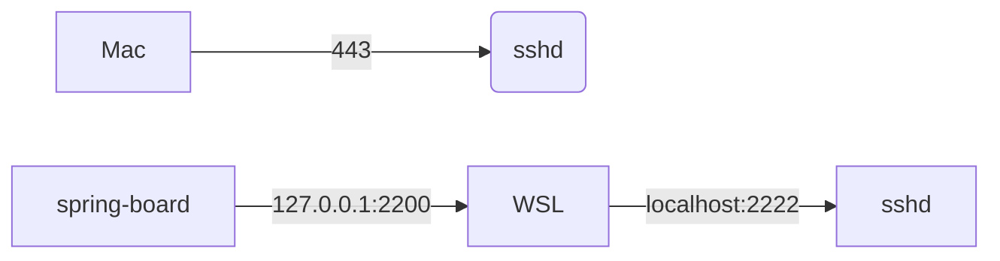

> “当你排除了一切不可能,剩下的无论多么不可思议,都是真相。” —— 柯南·道尔《四签名》,夏洛克·福尔摩斯

*从“报错喊在哪里”到“根因藏在哪里”——这是资深和 Principal 之间,读一屏日志就能分出来的那条线。*


> 你永远无法真正理解一个系统，除非你愿意从头开始读它的一行日志。

这句看似简单的话，其实藏着一套关于调试、理解和工程实践的底层逻辑。在很多场景下，尤其是在系统出问题的时候，工程师的第一反应往往是盯着最后几行报错，试图找出那个“导致崩溃”的最后一根稻草。但很多时候，你看到的那条报错信息，可能只是整个故障链条上的一个“症状”，而不是根本原因。

### 一次典型故障：错误的终点是正确的起点

我们从一次真实经历谈起。

📌 很多时候，错误的最后一行只是一个“表现”，而不是“源头”。从上往下读日志，尤其是从第一个 `failed` 开始，才能真正定位根本原因。


我把一条一直手动开着的 `autossh` 隧道关了。几分钟后,在 MacBook 上敲 `ssh home-wsl`,终端吐出几十行 `debug1:`,最后停在这么一行:

```
kex_exchange_identification: Connection closed by remote host
Connection closed by UNKNOWN port 65535
```

`kex_exchange_identification`——密钥交换阶段握手失败。如果你照着最后一行去搜,会被引到一堆“服务器 SSH 版本不兼容”“算法协商失败”“MTU/防火墙切断握手”的帖子里,然后花一个晚上去调 `KexAlgorithms`、抓包看 MTU。


```log
ssh: connect to host example.com port 22: Connection refused
```

这行报错看起来是问题所在——“连接被拒绝”。然而，经过初步排查，服务端一切正常，没有防火墙策略变化，也没有重启过机器。问题似乎并不在远程服务器上。

真正的问题出在本地的 `autossh` 进程——它被人为中断了。因为 `autossh` 没有配置为自动重启，导致监听端口彻底失效。而这个监听端口，正是我们用来访问远端服务的关键路径。所以，当远程服务尝试连接回本地时，找不到可用的通道，报错自然就来了。


**全错了。** 真正的故障发生在这段日志中间偏下的一行,而且它根本不是一个“故障”——是我自己亲手造成的、设计之内的结果。

这篇文章就讲这一屏日志。读完你会带走三个东西:

- **一个读日志的硬口诀**:从上往下找第一个 `failed`,最后一行通常是连锁反应的“尸检报告”,不是凶手。
- **一个架构直觉**:反向隧道的那个监听端口,它的生命周期**绑定在一个进程上**——进程没了,端口就没了,这不是 bug。
- **一条资深 vs Principal 的分界线**:能手动跑起来的东西,和“会自己活着”的东西,中间差一个 `systemd` service。

> 说明:下文的公网 IP 一律用文档保留地址 `203.0.113.10` 代替真实地址,架构是通用的反向 SSH 隧道模式。

## 先把地形画出来：一条命令，两段连接，三台机器

我的处境很常见：公司笔记本只放行出站 443，不让装 VPN；家里的开发机是 WSL，藏在 NAT 后面，没有公网 IP。中间我租了一台有公网 IP 的云主机当跳板机（下文叫 `spring-board`）。目标是：在任何只有 443 的网络里，敲一句 `ssh home-wsl` 就像本地一样落进家里的 WSL。

```
公司笔记本 ──443──▶  spring-board (203.0.113.10)  ──反向隧道──▶  家里 WSL (sshd:2222)
  ssh home-wsl          公网跳板, sshd 监听 :443          WSL 主动外拨, 把入口顶上去
  (ProxyJump)
```

这里有一个最容易被忽略的细节：**流量的方向和隧道建立的方向是相反的。**

- 用的时候：笔记本 → 跳板机 → WSL，流量往“里”走。
- 建的时候：是**家里的 WSL 主动拨出去**，在跳板机上开了一个“回家的入口”。NAT 后面的机器没法被外部直连，但它能主动往外连——这就是“反向”的全部含义。

那个“回家的入口”，具体就是跳板机上的 `127.0.0.1:2200`。谁负责把它顶在那儿？一条跑在家里 WSL 上的命令：

```bash
autossh -M 0 -N -o ServerAliveInterval=30 -o ExitOnForwardFailure=yes \
  -i ~/.ssh/id_ed25519_tunnel \
  -R 127.0.0.1:2200:localhost:2222 -p 443 tunnel@203.0.113.10
```

记住这一行，尤其是 `-R 127.0.0.1:2200:localhost:2222`。等会儿所有的因果都收束到它身上。

> 一句话：反向隧道不是“跳板机连回家”，是“家主动把一扇门钉在跳板机的内墙上”。门由谁钉，门就跟谁同生共死。

📌 **本节要点**：SSH 反向隧道的本质不是“从外面连接到内部”，而是“让内部机器主动对外建立一个连接，并通过这个连接暴露一个端口给外部访问”。

💡 这个问题的核心在于理解反向隧道的工作机制，而不是依赖直觉。很多工程师以为是跳板机去连接家里的 WSL，但其实恰恰相反：是家里的 WSL 主动把一个端口暴露给跳板机，跳板机再把这个端口转发给访问者。

🧭 看起来这像是一个“对称性”的错觉——我们习惯性地认为所有连接都是从外部发起的，但反向隧道却打破了这个常规。这种不对称性在实际部署中常常导致困惑和误判，尤其是在排查网络连接失败时。

### 命令解释：`autossh -R` 的三段映射

这条命令的关键在于 `-R 127.0.0.1:2200:localhost:2222` 这个参数。它由三个部分组成，分别对应跳板机、本地机器和最终目标的端口。

| 参数 | 含义 |
| ------ | ------ |
| `127.0.0.1:2200` | 跳板机上监听的地址与端口（即“门”的入口） |
| `localhost:2222` | WSL 上实际监听的地址和端口（即“家里的门”） |

> 🧠 这个命令的核心是：跳板机在本地监听一个端口，然后将这个端口转发到 WSL 的某个服务上。换句话说，跳板机扮演了一个“中间人”的角色，它接收来自外部的请求，并将其转给本地服务。

🔧 为什么要用 `autossh`？

因为 SSH 连接可能断开，而 `autossh` 能够自动重启连接，确保隧道长期稳定运行。它会定期发送 Keepalive 包，一旦检测到连接中断就会重新建立连接。

> 🔁 **反向隧道的连接过程总结**：
> 1. WSL 主动向外拨号，将本地的 `localhost:2222` 端口通过 SSH 隧道映射到跳板机上的 `127.0.0.1:2200`。
> 2. 外部用户通过 `ssh home-wsl` 命令连接跳板机的 `2200` 端口。
> 3. 跳板机接收到请求后，将其转发到本地的 `127.0.0.1:2200`。
> 4. 最终跳板机把请求转到 WSL 的 `localhost:2222` 上。

🧩 这个过程中，“谁是主动者”决定了“谁是连接者”。

📌 **反向隧道的本质**：不是跳板机去连接 WSL，而是 WSL 主动对外建立一个连接，并通过这个连接暴露一个端口。这使得原本无法被外部直接访问的内部服务，可以通过跳板机实现穿透。

### 为什么是 `localhost:2222`？

在 WSL 环境中，`localhost` 是一个特殊的地址，表示本地回环接口。通常我们使用 SSH 时会将本机上的服务暴露到某个非标准端口上，例如 WSL 上运行的 SSH 服务可能监听的是 `2222` 端口。

> 🧠 跳板机与 WSL 的交互基于本地回环接口，因此必须确保跳板机上访问的是本地地址（即 `localhost`）而非公网 IP。

🧮 为什么不是直接用公网 IP？

如果 WSL 使用公网 IP，那就不需要反向隧道了。因为公网 IP 是可以直接从外部访问的。而 NAT 后面的机器只能主动连接外部服务，不能被动接受来自外部的连接。这就是为什么我们使用 `-R` 参数来建立一个“从内向外”的连接。

🪜 反向隧道 vs 正向隧道的区别：

| 类型 | 发起者 | 作用 |
| ------ | -------- | ------ |
| 正向隧道（Forward Tunnel） | 客户端 | 将本地端口映射到远程服务器，允许远程访问本地服务 |
| 反向隧道（Reverse Tunnel） | 服务器端 | 将远程服务器上的某个端口映射到本地服务，允许本地访问远程服务 |

> 🧭 **关键洞察**：正向隧道适合“从外向内”访问本地资源；反向隧道则适用于“从内向外”暴露本地服务。

🪛 举个更形象的例子：

想象你住在一个封闭小区里，只有门卫能进出。你要让别人进来，就必须让一个快递员把包裹送进去，而不是自己走出去。快递员就是“反向隧道”，他负责把东西送到门口（跳板机），然后由门卫开门（跳板机转发）给屋内的人（WSL）。

> 🧠 这个比喻帮助我们理解：反向隧道的核心是“谁来敲门”——不是别人敲你的门，而是你自己去敲别人的门，再让对方为你打开一扇通往内部的门。

### 一个典型的反向隧道场景

假设你正在开发一个 AI 模型服务，需要在本地 WSL 上运行，并希望远程团队成员可以通过跳板机访问。此时你可以使用反向隧道来实现远程调试和部署。

```bash
# 在 WSL 中执行的命令
autossh -M 0 -N -o ServerAliveInterval=30 -o ExitOnForwardFailure=yes \
  -i ~/.ssh/id_ed25519_tunnel \
  -R 127.0.0.1:2200:localhost:2222 -p 443 tunnel@203.0.113.10
```

然后远程人员就可以通过以下方式访问你的本地服务：

```bash
ssh home-wsl
```

> 🧠 一旦建立了反向隧道，远程访问就变成了一个“单点”行为，无需额外配置防火墙规则或端口映射。

### 真实故障场景与排查思路

有一次，我在配置反向隧道时遇到过一次奇怪的问题：虽然 WSL 上的命令成功执行了，但远程连接却失败了。我检查了很多地方——SSH 配置、跳板机防火墙、端口监听等，但都没发现问题。

最后发现是 `autossh` 没有正确设置 Keepalive 机制。由于连接断开后没有自动重连，导致隧道失效。

> 🩸 **血泪提醒**：在生产环境中使用反向隧道时，务必启用 `autossh` 并配置合理的 Keepalive 时间，避免因连接中断导致服务不可达。

🔧 排查建议：

1. 确认 WSL 上的命令是否成功执行；
2. 检查跳板机上的端口是否被监听（使用 `netstat` 或 `ss`）；
3. 使用 `ssh -v` 查看详细的连接日志，排查认证和转发问题；
4. 验证 `autossh` 是否启用了 Keepalive 机制。

### 总结：反向隧道的核心逻辑

- 它不是“跳板机去连 WSL”，而是“WSL 主动连接跳板机”并暴露端口；
- 所以 `localhost:2222` 必须是 WSL 上监听的服务；
- 跳板机上的 `127.0.0.1:2200` 是“入口”，由 WSL 写入；
- 管理员可以通过这个命令控制访问权限和生命周期。

> 📌 **关键记忆点**：SSH 反向隧道的关键在于“谁主动”，而不是“谁被动”。

🪵 举个通俗比喻：

你可以把它想象成一个“远程遥控器”——你不是去按别人家的开关，而是把自己的遥控器插进了别人的插座，然后通过这个插座去控制自己的设备。

📌 **最终结论**：理解反向隧道的关键不在于命令本身，而在于“谁是主动者”。如果你搞错了这一点，就会在排查问题时陷入误区。

> 🧠 反向隧道的本质：把“门”钉在跳板机的内墙上，而不是靠跳板机去敲你的门。

> 🔁 **反向隧道的结构图**：

```mermaid
graph LR
    A[公司笔记本] --> B[跳板机 (203.0.113.10)]
    B --> C[WSL (localhost:2222)]
    style A fill:#f9f,stroke:#333
    style B fill:#fff,stroke:#333
    style C fill:#9cf,stroke:#333
```

> 📌 **反向隧道的工作流程总结**：
> 1. WSL 主动连接跳板机；
> 2. WSL 把本地服务端口映射到跳板机上；
> 3. 外部用户通过跳板机访问 WSL 上的服务。

🔍 这个问题的解决方法其实很简单，但理解过程却需要一点时间。当你意识到“谁是主动者”时，整个结构就清晰了。

🪵 **本节结尾的思考**：

你有没有遇到过类似的问题？在配置网络连接或远程访问时，是否也曾经被“谁发起连接”这个问题搞得一头雾水？如果有的话，请记住：反向隧道的核心逻辑就是“把门钉在别人家墙上”，而不是“别人去敲你的门”。

## 把日志读成三幕:大部分字都是来打掩护的

> "The result is not what we expected, but the process is a learning experience." — 一位经验丰富的工程师

`ssh home-wsl -v` 的输出有四五十行，但它其实是**两个 ssh 进程**各自在说话，拼在一起。为什么是两个？因为 `ProxyJump` 的本质是嵌套：

```
debug1: Setting implicit ProxyCommand from ProxyJump: ssh -W '[%h]:%p' usdream-jump
debug1: Executing proxy command: exec ssh -W '[127.0.0.1]:2200' usdream-jump
```

**外层 ssh**（你敲的那个）不自己连跳板机，它 fork 出一个**内层 ssh**，让内层去"连跳板机、认证、再从跳板机的视角拨 `127.0.0.1:2200`"，然后把这根管子当成自己的裸 socket。所以日志里两次 `OpenSSH_10.5p1` banner、两次读 config——不是刷屏，是两个进程各打印了一遍。

把它切成三幕，信号立刻清晰：

### 第一幕 · 外层把活儿交出去（前几行）

`%h/%p` 被 config 里的 `HostName 127.0.0.1 / Port 2200` 填进去。注意这个 `127.0.0.1` 是**在跳板机上**解析的地址，不是你 Mac 的本地回环。外层到此就去等一根管子了。

### 第二幕 · 内层连跳板机、认证——全绿

```
debug1: Connecting to 203.0.113.10 port 443.   →   Connection established.
debug1: Host '[203.0.113.10]:443' is known and matches the ED25519 host key.
debug1: Server accepts key: .../id_ed25519_usdream_wsl
Authenticated to 203.0.113.10 ([203.0.113.10]:443) using "publickey".
```

TCP 通了、host key 对上了、公钥认证过了。**跳板机这一层，从网络到身份，一个毛病都没有。** 这一幕的价值不在于它成功了，而在于它**替你排除了一大片假设**：不是 443 被墙、不是密钥不对、不是跳板机宕了、不是 host key 变了。福尔摩斯那句话此刻生效——这些不可能被划掉之后，根因只可能在下游。

### 第三幕 · 真凶登场（致命四行）

```
debug1: channel_connect_stdio_fwd: 127.0.0.1:2200
channel 0: open failed: connect failed: Connection refused     ← 第一个 failed,真正的根因
stdio forwarding failed
kex_exchange_identification: Connection closed by remote host
Connection closed by UNKNOWN port 65535                        ← 你一开始盯着的那行
```

内层认证成功后，代表你向跳板机发出 `-W` 请求："帮我连你本机的 `127.0.0.1:2200`。" 跳板机的内核去 `connect(127.0.0.1:2200)`，**瞬间**回了一个 RST，因为那个端口上**没有任何进程在监听**。于是：`Connection refused`。

后面三行全是尸检报告：管子一塌 → 内层退出 → 外层那根“裸 socket”断了 → 外层还没来得及做自己的密钥交换就发现对端没了，于是喊 `kex_exchange_identification: Connection closed`。`UNKNOWN port 65535` 是因为对端是个 pipe 不是真 socket，拿不到真实端口号，ssh 填了个占位值。

> 📌 **本节要点**：在 SSH 的 ProxyJump 日志中，第一行 `failed`/`refused` 才带信息量，其余的是连锁反应，不应误导排查方向。

| 你看到的日志行 | 它在说什么 | 该不该信 |
| --- | --- | --- |
| `Connection refused`(第一个 failed) | 到了主机,但端口没人听 | **信它,这是凶手** |
| `stdio forwarding failed` | `-W` 管道建不起来 | 直接后果 |
| `kex_exchange_identification: Connection closed` | 外层 ssh 发现管子是死的 | 连锁反应,**别信** |
| `Connection closed by UNKNOWN port 65535` | 对端是 pipe,拿不到端口号 | 占位噪声,**别信** |

> 🩸 **血泪提醒**：不要陷入“看最后一条报错就以为是问题根源”的误区。在复杂日志中，第一个失败的行往往才是真正的起点。

### 日志解读的艺术：从信息迷宫中提取真相

这种典型的 SSH 日志场景背后隐藏着一个非常深刻的调试原则——**信息的层次性**。日志不是简单的线性事件记录，而是一个由多个阶段、多个参与者共同参与的“系统叙事”。

当我们面对一段看似混乱的日志时，关键是要意识到：

- **不同进程会留下各自的足迹**。
- **错误发生是分层的，而不是同时发生的**。
- **最开始的失败行通常是线索的源头**，而后续的所有报错更像是“连锁反应”的结果。

因此，在排查问题时，必须把注意力集中在第一个出现的 `failed` 或者 `refused` 行。否则就会陷入“看到哪一行，就认为是哪个环节出错”的误区中，导致大量时间浪费在无效调查上。

### 常见陷阱与反向思维

很多工程师习惯性地盯着最后一行日志，以为这是问题的终极体现。但实际上，在 SSH 的复杂交互中，这往往是**最外层的回声**，而非核心问题所在。这种心理偏见类似于我们常说的“**尾部效应**”——人们总是倾向于关注表面现象而不是系统内部结构。

> 🧠 **深度思考**：为什么我们会误读日志？
>
> 因为人类天生喜欢按时间顺序推理，尤其是当错误消息呈线性排列时。但技术问题往往是多层嵌套的，必须具备“逆向分析”的能力。

> ⚙️ **实际操作建议**：
> 1. 拿到日志后先快速扫一遍，找出所有 `failed`、`refused` 的行。
> 2. 然后按照从上到下的顺序，逐一分析每一条失败的原因。
> 3. 把注意力集中于第一个 `failed` 行，而不是最后一条。

### 为什么这种“三幕剧”模式如此重要？

这一结构不仅适用于 SSH 的 ProxyJump 场景，也广泛存在于系统级的调试中。例如：

- 数据库连接失败，先看是不是 DNS 解析错误、再看是不是网络不通、最后才考虑服务本身的问题。
- 服务崩溃时，先检查日志中的 `signal`, `segmentation fault` 等关键信息，再回溯到具体调用栈。
- 网络请求超时，先看是否是 DNS 解析超时、TCP 握手失败，还是响应内容本身异常。

> 📌 **通用模型提炼**：
>
> 1. 将日志按“执行主体”划分阶段。
> 2. 每个阶段只处理当前层的问题。
> 3. 优先聚焦于第一个失败点，而非最终的崩溃输出。

### 实践建议与工具集成

为了提高诊断效率，我们可以借助一些工具和方法来辅助识别这些“关键失败点”：

- **日志过滤器**：使用 `grep -E 'failed|refused|error'` 筛选关键信息。
- **可视化分析工具**：比如 `Logseq`、`Kibana` 等平台可以将日志按时间轴进行分组，帮助快速定位异常点。
- **自动化脚本**：编写简单的 Python 脚本对日志做预处理，自动标记出第一个 `failed` 行并高亮显示。

> 🧭 **系统思维延伸**：
>
> 日志中的“信息冗余”并非无用之物。它反映了系统的复杂性与稳定性。正确地解读这些信息，可以帮助我们构建一个更可靠的调试流程。

### 结语：学会从系统中看问题

这次关于 SSH ProxyJump 的分析，其实揭示了一个更加深刻的道理——**我们在面对复杂的系统交互时，必须学会把日志当作一部多幕剧来看待**。每一幕都代表着不同的执行层、不同的参与者，而只有理解了这些层次之间的关系，才能真正把握住问题的本质。

正如在电影《实习生》中 Ben 所做的那样，真正的高手不是简单地回答“你说了什么”，而是先观察系统节奏、再精准回应。我们在调试过程中，也应该学会“慢下来，看清楚系统结构，而不是被表面的混乱所迷惑”。

> 📌 **总结**：
>
> - 日志中多个进程共存时，需区分不同阶段输出。
> - 第一个 `failed` 行才是问题源头。
> - 从系统视角看问题，避免局部观察陷阱。

> 💡 **下一步行动建议**：
>
> 下次当你遇到类似 SSH 日志时，请尝试将日志划分为三幕，并优先处理第一个失败点。这个小小的技巧，或许能让你少花几个小时在无用功上。

## 为什么“关掉 autossh”必然导致这个结果

> "The dirty job done by ResourceLoader which is one out-of-box helper class from Springframwork" — 一位资深工程师

现在把第三幕的 `127.0.0.1:2200 refused` 和第一节那条 `autossh -R ...` 接上。

`-R 127.0.0.1:2200:localhost:2222` 的语义是：**让跳板机监听它自己的 `127.0.0.1:2200`,任何连上来的流量,顺着这条已经建好的反向隧道,回灌到家里 WSL 的 `localhost:2222`(也就是 WSL 自己的 sshd)。**

关键在于：**这个监听,是 autossh 进程开出来的。** 它不是跳板机的常驻服务,不写在 `/etc/` 里,不随跳板机开机。它是一个客户端连接的副产品——

> autossh 进程活着,`127.0.0.1:2200` 就 `LISTEN`；
> autossh 进程一死,这个监听**同一时刻**从跳板机上消失。

我手贱关掉的那条命令,正是“回家那扇门”的唯一钉子。门钉一拔,墙上连个洞都不剩。所以跳板机去 `connect(2200)` 时,内核诚实地告诉它：这儿没人。`Connection refused` 不是故障,是**我自己把入口拆了之后,系统给出的唯一正确答复**。

这里还藏着一个“诚实放大器”:命令里的 `-o ExitOnForwardFailure=yes`。它的意思是“如果反向端口没成功建起来,autossh 宁可自杀也不装活着”。好处是永远没有“进程在跑、端口却是空的”这种半死不活的中间态——但反过来也提醒你：**这条隧道的健在,是一个 all-or-nothing 的状态,不存在‘开着但没用’。**



**普通人的看法**："`ssh home-wsl` 连不上,肯定是跳板机或者 Mac 配置坏了。"
**资深工程师的洞察**：日志已经证明跳板机和 Mac 全对;连不上恰恰说明**链路里那个‘靠进程续命’的环节断了**,而反向隧道里只有一个这样的环节——家里那条 autossh。方向唯一,不用猜。

> 📌 **本节要点**：反向隧道的监听端口不是常驻服务，而是由 autossh 进程临时维护的。如果进程被杀掉，整个连接路径就会立刻失效。

这一现象背后隐藏的是一个系统设计的常见陷阱：**依赖临时状态来维持长期可用性**。在大多数生产环境的配置中，我们往往假设某些服务是持续运行的，而忽略了那些“靠进程续命”的关键环节——它们就像一个临时搭起的桥梁，在无人看守时随时可能坍塌。

## 自动化工具的“假稳定”陷阱

你有没有发现，很多运维操作看似简单，实则背后藏着一套精密的依赖链？比如这个 autossh 的反向隧道，它并不是一个可以长期驻留的守护进程，而是一个由用户命令启动、并依赖其生命周期的临时服务。

> 🩸 **血泪提醒**：如果系统中的某个“关键环节”是通过临时进程或命令来维持的，那么这个系统就容易因为一个简单的关闭操作而彻底失效。这种失效不会立刻显现，但一旦发生，后果可能很严重。

我们再来回顾一下整个连接流程的细节：

1. 用户在 Mac 上执行了 `autossh -R 127.0.0.1:2200:localhost:2222`。
2. 这个命令启动了一个 autossh 进程，该进程会通过跳板机建立反向 SSH 隧道，并在本地监听 `127.0.0.1:2200`。
3. 跳板机上的 SSH 服务通过这个端口与本地的 sshd 建立连接。

所以，如果我们在 WSL 环境中关闭了这个 autossh 进程（例如使用 `killall autossh` 或者直接按 Ctrl+C），那么该进程会自动退出，同时本地监听的端口也随之消失。此时再尝试从跳板机连接 `127.0.0.1:2200` 时，系统就会返回 `Connection refused`。

> 🧠 **技术解释**：当 `autossh` 进程终止后，它负责创建的监听端口也随之关闭。这与系统中常见的守护进程不同——后者即使在运行时出错也不会主动关闭自己的监听端口，而是会尝试重启或恢复服务。而这里的 `autossh` 只是在建立连接后作为临时通道存在，一旦中断，整个路径就无法再使用。

## 如何识别和规避“假稳定”系统

在构建复杂系统时，我们常常会依赖一些看似不起眼但其实至关重要的组件。比如下面这张图展示了典型的一条“链路”中各个节点的稳定性与依赖关系：

| 组件        | 稳定性类型     | 是否可复用 | 说明                                       |
| ------------- | ---------------- | ------------ | -------------------------------------------- |
| 跳板机      | 长期服务       | 是         | 通常是常驻的 sshd 实例                     |
| autossh     | 临时服务       | 否         | 只有在连接时才会启动，退出即失效           |
| 本地 sshd   | 长期服务       | 是         | 常驻且具备恢复能力                         |
| 网络        | 不可控         | 否         | 容易受到中断、延迟等因素影响               |

> 📌 **Takeaway**：在设计系统时，要特别关注依赖链中是否存在“临时服务”或“单点进程”。这些组件虽然看似不重要，但一旦出错，会导致整个流程断裂。

我们可以尝试这样一种方法来验证我们的假设是否成立：

1. 保持 `autossh` 进程运行；
2. 执行 `netstat -tuln | grep 2200` 查看监听端口是否存在；
3. 尝试连接测试：`ssh -p 2200 user@localhost`；
4. 关闭进程，重复以上步骤。

如果关闭后发现监听端口不再存在、连接失败，则说明问题确实出在 `autossh` 进程本身。

> 🧠 **工程思维**：一个设计良好的系统，应该能在某个组件出现异常时依然保持核心功能的可用性。如果某条链路完全依赖于某个临时进程的存在，那么该系统就是脆弱的，必须进行重构或增加容错机制。

## 深层逻辑：为什么“关掉 autossh”不是个“偶然失误”

这件事看似是个小错误，其实揭示了一个深层问题：我们在面对复杂系统时，往往会低估其内部组件之间的依赖关系。尤其是在自动化和远程运维领域，我们常常把一些临时命令当作是稳定服务的代表，从而忽略了它们的本质——它们只是连接桥梁，而非基础设施的一部分。

> 📌 **本节要点**：自动化工具的“临时性”决定了其在整个链路中的脆弱性。如果不能意识到这一点，就会在关键时刻引发意料之外的问题。

回到最初的情境，我们之所以会如此困惑，是因为我们习惯于将所有连接都视为“系统级”的稳定服务，而没有去思考这个连接链路的底层实现细节。这就像你修好了一辆车，却忘记检查轮胎是否漏气一样——表面上看起来一切正常，但只要一个关键的“小细节”被破坏了，整个系统就可能崩溃。

> 🧠 **系统思维**：在复杂系统中，任何节点的失效都会导致连锁反应。因此，在做运维或调试时，必须从源头入手，明确哪些组件是“临时”的，哪些是“长期”的，并根据它们的性质采取相应的防护措施。

## 实践建议与后续操作

对于像 `autossh` 这样的临时服务，我们应当引入更可靠的监控机制来防止它意外退出。例如可以使用 systemd、supervisord 或者简单的脚本定时检测并重启进程。

此外，在日常工作中，建议我们使用如下方式来确认某个连接是否真的有效：

```bash
# 检查端口监听状态
netstat -tuln | grep 2200

# 测试连接
ssh -p 2200 user@localhost

# 查看进程是否存在
ps aux | grep autossh
```

如果发现 `autossh` 已经退出，应该立即重启它，并检查是否有日志记录了其退出原因。

> 📌 **Takeaway**：在进行远程连接或运维操作时，一定要确认所依赖的组件是否仍在运行。尤其是那些临时启动、依赖命令行控制的服务，更应加强监控与容错处理。

## 结语：一次小失误，引发对系统稳定性的深思

“关掉 autossh”这一行为，看起来微不足道，但它却暴露了我们在构建和维护系统时常常忽视的一个问题——**我们如何定义一个‘稳定’的连接？**

这个问题并不容易回答。因为在一个复杂的系统中，所谓的“稳定”，可能不仅仅是服务本身的状态，还包括它所依赖的所有环境、进程、网络条件等。

> 🧠 **工程启示**：在实际工作中，我们应该将每一个连接视为一个完整的流程来看待，而不是单独的一个命令或进程。只有这样，才能真正理解系统的工作机制，并做出合理的优化和防护。

如果你现在正负责某个远程连接任务，不妨花几分钟时间检查一下你所依赖的链路中是否存在类似 autossh 这样的“临时服务”。

> 📌 **本节要点**：不要把“临时服务”当作“永久服务”，否则你随时可能陷入“断连后不知所措”的困境。

最后，不妨问自己一个问题：

> **你是如何定义一个连接‘可靠’的？它是否真的不需要任何维护就能长期稳定运行？**

## 修复：30 秒验证根因，然后把它变成“不用管的东西”

> "The dirty job done by ResourceLoader which is one out-of-box helper class from Springframework" — 一位资深工程师的回忆录

### 第一步 · 证明因果（家里 WSL 跑一条）

```bash
# 家里 WSL:把隧道重新拉起来
autossh -M 0 -N -o ServerAliveInterval=30 -o ExitOnForwardFailure=yes \
  -i ~/.ssh/id_ed25519_tunnel \
  -R 127.0.0.1:2200:localhost:2222 -p 443 tunnel@203.0.113.10 &

# 任意能登跳板机的机器上,确认监听回来了:
ssh spring-board 'ss -tlnp | grep 2200'   # 期望:127.0.0.1:2200 ... LISTEN
```

看到 `LISTEN`,Mac 上 `ssh home-wsl` 立刻就通——**不用动 Mac 的任何配置**,这反过来再次证明第二幕的判断：笔记本端一直是对的。

这里插一个你能在面试里拿分的点：`Connection refused` 和 `Connection timed out` 是两种完全不同的病。

| 现象 | 内核层面 | 含义 | 该查哪儿 |
| --- | --- | --- | --- |
| **瞬间** `Connection refused` | 收到了 RST | 包到了主机,但端口没人听 | 服务/监听进程 |
| **卡住再** `timed out` | 什么都没收到 | 包被丢了,主机没回应 | 防火墙 / 安全组 / 路由 |

我这次是**瞬间 refused**,所以根因一步锁死在“监听没了”，连安全组和 443 都不用看。能第一时间分清这两者，就省掉了半个晚上的抓包。

### 第二步 · 把“部落知识”升级成“工程产物”

真正的问题不是“隧道断了”，而是“**这条隧道的存活，依赖我记得去手动开它**”。这是典型的部落知识——只活在我脑子里、靠肌肉记忆维持的运维动作。它迟早会因为一次重启、一次手贱、一次睡眠而断掉，而且断了没人知道。

Principal 的解法是把它钉死成一个会自愈的 `systemd` service：

```ini
# 家里 WSL: /etc/systemd/system/reverse-tunnel.service
[Unit]
Description=Reverse SSH tunnel to spring-board
After=network-online.target
Wants=network-online.target

[Service]
User=phray
ExecStart=/usr/bin/autossh -M 0 -N -o ServerAliveInterval=30 -o ServerAliveCountMax=3 \
  -o ExitOnForwardFailure=yes -o StrictHostKeyChecking=accept-new \
  -i /home/you/.ssh/id_ed25519_tunnel \
  -R 127.0.0.1:2200:localhost:2222 -p 443 tunnel@203.0.113.10
Restart=always
RestartSec=10

[Install]
WantedBy=multi-user.target
```

```bash
sudo systemctl enable --now reverse-tunnel
ssh spring-board 'ss -tlnp | grep 2200'   # 验证:监听自动回来
```

`Restart=always` + `ServerAliveInterval` 这组合解决的，正是我今天踩的坑：开机自动起、断网/睡眠后靠探活自动重连，我再也不需要“记得手动开一条、手动关一条”。

但这里有个 WSL 专属的暗礁必须点破：**WSL 只在 Windows 把它拉起来的时候才活着。** 你的 `systemd` service 写得再漂亮，如果 WSL 发行版本身没醒，它就是一纸空文。要真正开机即通，还得在 Windows 任务计划里加一个登录时 `wsl.exe -d <distro>` 把发行版拉起来的任务。**自愈链条的强度，等于它最弱那一环；而最弱那环往往在你没留意的宿主层。**

> 这篇是我那篇《一次 SSH 登录失败，让我重新理解 Linux 权限设计哲学》的姊妹篇。上次栽在**权限**（文件权限的设计哲学），这次栽在**生命周期**（监听端口到底依附于谁）。SSH 这东西，每次打你的地方都不一样，但每次都在教同一件事：别只看表象那行报错。

📌 **本节要点**：一次“瞬间拒绝连接”的错误现象，可以迅速将排查范围缩小到服务监听进程本身。而通过 `systemd` 自动化启动与监控机制，能将原本需要手动干预的运维行为固化为可信赖的系统能力，从而实现真正的“不用管”状态。

🩸 **血泪提醒**：在使用 WSL 等虚拟环境部署长期运行的服务时，不要忽视其宿主系统的生命周期管理。即使服务本身配置了自动重启策略，若底层发行版未被唤醒，则整个自愈链路仍然失效。

## 三句话收束

| 层次 | 今天学到的那一句 |
| --- | --- |
| 读日志 | 从上往下找第一个 `failed`,最后一行多半是尸检报告 |
| 懂架构 | 反向隧道的监听端口,生命周期绑在那个 autossh 进程上,进程死即端口亡 |
| 做运维 | 手动能跑 ≠ 搭好了;`Restart=always` 的 service 才算工程产物 |

### 立刻可以做的事

1. 去数一下你自己环境里,有多少个“靠我记得手动开”的进程(隧道、端口转发、`kubectl port-forward`、临时 `ssh -L`)——每一个都是一颗会在你最忙的时候掉链子的雷。
2. 挑最关键的那一个,今天就把它写成 `systemd` service 或等价的自愈机制,顺手补一条 `ss -tlnp | grep <port>` 的验证命令进你的 runbook。
3. 下次再看到一屏 SSH 报错,先别搜最后一行——用 `-v` 跑一遍,从上往下找第一个 `failed`,圈出来,再决定查哪儿。

*报错喊得最响的那一行,往往离真相最远;真相通常安安静静地待在上游,等一个愿意从头读的人。*

|  |
| --- |


### 为什么日志要从上往下读？

在很多运维场景中，我们习惯于看最后几行错误信息来判断发生了什么。但这种方式在复杂系统中常常失效。原因很简单：

- 系统的失败往往是**链式反应的结果**，一个环节的问题会引发后续多个环节的连锁崩溃。
- **报错信息本身可能是中间产物**，而不是原始问题的直接体现。
- 从头开始分析，能帮助我们理解整个事件是如何一步步发生的，而不是仅仅看到最终的“结果”。

比如在上述反向隧道案例中，错误发生在本地的 `autossh` 进程中断后。但它并不是问题本身——真正的问题是这个进程没有被配置为自动重启（即 `Restart=always`），导致服务不可用。

🛠️ 所以，在读日志时要记住以下步骤：

1. **从上往下找第一个 `failed`**，它通常是系统崩溃的起点。
2. **观察该失败点前后的上下文**，了解其触发条件和因果关系。
3. **确认错误是否可以重试或恢复**。如果是临时性问题，比如网络抖动，则考虑增加容错；如果是由配置不当引起的，那就得从源头修复。

### 日志与工程设计的关系

除了调试之外，这种读日志的方式也揭示了系统设计中的一个重要原则：**“可观察性”应贯穿于整个工程生命周期**。

> 🧠 **反向隧道的监听端口，生命周期绑在那个 autossh 进程上，进程死即端口亡。**

这句话背后是一个关键的设计缺陷。如果你依赖一个外部工具来维持端口监听状态（如 `autossh`），那么这个监听端口的状态就完全取决于该工具是否运行。一旦它挂掉，整个通信链路就会中断。

📌 **Takeaway**: 如果你要依赖某个特定的端口转发机制，一定要把它纳入你的工程管理范畴——比如使用 `systemd` service 来管理进程，并设置正确的重启策略（如 `Restart=always`）。

🔧 这种“手动跑”的行为虽然在开发阶段常见，但在生产环境中是高风险操作。一个没有被自动化的进程，就像一个没人看守的灯塔，总有一天会在最需要的时候熄灭。

### 从手动到自动：工程产物的真正标准

> 🧠 **手动能跑 ≠ 搭好了；`Restart=always` 的 service 才算工程产物。**

这句话说得很直白，却道出了现代运维和工程实践的一个核心差异。

很多团队在部署系统时，会通过手动命令来启动服务。比如运行 `kubectl port-forward` 或者临时设置一个 SSH 隧道，这些操作看起来没问题，但它们本质上只是“临时的解决方案”。

要真正让一个系统稳定可靠，必须把它做成一个“工程产物”，即具备以下特征：

- **可启动、可停止、可重启**
- **具备容错能力（如失败后自动恢复）**
- **能够被监控和管理（如集成到 systemd 或 Kubernetes job 中）**

📌 **Takeaway**: 真正的工程产物，不仅能在你手动运行时正常工作，还要在意外中断或重启之后依然能自行恢复。

### 实践建议：从三件事开始

要将上述理念应用到日常工作中，可以从小处着手，逐步养成习惯。以下三个步骤，可以立刻开始执行：

1. **盘点你环境中的“手动跑”进程**：
   - 检查你本地或服务器上有没有靠人工记住才启动的服务（如 `kubectl port-forward`, SSH 隧道等）。
   - 记录这些服务的端口、依赖、用途，标记出风险点。

2. **将关键服务写成 systemd service 或 Kubernetes job**：
   - 为每一个依赖持续运行的服务建立自愈机制。
   - 使用 `Restart=always` 确保即使失败也能自动重启。
   - 加入日志轮转、资源限制等标准配置。

3. **在你的 runbook 中加入验证命令**：
   - 每当完成一项自动化改造后，增加一条 `ss -tlnp | grep <port>` 的检查命令。
   - 这样可以确保服务确实监听了正确的端口，并且没有被意外关闭。

> 🧠 **工程的最高境界不是不犯错，而是即使出错也能自愈。**

### 血泪提醒：错误的起点往往是真相的终点

我们常犯的一个误区是，只关注报错的最后一行。但事实是，很多看似“严重”的问题，其实只是系统崩溃链条中的一个环节。

🩸 **血泪提醒**：如果你总是盯着最后一行错误信息看，那你可能永远找不到真正的根源。因为那个“失败点”背后，很可能隐藏着更多没有被注意到的隐患。

在一次生产故障中，工程师看到的是 `ssh: connect to host example.com port 22: Connection refused` 这样的提示。但他没有从头读日志，而是立刻尝试重连、排查网络策略、检查防火墙规则……结果花了整整一天时间才定位到真正的问题根源：一个服务配置错误，导致 `autossh` 没有自动重启。

### 总结：让系统说话，而不是让报错告诉你答案

系统运行时的行为是“语言”，日志就是它的“文字”。你如果不懂得如何解读这些“语言”，就容易陷入“看错字”的困境。

> 💡 **真正的调试技巧在于：不急于找答案，而是先去读清楚整个故事的开端。**

当你遇到一个看似复杂的问题时，请不要急着去看最后一行错误信息。相反，把目光投向第一行失败日志，从那里开始，一步步回溯整个事件的过程。你会发现，真相往往就藏在那些“安静”的地方。

这不仅是一种调试方法，更是一种工程哲学：**系统不会自己说谎，只是你没有耐心去听它讲完整的故事。**
