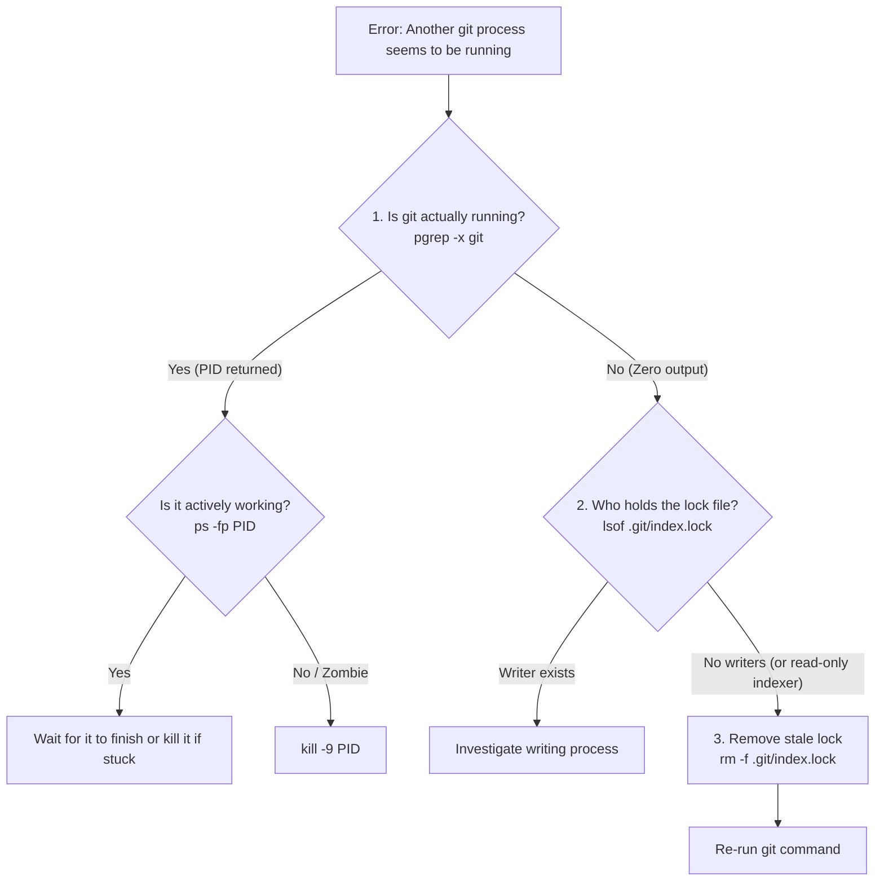

"Nothing in life is to be feared, it is only to be understood. Now is the time to understand more, so that we may fear less." — Marie Curie

### The Stalled Fast-Path

Every engineer who touches a command line develops a muscle-memory reflex. For many, it is a one-key or two-letter shortcut—an automated wrapper that bundles staging, AI-assisted commit messaging, rebasing, and pushing. In my workspace, that alias is `savee`. It executes a battle-tested automation script: [`git_checkin_e.sh`](file:///Users/toddzhang/ws/todd/effectiveCodingBase/src/main/scripts/auto/git_checkin_e.sh).

On a quiet Sunday morning, with multiple AI agents and background daemons humming along in the background, I keyed the alias expecting the usual two-second green checkmark.

Instead, the terminal stopped dead:

```text
❌ Another git process seems to be running. Please wait or check running processes.
```

I checked the terminal. No interactive rebase was paused. No background `git push` was churning. The repository appeared completely still. 

Yet the machine insisted someone else was holding the steering wheel.

---

### Act I: The Illusion of Concurrent Execution

When Git operations fail with lock collisions, the default culprit is almost always `.git/index.lock`. Git creates this sentinel file as an atomic transaction barrier: before any command mutates the index, it creates the lock; when it finishes, it atomically renames the lock over the index. If a process is abruptly terminated (`SIGKILL`, laptop lid closed mid-commit, power cut), the lock file is orphaned.

Our auto-checkin script was already written to be clever. It anticipated interrupted executions:

```bash
# Handle stale index.lock file if left behind by interrupted git processes
LOCK_FILE=".git/index.lock"
if [ -f "$LOCK_FILE" ]; then
    if ! pgrep -f "git.*effectiveCodingBase" > /dev/null 2>&1 && ! pgrep -x git > /dev/null 2>&1; then
        echo "⚠️  Found stale $LOCK_FILE with no running git process. Cleaning up..."
        rm -f "$LOCK_FILE"
    else
        echo "❌ Another git process seems to be running. Please wait or check running processes."
        exit 1
    fi
fi
```

The script checked two conditions:
1. Is `.git/index.lock` present?
2. If yes, is there any running git process associated with `effectiveCodingBase` or any generic `git` command?

If no process is running, wipe the stale lock and proceed. If a process *is* running, abort to avoid corrupting a real operation.

The script had aborted. Therefore, according to the script's logic, a Git process was actively running in the repository.

Except... was it?

---

### Act II: Interrogating the Process Table

I fired off the first sanity check:

```bash
$ pgrep -x git
# (Exit code 1: zero output)
```

There was no running executable named `git`. Not one.

Then why did the defensive guard trip? Let us run the exact regex the script used:

```bash
$ pgrep -f "git.*effectiveCodingBase"
17214
28984
```

Two Process IDs popped up immediately: `17214` and `28984`.

To see what was behind those PIDs, we ran `ps`:

```bash
$ ps -fp 17214,28984
  UID   PID  PPID   CMD
  501 17214 17213   npm exec @modelcontextprotocol/server-pdf --stdio
  501 28984 28659   npm exec @modelcontextprotocol/server-pdf --stdio
```

A Node.js MCP server? Why would an MCP PDF server match `git.*effectiveCodingBase`?

---

### Act III: The Trap of `pgrep -f` on Unix and macOS

This is where operating system internals meet subtle shell programming traps.

Most developers learn that `pgrep -f <pattern>` searches the "full command line arguments" rather than just the process name. 

However, on macOS and various BSD-derived kernels, `pgrep -f` does not stop at `argv[0] ... argv[n]`. Depending on process initialization and environment export, `pgrep -f` inspects the entire memory block of the process's command buffer, which includes the inherited **environment variables**!

Let us inspect the full environment strings of PID 17214:

```text
PATH=/Users/toddzhang/.../my-git-custom-commands/:/Users/toddzhang/ws/todd/effectiveCodingBase/src/main/scripts/...
```

Notice what is inside `$PATH`:
- It contains `/my-git-custom-commands/` (which contains the substring `git`).
- Several paths later, it contains `/Users/toddzhang/ws/todd/effectiveCodingBase/...`.

Because the regex was:
```regex
git.*effectiveCodingBase
```
It lazily matched across the environment variable block:
```text
...my-[git]-custom-commands:.../todd/[effectiveCodingBase]...
```

The PDF MCP daemon had been launched from a shell session that inherited the user's custom `$PATH`. It had nothing to do with Git, and it wasn't executing a single Git command. Yet because `git` preceded `effectiveCodingBase` in the `$PATH` string, it was permanently matching `git.*effectiveCodingBase`!

Every time `.git/index.lock` was left behind by any transient glitch or editor inspection, the safety guard suffered a catastrophic **false positive**: it assumed the PDF MCP server was a running Git transaction.

---

### Act IV: The Double Culprit (LSOF and File Handles)

There was one more layer to unpeel. Was the lock file actually locked by anyone?

```bash
$ lsof .git/index.lock
COMMAND     PID      USER   FD   TYPE DEVICE SIZE/OFF     NODE NAME
language_ 82589 toddzhang   33r   REG   1,17        0 84516209 .git/index.lock
agy       86807 toddzhang  127r   REG   1,17        0 84516209 .git/index.lock
```

Notice the file descriptor mode: `33r` and `127r`.

The `r` signifies a **read-only** file descriptor. Language servers and IDE indexers routinely open files in `.git/` with read-only descriptors or directory watchers (`kqueue` on macOS) to track file changes. They were not holding a write lock, nor were they mutating the repository.

The file had an mtime from hours earlier:
```text
-rw-r--r--@ 1 toddzhang  staff  0 10 Oct 22:30 .git/index.lock
```
A stale 0-byte ghost file created yesterday, completely unowned by any active writer, but permanently protected by a broken regex that mistook a background Node server for an active `git commit`.

---

### Act V: The Surgical Fix

To make the script resilient, we replaced the loose substring regex with a strict command-boundary pattern:

```bash
# Look for actual running git processes accessing this repo or git commands
if ! pgrep -f "^([^ ]*/)?git[ 	].*effectiveCodingBase" > /dev/null 2>&1 && ! pgrep -x git > /dev/null 2>&1; then
    echo "⚠️  Found stale $LOCK_FILE with no running git process. Cleaning up..."
    rm -f "$LOCK_FILE"
else
    echo "❌ Another git process seems to be running. Please wait or check running processes."
    exit 1
fi
```

#### Why this pattern works:
- `^([^ ]*/)?git[ \t]` ensures that the string `git` appears either at the start of the command line or immediately after a path separator (`/`), followed immediately by a space or tab (the Git subcommand or flag).
- It completely ignores arbitrary occurrences of `git` embedded within directory names, flags, or `$PATH` strings like `my-git-custom-commands`.

We tested the fix by dropping a dummy `.git/index.lock` into the repo and invoking the check.
Result:
```text
⚠️  Found stale .git/index.lock with no running git process. Cleaning up...
```
The ghost was dispelled in single-digit milliseconds.

---

### The SME Field Runbook: Debugging Any Future Git Lock

When your terminal tells you Git is locked, do not panic and do not blindly run `rm -f .git/index.lock` without verifying first. Follow these three authoritative steps:



#### 1. Verify Process Reality
```bash
# Check if any genuine git executable is running
pgrep -x git

# List full command lines if you want complete transparency
ps aux | grep -i "[g]it"
```
If an active `git push`, `git rebase`, or `git gc` is actually working, let it finish.

#### 2. Inspect File Open Status & Age
```bash
# Check if any process holds the file open for writing
lsof .git/index.lock

# Check when the lock was created
ls -l .git/index.lock
```
If the timestamp is hours old or if the only processes holding it are IDE language servers reading it (`...r`), it is 100% stale.

#### 3. Clear and Resume
```bash
rm -f .git/index.lock
```

---

### Key Engineering Takeaways

1. **Be wary of `pgrep -f`**: It matches everything in the command buffer, including environment strings on BSD/macOS. A loose regex like `git.*repo` is a loaded gun waiting for your `$PATH` or arguments to match.
2. **Read-only handles are not write locks**: Language servers and background watchers (`lsof`) will happily maintain read descriptors on `.git` files. Only active writers represent concurrency hazards.
3. **Automate the cleanup, but anchor the regex**: Good developer tooling handles edge cases automatically—great developer tooling ensures its self-healing logic doesn't hallucinate phantom conflicts.
