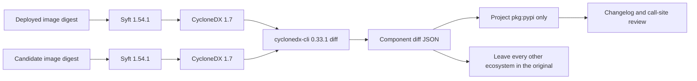

> "If names be not correct, language is not in accordance with the truth of things." — Confucius, Analects XIII.3, tr. James Legge

# The standard is the bill, not the command

*From "we adopted CycloneDX" to "we can name the package that moved" — four jobs that people keep collapsing into one logo.*

An Airflow 3.3.1 image upgrade went out green. `pip check` inside the image was green. Someone had read the release notes. Then an FTP provider changed how it opened a protected data channel. The packages that had actually moved were not in the review pack:

| Package | Old | New |
| --- | --- | --- |
| SQLAlchemy | 1.4.54 | 2.0.51 |
| Paramiko | 4.0.0 | 5.0.0 |
| pandas | 2.2.3 | 3.0.0 |
| apache-airflow-providers-ftp | 3.14.0 | 3.15.2 |

`pip check` answers "does this set satisfy itself?" Release notes answer "what did the project choose to announce?" The running image answers "what is on the machine?" Those are three documents. A green check on the first one does not sign the third.

The claim this piece will not soften: **calling `cyclonedx-cli` the industry standard confuses the metre with the ruler.** The metre is the CycloneDX bill defined by ECMA-424. The ruler is a reference implementation that can subtract two bills. An upgrade needs a ruler pinned to a release, proved against real images, and a review step no scanner will do for you, because no scanner knows which DAG imports Paramiko. Drop any layer and the next SQLAlchemy 2 sails through on a green build.

If you own image upgrades, or you are about to sell "an SBOM tool" to a platform review, four distinctions matter more than a product shortlist:

- **Split the name.** Format, generator, differ, and review are separate duties.
- **A non-empty diff is evidence.** Upgrades are supposed to move packages. Failure is a missing bill, an invalid bill, or an old image you cannot name by digest.
- **Do not boot the candidate to inventory it.** The layers are already the bill. Starting the container executes code your review has not accepted.
- **Python packages are the decision. OS packages are the background.** Keep both. The page a human reads has to lift `pkg:pypi` out of the noise.

The order below is the order a review gets the names wrong, which is the useful order.

## 1. Green was an answer to a different question

Five whys, stopped at the mechanism.

1. Why did FTP behaviour change? The provider moved from 3.14.0 to 3.15.2, and the protected-data-channel call changed with it.
2. Why did the upgrade review miss it? The review read release notes and lockfiles, not the distributions installed in two immutable images.
3. Why did `pip check` stay green? It checks coherence inside the new image. A mutually compatible set of major upgrades is a passing check.
4. Why were the release notes not enough? They describe what Airflow core wanted you to notice. SQLAlchemy, Paramiko, and pandas can jump a major in the same image without earning a heading.
5. Why was there no machine-readable delta? The pipeline checked coherence, tagged the image, and wrote the tag into GitOps. It never archived "old digest versus new digest" as a required artifact.

The control does not belong in a chat thread, and it is not a longer upgrade note. Every candidate image owes the deployed image a component delta. Non-empty is a successful build. The build fails when the delta was not produced.

> Coherence is a property of one image. Change is a property of two. Signing the second with the first's green light is using a thermometer as a chart.

## 2. Four names that get flattened into one

I rechecked the public specs and repositories in October 2026. This is the table that belongs in an architecture review. "The industry uses the CycloneDX CLI" does not.

| Layer | What it actually is | Checkable on 2026-10-14 | Job in an upgrade |
| --- | --- | --- | --- |
| CycloneDX 1.7 | The bill format. ECMA-424, 2nd edition, December 2025. JSON is the primary serialisation | ISO/IEC 27055 is still a draft, not a published ISO standard | The contract between two images |
| SPDX 2.2.1 | The other real international standard, ISO/IEC 5962:2021 | Current community text is 3.0.1. BuildKit attaches SPDX by default | A legitimate alternative. We did not pick it, because component-version diff has no equally direct reference command there |
| Syft 1.54.1 | An Apache-2.0 scanner that reads image layers and writes CycloneDX or SPDX | About 9,700 stars, still shipping. BuildKit's default SBOM scanner is this path | Generator |
| cyclonedx-cli 0.33.1 | OWASP's .NET reference CLI, released 2026-07-23 | About 548 stars. `diff --component-versions` is a command feature. It is not in the ECMA-424 text | Differ. Pin it, validate the bills, then let it speak |
| Human review | Map the Python delta onto changelogs and real DAG call sites | No commodity scanner knows the line that imports Paramiko | The decision |

SPDX is not the junior standard. Telling an architecture board that CycloneDX is already ISO and SPDX is not, is false as of October 2026. The reverse slogan is also false. A GitHub organisation named CycloneDX does not turn its CLI into the specification. The specification says which fields a bill contains. It does not define the JSON shape of a diff subcommand.

The same organisation ships `sbom-utility diff`. Its own docs mark that command experimental. The output is an RFC 6902 JSON Patch, and the project tells you to strip `bom-ref`, hashes, and properties first or the patch is noise. About 168 stars. That is not an upgrade report.

The neighbours, so "most popular" does not get promoted to "right job":

| Tool | What it is good at | What it does not replace |
| --- | --- | --- |
| Trivy | Vulnerability scan, and it can emit CycloneDX or SPDX. About 38,400 stars | The upgrade decision between two releases |
| Docker Scout `compare` | Image-to-image package and vulnerability delta | Compare is still documented as experimental, and it is a vendor service |
| Amazon Inspector SBOM | Emits CycloneDX and scans for vulnerabilities | A release-to-release component diff |
| GitHub dependency review | Compares manifests and lockfiles on a pull request | A distribution that was installed in the image and never written to the lockfile |
| Google container-diff | An older image diff | The project is archived and points people at diffoci |
| cdxgen | CycloneDX from a source tree | Layer scanning of a container. That job belongs to Syft |

First principles, and then stop: an upgrade review compares **two immutable runtime environments**. A lockfile is intent. An SBOM is the inventory of an environment. A diff is the subtraction of two inventories. A review is that subtraction explained against business code. Substitute any of those artifacts for its neighbour and a green pipeline will miss the next major.



## 3. What the command actually prints

I ran the pinned `0.33.1` binary. The version line was `0.33.1+b3cfa4b0edc356dad07e0b6e7ab6da0a94af0246`. Two minimal bills, both accepted by `cyclonedx validate --fail-on-errors`, produced this shape:

```json
{
  "componentVersions": {
    "sqlalchemy": {
      "added": [
        {
          "type": "library",
          "name": "sqlalchemy",
          "version": "2.0.51",
          "purl": "pkg:pypi/sqlalchemy@2.0.51"
        }
      ],
      "removed": [
        {
          "type": "library",
          "name": "sqlalchemy",
          "version": "1.4.54",
          "purl": "pkg:pypi/sqlalchemy@1.4.54"
        }
      ],
      "unchanged": []
    }
  }
}
```

The traps sit in that shape:

- Under one name, the old version is in `removed` and the new version is in `added`. There is no `modified` field. A version change is "drop the old coordinate, add the new one."
- Unchanged components are present in the JSON. Text mode hides them and prints only names with adds or removes. Count from the text and you lose the denominator.
- Key order is not stable, so the raw stdout is a bad byte-for-byte golden file. The review report sorts its own rows and stores a SHA-256 of the CLI stdout. Archive the stdout unchanged. The review JSON is a projection, not a second source of truth.
- `purl` decides the section. Every purl on the entry must start with `pkg:pypi/` before the row is Python. One `pkg:deb/` purl and the entry leaves the Python table. No purl means "other". Do not guess from the name.
- Issue #380, from 2024, showed an empty diff or an `ArgumentNullException` on inputs that were not valid CycloneDX. The maintainer's point was the files, not the command. Validate, then diff. On validation failure, do not paste stderr into the evidence. A registry URL can carry a token.

Syft `1.54.1` emits CycloneDX **1.7** by default. I validated one of those documents with the same CLI and got `BOM validated successfully.` The generator and the differ finally speak one spec revision. That pairing is why these two versions, not the star counts.

> The differ's output is the shape of the fact. If the projection script compares versions again, you have two engines, and two engines will eventually disagree about a major.

## 4. Do not start the image in order to name it

The tempting inventory is `docker run --entrypoint python <digest> -m pip inspect`. It looks precise, because pip reports the distributions it installed. It also turns inventory into code execution inside a candidate you have not approved.

Information changes direction at that boundary. Image layers are a frozen filesystem. Syft reads the layers and rebuilds components from metadata files. `pip inspect` starts an interpreter, inherits the image's entry environment, and asks that process to describe itself. The first path trusts a scanner to read files. The second path trusts an unapproved image to tell the truth.

Four production reasons, in the order they actually bite:

1. Overriding the entrypoint drops PATH. A real build already failed `--entrypoint pip` because the interpreter lived behind the image's own entry script. The fix was `bash -c`. Every extra shell is another place the evidence can be rewritten.
2. A `pip freeze` direct URL can embed credentials. Writing that line to the build log archives the token for the life of the artifact.
3. `docker run` on an amd64 runner sees one platform of a multi-arch image, and the log still reads as if it saw "the image". `--platform linux/amd64` makes the evidence match the node architecture and stops pretending the arm64 half was reviewed.
4. The scanner version has to be exact. A Syft patch release changes the component graph. A changed graph is not the same upgrade evidence.

The commands are:

```bash
syft --quiet --scope squashed --platform linux/amd64 \
  -o "cyclonedx-json=old.cdx.json" \
  "registry.example/apache-airflow@sha256:<digest>"

cyclonedx validate --input-file old.cdx.json --fail-on-errors
cyclonedx diff old.cdx.json new.cdx.json \
  --component-versions --output-format json \
  > cyclonedx-component-diff.json
```

`--scope squashed` is the final filesystem, which is what a process sees after start. `all-layers` counts packages that an upper layer already replaced. The digest has to come from `RepoDigests` and contain `@sha256:`. A local image ID is enough for an experiment. It is not a release record across builds.

The proof boundary has to stay visible. The JSON above is the real stdout of `0.33.1` against a minimal pair of bills. A Syft 1.7 document was validated by that same CLI. The historical Airflow image pair was not scanned on this machine, because the Docker daemon was down. The fixture proves the contract. Production proof is the pipeline run against the old digest and the new one. Calling the contract test a production attestation is the same naming error as calling the CLI a standard.

## 5. The bill is larger than the decision, and that is the point

An Airflow base image carries more Debian packages than pip packages. Paste the full CLI JSON into the job summary and the reviewer loses pandas in a sea of `libssl`. Keep only Python and you delete the base image's OpenSSL move from the evidence.

The symmetry breaks at "one bill describes the whole image." The decision needs two views of one fact:

| View | What you keep | Who reads it |
| --- | --- | --- |
| Original | The full `componentVersions` object, plus both SBOMs | Audit, vulnerability tools, the regression when you next bump the CLI |
| Python projection | Changed, added, and removed `pkg:pypi` rows, sorted by name | The upgrade review, changelog pass, and direct DAG imports |
| Other ecosystems | Counts, and a short Markdown sample | A signal that the base image moved; the full list stays in the original |

An honest summary looks like this:

```text
Python: 5 changed, 1 added, 1 removed, 1 unchanged
Other components: 0 changed, 1 added, 0 removed, 0 unchanged
```

That one "other" row is a deliberate `pkg:deb/debian/libssl` in the fixture. It has to land outside Python. A name-sorted Python table that swallows it is wrong.

The review order can stay fixed:

1. Removed Python packages: do DAGs, plugins, or providers still import them?
2. Majors: read the migration guide. The leading digit is not the risk.
3. Providers: read that provider's changelog. Airflow core will not explain an FTP data channel.
4. Libraries imported by business code: the call site, not "we think we use Paramiko."
5. Transport and crypto: retry against the real peer. A CVE list is not that test.
6. Newly added transitive packages: name the parent.
7. Everything else: read the counts. Open the original when the counts look wrong.

Distance between version numbers is not risk. One small FTP provider release changed production behaviour. A pandas major can be a no-op if no call site touches the removed API. Risk lives at the call site.

## 6. Pin it, prove it, then delete your own diff

A hand-rolled diff, PEP 503 names, stable sort, can show SQLAlchemy in a week. It will also live twice, ignore the `pip inspect` schema version, and require the image to run. That script is a probe. It is not the control.

The replacement is done when one condition holds: the pinned CLI's component diff matches the archived stdout for the same two bills; the projection shows the four packages at the old and new versions; a second run produces the same review JSON bytes. After that, delete the comparer. Local code keeps three jobs: reject the wrong tool version, call validate and diff, and project `pkg:pypi` into the page humans and downstream automation read.

The version check has to fail on "close enough":

```text
Syft must be exactly 1.54.1
cyclonedx-cli must be exactly 0.33.1
```

A floating `latest` makes Thursday's evidence incomparable with Friday's. Incomparable evidence cannot explain an incident that already happened.

CISA's SBOM minimum elements, updated 2026-07-29, add component hash, license, tool identity, generation context, and an author signature. NIST SSDF talks about provenance and sharing. SLSA v1.2 talks about build provenance. Those describe the shape a bill should grow into. They are not a regulation that has already attached itself to your pipeline. A 90-day Actions artifact is not signed, and it is not an OCI referrer stuck to the image digest. A SHA-256 of the CLI stdout inside the review JSON proves that this page matches that diff. It does not prove the registry still carries the bill with the image.

That half is unfinished. Writing it up as a shipped capability would be another false name.

## Do this on the next build

1. Print `syft version` and `cyclonedx --version`. Stop unless they are `1.54.1` and `0.33.1`.
2. Generate CycloneDX for the old digest and the new one. `validate --fail-on-errors`, then `diff --component-versions`. Archive the raw JSON and the Python projection together.
3. Fail the build when the bill or the diff is missing. Do not fail it because the diff is non-empty.
4. Regress SQLAlchemy, Paramiko, pandas, and the FTP provider. Miss one row and the evidence still does not cover the upgrade that already hurt.
5. Leave vulnerability policy on Trivy, Grype, or Inspector. One diff should not also be the security gate.

## The open end

The next piece worth writing is attaching that SBOM as an OCI referrer of the image digest, instead of a 90-day file beside the build log. Until then, "we have supply-chain proof" is early. What you have is a component delta that can be recomputed, and a review vocabulary that will stop calling the CLI the standard.

*The bill is the contract, the command is the ruler, the review is the signature. Engraving "standard" on the ruler does not bring the contract into force.*
