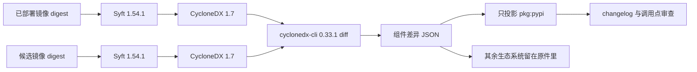

> “名不正，则言不顺；言不顺，则事不成。” —— 《论语·子路》

# 标准是那份清单，不是那个命令

*从“我们上了 CycloneDX”到“我们能指出镜像里哪一个包换了版本”——中间隔着格式、生成器、差异器和人的审查，四件不能互相冒充的东西。*

一次 Airflow 3.3.1 的生产镜像升级，构建是绿的。镜像里的 `pip check` 也是绿的。升级说明被读过。然后线上一个 FTP provider 的行为和上一版不一样：保护数据通道的调用变了。回头拆包，才看见四条当时没人指出来的移动：

| 包 | 旧版本 | 新版本 |
| --- | --- | --- |
| SQLAlchemy | 1.4.54 | 2.0.51 |
| Paramiko | 4.0.0 | 5.0.0 |
| pandas | 2.2.3 | 3.0.0 |
| apache-airflow-providers-ftp | 3.14.0 | 3.15.2 |

`pip check` 回答的是“这一套装在一起，依赖图协不协调”。它不回答“和上一张正在跑的镜像比，谁动了”。升级说明回答的是项目宣布了什么。正在跑的容器回答的是机器上实际有什么。这三份答案不是同一份文件。

这篇文章只坚持一个可以反驳的判断：**把 `cyclonedx-cli` 叫成行业标准，是把尺子说成了公尺。** 公尺是 ECMA-424 里的 CycloneDX 清单。尺子是一个可以计算两份清单差异的参考实现。升级要的是一把被钉死版本、并且用真实镜像证明过的尺子，外加一套人还得自己做的审查。缺任何一层，绿的构建仍然会放过 SQLAlchemy 2。

如果你负责过镜像升级，或者正在给团队推销“上一个 SBOM 工具”，下面四件事比工具名单有用：

- **名字先拆开。** 格式、生成器、差异器、审查，是四份职责。
- **差异不是失败。** 升级本来就会改包。失败的是清单没生成、清单不合法、或者你说不出旧镜像的 digest。
- **不要为了点名而把候选镜像跑起来。** 层里的文件已经是清单。启动容器是在执行不受你审查流程控制的代码。
- **Python 包是决策，操作系统包是背景。** 两份都要留下。交给人看的那一页，必须把 `pkg:pypi` 拎出来。

下面按“评审时最容易叫错名字的地方”排，不按我查资料的顺序。

## 1. 绿，是对另一个问题的回答

五个为什么，停在机制上，不停在态度上。

1. 为什么 FTP 行为变了？provider 从 3.14.0 到了 3.15.2，保护数据通道的调用变了。
2. 为什么升级评审没看见？评审读的是发行说明和锁定文件，不是两张不可变镜像里已经装上的发行版。
3. 为什么 `pip check` 没拦住？它检查的是新镜像内部的依赖是否自洽。一套全新的、彼此兼容的主版本升级，检查结果就是通过。
4. 为什么发行说明不够？说明写的是 Airflow 核心想让你知道的变化。SQLAlchemy、Paramiko、pandas 的主版本跳跃可以发生在同一张镜像里，而不出现在那一页的标题上。
5. 为什么当时没有一份机器可读的差异？因为构建管道会做一致性检查，会打标签，会把 tag 写进 GitOps。它没有把“旧 digest 对新 digest”变成必须归档的产物。

所以控制点不该长在聊天记录里，也不是再写一份更长的升级说明。控制点是：每张候选镜像，对着正在部署的那张，交出一份组件级差异。非空是证据，不是构建失败。构建失败只留给“差异没有被产生出来”的情况。

> 一致性是一张镜像内部的性质。变更是两张镜像之间的性质。用前者的绿灯给后者签字，是把体温计当成了病历。

## 2. 四个名字，人们习惯压成一个

2026 年 10 月我把公开规格和仓库重新对过一遍。能放进架构评审的，是下面这张表，不是一句“业界都在用 CycloneDX CLI”。

| 层 | 它实际是什么 | 2026-10-14 能核对的事实 | 在升级里的职务 |
| --- | --- | --- | --- |
| CycloneDX 1.7 | 清单格式。ECMA-424 第二版，2025 年 12 月。JSON 是主序列化 | ISO/IEC 27055 仍是草案，不是已发布的 ISO 标准 | 两张镜像之间的合同 |
| SPDX 2.2.1 | 另一份真正的国际标准，ISO/IEC 5962:2021 | 社区现行文本已经到 3.0.1。BuildKit 默认附的 SBOM 是 SPDX | 合法的另一选择。我们没选它，是因为组件版本差异没有一支同样直接的参考命令 |
| Syft 1.54.1 | 读镜像层、写 CycloneDX 或 SPDX 的扫描器。Apache-2.0 | 约 9,700 star，当天仍在更新。BuildKit 的默认 SBOM 扫描器走的就是这条路 | 生成器 |
| cyclonedx-cli 0.33.1 | OWASP 的 .NET 参考命令行。2026-07-23 发布 | 约 548 star。`diff --component-versions` 是命令的功能，不在 ECMA-424 正文里 | 差异器。钉死版本，先验证清单，再允许它开口 |
| 人的审查 | 把 Python 包的差异对上 changelog 和 DAG 里的真实调用 | 没有任何商品化扫描器知道你的 DAG 在哪一行 import 了 Paramiko | 决策 |

SPDX 并不更“不标准”。谁要是用“CycloneDX 已经是 ISO、SPDX 还不是”来说服架构委员会，这句话在 2026 年 10 月是假的。反过来也假：CLI 仓库放在 `CycloneDX` 组织下，不使它成为标准文本。标准文本规定清单里有什么字段。它不规定 diff 子命令的 JSON 长什么样。

同组织还有一个 `sbom-utility diff`。它自己的文档把这条命令标成实验性的，输出的是 RFC 6902 的 JSON Patch，还建议你先裁掉 `bom-ref`、哈希和 properties，否则补丁全是噪声。约 168 star。它不适合当升级报告。

旁边的参照，用来防止“最流行”变成“最合适”：

| 工具 | 它擅长 | 它不替代的东西 |
| --- | --- | --- |
| Trivy | 漏洞扫描，也能出 CycloneDX / SPDX。约 38,400 star | 两个发行版之间的升级决策 |
| Docker Scout `compare` | 镜像对镜像的包和漏洞差 | 文档仍把 compare 标成实验能力，而且是供应商服务 |
| Amazon Inspector SBOM | 产出 CycloneDX，并做漏洞扫描 | 发布到发布的组件差异 |
| GitHub dependency review | 比较 PR 上的 manifest 和 lockfile | 已经装进镜像、却没写进 lockfile 的那个发行版 |
| Google container-diff | 曾经的镜像 diff | 项目已归档，官方让人改去看 diffoci |
| cdxgen | 从源码树生成 CycloneDX | 容器镜像的层扫描。这件工作 Syft 更合适 |

第一性原理到这里就够了：升级评审要比较的是**两个不可变运行环境**。lockfile 是构建意图。SBOM 是那个环境的清单。diff 是两份清单的差。审查是差对业务代码的解释。四步里任何一步拿邻步的产物来冒充，绿的流水线都会再次放过主版本跳跃。



## 3. 命令真正吐出来的东西

我在本机跑过钉死的 `0.33.1`。版本行是 `0.33.1+b3cfa4b0edc356dad07e0b6e7ab6da0a94af0246`。两份最小的、通过 `cyclonedx validate --fail-on-errors` 的清单，diff 的 JSON 长这样：

```json
{
  "componentVersions": {
    "sqlalchemy": {
      "added": [
        {
          "type": "library",
          "name": "sqlalchemy",
          "version": "2.0.51",
          "purl": "pkg:pypi/sqlalchemy@2.0.51"
        }
      ],
      "removed": [
        {
          "type": "library",
          "name": "sqlalchemy",
          "version": "1.4.54",
          "purl": "pkg:pypi/sqlalchemy@1.4.54"
        }
      ],
      "unchanged": []
    }
  }
}
```

几个容易在封装时踩空的事实：

- 同一个名字下，旧版本在 `removed`，新版本在 `added`。没有一个叫 `modified` 的字段。版本变化是“移除旧坐标、加入新坐标”。
- JSON 里未变化的组件也在。文本模式会把它们藏起来，只打印有增删的名字。你若只根据文本模式做计数，会把分母弄丢。
- 键的顺序不稳定，不适合当字节级黄金文件。审查报告自己排序，并对 CLI 的原始 stdout 做 SHA-256。原始文件原样归档。审查 JSON 是投影，不是第二份事实。
- `purl` 决定这个组件进哪一节。全部以 `pkg:pypi/` 开头，才算 Python。混进一个 `pkg:deb/`，整条就离开 Python 表。没有 purl 的条目进“其他”，不要靠名字猜。
- 2024 年的 issue #380 里，非法输入得到过空 diff，或者 `ArgumentNullException`。维护者的结论是：那两份文件不是合法的 CycloneDX。所以顺序是 validate，然后 diff。验证失败时不要把 stderr 贴进证据，URL 里可以藏着仓库令牌。

Syft `1.54.1` 默认写出的是 CycloneDX **1.7**。我用同一支 CLI 验证过一份这样的文档，结果是 `BOM validated successfully.` 生成器和差异器终于说的是同一版规格。这是选 1.54.1 和 0.33.1 这一对的原因，不是因为它们的 star 数好看。

> 差异器的输出是事实的形状。投影脚本若再算一遍版本比较，你就有了两个引擎，而两个引擎一定会在某个主版本上各说各话。

## 4. 点名的时候，不要把镜像启动起来

旧做法很有诱惑力：`docker run --entrypoint python <digest> -m pip inspect`。它看起来精确，因为 pip 自己报告已安装的发行版。它也把清单的产生，变成了候选镜像里的代码执行。

信息在这里换了方向。镜像层是一份冻结的文件系统。Syft 读层，用目录里的 metadata 还原组件。`pip inspect` 启动解释器，跑镜像自己的入口环境，再相信它打印的 JSON。前一条路径的信任边界是“扫描器有没有读对文件”。后一条路径的信任边界是“这张还没批准的镜像，愿不愿意老实报告自己”。

生产管道里更具体的理由有四条：

1. 入口点会被你覆盖，PATH 也会变。已经有过这样的构建：`--entrypoint pip` 找不到 pip，因为镜像把解释器放在自己的入口脚本后面。于是有人改成 `bash -c`。每多一层 shell，证据就多一处可以偷偷改写输出的地方。
2. `pip freeze` 的直链 URL 可以带凭据。把这一行写进构建日志，等于把令牌归档 90 天。
3. 多架构镜像在 amd64 的 runner 上 `docker run`，你看到的只是 runner 的那一个平台，可日志里写的像是“这张镜像”。显式写下 `--platform linux/amd64` 之后，证据的范围和集群节点的架构一致，也不再假装覆盖了 arm64。
4. 扫描器的版本必须钉死。Syft 换一个小版本，组件图就会变。变了的图不该被叫成同一份升级证据。

对应的生成命令是：

```bash
syft --quiet --scope squashed --platform linux/amd64 \
  -o "cyclonedx-json=old.cdx.json" \
  "registry.example/apache-airflow@sha256:<digest>"

cyclonedx validate --input-file old.cdx.json --fail-on-errors
cyclonedx diff old.cdx.json new.cdx.json \
  --component-versions --output-format json \
  > cyclonedx-component-diff.json
```

`--scope squashed` 看的是最终文件系统，和进程启动之后看见的那一层对齐。`all-layers` 会把被上层盖掉的包再数一遍。digest 必须来自 `RepoDigests`，并且包含 `@sha256:`。本地镜像 ID 够做一次实验，不够做跨构建的发布记录。

这里有一条必须说清的证明边界。上面的 CLI JSON，是用最小清单对 `0.33.1` 跑出来的，和命令的真实 stdout 一致。Syft 1.7 文档能被同一支 CLI 验证，也跑过。正在跑的那对历史 Airflow 镜像，还没有在这台机器上扫过，因为当时 Docker 守护进程不在。fixture 证明的是合同。生产证明要等管道对着旧 digest 和新 digest 跑一次。把合同测试说成已经核对过生产镜像，是另一种名不副实。

## 5. 清单比决策大，这是特性

一张 Airflow 基础镜像的 SBOM 里，Debian 包的数量会压过 pip 包。如果把 CLI 的全文贴进构建摘要，评审者会在 `libssl` 的海洋里找不到 pandas。如果只留 Python，你又把基础镜像的 OpenSSL 升级从证据里删掉了。

对称在“一张清单描述整张镜像”这里破掉。决策需要两个切面，而不是两份互相矛盾的事实：

| 切面 | 留下什么 | 谁读 |
| --- | --- | --- |
| 原件 | CLI 的 `componentVersions` 全文，加上两份 SBOM | 事后审计、漏洞工具、下一次工具升级时的回归 |
| Python 投影 | 仅 `pkg:pypi` 的变更、新增、删除，按名字排序 | 升级评审、changelog 对照、DAG 里的直接 import |
| 其他生态系统 | 计数，以及 Markdown 里有限的前几十行 | 提醒基础镜像也动了；全文仍在原件里 |

投影的摘要长这样才算诚实：

```text
Python: 5 changed, 1 added, 1 removed, 1 unchanged
Other components: 0 changed, 1 added, 0 removed, 0 unchanged
```

那 1 个 other，是故意放进 fixture 的 `pkg:deb/debian/libssl`。它必须出现在“其他”，不能被一个按名字排序的 Python 表吞掉。

审查顺序也由此固定，不必每次开会重新发明：

1. 被删掉的 Python 包：DAG、插件、provider 是否还在 import。
2. 主版本：迁移指南，而不是版本号的第一位数字本身。
3. provider：读那个 provider 的 changelog。Airflow 核心的发行说明不会替 FTP 数据通道负责。
4. 被业务代码直接 import 的库：对到调用点，而不是对到“我们好像用了 Paramiko”。
5. 传输和加密库：对着真实的对端再试，不要对着 CVE 列表独自结论。
6. 新增的传递依赖：它的父依赖是谁。
7. 其他生态系统：看计数。计数异常时再打开原件。

版本号的距离不是风险。FTP provider 一个小版本就改变了线上行为。pandas 的主版本跳跃也可能对你的 DAG 完全无感，如果没有调用点碰到那条删掉的 API。风险在调用点，不在数字的大小。

## 6. 钉死、证明，然后删掉自己的 diff

自己写一个 PEP 503 归一化加排序的 Python diff，能在一周内证明“我们看见了 SQLAlchemy”。它也会在两个仓库里各活一份，对 `pip inspect` 的 schema 版本视而不见，并且必须把镜像跑起来。这种脚本的正确身份是探路，不是控制点。

替换完成的判据只有一条：同一对清单，钉死的 CLI 给出的组件差异，和你归档的那份 stdout 一致；投影里能看见那四个包的新旧版本；重复跑，审查 JSON 字节相同。做到之后，自己的比较器就该删掉。留下的本地代码只做三件事：检查工具版本字符串、调用 validate 和 diff、把 `pkg:pypi` 投影成人和下游自动化要读的页。

工具版本检查要失败于“几乎对”：

```text
Syft must be exactly 1.54.1
cyclonedx-cli must be exactly 0.33.1
```

浮动的 `latest` 会让星期四的证据和星期五的证据不可比。不可比的证据不能拿来解释一次已经发生的故障。

CISA 在 2026-07-29 更新的 SBOM 最小要素，把组件哈希、许可证、生成工具、生成上下文和作者签名写进了新的基线。NIST SSDF 谈的是来源和分享。SLSA v1.2 谈的是构建 provenance。这些是清单应该长成的样子，不是已经自动适用的法规。今天的构建产物如果只是一张留存 90 天的 Actions artifact，它还没有签名，也没有作为 OCI referrer 粘在镜像 digest 上。审查 JSON 里对 CLI stdout 的 SHA-256，只能证明“这一页对得上那次 diff”。它不能证明“这张镜像在仓库里仍然带着这份清单”。

这是还没做完的半截，不该写成已经上线的能力。

## 立刻可以做的事

1. 在下一次镜像构建里打印两行版本：`syft version` 和 `cyclonedx --version`。对不上 `1.54.1` 和 `0.33.1` 就停。
2. 对旧 digest 和新 digest 各生成一份 CycloneDX，先 `validate --fail-on-errors`，再 `diff --component-versions`。原始 JSON 和 Python 投影一起归档。
3. 把构建失败条件写成“清单或差异没有产生”，不要写成“差异非空”。
4. 拿 SQLAlchemy、Paramiko、pandas、FTP provider 这四行做一次回归。少一行，这份证据就还没覆盖已经伤过你的那次升级。
5. 把漏洞扫描留在 Trivy、Grype 或 Inspector。不要让同一次 diff 兼任安全策略。

## 还开着的口

下一件值得写清楚的事，是把这份 SBOM 变成镜像 digest 的 OCI referrer，而不是构建日志旁边的一个 90 天附件。在那之前，任何“我们已经有供应链证明”的说法都说早了。现在拥有的，是一张能被重复计算的组件差异，以及一份不会再把 CLI 叫成标准的评审语言。

*清单是合同，命令是尺子，审查是签字。把尺子刻上“标准”两个字，合同并不会因此生效。*
