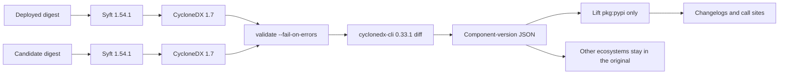

> "Things have their root and their branches. Affairs have their end and their beginning. To know what is first and what is last will lead near to what is taught." — The Great Learning, tr. James Legge

# The bill first, then the subtraction

*From "what is installed on this digest" to "what moved relative to the digest we run" — a contract, a pinned ruler, and a signature no scanner will give you.*

The build was green. `pip check` inside the image was green. Someone had read the release notes. Then an FTP task died: the data channel started asking for protected transfer, and the peer still spoke the old handshake. The four rows that would have started the review were not in the pack:

| Package | 3.1.6 | 3.3.1 |
| --- | --- | --- |
| SQLAlchemy | 1.4.54 | 2.0.51 |
| Paramiko | 3.5.1 | 5.0.0 |
| pandas | 2.1.4 | 2.3.3 |
| apache-airflow-providers-ftp | 3.14.0 | 3.15.2 |

Those numbers are a scan, not folklore. On 15 October 2026 the public images `apache-airflow:3.1.6` and `apache-airflow:11b7aa7` (Airflow 3.3.1) were inventoried on `linux/amd64`. Paramiko did not move "4 to 5"; it moved **3.5.1 to 5.0.0**. pandas did not jump to 3.x; it landed on **2.3.3**. The FTP behaviour arrived in **3.15.1**; this pair installed **3.15.2**.

`pip check` answers whether this saucepan of packages is internally coherent. Release notes answer what the project chose to announce. The running container answers what is on the machine. Three questions, three documents. Signing the third with a green light from the first is how SQLAlchemy 2 ships again.

The claim this piece will not soften: **an upgrade review does not need another homemade version comparer. It needs two valid bills of materials, then a subtraction.** The writing format of the bill is CycloneDX 1.7 (ECMA-424). Syft writes it from the layers and does not start the candidate. A pinned `cyclonedx-cli` subtracts. People still sign the Python rows against DAG call sites. Calling the CLI "the industry standard" engraves "metre" on a ruler.

Walk away with three things:

- **An SBOM is the ingredients list of one image digest**, not an invoice, not a lockfile, and not a vulnerability report.
- **Subtracting two bills earns its keep when the running image is about to change.** A green `pip check` and a CVE scan answer different questions.
- **A non-empty diff is success.** The build fails when the bill cannot be produced, does not validate, or the ruler's version drifted.

The teaching order is not the discovery order. The accident came first. The names came later. A reader who has never heard "SBOM" needs the ingredients list before the tool matrix.

## 1. What CISA means by ingredients list

CISA is the U.S. Cybersecurity and Infrastructure Security Agency. Its public writing calls an SBOM the **ingredients list of software**. On 29 July 2026, with the NSA, the FBI, and international partners, it published *2026 Minimum Elements for a Software Bill of Materials*, replacing the 2021 NTIA baseline. The metaphor survived the revision.

A food label does not ask you to trust a slogan. It asks you to see water, sugar, which preservative. A container image is a black box to operations. Without a bill, you ask vendors, peel layers, and guess.

Three documents people mash into one word:

| Document | What it records | Question it answers |
| --- | --- | --- |
| Release notes | What the project chose to put in the changelog | What the authors wanted you to know |
| Lockfile / build manifest | Coordinates a build **intended** to resolve | What the source tree declared |
| SBOM | Components **actually present** on one digest's filesystem | What a process will see after start |

CISA's minimum elements are a **field checklist**: name, version, hash, license, generating tool, generation context. They describe what a competent bill should contain. They are not a university regulation, and they are not a differ. No campus change-management process grows a new mandatory clause because a PDF landed in Washington. Align fields against the checklist if you want. Comparing two Airflow images still needs a generator and a ruler.

> A bill turns "what is inside" into a checkable fact. It does not decide which row will break a task, and it does not patch the peer.

## 2. Why the project exists, and when subtraction is the point

One SBOM answers "does this digest contain library X at version Y?" Log4Shell and xz-utils are that question. An upgrade review asks one more: **relative to the digest we run, what moved?** Inventory is one bill. Changelog input is the difference of two.

Four squares:

| Occasion | The move | Without a bill |
| --- | --- | --- |
| Image pin | The build is about to rewrite the base sha | Review starts from release notes; a provider minor walks through |
| Incident | A task changed behaviour after a "small" bump | People peel layers after the outage |
| Advisory | "Is this library in what we run?" | The first week is spent asking vendors |
| Not this control | `pip check`, Trivy / Grype / Inspector | Each has a job; none of them lists what moved |

Vulnerability scanners ask whether a known CVE is present. Subtraction asks how coordinates walked between two releases. The same CycloneDX document can feed both. Do not weld both jobs to the same build-failure condition.

If someone on the team says "our SBOMs are only for Airflow images, so xz is off-topic" — the kinship is the question, not the coverage. Syft reads the final filesystem. If Debian's `xz-utils` / `liblzma` sits in the layers, it appears as `pkg:deb` in the BOM, not necessarily on the Python review page. A pipeline that only bills `apache-airflow` can answer **each Airflow digest**. Fleet-wide "which images contain 5.6.0" needs the same method on every image type, plus a store keyed by digest. The xz card is the industry rhyme. The pipeline first ships the second bill for an upgrade.

## 3. A green check answered the wrong question

`pip check` looks at **one environment**: are declared dependencies present, do version ranges collide. Exit 0 means the set hangs together. The new image can carry SQLAlchemy 2, Paramiko 5, and numpy 2 at once. If pip is satisfied, the light is green.

It does not pull the old image. It does not list who moved from 3.1.6 to 3.3.1. A brand-new, internally coherent pile of major upgrades is, to this tool, success.

Five whys, stopped at the mechanism:

1. Why did FTP change? The provider moved 3.14.0 → 3.15.2; from 3.15.1 the data channel can be protected.
2. Why did review miss it? The pack was release notes plus a green pip check, not a component diff of two immutable images.
3. Why didn't `pip check` catch it? It tests coherence inside the new image.
4. Why weren't release notes enough? Core notes do not own every provider's transport default.
5. Why was there no machine-readable delta? The pipeline tagged images and wrote shas into GitOps. It never archived "old digest versus new digest".

> Coherence is a property of one image. Change is a property of two. Signing a chart with a thermometer does not make a diagnosis.

## 4. How a "small" bump breaks a task

FTP uses two connections: commands on the control channel, files on the data channel. A protected data channel encrypts the latter (`PROT P`). After **3.15.1**, the provider can negotiate that path by default. A peer that still offers a clear data channel fails the transfer.

The version line looks minor: 3.14.0 → 3.15.2. It does not look like SQLAlchemy 1.4 → 2.0. Reviewers file it under "come along for the ride". The behaviour landed in **3.15.1**; this image pair installed **3.15.2**, which already contains it. Do not tell the room that 3.15.2 invented the protected channel.

Without a component list, review did not open on that row. The task failed, then people searched backward. That is tribal knowledge that never became an engineering artifact: someone remembers "FTP bit us once", and the pipeline cannot produce a line.

📌 Distance between version numbers is not risk. Risk lives at the call site and at the peer. A patch can change a transport default. A major bump can be a no-op for your DAGs.

## 5. The same question in the field: Log4Shell, xz, CISA 2026

In December 2021, Log4Shell (CVE-2021-44228) turned "is this library in what we run?" into a national incident. CISA advisory **AA21-356A** opened with inventory: every asset that uses Log4j, with versions. CISA also kept a public affected-product list, because many owners could not answer from a bill of their own.

In March 2024, xz-utils **5.6.0 and 5.6.1** carried a backdoor (CVE-2024-3094). The operational question was which **images and distros** contained those versions. A laptop `requirements.txt` often never names xz. It lives in the base image, in distro packages, inside someone else's binary.

Do not write history as "an SBOM would have stopped a supply-chain implant". The claim that stands is narrower: without a bill, week one of an advisory is spent asking whether we have the library; with a bill, the question is a query over JSON.

CISA 2026 filled in fields. It still does not subtract. Keep three cards apart:

| Thing | Job |
| --- | --- |
| CISA 2026 minimum elements | Which columns a bill should have |
| CycloneDX 1.7 / ECMA-424 | How the bill is written |
| `cyclonedx-cli diff --component-versions` | Added, removed, changed between two valid bills (a CLI feature, not the Ecma text) |

SPDX 2.2.1 is ISO/IEC 5962:2021 — a real standard. BuildKit can attach SPDX with `--sbom=true`. What it attaches by default is provenance, not an SBOM. CycloneDX was chosen because a reference CLI already diffs component versions, not because it is "more ISO". CycloneDX's own ISO/IEC 27055 was still a draft in October 2026. Telling an architecture board the opposite is a factual error.

## 6. Why not write the comparer ourselves

The old path is seductive: boot the candidate, `pip inspect` or `pip freeze`, subtract two text lists. It looks precise, because pip reports installed distributions. It also turns inventory into **execution of an image the review has not accepted**.

Information changes direction here. Image layers are a frozen filesystem. Syft reads layers. `pip inspect` starts an interpreter and trusts the JSON it prints. One trust boundary is "did the scanner read the files". The other is "will this candidate tell the truth about itself".

| Approach | What it actually does | Why we leave it |
| --- | --- | --- |
| Boot the image, `pip freeze`, diff | Executes the candidate, sees Python, owns version compare | Executes unreviewed code; misses Debian and cargo |
| Homemade pip-inspect parser | Same class of work, private JSON in two repos | Thursday's script and Friday's script diverge |
| Trivy / Grype / Inspector | Asks whether a known CVE is present | Keep as vuln policy, not the upgrade report |
| SPDX plus our own differ | The format is a real standard | No purpose-built component-version CLI; subtraction returns to us |
| Syft 1.54.1 + cyclonedx-cli 0.33.1 | Reads layers, writes 1.7, validates, lists added/removed/changed | Image stays unstarted; format is ECMA-424; the pin makes two Fridays comparable |

Nearby options, so "most stars" does not become "best fit":

| Project | Role | Decision |
| --- | --- | --- |
| Syft | Image scanner, ~9,700 stars, BuildKit's SBOM scan path | Adopt as generator |
| Trivy | Scan plus vulns, ~38,400 stars | Vuln policy, not upgrade diff |
| cyclonedx-cli | Reference differ, 0.33.1, ~548 stars | Pin it, validate first |
| Docker Scout compare | Image-to-image | Docs still mark compare experimental; vendor service |
| sbom-utility diff | RFC 6902 patch | Docs mark it experimental |
| container-diff | Old image diff | Archived |
| cdxgen | CycloneDX from a source tree | Image layers: Syft |
| GitHub dependency review | Compares lockfiles on a PR | Blind to a distro that is installed but never locked |

A PEP 503-normalizing Python diff can prove "we saw SQLAlchemy" in a week. It will also live twice, in two repositories, and it will boot the image. That script is a spike. After the spike, local code should only check tool version strings, call validate and diff, and lift `pkg:pypi` into a page humans read.

## 7. Architecture: generate, validate, subtract, project



The generate command has to name its scope. `--scope squashed` is the final filesystem, aligned with what a process sees after start. `all-layers` double-counts packages the upper layer hid. Pin the platform to the cluster nodes — here, `linux/amd64`. The digest must come from `RepoDigests` and contain `@sha256:`. A local image id is enough for a laptop experiment, not for a release record across builds.

```bash
export SYFT_FILE_METADATA_SELECTION=none

syft --quiet --scope squashed --platform linux/amd64 \
  -o "cyclonedx-json=old.cdx.json" \
  "registry.example/apache-airflow@sha256:<old>"

syft --quiet --scope squashed --platform linux/amd64 \
  -o "cyclonedx-json=new.cdx.json" \
  "registry.example/apache-airflow@sha256:<new>"

cyclonedx validate --input-file old.cdx.json --fail-on-errors
cyclonedx validate --input-file new.cdx.json --fail-on-errors
cyclonedx diff old.cdx.json new.cdx.json \
  --component-versions --output-format json \
  > cyclonedx-component-diff.json
```

`SYFT_FILE_METADATA_SELECTION=none` is not taste. Syft's default file catalog writes thousands of `type: file` components with no version and often no purl. One untrimmed 3.1.6 scan had 7714 components, 7190 of them files. `cyclonedx diff` then treats certificate paths as components; a projector that needs a usable version exits with an input error. With file metadata off, packages remain. The projector still skips leftover `type: file` rows and counts them as `skipped_file_entries`.

🩸 Do not echo CLI stderr into the build summary when validation fails. Those lines can contain registry URLs with tokens. Externally: "validate failed", plus a redacted snippet that drops `://`, `token`, and `password`.

Do not install tools with `curl | sh`. On a linux/amd64 GitHub runner, fetch the pinned `syft_1.54.1_linux_amd64.tar.gz` and the self-contained `cyclonedx-linux-x64`. Version gates must fail on "almost":

```text
Syft must be exactly 1.54.1
cyclonedx-cli must be exactly 0.33.1
```

An unpinned `latest` makes Thursday's evidence incomparable with Friday's. Incomparable evidence cannot explain an incident that already happened.

## 8. The JSON the ruler actually emits

The pinned `0.33.1` version line is `0.33.1+b3cfa4b0edc356dad07e0b6e7ab6da0a94af0246`. `diff --component-versions` has no `modified` field. Under one name, the old version sits in `removed` and the new version in `added`. A version change is a coordinate swap.

```json
{
  "componentVersions": {
    "sqlalchemy": {
      "added": [
        {
          "type": "library",
          "name": "sqlalchemy",
          "version": "2.0.51",
          "purl": "pkg:pypi/sqlalchemy@2.0.51"
        }
      ],
      "removed": [
        {
          "type": "library",
          "name": "sqlalchemy",
          "version": "1.4.54",
          "purl": "pkg:pypi/sqlalchemy@1.4.54"
        }
      ],
      "unchanged": []
    }
  }
}
```

Facts that break wrappers:

- **Unchanged** components are in the JSON. Text mode hides them. Counting from text mode loses the denominator.
- Key order is unstable. Do not gold-file the bytes. The review page sorts; it also stores the SHA-256 of the CLI's **raw stdout**. Archive the original as-is. The review JSON is a projection, not a second source of truth.
- `purl` decides the section. Python iff every purl starts with `pkg:pypi/`. One `pkg:deb/` moves the whole entry out of the Python table.
- Issue #380 (2024): invalid BOMs yielded an empty diff or `ArgumentNullException`. Maintainer: the inputs were not valid CycloneDX. Validate, then diff.

Projection must follow the CLI's shape, not re-compare versions:

```python
def is_changed(entry: dict) -> bool:
    return bool(entry.get("added")) and bool(entry.get("removed"))

def is_python(entry: dict) -> bool:
    comps = list(entry.get("added") or []) + list(entry.get("removed") or [])
    if not comps:
        comps = list(entry.get("unchanged") or [])
    purls = [c.get("purl") or "" for c in comps]
    return bool(purls) and all(p.startswith("pkg:pypi/") for p in purls)
```

Exit codes are part of the contract. A non-empty diff is exit 0. Failures: missing inputs (no image, no digest), extraction failure, write failure. The build summary should say: reviewers open the Python page; the full CLI JSON is the CycloneDX original.

## 9. A scan of real images

15 Oct 2026, the public pair, `linux/amd64`, Syft 1.54.1, file metadata off, CLI 0.33.1. The review skill and the pipeline projector produced the same summary from the same CLI stdout. Two runs hashed that stdout to:

```text
5ee5fe7332d9121ba7b7d1c8c9d07edec319efba1445501a61f9d7eb0857a919
```

Python:

| | Count |
| --- | --- |
| Changed | 190 |
| Added | 20 |
| Removed | 11 |
| Unchanged | 85 |

Other components: 57 changed, **503 added**, 2 removed, 158 unchanged. Those 503 are almost all **pkg:cargo** crates inside the `uv` / `uvx` binaries, not 503 Debian packages. Debian `libssl3` did move: `3.0.18-1~deb12u1` → `3.0.20-1~deb12u2`. Reading 503 as "the base image grew 503 OS packages" panics the room in the wrong place.

The same scan also shows `cryptography` 42.0.8 → 50.0.0, `numpy` 1.26.4 → 2.5.1, `flask` 2.2.5 → 3.1.3, `apache-airflow` 3.1.6 → 3.3.1. Removed: `sshtunnel` 0.4.0, `sqlalchemy-jsonfield`. Added: `psycopg` 3.3.4. The full Markdown is alphabetical. The first page for reviewers lifts the four rows that matter to the incident. That is a projection, not a four-row report.

Exit 0. Non-empty is success.

Review order, so the meeting does not reinvent it:

1. Removed Python packages: does code still import them.
2. Major versions: read the migration guide.
3. Providers: that provider's changelog.
4. Libraries the business imports directly: the call site.
5. Transport and crypto: retry against the real peer.
6. New transitives: which parent pulled them.
7. Other ecosystems: counts first, original JSON if the counts look wrong.

## 10. The half that is not shipped

Author signatures from CISA 2026, SLSA provenance, attaching the SBOM as an OCI referrer on the image digest — none of that is delivered by this pipeline yet. A ninety-day build artifact proves "this page hashes to that CLI stdout". It does not prove "the image in the registry still carries this bill".

Writing "we already have supply-chain attestation" as present tense is another incorrect name. What exists is a repeatable component diff, and a vocabulary that stops calling the CLI the standard.

## Do this today

1. Print and pin `syft version` = `1.54.1` and `cyclonedx --version` starting `0.33.1` on the image build. Stop on mismatch.
2. Generate CycloneDX for the old digest and the new one with `SYFT_FILE_METADATA_SELECTION=none`, validate, then diff. Archive the original and the Python projection together.
3. Fail the build when the bill, a valid diff, or the pinned ruler cannot be produced. Do not fail on a non-empty package list.
4. Regress SQLAlchemy, Paramiko, pandas, and the FTP provider. Use the scanned versions, not the folklore.
5. Leave vulnerability policy on Trivy, Grype, or Inspector. The same diff must not double as a CVE gate.

The next piece worth writing on its own is attaching this SBOM as a referrer on the digest, instead of a neighbour of the build log. Until then, review still starts on this page, and the signature is still a person's.

*List what is there, then subtract. If the green check answered a different question, the signature is empty.*
