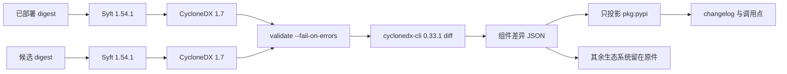

> “物有本末，事有终始。知所先后，则近道矣。” —— 《礼记·大学》

# 先有配料表，再相减

*从“镜像里装着什么”到“相对上一张 digest 动了什么”——中间隔着一张合同、一把钉死的尺子，和人还得自己做的签字。*

构建是绿的。镜像里的 `pip check` 也是绿的。有人读过升级说明。然后一条走 FTP 的任务断了：数据通道开始要求受保护传输，对端还按旧方式协商。回头拆包，才看见当时审查材料里根本没有的四行：

| 包 | 3.1.6 | 3.3.1 |
| --- | --- | --- |
| SQLAlchemy | 1.4.54 | 2.0.51 |
| Paramiko | 3.5.1 | 5.0.0 |
| pandas | 2.1.4 | 2.3.3 |
| apache-airflow-providers-ftp | 3.14.0 | 3.15.2 |

这四行不是传闻。2026 年 10 月 15 日，对着公开镜像 `apache-airflow:3.1.6` 和 `apache-airflow:11b7aa7`（后者是 Airflow 3.3.1）各扫了一遍，平台钉在 `linux/amd64`。Paramiko 不是民间传说里的 4 到 5，是 **3.5.1 到 5.0.0**。pandas 没有跳到 3.x，停在 **2.3.3**。FTP provider 的行为变化从 **3.15.1** 引进，这对本机装上的是 **3.15.2**。

`pip check` 回答的是：这一锅料彼此冲不冲。发行说明回答的是：项目愿意宣布什么。正在跑的容器回答的是：机器上实际有什么。三道题，三份文件。用第一道题的绿灯给第三道题签字，下一次 SQLAlchemy 2 还会穿过去。

这篇文章只坚持一个可以反驳的判断：**升级审查要的不是再写一个比版本的脚本，而是先有两张合法的配料表，再相减。** 配料表的书写格式是 CycloneDX 1.7（ECMA-424）。写出它的是 Syft，读层，不启动候选镜像。相减的是钉死版本的 `cyclonedx-cli`。人还要对着 Python 行和 DAG 调用点签字。把 CLI 叫成“行业标准”，是把尺子刻上了公尺的字。

读完你该带走三件事：

- **SBOM 是一张镜像 digest 的配料表**，不是发票，不是 lockfile，也不是漏洞扫描报告。
- **比较两张表，只在“正在跑的镜像即将被换掉”时值钱。** 绿的 `pip check` 和 CVE 扫描回答的是另外两道题。
- **非空的差异是成功。** 构建失败只留给清单没生成、清单不合法、或者尺子的版本漂了。

下面按教别人时该出现的顺序写：先讲配料表是什么，再讲何时相减，再讲工具为什么是这三件，最后落到架构、命令形状、一次真实扫描，和可以今天就改的流水线条件。发现顺序是反过来的——先撞上 FTP，再去找行业名字。教学顺序不必重复事故顺序。

## 1. 配料表：CISA 那句话到底在指什么

CISA 是美国网络安全与基础设施安全局。它在公开文件里把 SBOM 写成 software 的 **ingredients list**——配料表。2026 年 7 月 29 日，它和 NSA、FBI 以及国际伙伴一起发布了《2026 Minimum Elements for a Software Bill of Materials》，取代 2021 年 NTIA 的基线。那份文件仍然用这个比喻。

食品包装上的配料表，不要求你相信厂家口头说“里面都是好东西”。它要求你看见：水、糖、哪一种防腐剂。软件镜像对运维来说是黑盒子。没有配料表，你只能问供应商、翻层、猜。

三个容易被压成一个词的文件：

| 文件 | 它记录的是 | 它回答的问题 |
| --- | --- | --- |
| 发行说明 | 项目选择写进 changelog 的内容 | 作者想让你知道什么 |
| lockfile / 构建清单 | 一次构建**打算**解析出的坐标 | 源码树里声明了什么 |
| SBOM | 某一个 digest 的文件系统上**实际装着**的组件 | 这台机器启动之后会见到什么 |

CISA 的 minimum elements 是**字段检查表**：名字、版本、哈希、许可证、生成工具、生成上下文。它告诉你一张合格的表应该长什么样。它不是大学规章，也不是比较器。澳洲高校、某个内部变更流程，都不会因为这份 PDF 自动多出一条强制条款。要对齐字段，可以对照它。要比较两张 Airflow 镜像，仍然需要生成器和尺子。

> 配料表让“里面有什么”变成可检查的事实。它不替你决定哪一行会炸任务，也不替你打补丁。

## 2. 为什么要有项目，为什么要相减

只生成一张 SBOM，能回答“这一张 digest 里有没有某个库、哪个版本”。Log4Shell 和 xz-utils 问的就是这个。升级审查多问一句：**相对正在跑的那一张，新的一张换了什么。** 一张表是盘点。两张表的差，才是 changelog 审查的输入。

相减值钱的场景，可以收成四格：

| 场合 | 具体动作 | 没有表时发生什么 |
| --- | --- | --- |
| 镜像钉死 | 构建即将改写基础镜像 sha | 评审从发行说明出发，provider 小版本从眼皮底下走过 |
| 事故 | 任务在“小版本”之后行为变了 | 事后才去翻层，而不是从组件行开始 |
| 通告 | “这个库在我们跑的东西里吗？” | 第一周花在问供应商，而不是查清单 |
| 不该用这套控制 | `pip check`、Trivy / Grype / Inspector | 它们各有职务；拿它们冒充“什么动了”，会再签一次错的字 |

漏洞扫描问的是：已知 CVE 在不在。相减问的是：两个发行版之间，坐标怎么走。同一张 CycloneDX 可以喂给扫描器，也可以喂给 diff。职务不要焊死在同一次构建失败条件上。

队里若有人问“我们只要 Airflow 镜像的 SBOM，xz 那种事跟我们有什么关系”——关系在问法，不在覆盖范围。Syft 扫的是最终文件系统，Debian 的 `xz-utils` / `liblzma` 若在层里，会出现在 BOM 的 `pkg:deb` 里，不一定出现在给评审员看的 Python 摘要页。今天的管道若只为 `apache-airflow` 产表，它能可靠回答的是**每一张 Airflow digest**。要答全组织哪些镜像带 5.6.0，需要同一套方法覆盖其它镜像，并集中按 digest 检索。卡片上的 xz，是行业同一问；流水线先解决的是升级时的第二张表。

## 3. 绿灯答错了题

`pip check` 只看**当前这一个环境**：声明的依赖有没有装齐，版本范围是否互相冲突。全部通过就是 exit 0。新镜像里可以同时装着 SQLAlchemy 2、Paramiko 5、numpy 2，只要 pip 认为它们彼此合法，检查结果就是绿的。

它不会拉旧镜像来对比。它不会列出“从 3.1.6 到 3.3.1 谁从几升到几”。一套全新的、内部自洽的主版本升级，对它来说是成功。

五个为什么，停在机制上：

1. 为什么 FTP 行为变了？provider 从 3.14.0 走到 3.15.2，3.15.1 起数据通道可以走受保护传输。
2. 为什么评审没看见？材料是发行说明和“pip 绿了”，不是两张不可变镜像的组件差。
3. 为什么 `pip check` 没拦住？它检查的是新镜像内部是否自洽。
4. 为什么发行说明不够？核心发行说明不为每一个 provider 的传输默认值负责。
5. 为什么当时没有机器可读的差？管道会打标签、会把 sha 写进 GitOps，它没有把“旧 digest 对新 digest”变成必须归档的产物。

> 一致性是一张镜像内部的性质。变更是两张镜像之间的性质。用体温计给病历签字，病不会消失。

## 4. “小版本”为什么能把任务打坏

FTP 有两条连接：控制通道发命令，数据通道传文件。受保护的数据通道，就是数据通道也加密，协议里对应 `PROT P`。provider **3.15.1** 把这条路径加进默认协商之后，对端若仍按明文数据通道握手，传输就断。

版本号看起来像次要升级：3.14.0 → 3.15.2。它不像 SQLAlchemy 1.4 → 2.0 那么显眼。审查人容易把它当成“跟着升就行”。行为变化发生在 **3.15.1**；这次镜像对里装上的是 **3.15.2**，已经包含那个变化。不要说成“3.15.2 才第一次加上保护通道”。

没有组件清单时，审查不是从这一行开始的。任务坏了以后才回头找。这就是“部落知识”还没变成工程产物的样子：有人记得“上次 FTP 出过事”，流水线却拿不出一行可归档的 diff。

📌 版本数字的距离不是风险。风险在调用点和对端。一个 patch 可以改传输默认值；一次主版本跳跃也可能对你的 DAG 完全无感。

## 5. 行业同一问：Log4Shell、xz、CISA 2026

2021 年 12 月，Log4Shell（CVE-2021-44228）把“我们跑的东西里有没有这个库”变成了国家层面的应急动作。CISA 公告 **AA21-356A** 的第一条是：把所有用到 Log4j 的资产按版本盘点出来。它还维持一份公开的受影响产品清单，因为很多所有者答不出自己的配料表。

2024 年 3 月，xz-utils 的 **5.6.0 / 5.6.1** 被发现含有后门（CVE-2024-3094）。运维问题是：哪些**镜像和发行版**装着这两个版本。开发者笔记本上的 `requirements.txt` 常常根本列不出 xz——它在基础镜像、系统包、别人的二进制里。

不要把“有 SBOM 就能挡住供应链投毒”写成已经发生的历史。更窄、也站得住的说法是：没有配料表，通告后的第一周花在问“我们有没有”；有表，问题变成对 JSON 的查询。

CISA 2026 最小要素把字段补全了。它仍然不是 differ。三张牌必须分开：

| 东西 | 职务 |
| --- | --- |
| CISA 2026 minimum elements | 一张 BOM 该有哪些栏位 |
| CycloneDX 1.7 / ECMA-424 | 这张表怎么写 |
| `cyclonedx-cli diff --component-versions` | 两张合法表之间列出增、删、改（工具能力，不在 ECMA 正文里） |

SPDX 2.2.1 是 ISO/IEC 5962:2021，是另一份真正的标准。BuildKit 可以用 `--sbom=true` 附上 SPDX；默认附的是 provenance，不是 SBOM。没选 SPDX，不是因为它“不够 ISO”。选 CycloneDX，是因为参考 CLI 已经能做组件版本差。CycloneDX 自己的 ISO/IEC 27055 在 2026 年 10 月仍是草案。谁用“CycloneDX 已经是 ISO、SPDX 还不是”去过架构委员会，这句话当时是假的。

## 6. 为什么不是自己写比较器

旧做法很有诱惑力：把候选镜像跑起来，`pip inspect` 或 `pip freeze`，两份文本一减。它看起来精确，因为 pip 自己报已安装的发行版。它也把清单的产生，变成了**还没批准的镜像里的代码执行**。

信息在这里换了方向。镜像层是冻结的文件系统。Syft 读层。`pip inspect` 启动解释器，再相信它打印的 JSON。前一条路径的信任边界是“扫描器有没有读对文件”。后一条路径的信任边界是“这张候选镜像愿不愿意老实报告自己”。

| 做法 | 它实际做什么 | 为什么放下 |
| --- | --- | --- |
| 启动镜像，`pip freeze`，diff | 执行候选，只看见 Python，自己比版本 | 执行未审查代码；看不见 Debian 和 cargo |
| 自制 `pip inspect` 解析器 | 同一类工作，两套私有 JSON | 星期四的脚本和星期五的脚本会分叉 |
| Trivy / Grype / Inspector | 问已知 CVE 在不在 | 留下当漏洞策略，不当升级报告 |
| SPDX 再自己写 differ | 格式是真标准 | 没有现成的组件版本 CLI，减法又回到自己手里 |
| Syft 1.54.1 + cyclonedx-cli 0.33.1 | 读层，写 1.7，校验，再列出增删改 | 镜像保持未启动；格式是 ECMA-424；钉死版本让两个星期五可比 |

旁边的参照，防止“最流行”变成“最合适”：

| 项目 | 角色 | 决定 |
| --- | --- | --- |
| Syft | 镜像扫描器，约 9,700 star，BuildKit 的 SBOM 扫描路径 | 采用为生成器 |
| Trivy | 扫描加漏洞，约 38,400 star | 漏洞策略，不是升级 diff |
| cyclonedx-cli | 参考差异器，0.33.1，约 548 star | 钉死，先 validate |
| Docker Scout compare | 镜像对镜像 | 文档仍标实验，且是供应商服务 |
| sbom-utility diff | RFC 6902 补丁 | 文档自己标实验 |
| container-diff | 旧镜像 diff | 已归档 |
| cdxgen | 从源码树出 CycloneDX | 镜像层扫描选 Syft |
| GitHub dependency review | 比较 PR 上的 lockfile | 看不见已装进镜像、却没写进 lockfile 的那个发行版 |

自己写一个 PEP 503 归一化再排序的 Python diff，能在一周内证明“我们看见了 SQLAlchemy”。它也会在两个仓库里各活一份，并且必须把镜像跑起来。这种脚本的正确身份是探路。探路结束之后，本地代码只该做三件事：核对工具版本字符串、调用 validate 和 diff、把 `pkg:pypi` 投影成人要读的页。

## 7. 架构：生成、校验、相减、投影



生成命令必须把范围写死。`--scope squashed` 看最终文件系统，和进程启动之后看见的那一层对齐。`all-layers` 会把被上层盖掉的包再数一遍。平台写成集群节点的架构，这里是 `linux/amd64`。digest 必须来自 `RepoDigests`，并且带 `@sha256:`。本地镜像 ID 够做实验，不够做跨构建的发布记录。

```bash
export SYFT_FILE_METADATA_SELECTION=none

syft --quiet --scope squashed --platform linux/amd64 \
  -o "cyclonedx-json=old.cdx.json" \
  "registry.example/apache-airflow@sha256:<old>"

syft --quiet --scope squashed --platform linux/amd64 \
  -o "cyclonedx-json=new.cdx.json" \
  "registry.example/apache-airflow@sha256:<new>"

cyclonedx validate --input-file old.cdx.json --fail-on-errors
cyclonedx validate --input-file new.cdx.json --fail-on-errors
cyclonedx diff old.cdx.json new.cdx.json \
  --component-versions --output-format json \
  > cyclonedx-component-diff.json
```

`SYFT_FILE_METADATA_SELECTION=none` 不是口味问题。Syft 默认会把成千上万个 `type: file`、没有版本、常常没有 purl 的路径写进 BOM。3.1.6 的一份未裁剪扫描里，7714 个组件里有 7190 个是文件。`cyclonedx diff` 随后把证书路径一类的名字当成组件；投影脚本在“没有可用版本”时以输入错误退出。关掉文件元数据之后，BOM 里留下的是包。投影仍然跳过残留的 `type: file`，并把它们记成 `skipped_file_entries`。

🩸 验证失败时不要把 CLI 的 stderr 原样贴进构建摘要。错误行里可以藏着带令牌的仓库 URL。对外只保留“validate 失败”和一份去掉 `://` / `token` / `password` 的安全摘要。

安装工具时不要 `curl | sh`。GitHub 上的 linux/amd64 runner 拉钉死的 `syft_1.54.1_linux_amd64.tar.gz` 和自包含的 `cyclonedx-linux-x64`。版本检查要失败于“几乎对”：

```text
Syft must be exactly 1.54.1
cyclonedx-cli must be exactly 0.33.1
```

浮动的 `latest` 会让星期四的证据和星期五的证据不可比。不可比的证据不能拿来解释一次已经发生的故障。

## 8. 尺子吐出来的 JSON，以及本地代码不该再发明的东西

钉死的 `0.33.1` 版本行是 `0.33.1+b3cfa4b0edc356dad07e0b6e7ab6da0a94af0246`。`diff --component-versions` 的 JSON 没有 `modified` 字段。同一个名字下，旧版本在 `removed`，新版本在 `added`。版本变化就是换坐标。

```json
{
  "componentVersions": {
    "sqlalchemy": {
      "added": [
        {
          "type": "library",
          "name": "sqlalchemy",
          "version": "2.0.51",
          "purl": "pkg:pypi/sqlalchemy@2.0.51"
        }
      ],
      "removed": [
        {
          "type": "library",
          "name": "sqlalchemy",
          "version": "1.4.54",
          "purl": "pkg:pypi/sqlalchemy@1.4.54"
        }
      ],
      "unchanged": []
    }
  }
}
```

封装时容易踩空的事实：

- JSON 里**未变化**的组件也在。文本模式会把它们藏起来。只根据文本计数，会把分母弄丢。
- 键的顺序不稳定，不适合当字节级黄金文件。审查报告自己排序，并对 CLI 的**原始 stdout** 做 SHA-256。原件原样归档。审查 JSON 是投影，不是第二份事实。
- `purl` 决定进哪一节。每一条 purl 都以 `pkg:pypi/` 开头，才算 Python。混进一个 `pkg:deb/`，整条离开 Python 表。
- 2024 年的 issue #380：非法 BOM 得到过空 diff 或 `ArgumentNullException`。维护者的结论是输入不是合法 CycloneDX。所以顺序是 validate，然后 diff。

投影逻辑必须跟 CLI 的形状走，而不是再比一遍版本：

```python
def is_changed(entry: dict) -> bool:
    return bool(entry.get("added")) and bool(entry.get("removed"))

def is_python(entry: dict) -> bool:
    comps = list(entry.get("added") or []) + list(entry.get("removed") or [])
    if not comps:
        comps = list(entry.get("unchanged") or [])
    purls = [c.get("purl") or "" for c in comps]
    return bool(purls) and all(p.startswith("pkg:pypi/") for p in purls)
```

退出码也是合同。差异非空是 exit 0。失败属于：输入不够（缺镜像、缺 digest）、抽取失败、写出失败。构建摘要里要写清：评审员打开 Python 页；完整 CLI JSON 才是 CycloneDX 差异原件。

## 9. 一次对着真实镜像的扫描

2026-10-15，公开镜像对，`linux/amd64`，Syft 1.54.1，文件元数据关闭，CLI 0.33.1。技能路径和管道投影对同一份 CLI stdout 给出相同摘要。两次运行的 CLI stdout SHA-256 都是：

```text
5ee5fe7332d9121ba7b7d1c8c9d07edec319efba1445501a61f9d7eb0857a919
```

Python 一侧：

| | 数量 |
| --- | --- |
| 变更 | 190 |
| 新增 | 20 |
| 删除 | 11 |
| 未变 | 85 |

其它组件：57 变更，**503 新增**，2 删除，158 未变。那 503 几乎全是 `uv` / `uvx` 二进制里的 **pkg:cargo** crate，不是 503 个 Debian 包。Debian 的 `libssl3` 确实动了：`3.0.18-1~deb12u1` → `3.0.20-1~deb12u2`。把 503 读成“基础镜像多了 503 个系统包”，评审会在错误的地方恐慌。

同一扫描里还能看见：`cryptography` 42.0.8 → 50.0.0，`numpy` 1.26.4 → 2.5.1，`flask` 2.2.5 → 3.1.3，`apache-airflow` 3.1.6 → 3.3.1。删除侧包括 `sshtunnel` 0.4.0、`sqlalchemy-jsonfield`。新增侧包括 `psycopg` 3.3.4。这些行在完整 Markdown 里按字母序排；给评审员的第一页只抬直接相关的四行，是投影，不是“报告只有四行”。

exit 0。非空是成功。

审查顺序不必每次开会重发明：

1. 被删的 Python 包：代码是否还在 import。
2. 主版本：读迁移指南。
3. provider：读那个 provider 的 changelog。
4. 业务直接 import 的库：对到调用点。
5. 传输和加密库：对着真实对端再试。
6. 新增的传递依赖：父依赖是谁。
7. 其它生态系统：先看计数，异常再打开原件。

## 10. 还没做完的半截

CISA 2026 要求的作者签名、SLSA provenance、把 SBOM 作为 OCI referrer 粘在镜像 digest 上，都还不是这条流水线已经交付的能力。今天若只有一张留存 90 天的构建附件，它证明的是“那一次 diff 的 stdout 哈希对得上这一页”。它不证明“仓库里的那张镜像仍然带着这份清单”。

把“我们已经有供应链证明”写成现状，是另一种名不副实。现在拥有的，是可重复计算的组件差异，以及一套不再把 CLI 叫成标准的语言。

## 立刻可以做的事

1. 在镜像构建里打印并钉死 `syft version` = `1.54.1`、`cyclonedx --version` 以 `0.33.1` 开头。对不上就停。
2. 对旧 digest 和新 digest 各生成 CycloneDX，环境变量带 `SYFT_FILE_METADATA_SELECTION=none`，先 validate，再 diff。原件和 Python 投影一起归档。
3. 把构建失败写成“清单、合法 diff 或钉死的尺子没有产生”，不要写成“差异非空”。
4. 拿 SQLAlchemy、Paramiko、pandas、FTP provider 这四行做回归。版本必须是扫出来的那一组，不是传闻。
5. 把漏洞扫描留在 Trivy、Grype 或 Inspector。同一次 diff 不要兼任安全策略。

下一件值得单独写的，是把这份 SBOM 变成 digest 的 referrer，而不是构建日志旁边的附件。在那之前，审查仍然从这一页开始，签字仍然是人的。

*先列其物，再较其差。绿的检查若答的是另一道题，签字就是空的。*
