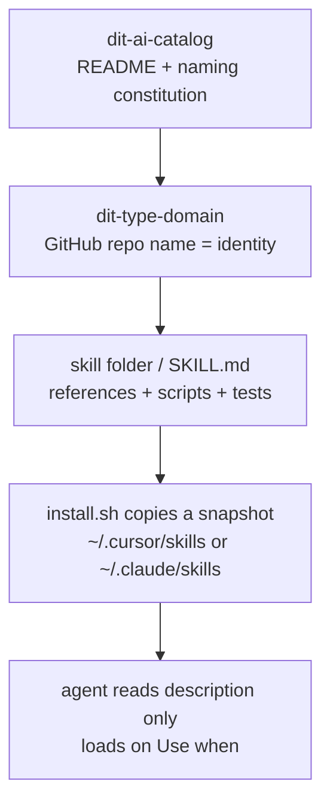

> "Once names are fixed, realities can be distinguished; once the Way is practiced, intentions can get through." — Xunzi, *Zhengming* (Rectifying Names)

# The catalog has one file. The name is the runtime.

*From "a list of AI repos" to "a constitution the installer and the agent both obey."*

I cloned the team's AI catalog expecting a generator, an indexer, at least a `metadata.yaml`. `git ls-files` printed one line:

```text
README.md
```

The header badges claim 10 repos, 6 skills, 3 MCP servers, 1 agents repo, standard v1.0. The catalog itself is not one of the 10. No Python. No CI. No Backstage `catalog-info.yaml`.

The naive read: an unfinished index page. The seasoned read: **the most important AI repo is allowed to have no code, because its job is to stop the other ten from becoming a junk drawer.** Treat the catalog as a tool inventory and you will mis-name the next repo and mis-load the next skill. It is a naming constitution. The runtime lives one layer down: the `Use when` clause in a skill contract, and the `check_skill.sh` that CI actually runs.

Three things to leave with:

- A repo name states identity. Attributes go in topics and metadata, never in the name.
- Repo name, skill install name, and agent trigger are three contracts that look like one string and break in different places.
- Before an agent opens `SKILL.md`, the only signal it has is whether the description contains `Use when`.

Useful order, not discovery order.

## 1. Four layers. Do not flatten them.



| Layer | Example | Consumer | Blast radius if you rename it |
|---|---|---|---|
| Catalog | `dit-ai-catalog` | humans, review, new joiners | people cannot find the repo; the standard drifts |
| Repo name | `dit-skills-airflow` | clone URL, GitHub topic | every clone, CI pin, and bookmark breaks |
| Skill name | `dit-skills-airflow-develop` | install path, `name:`, manifest | copies already on laptops keep triggering under the old name |
| Trigger | `Use when creating a new DAG` | agent routing | the right skill stays cold; the wrong one dumps its templates into context |

This is information directionality: each boundary rewrites the same characters under its own assumptions. In a human head the meaning is "the Airflow skill pack." In git the syntax is a repo name. In the agent the syntax is a description. You cannot use a repo name as a slash command, and you cannot use a skill folder as a GitHub search term.

> The catalog answers what is allowed to exist. The skill contract answers whether this turn should speak.

## 2. The naming standard is executable, not copy

One formula:

```text
dit-<type>-<domain>[-<qualifier>]
```

Hard rules: lowercase only; hyphens only, never underscores or camelCase; at most four segments; ideally under 30 characters; `type` from a closed vocabulary; `domain` is the canonical system name, not the framework.

| type | For | In production | Empty on purpose |
|---|---|---|---|
| `skills` | skill bundles | airflow / api / claude / dbt / onehelp / snowflake | |
| `mcp` | MCP servers | airflow / jira / servicenow | |
| `agents` | agents | devops | |
| `evals` | eval suites | | reserved |
| `prompts` | shared prompts | | reserved |
| `lib` | shared code | | reserved |
| `infra` | deploy / IaC | | reserved |
| `template` | repo scaffolds | | reserved |

The empty rows exist so the next debate does not reopen the vocabulary. If someone invents a ninth type, ask first: is this a new identity, or an attribute hanging off an old one? `deprecated`, `v2`, and owning team are attributes. Encode an attribute in the name and the first rename teaches everyone to stop renaming. GitHub topics (`skills` / `mcp` / `agents`) are for search. Owner and lifecycle belong on org custom properties.

Occam's razor is strict here: the name answers "who is this." Nothing else is the name's job.

The add-a-repo checklist in the README is: name it by the formula → add the matching topic → append a catalog entry → bump the header counts. Step 3 still says "copy an existing `<tr>` row." The page is now `### [repo]` heading blocks. The process is right. The prose is stale. That is the failure mode of a hand-maintained catalog, not an accident.

> The moment a name starts carrying lifecycle, the naming scheme is already dead.

## 3. Archaeology: why eight repos were renamed in a day

On 2026-08-31 the catalog landed with standard names on the left and the still-live old names on the right. By 09-01 all eight had moved. Commit `a645e90` closed the programme and rejected `dit-skills-ditapi`: it stutters, and it names the framework instead of the domain. The live name is `dit-skills-api`.

| Old GitHub name | Standard name | Disease that got cut |
|---|---|---|
| `dit-airflow-skill` | `dit-skills-airflow` | type not in segment two |
| `dit-claude-skills` | `dit-skills-claude` | same |
| `dit-dbt-sqlfluff-skills` | `dit-skills-dbt` | five segments; implementation detail in the identity |
| `ditapi-skills` | `dit-skills-api` | prefix is not `dit-<type>` |
| `dit-onehelp-skills` | `dit-skills-onehelp` | type last |
| `dit-snowflake-skills` | `dit-skills-snowflake` | type last |
| `dit-jira-mcp` | `dit-mcp-jira` | type last |
| `servicenow_mcp` | `dit-mcp-servicenow` | underscore; not even `dit-` |

Added after that programme, not among the eight: `dit-agents-devops` on 09-10, `dit-mcp-airflow` on 09-21. Once every repo answered to its standard name, they tore out the `proposed` / `live` / `Clone as` scaffolding.

They also left an asymmetry on purpose: GitHub repo names moved; skill install names did not, not yet. `~/.cursor/skills/<old-name>` is a contract on someone else's laptop. Renaming a GitHub repo is cheaper. Later, `dit-skills-airflow` grew `develop` / `decommission` / `image-deps` on its own clock, and the old `dit-airflow-skill` became a legacy entry in `install.sh` that reminds you to uninstall it. That is not a contradiction. Two contracts changed at two speeds.

> A repo rename breaks clone URLs. A skill rename breaks triggers already installed on other machines.

## 4. The real runtime: `Use when` and `check_skill.sh`

The standard skill packs (airflow, api) share one skeleton. `install.sh` discovers skills with a single rule: a top-level folder counts if it contains `SKILL.md`. It then copies a snapshot into `~/.cursor/skills` and/or `~/.claude/skills`, next to `<name>.install.json`. Copies, not symlinks. Pull, then reinstall. Cursor also scans `~/.claude/skills`, so installing into both directories lists every skill twice — which is why you sometimes install to one side only.

The contract is `tests/check_skill.sh`, not a wish in the README:

```bash
[ "$NAME" = "$FOLDER" ] || fail "name: '$NAME' must match the folder name '$FOLDER'"
printf '%s' "$NAME" | grep -Eq '^[a-z0-9]+(-[a-z0-9]+)*$' \
  || fail "name: must be lowercase letters, digits and single hyphens"

printf '%s' "$DESC" | grep -qi 'use when' \
  || fail "description: should say when to use the skill ('Use when ...')"
[ "${#DESC}" -le 1024 ] || fail "description: longer than 1024 characters"

[ "$LINES" -le 500 ] || fail "SKILL.md is $LINES lines (cap $MAX_LINES)"
```

Further down the same script: every `references/*.md` must be linked from `SKILL.md`; references must not link outside the skill; every file in `scripts/` and `assets/` must be mentioned; Python must parse; shell must pass `bash -n`. No "AI Instructions / System Use Only" blocks.

That is tribal knowledge becoming an artifact. The catalog says what a repo may be called. The contract says how an agent finds a skill, and how a decommission task is kept from loading nine develop templates.

The trigger chain should be speakable:

1. Someone asks for a sync DAG from a warehouse into an archive system.
2. The agent reads skill descriptions only.
3. `dit-skills-airflow-develop` hits on `Use when creating or scaffolding a new DAG`.
4. It reads the short `SKILL.md` router, then the matching `references/` file.
5. It asks type / source / target / schedule, proposes names, waits, then generates files.

On-demand loading is the design. Develop ships nine templates. Decommission must never pull them into context. The 500-line cap on `SKILL.md` is a context budget, not a style rule.

> The description is the routing table. `SKILL.md` is the table of contents. `references/` is the manual. Writing all three into one file is a context tax.

## 5. The lines inside a skill that are actually expensive

Take `dit-skills-airflow-develop`. Frontmatter `name:` must equal the folder name. The description says what the skill does, when to use it, and — this is the valuable bit — when not to: deleting a DAG belongs to decommission. Negative routing beats another three hundred words of positive prose.

Once loaded, the red lines outrank the templates:

| Red line | Why it is a red line |
|---|---|
| No `Variable.get()` / `get_param()` in DAG files | Airflow 3 must not call these at parse time; runtime values come from Jinja |
| Schedule is hardcoded, branched on an env var | cron is not a Variable; parse time must not read runtime state |
| Credentials must not land in `KubernetesPodOperator.env_vars` | the render is written into the metadata DB and the pod spec |
| Tests are pytest, not `DagBag` | matches the repo's existing test contract |
| The matching lines in `.airflowignore` / `.ciignore` must be commented out | a file on disk is not a loaded DAG |

The five DAG families are downstream of the same constitution: `ingestion_*`, `sync_*_to_*`, `move_*_to_*`, `analytics_*`, `admin_*`. The repo name says "this is an Airflow skill pack." The `dag_id` says "this is which kind of pipeline." Two vocabularies. Do not mix them.

The api pack applies the same contract to a different chain: `dit-skills-api-develop` scaffolds `ditapi-*` services, `deploy` walks the gateway and sealed secrets, `postman-smoke` discovers endpoints from OpenAPI and fails the run if a credential is committed in `smoke.json`. `mq-repo-setup` is not vendored; install pulls it from the configs repo — a remote skill, so the local tree does not hold a stale copy.

The dbt line is where repo name, skill name, and the folder on disk come apart. The catalog lists `dit-skills-dbt` with two skills, sqlfluff and Data Vault. A laptop that still has `dit-dbt-sqlfluff-skills` still installs as `dbt-sqlfluff-skills`. You will talk standard names in review and edit the legacy path on disk. The promise did not change: build a column-ownership map from Snowflake `DESCRIBE`, never guess an alias; prove the row set with COUNT + EXCEPT before dag-test. dag-test proves lint and compile. It does not prove equivalence.

> Templates are examples. Red lines are the contract. When an example ages, obey the contract.

## 6. The catalog is already drifting

The cost of a hand-maintained README is visible now:

| Drift | What it exposes |
|---|---|
| Add-a-repo still says copy a `<tr>` | scaffolding was removed; the checklist was not rewritten |
| dbt row says 09-11 in the title and 08-31 on the badge | counts and dates are a human sync |
| evals / prompts / lib / infra / template are empty | reservation is correct; people will treat empty slots as "open anything" |
| Platform repos (clusters, images, GitOps) are not in the catalog | two naming worlds; do not let the catalog govern infrastructure |
| Old clone names still sit on disk | the catalog says live; the laptop says legacy |

The first README mentioned a Backstage-shaped `catalog-info.yaml` generator. What shipped is one Markdown file. For ten repos, Occam's razor holds. The price is that staleness is a known fault, not an incident. First principles: the catalog has no test. The skill contract does. "What may this repo be called" is a review question. "Can an agent discover this skill" is a CI question.

The ten live repos are easier to remember by duty than by alphabet:

- **skills**: teach an agent how to change your repo (DAGs, APIs, dbt, change records, Snowflake, editor guardrails).
- **mcp**: give an agent hands on a real system (nine Airflow slices, Jira, ServiceNow).
- **agents**: a packaged troubleshooting entry (read-only, least privilege, via Teams or the editor).

MCP and skill are not the same kind of thing. A skill is a program installed into the editor. An MCP server is an interface that runs somewhere else. The catalog splits them by `type` so "let's open another AI repo" cannot be the same PR twice.

> A standard with no test will be broken by the next add-a-repo pull request.

## One table to hold the rest

| Question | Wrong answer | Contract answer |
|---|---|---|
| What is this repo? | "an AI toolkit" | `dit-<type>-<domain>`, type from the closed vocabulary |
| Where is the logic? | "in the catalog" | in the indexed repos; the catalog only legislates |
| Why can repo name and skill name differ? | "legacy, should fix" | two contracts, two blast radii |
| How does the agent pick a skill? | "by folder name" | by `Use when` in the description |
| May we call it `dit-mcp-jira-deprecated`? | "that's clear" | no. Lifecycle is not identity |
| Why no generator? | "not finished" | ten repos keep a README; review absorbs stale; do not build a portal for it |

## Do this today

1. Open your own catalog page. Check header counts against the real repo list, and every updated date. Mark the mismatches before you open a new repo.
2. On the next new-repo PR, write one line first: `type=` which vocabulary row, `domain=` which system. If you cannot fill both, the name is not ready.
3. Before renaming a GitHub repo, search `~/.cursor/skills` and `~/.claude/skills` for the install name. Changing the repo and leaving the skill is legal. Changing both at once is a migration.
4. When you write a new skill, write a description under 200 words first — it must contain `Use when` and one negative route — then write `references/`. Manual first, router second, and the agent will treat the whole manual as the home page.
5. If a legacy clone name is still on disk, label it legacy. Do not use it as the current standard in review.

*A list tells you what exists. A constitution tells you what is allowed to exist.*
