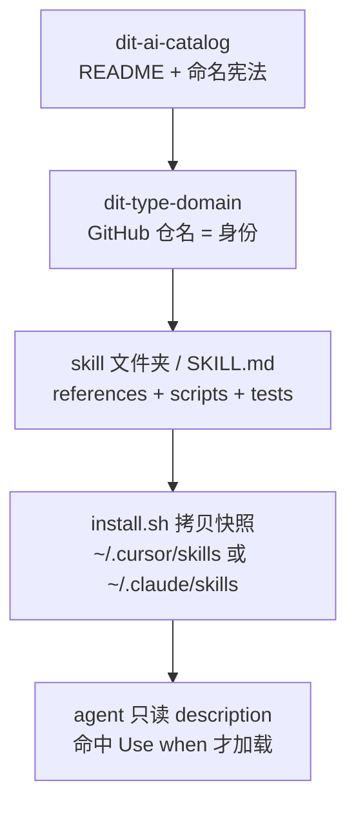

> “名定而实辨，道行而志通。” — 荀子《正名》

# 整个 AI 仓只有一份 README：命名才是运行时

*从「这是工具清单」到「这是命名宪法」—— skill 会不会被加载，在仓名定下来的那一刻就开始了。*

我把团队的 AI 目录仓 clone 下来，以为会看到生成器、索引脚本、至少一份 `metadata.yaml`。`git ls-files` 打出来只有一行：

```text
README.md
```

Header 徽章写着 10 个仓、6 个 skills、3 个 MCP、1 个 agents、standard v1.0。仓本身不计入这 10。没有 Python，没有 CI，没有 Backstage 的 `catalog-info.yaml`。

普通人的看法：这是一个还没写完的索引页。资深工程师的洞察：**最重要的 AI 仓可以没有代码，因为它的工作是阻止另外十个仓变成杂物抽屉。** 把 catalog 当工具清单读，你会开错下一个仓、加载错下一个 skill。它是命名宪法。真正的运行时在下一层：skill 合同里的 `Use when`，以及 CI 里那份 `check_skill.sh`。

读完你该带走三件事：

- 仓名只表达身份；属性走 topic 和 metadata，不写进名字。
- 仓名、skill 安装名、agent 触发词是三份契约，长得很像，炸的面完全不同。
- Agent 打开 `SKILL.md` 之前，只看见 description 里有没有 `Use when`。

下面按有用程度排，不按我发现的顺序。

## 1. 四层，不要压成一层



| 层 | 例子 | 谁在用 | 改错了会怎样 |
|---|---|---|---|
| 目录 | `dit-ai-catalog` | 人、评审、新同事 | 找不到仓，标准漂移 |
| 仓名 | `dit-skills-airflow` | clone URL、GitHub topic | 所有 clone / CI / bookmark 断 |
| skill 名 | `dit-skills-airflow-develop` | 安装目录、`name:`、manifest | 本机已装副本继续用旧名触发 |
| 触发词 | `Use when creating a new DAG` | agent 路由 | 该加载的不加载，不该加载的全读进上下文 |

这是信息单向性：每一层都按自己的假设改写同一串字符。语义在人脑子里是「Airflow 技能」；语法在 git 里是仓名，在 agent 里是 description。你不能拿仓名去当 slash command，也不能拿 skill 文件夹名去当 GitHub 检索词。

> 目录回答「可以存在什么」。Skill 合同回答「这次该不该开口」。

## 2. 命名标准是可执行规则，不是文案

公式只有这一条：

```text
dit-<type>-<domain>[-<qualifier>]
```

硬约束：全小写；只用连字符，禁止下划线和 camelCase；最多四段；最好短于 30 个字符；`type` 必须来自封闭词表；`domain` 是系统的规范名，不是框架名。

| type | 干什么 | 现役 | 空位 |
|---|---|---|---|
| `skills` | skill 包 | airflow / api / claude / dbt / onehelp / snowflake | |
| `mcp` | MCP server | airflow / jira / servicenow | |
| `agents` | agent | devops | |
| `evals` | 评测套件 | | 预留 |
| `prompts` | 共享 prompt | | 预留 |
| `lib` | 共享代码 | | 预留 |
| `infra` | 部署 / IaC | | 预留 |
| `template` | 仓脚手架 | | 预留 |

词表现在预留，是为了以后不再开会。新同事若发明第九种 type，先问：它是新身份，还是旧身份上的一个属性？`deprecated`、`v2`、拥有团队，都是属性。属性写进名字，第一次改名就会教团队「以后别再改了」。GitHub topic（`skills` / `mcp` / `agents`）负责检索；owner 和生命周期放组织自定义属性。

奥卡姆剃刀在这里很硬：名字只回答「这是谁」。其余都不是名字的职责。

加仓流程写在 README 里：按公式起名 → 打匹配 topic → 在 catalog 加一条 → 改 header 计数。第 3 步还写着复制 `<tr>`，页面本身已经改成 `### [repo]` 标题块。流程对，文案旧了——手维护目录的失败模式，不是意外。

> 名字一旦开始扛生命周期，命名方案就已经死了。

## 3. 考古：八个仓为什么在一天里改完名

2026-08-31 目录仓落地时，左边是标准名，右边是当时还活着的旧名。到 09-01，八个仓全部切到标准名。commit `a645e90` 把这件事收尾，并且否决了 `dit-skills-ditapi`：口吃，且把框架当成了 domain。最终叫 `dit-skills-api`。

| 旧 GitHub 名 | 现标准名 | 被修掉的病 |
|---|---|---|
| `dit-airflow-skill` | `dit-skills-airflow` | type 不在第二段 |
| `dit-claude-skills` | `dit-skills-claude` | 同上 |
| `dit-dbt-sqlfluff-skills` | `dit-skills-dbt` | 五段，且把实现细节写进仓名 |
| `ditapi-skills` | `dit-skills-api` | 前缀不是 `dit-<type>` |
| `dit-onehelp-skills` | `dit-skills-onehelp` | type 置后 |
| `dit-snowflake-skills` | `dit-skills-snowflake` | type 置后 |
| `dit-jira-mcp` | `dit-mcp-jira` | type 置后 |
| `servicenow_mcp` | `dit-mcp-servicenow` | 下划线，连 `dit-` 都没有 |

之后才新增、不在那八个里的：09-10 的 `dit-agents-devops`，09-21 的 `dit-mcp-airflow`。迁完，他们拆掉了 `proposed` / `live` / `Clone as` 脚手架——每个仓都已经能用标准名 clone。

当时有一条故意留下的不对称：GitHub 仓名改了，skill 安装名先不动。`~/.cursor/skills/<old-name>` 是用户机器上的契约；改仓名的爆炸半径小得多。后来 `dit-skills-airflow` 自己演进到 `develop` / `decommission` / `image-deps`，旧的 `dit-airflow-skill` 变成 `install.sh` 里的遗留项，提醒你卸掉。这不是前后矛盾，是两份契约按各自的节奏改。

> 仓名改的是克隆地址。Skill 名改的是已经装到别人电脑上的触发器。

## 4. 真运行时：`Use when` 和 `check_skill.sh`

标准 skills 仓（airflow、api）共用一套骨架。`install.sh` 的发现规则就一行：顶层目录里有 `SKILL.md` 的，才算 skill。然后拷贝快照到 `~/.cursor/skills` 和/或 `~/.claude/skills`，旁边写 `<name>.install.json`。拷贝不是 symlink。拉更新必须重装。Cursor 也会扫 `~/.claude/skills`，两边都装会看到两份——所以有时只装一边。

CI 里的合同来自 `tests/check_skill.sh`，不是 README 里的愿望清单：

```bash
[ "$NAME" = "$FOLDER" ] || fail "name: '$NAME' must match the folder name '$FOLDER'"
printf '%s' "$NAME" | grep -Eq '^[a-z0-9]+(-[a-z0-9]+)*$' \
  || fail "name: must be lowercase letters, digits and single hyphens"

printf '%s' "$DESC" | grep -qi 'use when' \
  || fail "description: should say when to use the skill ('Use when ...')"
[ "${#DESC}" -le 1024 ] || fail "description: longer than 1024 characters"

[ "$LINES" -le 500 ] || fail "SKILL.md is $LINES lines (cap $MAX_LINES)"
```

再往下：每个 `references/*.md` 必须被 `SKILL.md` 链到；references 不能链出 skill 目录；`scripts/` 和 `assets/` 必须在 `SKILL.md` 里被提到；`.py` 能 parse，`.sh` 过 `bash -n`。禁止写 “AI Instructions / System Use Only”。

这就是部落知识变成工程产物的那条线。目录告诉你仓该叫什么；合同告诉你 agent 怎样才找得到、怎样才不会把 decommission 的上下文塞进 develop 的九套模板。

触发链必须能口头走一遍：

1. 用户说「建一个从仓库到档案系统的 sync DAG」。
2. Agent 只看各 skill 的 `description`。
3. `dit-skills-airflow-develop` 的 `Use when creating or scaffolding a new DAG` 命中。
4. 读短路由 `SKILL.md`，再按表去读对应 `references/`。
5. 问 type / source / target / schedule，提议命名，等人确认，再生成文件。

按需加载是刻意的。Develop 有九套模板；Decommission 绝不该把这些模板读进上下文。`SKILL.md` 的 500 行上限不是审美，是上下文预算。

> description 是路由表。SKILL.md 是目录。references 才是手册。把三者写进同一份文件，就是在交上下文税。

## 5. 一个 skill 里真正值钱的红线

以 `dit-skills-airflow-develop` 为例。Frontmatter 的 `name:` 必须等于文件夹名。description 先写做什么，再写何时用，最后把「删除 DAG 请走 decommission」写进去——这是负向路由，比再写三百字正向说明更值钱。

打开之后，红线比模板重要：

| 红线 | 为什么是红线 |
|---|---|
| DAG 文件里禁止 `Variable.get()` / `get_param()` | Airflow 3 在 parse 期就不要这些调用；运行时用 Jinja |
| schedule 写死在 DAG，按环境变量分支 | cron 不是 Variable，避免解析期读运行时状态 |
| 凭证不准进 `KubernetesPodOperator.env_vars` | 渲染结果会进 metadata DB 和 pod spec |
| 测试是 pytest，不用 `DagBag` | 和仓库现有测试约定对齐 |
| `.airflowignore` / `.ciignore` 对应行必须注释掉 | 文件在磁盘上不等于 DAG 会被加载 |

五类 DAG 的命名本身也是宪法的下游：`ingestion_*`、`sync_*_to_*`、`move_*_to_*`、`analytics_*`、`admin_*`。仓名管「这是 Airflow 技能包」；`dag_id` 管「这是哪一种管道」。两套词表，不要混用。

旁边的 api 包把同一套合同用在另一条链上：`dit-skills-api-develop` 脚手架 `ditapi-*` 服务，`deploy` 走网关和密封密钥，`postman-smoke` 从 OpenAPI 发现端点、禁止把凭证写进 `smoke.json`。`mq-repo-setup` 不在这个仓里 vendoring，安装时从配置仓拉取——远程 skill，本地不存一份会过期的副本。

dbt 这条最能暴露「仓名 / skill 名 / 本机目录」三张皮。Catalog 写的是 `dit-skills-dbt`，里面两个 skill：sqlfluff 和 Data Vault。本机若还留着旧目录 `dit-dbt-sqlfluff-skills`，安装名仍是 `dbt-sqlfluff-skills`，你对外讲标准名、对内改旧路径，两套现实会打架。核心承诺没变：用 Snowflake `DESCRIBE` 建列归属图，不猜 alias；改完用 COUNT + EXCEPT 证明行集没变，再跑 dag-test。dag-test 只证明能 lint / compile，不证明结果等价。

> 模板是例子。红线是合同。例子过期时，听合同。

## 6. 目录自己已经在漂移

手维护 README 的代价现在就能指出来，不需要等明年：

| 漂移 | 它暴露了什么 |
|---|---|
| 加仓说明还在说复制 `<tr>` | 迁完脚手架拆了，步骤文案没跟上 |
| dbt 条目标题写 09-11，徽章写 08-31 | 计数和日期是人肉同步 |
| 词表里的 evals / prompts / lib / infra / template 全空 | 预留是对的；有人会把空位当成「可以随便开仓」 |
| 平台仓（集群、镜像、GitOps）不在目录里 | 两套命名世界，不要拿 catalog 去管基础设施 |
| 本机旧 clone 名还在 | 目录说 live，磁盘说 legacy |

初始 README 提过 Backstage 那种 `catalog-info.yaml` 生成器。落地仍是一份手改的 Markdown。对十个仓，奥卡姆剃刀站得住；代价是 stale 成为已知故障，而不是事故。第一性原则：目录的正确性没有测试。Skill 合同有。所以「仓该叫什么」靠评审，「skill 能不能被发现」靠 CI。

现役十个仓可以按职责记，不必按字母表背：

- **skills**：教 agent 怎么改你的仓（DAG、API、dbt、变更单、Snowflake、编辑器护栏）。
- **mcp**：给 agent 连真实系统的手（九套 Airflow、Jira、ServiceNow）。
- **agents**：组装好的排障入口（只读、最低权限，走 Teams 或编辑器）。

MCP 和 skill 不是一种东西。Skill 是装进编辑器的程序；MCP 是跑在别处的接口。Catalog 用 type 把它们切开，就是为了不让「再开一个 AI 仓吧」变成同一种 PR。

> 没有测试的标准，只会在下一次加仓时被打破。

## 一张表收住

| 问题 | 错误答案 | 合同上的答案 |
|---|---|---|
| 这是什么仓？ | 「一个 AI 工具集」 | `dit-<type>-<domain>`，type 来自封闭词表 |
| 逻辑在哪？ | 「在 catalog 里」 | 在被索引的仓；catalog 只立法 |
| 为什么仓名和 skill 名可以不同？ | 「历史包袱，该修」 | 两份契约，爆炸半径不同 |
| Agent 怎么选 skill？ | 「看文件夹名」 | 只看 description 的 `Use when` |
| 新仓叫 `dit-mcp-jira-deprecated` 行吗？ | 「挺清楚的」 | 不行。生命周期不是身份 |
| 为什么不用生成器？ | 「还没做完」 | 十个仓选手维护；stale 用评审补，不用再造平台 |

## 立刻可以做的事

1. 打开你们自己的目录页，核对 header 计数、实际仓数、每一条的更新日期。对不上的先标出来，不要先开新仓。
2. 下一份新仓 PR，先写一行：`type=` 词表中的哪一个，`domain=` 哪个系统。写不出这两项，名字就还没准备好。
3. 改 GitHub 仓名前，先搜本机 `~/.cursor/skills` 和 `~/.claude/skills` 里的安装名。只改仓、不改 skill，是合法的；两头一起改，要当一次迁移做。
4. 写新 skill 时，先写 200 字以内的 `description`（必须含 `Use when` 和一句负向路由），再写 `references/`。先写手册再补路由，agent 会把整本手册当首页。
5. 若本机还有旧目录名，把它标成 legacy，不要在评审里用旧名当现行标准。

*清单告诉你有什么。宪法告诉你什么可以存在。*
