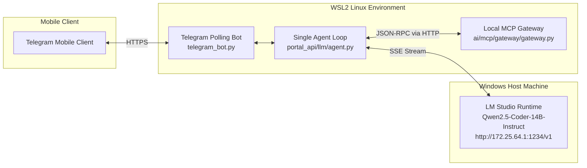

> "The person whose mouth is open always has their ears closed." — Thomas Martell

# When a 14B Local Model Hallucinates Tool Calls: A Lead AI Dev's Guide to Defensive Agent Architecture

*From placeholder loops to self-healing state machines — what separates a Lead AI engineer from a prompt wrapper developer is defensive architecture against non-deterministic local models.*

In contemporary AI Agent development, a persistent illusion lingers: *"If you craft your prompt with enough clarity and declare an OpenAI-compatible function schema, any agent will operate as seamlessly on local open-weight models (like a 14B instruction-tuned model) as it does on GPT-4 or Claude 3.5 Sonnet."*

Earlier today, while testing our local engineering assistant via mobile Telegram, an astonishingly surreal message popped onto my screen:

```text
🛠️ Tools Executed:
• search_tool_catalog({"query": "blog Chinese quotes"})
• get_tool_schema({"tool_names": ["<tool_name>"]})
• execute_tool({"tool_name": "<tool_name>", "arguments": {}})

Let's proceed with listing your blog Chinese quotes using the MCP tool.
1. Search for relevant tools:
2. Get schema for the selected tool (replace <tool_name> with actual tool name):
3. Execute the tool to list your blog Chinese quotes...

First, let's search for the relevant tool again:
{
  "name": "searchtoolcatalog",
  "arguments": {
    "query": "blog Chinese quotes"
  }
}
```

My prompt was simple: *"List my blog Chinese quotes."*
Instead of retrieving quotes, the agent attempted to execute the discovery step, the schema inspection step, and the final execution step **all at once in round zero**. Worse, it filled the parameters for steps 2 and 3 with the literal string `"<tool_name>"`! Then, following the runtime error, it dumped a raw JSON block into its conversation text stream, stripped the underscore into `"searchtoolcatalog"`, and ground the entire conversation loop to a dead halt.

When junior developers encounter this, their first reflex is usually: *"This model is simply too small; 14B models can't handle tools. Let's add another 500 words of strict warnings to the system prompt."*
In high-reliability software engineering, **relying on non-deterministic LLM obedience as your primary line of defense is where systems collapse.**

This post walks through a real-world, cross-environment incident (WSL2 Python Agent ↔ Windows Host LM Studio running Qwen2.5-Coder-14B ↔ Model Context Protocol local gateway). It dissects the entire chain of thought: from symptom triage and root cause discovery through the 5 Whys, architectural trade-offs, and building a battle-tested, self-healing agent loop.

---

### What You Will Take Away:
1. **The 5-Whys Root Cause Chain**: How to look beyond the LLM black box across WSL-Host network boundaries and identify the exact triggers of parallel phantom calls and leaked raw JSON.
2. **Applying Postel's Law to Agentic Runtimes**: Why expecting OpenAI-pure JSON deltas from local open-source models is a recipe for failure, and how to build resilient extractors tolerant of dropped underscores, casing drift, and bare JSON.
3. **The Tri-Stream State Machine Invariant**: How to architecturally decouple reasoning tokens, tool invocation events, and user presentation streams so internal trial-and-error never leaks into production user text.

---

## 1. Triage & Incident Topography: Working Backwards from Symptoms

A fundamental rule for Lead AI Engineers: **Understand the complete system topography first; isolate the slices next. Never patch code or prompts blindly.**

### 1.1 System Topography

Our assistant operates in a cross-boundary development environment:



### 1.2 Signature Symptoms

Examining the raw failure logs revealed four distinct anomalies:
1. **Parallel Dummy Batching**: The model emitted three distinct tool invocations in round 0, populating invocations 2 and 3 with literal placeholders `"<tool_name>"`.
2. **Post-Failure Text Fallback**: After the dummy invocations failed, round 1 did not use native function calling deltas; instead, it emitted raw JSON directly inside the content text stream.
3. **Identifier Drift**: The emitted JSON named the tool `"searchtoolcatalog"` (missing underscores), breaking strict equality lookups.
4. **Premature Text Streaming**: Internal scaffolding instructions and raw JSON blocks were yielded directly as user-facing text before tool verification completed.

With these four signatures isolated, we could reproduce and penetrate the root causes directly.

---

## 2. Penetrating Root Causes: The 4 Failure Layers

By writing reproducible test drivers against LM Studio and the MCP Gateway, we unraveled the technical layers behind the crash:

### Root Cause 1: Step-by-Step Prompting Misinterpreted as Batch Execution

Look at the original steering instruction:
```text
To use any capability:
1) Call list_tool_domains({}) or search_tool_catalog({"query": "<topic>"}) to discover tools;
2) Call get_tool_schema({"tool_names": ["<tool_name>"]}) to inspect required arguments;
3) Call execute_tool({"tool_name": "<name>", "arguments": {...}}) to run the tool.
```

To frontier models, this reads as an iterative conversational lifecycle across turns. But to an open-weights 14B instruction-tuned model, it was interpreted as a batch script to execute immediately in a single turn.
Having no actual tool name yet, the model mechanically grabbed the placeholder `"<tool_name>"` from the prompt and pushed all three calls out at once.

### Root Cause 2: Protocol Asymmetry in Local Model Runtimes

Frontier models backed by provider-level tool infrastructures reliably emit `delta.tool_calls`.
However, local runtimes (LM Studio, Ollama, vLLM) executing GGUF/AWQ models exhibit significant variability:
- When models reason or experience prompt tension, they often revert to their strongest pre-training habit: outputting JSON directly into the `content` stream:
  ```json
  {
    "name": "searchtoolcatalog",
    "arguments": { "query": "blog Chinese quotes" }
  }
  ```

Our original extractor had an overly academic expectation:
```python
# Only checked XML tags or markdown fences
tag_pattern = re.compile(r"<(?:execute|tools|tool_call)>.*?</...>")
code_pattern = re.compile(r"```(?:json)?\s*(\[.*?\]|\{.*?\})\s*```")
```
When the model emitted bare JSON with neither XML tags nor markdown backticks, the extractor found nothing. The agent concluded no tools were requested, treated the raw JSON as the final text response, and terminated the turn.

### Root Cause 3: The Violation of Postel's Law — Strict Identifier Brittleness

Local models frequently drop underscores (`search_tool_catalog` -> `searchtoolcatalog`) or call tools by their intuitive short name (`list_quotes` instead of `output-learn-agent_list_quotes`).

Because the agent checked strictly `if item.get("name") in known_tools:`, any dropped character caused silent rejection. Similarly, inside the MCP Gateway, tools were indexed solely by full compound names (`output-learn-agent_list_quotes`), causing unqualified calls to fail with `Tool 'list_quotes' not found`.

### Root Cause 4: Premature Text Yielding in Intermediate Rounds

Review the original agent streaming generator:
```python
async for ev in stream_chat(...):
    if ev.t == "text":
        round_text.append(ev.d)
        yield Event("text", ev.d)  # Premature leak to the user!
    elif ev.t == "tool_call":
        calls.extend(ev.calls)
```
In an effort to minimize latency, tokens were yielded to Telegram immediately as they arrived. But if the round later turned out to contain a tool invocation, those already-streamed tokens could not be revoked. Telegram accumulated the model's pre-call chatter and raw JSON, producing the cluttered error output.

---

## 3. Solution Matrix & Trade-Offs

When addressing these root causes, we evaluated three distinct architectural approaches:

| Dimension | Option A: Prompt-Only Enforcement | Option B: Strict Schema Enforcement | Option C: Defensive State Machine (Adopted) |
|---|---|---|---|
| **Core Technique** | Add verbose negative prompts ("Do NOT call tools in parallel; NEVER emit bare JSON") | Reject all text JSON; demand strict OpenAI-compliant `delta.tool_calls` | 1. Clarify sequential rules;<br/>2. Postel's Law parser for bare JSON & fuzzy names;<br/>3. Decouple streaming state machine. |
| **Local 14B Robustness** | **Poor**. Prompt compliance degrades as conversation history expands. | **Brittle**. Incompatible with models that emit ChatML/XML or raw JSON. | **Exceptional**. Self-heals across diverse open-source model runtimes. |
| **System Reliability** | Probabilistic | Low (high error & abort rate) | **Deterministic & self-healing** |
| **Engineering Cost** | Near zero | High (requires custom model runtime forks) | **Focused & maintainable (agent loop & gateway router)** |

We chose **Option C**: in production engineering, **a probabilistic component (the LLM) must be constrained by deterministic state machines and defensive runtime harnesses.**

---

## 4. Implementation: The Quadruple Defensive Architecture

### 4.1 Layer 1: Sequential Steering & Placeholder Pruning

We revised `STEERING` to decouple discovery capabilities from execution rules:

```python
STEERING = (
    "You are Toddy Portal Assistant, an AI engineering assistant integrated with "
    "Model Context Protocol (MCP) tools via a local gateway in WSL (ai/mcp/gateway/gateway.py).\n"
    "You have access to meta-tools for discovering and executing enterprise and developer tools:\n"
    "- search_tool_catalog: Search tool catalog by query or domain\n"
    "- list_tool_domains: List high-level operational domains\n"
    "- get_tool_schema: Inspect required arguments for a specific tool\n"
    "- execute_tool: Execute a tool with arguments\n\n"
    "OPERATING RULES:\n"
    "1. When the user asks you to do something requiring tools:\n"
    "   ALWAYS call `search_tool_catalog` first with a concise keyword query (e.g. query='quotes').\n"
    "2. Execute ONE tool at a time sequentially. NEVER emit placeholder strings like '<tool_name>' or '<name>'.\n"
    "3. Wait for the tool result from `search_tool_catalog` before calling `execute_tool`.\n"
    "4. Once you receive the tool name, call `execute_tool` with the exact tool_name.\n"
    "5. When the tool returns data, summarize and present the final answer clearly to the user."
)
```

Additionally, we added a programmatic pruning barrier in code: if a model still emits `search_tool_catalog` combined with dummy calls containing `"<tool_name>"`, we automatically filter out the dummy calls, allowing the valid search to proceed:

```python
def is_placeholder(val: object) -> bool:
    if not isinstance(val, str):
        return False
    s = val.strip().lower()
    return (s.startswith("<") and s.endswith(">")) or s in (
        "<tool_name>", "tool_name", "<name>", "name", "<topic>", "<query>", ""
    )

def filter_invalid_calls(calls: list) -> list:
    """Filter out tool calls with literal placeholder strings like '<tool_name>'."""
    valid = []
    for call in calls:
        if call.name == "get_tool_schema":
            names = call.args.get("tool_names") or []
            if isinstance(names, list) and all(is_placeholder(n) for n in names):
                continue
        elif call.name == "execute_tool":
            if is_placeholder(call.args.get("tool_name")):
                continue
        valid.append(call)
    return valid
```

### 4.2 Layer 2: Bare JSON Scanner with Fuzzy Name Resolution

We integrated `json.JSONDecoder().raw_decode()` and alphanumeric normalization to extract tool calls from any format:

```python
def extract_text_tool_calls(text: str, known_tools: set[str]) -> tuple[list, str]:
    """Extract tool calls emitted inside XML tags, markdown blocks, or bare JSON objects."""
    calls = []
    clean_text = text

    def resolve_tool_name(name_str: str) -> str | None:
        if not name_str or not isinstance(name_str, str):
            return None
        if name_str in known_tools:
            return name_str
        # Strip punctuation & casing: 'searchtoolcatalog' -> 'search_tool_catalog'
        norm = re.sub(r"[^a-zA-Z0-9]", "", name_str).lower()
        for kt in known_tools:
            if re.sub(r"[^a-zA-Z0-9]", "", kt).lower() == norm:
                return kt
        return None

    def try_parse_call(item: dict) -> ToolCall | None:
        name = item.get("name") or item.get("tool") or item.get("function")
        if not isinstance(name, str):
            return None
        resolved = resolve_tool_name(name)
        args = item.get("arguments") or item.get("parameters") or item.get("args") or {}
        if isinstance(args, str):
            args = coerce_json(args)
        if not isinstance(args, dict):
            args = {}

        if resolved:
            return ToolCall(id=None, name=resolved, args=as_record(args))
        # Direct catalog tool fallback: list_quotes -> execute_tool(tool_name='list_quotes')
        if "execute_tool" in known_tools and not is_placeholder(name):
            return ToolCall(id=None, name="execute_tool", args=as_record({"tool_name": name, "arguments": args}))
        return None

    # Scan XML tags and markdown blocks...
    # Scan bare JSON objects
    decoder = json.JSONDecoder()
    pos = 0
    matched_spans = []
    while pos < len(text):
        idx = text.find("{", pos)
        if idx == -1:
            break
        try:
            obj, end_idx = decoder.raw_decode(text[idx:])
            if isinstance(obj, dict):
                tc = try_parse_call(obj)
                if tc:
                    calls.append(tc)
                    matched_spans.append((idx, idx + end_idx))
                    pos = idx + end_idx
                    continue
        except ValueError:
            pass
        pos = idx + 1

    if calls and matched_spans:
        chars = list(clean_text)
        for start, end in reversed(matched_spans):
            chars[start:end] = []
        clean_text = "".join(chars).strip()

    return filter_invalid_calls(calls), clean_text
```

### 4.3 Layer 3: Gateway Smart Routing

In `ai/mcp/gateway/gateway.py`, we added flexible identifier resolution so unqualified short names resolve cleanly to their full catalog definitions:

```python
def resolve_entry(name: str) -> dict | None:
    """Resolve a tool name by full name, short name, or normalized name."""
    if not name or not isinstance(name, str):
        return None
    if name in catalog_entries:
        return catalog_entries[name]
    short_matches = [e for e in catalog_entries.values() if e["tool"] == name]
    if len(short_matches) == 1:
        return short_matches[0]
    norm = re.sub(r"[-:.]", "_", name).lower()
    norm_clean = re.sub(r"[^a-z0-9]", "", norm)
    for e in catalog_entries.values():
        e_norm = re.sub(r"[-:.]", "_", e["name"]).lower()
        if e_norm == norm or re.sub(r"[^a-z0-9]", "", e["tool"].lower()) == norm_clean:
            return e
    return short_matches[0] if short_matches else None
```

### 4.4 Layer 4: State Machine Event Buffering

In `run_turn()`, text tokens generated during intermediate tool rounds are held in memory:

```python
for rnd in range(MAX_TOOL_ROUNDS):
    splitter = _ThinkSplitter()
    round_text = []
    round_text_events = []
    calls = []

    async with aclosing(stream_chat(provider, model, messages, tools)) as stream:
        async for ev in stream:
            if ev.t == "text":
                for kind, piece in splitter.feed(ev.d):
                    if kind == "think":
                        yield Event("think", piece)
                    else:
                        round_text.append(piece)
                        if not tools:
                            yield Event("text", piece)
                        else:
                            round_text_events.append(piece)
            elif ev.t == "tool_call":
                calls.extend(ev.calls or [])

    # Extract and filter tool calls...
    if not calls:
        # Zero tool calls: this round contains the verified final answer!
        if tools:
            for piece in round_text_events:
                yield Event("text", piece)
        return

    # Tools were executed: route pre-call chatter to think, shielding the user
    stripped_commentary = "".join(round_text).strip()
    if stripped_commentary:
        yield Event("think", stripped_commentary)

    # Proceed to execute tools and feed results back to messages...
```

---

## 5. Verification & Live Trace

With these layers deployed, we ran our test suite and verified the pipeline against live infrastructure:

### 5.1 Test Suite Validation

Three targeted regression tests were added to `test_agent.py`:
- `test_text_embedded_tool_call_bare_json_fuzzy`: Validated bare JSON extraction with missing underscores.
- `test_filter_invalid_placeholder_calls`: Verified safe pruning of batched `<tool_name>` calls.
- `test_direct_catalog_tool_call_fallback`: Tested direct short-name invocation fallback.

```bash
pytest src/toddy_portal/services/portal_api/tests
============================== 91 passed in 3.82s ==============================
```

### 5.2 Live End-to-End Trace

Executing the original prompt `"list my blog Chinese quotes"` against LM Studio Qwen2.5-Coder-14B:

```text
=== RUNNING LIVE TURN ===
[THINK]: To list your blog Chinese quotes, I'll start by searching the tool catalog...
[TOOL]: search_tool_catalog({"query": "quotes", "domain": "output-learn-agent"})
[TOOL]: ↳ { "hits": [ { "name": "output-learn-agent_list_quotes", "tool": "list_quotes", ... } ] }
[THINK]: Got it. Now I'll call get_tool_schema to get the full JSON schemas...
[TOOL]: get_tool_schema({"tool_names": ["output-learn-agent_list_quotes"], "role": "developer"})
[TOOL]: ↳ { "layer": "2_schema_disclosure", ... }
[THINK]: Now that I have the schema, I'll execute the output-learn-agent_list_quotes...
[TOOL]: execute_tool({"tool_name": "output-learn-agent_list_quotes", "arguments": {"language": "zh"}})
[TOOL]: ↳ {"language":"zh","count":32,"quotes":["人不过是夏天午后一片绿叶飘入池塘...", ...]}

Here are your Chinese quotes:
1. 人不过是夏天午后一片绿叶飘入池塘，水面泛起的一圈波纹，那些腐烂的草叶裹挟着我的呼吸...
2. 走大道，大道人少
3. 鸟儿在天空飞过时，是不会在乎地面上的栅栏的
...
32. 细节一:在大阪看到一则广告牌:"28岁的野心,33岁的决意,40岁的意欲,46岁的充实,53岁的余裕。”...
You have 32 Chinese quotes in your blog reference.
=== TURN COMPLETED ===
```

**Comparison of Execution Profiles:**

| Metric | Before Fix | After Fix |
|---|---|---|
| **Turn Orchestration** | 3 phantom calls emitted in parallel | Strict sequential pipeline (Search -> Schema -> Exec) |
| **Placeholder Safety** | Emitted literal `"<tool_name>"` triggering 404 | Cleanly pruned before reaching the gateway |
| **JSON Parser** | Bare JSON leaked into text output | Intercepted and normalized into standard `ToolCall` |
| **Output Cleanliness** | Polluted with internal prompt steps | Clean final answer; reasoning routed to `think` |

---

## 6. Lead AI Dev Reflections: Principles for Robust Agent Design

This incident transcended a simple bug fix; it served as a clear validation of core agent architecture principles. For engineering teams deploying agents to local hardware, four rules stand out:

### Principle 1: Never Treat Edge Models as Miniature GPT-4s

Developers often assume edge models possess frontier-grade temporal reasoning and prompt adherence. In practice, 14B-class open-weight models have narrower attention spans and shallower instruction alignment: **their temporal compliance is probabilistic, and their structural outputs are noisy.**
**Prompts represent intent; code enforces invariants.** Never rely on system prompts alone to maintain temporal boundaries; enforce state transitions with deterministic state machines in your driver code.

### Principle 2: Uphold Postel's Law at the Model Boundary

> *"Be conservative in what you do, be liberal in what you accept from others."*

Large language models are inherently non-deterministic input sources. A production-grade agent runtime must never assume strict adherence to a single format:
- Transmit information that is concise, unambiguous, and strictly formatted (Conservative).
- Ingest responses that tolerate XML, markdown fences, bare JSON, missing underscores, and short names (Liberal).

### Principle 3: The Tri-Stream Invariant

Every resilient agent architecture must structurally isolate three distinct data streams:
1. **Reasoning Stream**: Internal thinking and self-correction tokens, displayed in collapsible UI elements or debug logs, never mixed with final deliverables.
2. **Tool Invocations Stream**: Structured control-plane commands driving external system interactions.
3. **User Presentation Stream**: Verified, user-facing natural language deliverables.

Coupling intermediate reasoning tokens directly into the user presentation stream invites chaos when tools retry or recover.

---

### Action Items for Your Agent Codebase

1. **Audit Your Tool Parser**: Does it rely strictly on `json.loads` or markdown code blocks? Integrate `json.JSONDecoder().raw_decode()` to give your agent immediate resilience against bare JSON outputs.
2. **Audit Your Meta-Prompts**: Do your prompts list sequential steps (`1) search 2) get schema 3) exec`)? Explicitly add an invariant forbidding parallel future-step generation before earlier step results are returned.
3. **Install Placeholder Guards**: Add an invariant check prior to tool dispatch that drops calls with `"<tool_name>"` or `"<param>"` literals, protecting your gateway from cascades of phantom errors.

---

*True maturity in AI engineering is not measured by the eloquence with which you instruct a model, but by how reliably your architecture recovers when the model makes an unexpected mistake.*
