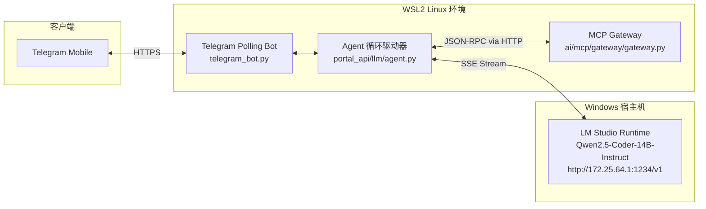

> “嘴巴开着的那个人，他的耳朵一定是关着的。” — 托马斯·马特尔

# 当 14B 模型开始“胡言乱语”：端侧 AI Agent 工具调用的排障与防御性架构实战

*从占位符死循环到自愈状态机——区分 Lead AI 开发者与调包工程师的，是面对非确定性端侧模型时的架构防御能力。*

在当下的 AI Agent 开发浪潮中，最常见的一种教条是：“只要 Prompt 写得足够结构化，配合 OpenAI-compatible 的 Function Calling，Agent 就能在本地大模型（如 14B 开源模型）上像云端旗舰模型一样丝滑运转。”

今天下午在移动端 Telegram 调试本地私有部署的工程助手时，屏幕上赫然跳出了一段充满魔幻现实主义的回复：

```text
🛠️ Tools Executed:
• search_tool_catalog({"query": "blog Chinese quotes"})
• get_tool_schema({"tool_names": ["<tool_name>"]})
• execute_tool({"tool_name": "<tool_name>", "arguments": {}})

Let's proceed with listing your blog Chinese quotes using the MCP tool.
1. Search for relevant tools:
2. Get schema for the selected tool (replace <tool_name> with actual tool name):
3. Execute the tool to list your blog Chinese quotes...

First, let's search for the relevant tool again:
{
  "name": "searchtoolcatalog",
  "arguments": {
    "query": "blog Chinese quotes"
  }
}
```

我只是发了一句简单的需求：“帮我列出博客里的中文名言引用（list my blog Chinese quotes）”。
Agent 不仅没有真正查出任何引用，反而一本正经地在同一轮会话里把“搜索”、“查参数”、“执行”三个工具一口气全调了一遍，甚至在后面的参数里直接填上了字面量 `"<tool_name>"`！紧接着，由于工具执行报错，它又在文本中吐出了裸 JSON，顺便把下划线吞了，拼成了 `"searchtoolcatalog"`，最终彻底卡死终止。

很多刚入行 AI 开发的工程师面对这种现象，第一反应通常是：“这模型太笨了，14B 不如云端的大模型，得给它加几千字更严厉的 Prompt 警告”。
但在高可用架构体系里，**寄希望于模型输出的绝对听话，是系统崩塌的开始**。

这篇文章以真实的端侧跨架构链路（WSL2 Python Agent ↔ Windows Host LM Studio 本地 Qwen2.5-Coder-14B ↔ Model Context Protocol 本地网关）为切入点，完整复盘一次从现象捕捉、根因穿透、方案权衡到落地自愈架构的全链路排障实录。

---

### 你将获得：
1. **排障切入点与根因链条（The 5-Whys）**：如何穿透跨系统、跨网络（WSL ↔ Host）的 Agent 黑盒，精准定位模型“幻觉批量调用”与“裸 JSON 泄露”的技术原点。
2. **端侧模型的协议不对称性（Postel's Law）**：理解为什么不能用 GPT-4 的假设要求本地 14B 模型，以及如何实现容忍下划线丢失、大小写漂移与短命名的自愈解析器。
3. **Agent 执行状态机与分层隔离**：从架构层面彻底分离推理流（Thinking）、工具调用流（Invocations）与最终用户呈现流（Text），杜绝中间过程污染业务输出。

---

## 1. 现场还原与排障起手式：从症状倒推链路

作为系统的 Lead AI 开发者，排障的第一原则是：**先建立系统全景认知，再由表及里做链路切片**，严禁未经验证就盲目改代码或改 Prompt。

### 1.1 系统拓扑图

我们的本地 Assistant 运行在多环境隔离的开发机上：



### 1.2 异常现场特征提取

仔细研读移动端收到的错误片段，可以提炼出 4 个致命特征：
1. **多步骤并行假装调用**：模型在第 0 轮就同时发起了 3 个原生工具调用，且第 2、3 个调用的入参赫然是字面量模板 `"<tool_name>"`。
2. **工具失败后的自嗨式回退**：工具执行失败后，第 1 轮模型没有发起原生 Function Calling，而是在自然语言文本流中直接喷出了裸 JSON。
3. **命名漂移（Drift）**：裸 JSON 中的函数名是 `"searchtoolcatalog"`（缺少下划线 `_`），导致正则与字典查找完全失灵。
4. **流式文本与推理状态污染**：本应属于内部中间步骤的指令解释和裸 JSON，被当成了最终回复全量推给了用户。

有了这 4 个特征，我们就可以带着假设深入代码层做白盒验证。

---

## 2. 根因穿透：端侧 Agent 崩溃的 4 个技术层

通过编写单步重现脚本直接驱动 LM Studio 与网关，我们一步步撬开了深层次的根因：

### 根因 1：Prompt 的时序暗示被小模型误解为“批处理作业”

查看原先的系统引导词（`STEERING`）：
```text
To use any capability:
1) Call list_tool_domains({}) or search_tool_catalog({"query": "<topic>"}) to discover tools;
2) Call get_tool_schema({"tool_names": ["<tool_name>"]}) to inspect required arguments;
3) Call execute_tool({"tool_name": "<name>", "arguments": {...}}) to run the tool.
```

在云端万亿参数模型看来，这是指引会话多轮迭代的哲学指南；但在开源 14B 指令微调模型眼里，这被当作了“一次性完成任务的三步伪代码”。
模型在收到用户请求的第一瞬间，由于缺乏单步强约束，为了“完美遵从指南”，它强行在第一轮回复中生成了 3 个 Tool Calls。由于它此时根本还不知道工具叫什么，就机械地把示例里的 `"<tool_name>"` 抄了进去！

### 根因 2：本地模型的 Function Calling 协议不对称性

云端 API（如 OpenAI / Claude）有着严苛的微调保证：只要开启了 `tools`，模型绝大多数情况下都会走 `delta.tool_calls`。
但在本地运行的开源模型（包括 Ollama 或 LM Studio 加载的 GGUF/AWQ 模型），情况极其复杂：
- 部分模型的 Chat Template 针对 Hermes / ChatML 进行了硬编码；
- 当模型在思考时，它经常会“回退”到它最熟悉的预训练文本生成习惯：直接在 `content` 里面吐出裸 JSON，例如：
  ```json
  {
    "name": "searchtoolcatalog",
    "arguments": { "query": "blog Chinese quotes" }
  }
  ```

原先的 Agent 提取逻辑写得过于洁癖：
```python
# 原实现只匹配 XML 标签或 markdown 代码块
tag_pattern = re.compile(r"<(?:execute|tools|tool_call)>.*?</...>")
code_pattern = re.compile(r"```(?:json)?\s*(\[.*?\]|\{.*?\})\s*```")
```
当模型吐出既没有 XML 包裹、也没有 markdown 三反引号的裸 JSON 时，提取器直接判空返回！Agent 误以为模型已经完成了所有工具交互，就把这坨裸 JSON 当作了“最终答案”结束了回合。

### 根因 3：Postel 定律的缺失——命名脆弱性

开源小模型在输出标识符时，非常容易产生下划线省略（`search_tool_catalog` -> `searchtoolcatalog`）或者省略命名空间前缀（`output-learn-agent_list_quotes` -> `list_quotes`）。

当代码只用 `if item.get("name") in known_tools:` 这种严苛的全等匹配时，任何微小的 token 偏差都会导致工具调用被静默丢弃。在 MCP 网关内部，底层索引仅以 `catalog_entries[t["name"]]`（带服务前缀的完整全名）为键，模型直接调用 `list_quotes` 就会惨遭 `Tool 'list_quotes' not found`。

### 根因 4：流式事件的过早释放（Premature Text Yielding）

看一看原先 Agent 主循环的伪代码：
```python
async for ev in stream_chat(...):
    if ev.t == "text":
        round_text.append(ev.d)
        yield Event("text", ev.d)  # 致命问题：一边吐给用户，一边搜集本轮是不是工具调用
    elif ev.t == "tool_call":
        calls.extend(ev.calls)
```
因为流式传输想要降低延迟，每来一个字符就直接 `yield Event("text", ev.d)`。
但如果这一轮最终被证实是工具调用轮次，**那些已经推给客户端的字词根本收不回来**！Telegram 客户端记录下了整段过程性的絮叨和失败的工具 JSON，最终拼凑出了一篇“事故现场报告”。

---

## 3. 方案评估与权衡：架构师的决策矩阵

针对以上 4 个根因，业内常见的修法有多种取向，作为 Lead AI 开发者，我们必须在可靠性、侵入度与维护成本之间做出权衡：

| 解决维度 | 方案 A：纯 Prompt 约束派 | 方案 B：严格协议强类型派 | 方案 C：分层自愈与状态隔离（最终采纳） |
|---|---|---|---|
| **核心做法** | 在 System Prompt 里写几百字“你绝不能同时调用多个工具”、“严禁输出裸 JSON” | 关闭文本提取，强制要求 LM Studio 必须升级并匹配 OpenAI 的 delta 模式；不合规报错 | 1. 约束时序契约；<br/>2. 运行时遵循 Postel 定律做柔性容错；<br/>3. 状态机分层隔离文本与思考。 |
| **对小模型适用度** | **极差**。小模型上下文变长后依旧会产生注意力漂移。 | **脆弱**。大量本地 GGUF 模型直接失效，严重绑定特定运行时。 | **极佳**。自适应 Qwen、DeepSeek 等各类开源本地模型。 |
| **鲁棒性（Robustness）** | 低（概率性生效） | 中（报错率高，中断会话） | **极高（确定性拦截与自愈）** |
| **工程改造代价** | 几乎为零 | 极高（需定制底层推理端点） | **适中（聚焦在 Agent 驱动与网关路由层）** |

我们坚决选择了 **方案 C**：在软件工程中，**不可控的概率组件（LLM）必须被确定性的状态机（State Machine）与防御性外壳（Defensive Harness）所包裹**。

---

## 4. 实施落地：四重防御性重构

### 4.1 第一重防御：重塑操作契约与占位符清洗

重构 `STEERING`，明确将工具目录与操作准则解耦，强化单步执行约束：

```python
STEERING = (
    "You are Toddy Portal Assistant, an AI engineering assistant integrated with "
    "Model Context Protocol (MCP) tools via a local gateway in WSL (ai/mcp/gateway/gateway.py).\n"
    "You have access to meta-tools for discovering and executing enterprise and developer tools:\n"
    "- search_tool_catalog: Search tool catalog by query or domain\n"
    "- list_tool_domains: List high-level operational domains\n"
    "- get_tool_schema: Inspect required arguments for a specific tool\n"
    "- execute_tool: Execute a tool with arguments\n\n"
    "OPERATING RULES:\n"
    "1. When the user asks you to do something requiring tools:\n"
    "   ALWAYS call `search_tool_catalog` first with a concise keyword query (e.g. query='quotes').\n"
    "2. Execute ONE tool at a time sequentially. NEVER emit placeholder strings like '<tool_name>' or '<name>'.\n"
    "3. Wait for the tool result from `search_tool_catalog` before calling `execute_tool`.\n"
    "4. Once you receive the tool name, call `execute_tool` with the exact tool_name.\n"
    "5. When the tool returns data, summarize and present the final answer clearly to the user."
)
```

不仅如此，我们在代码层建立防御拦截网：如果模型依然顽固地将 `search_tool_catalog` 与含有 `"<tool_name>"` 的 `execute_tool` 打包送出，代码层主动识别并丢弃非法占位符调用，**只放行合法的搜索调用**：

```python
def is_placeholder(val: object) -> bool:
    if not isinstance(val, str):
        return False
    s = val.strip().lower()
    return (s.startswith("<") and s.endswith(">")) or s in (
        "<tool_name>", "tool_name", "<name>", "name", "<topic>", "<query>", ""
    )

def filter_invalid_calls(calls: list) -> list:
    """自动过滤携带假参数占位符的批处理调用，释放有效调用进入下游。"""
    valid = []
    for call in calls:
        if call.name == "get_tool_schema":
            names = call.args.get("tool_names") or []
            if isinstance(names, list) and all(is_placeholder(n) for n in names):
                continue
        elif call.name == "execute_tool":
            if is_placeholder(call.args.get("tool_name")):
                continue
        valid.append(call)
    return valid
```

### 4.2 第二重防御：基于 Postel 定律的流式裸 JSON 与模糊工具名提取器

我们引入了 Python 标准库的 `json.JSONDecoder().raw_decode()` 扫描流，配合基于无符号化（alphanumeric normalization）的模糊匹配，实现全格式自适应提取：

```python
def extract_text_tool_calls(text: str, known_tools: set[str]) -> tuple[list, str]:
    """支持 XML 标签、Markdown JSON 块、以及裸 JSON 对象的全方位提取与模糊容错"""
    calls = []
    clean_text = text

    def resolve_tool_name(name_str: str) -> str | None:
        if not name_str or not isinstance(name_str, str):
            return None
        if name_str in known_tools:
            return name_str
        # 消除下划线与大小写差异：searchtoolcatalog == search_tool_catalog
        norm = re.sub(r"[^a-zA-Z0-9]", "", name_str).lower()
        for kt in known_tools:
            if re.sub(r"[^a-zA-Z0-9]", "", kt).lower() == norm:
                return kt
        return None

    def try_parse_call(item: dict) -> ToolCall | None:
        name = item.get("name") or item.get("tool") or item.get("function")
        if not isinstance(name, str):
            return None
        resolved = resolve_tool_name(name)
        args = item.get("arguments") or item.get("parameters") or item.get("args") or {}
        if isinstance(args, str):
            args = coerce_json(args)
        if not isinstance(args, dict):
            args = {}

        if resolved:
            return ToolCall(id=None, name=resolved, args=as_record(args))
        # 兼容模型直接以具体工具名发起调用的情况（如直接调用 list_quotes）
        if "execute_tool" in known_tools and not is_placeholder(name):
            return ToolCall(id=None, name="execute_tool", args=as_record({"tool_name": name, "arguments": args}))
        return None

    # 1. 扫描 XML 标签与 Markdown 代码块
    # 2. 扫描裸 JSON 对象
    decoder = json.JSONDecoder()
    pos = 0
    matched_spans = []
    while pos < len(text):
        idx = text.find("{", pos)
        if idx == -1:
            break
        try:
            obj, end_idx = decoder.raw_decode(text[idx:])
            if isinstance(obj, dict):
                tc = try_parse_call(obj)
                if tc:
                    calls.append(tc)
                    matched_spans.append((idx, idx + end_idx))
                    pos = idx + end_idx
                    continue
        except ValueError:
            pass
        pos = idx + 1

    if calls and matched_spans:
        chars = list(clean_text)
        for start, end in reversed(matched_spans):
            chars[start:end] = []
        clean_text = "".join(chars).strip()

    return filter_invalid_calls(calls), clean_text
```

### 4.3 第三重防御：网关层工具名称智能解析（Smart Routing）

在 `ai/mcp/gateway/gateway.py` 网关中，彻底开放短名称与标准化解析，支持模型无论是带前缀 `output-learn-agent_list_quotes` 还是短名 `list_quotes` 均可精确命中：

```python
def resolve_entry(name: str) -> dict | None:
    """支持全限定名、短工具名、下划线/连字符互换的模糊命中"""
    if not name or not isinstance(name, str):
        return None
    if name in catalog_entries:
        return catalog_entries[name]
    # 短名精准匹配 (如 'list_quotes')
    short_matches = [e for e in catalog_entries.values() if e["tool"] == name]
    if len(short_matches) == 1:
        return short_matches[0]
    # 字符标准化匹配 (连字符与下划线互转)
    norm = re.sub(r"[-:.]", "_", name).lower()
    norm_clean = re.sub(r"[^a-z0-9]", "", norm)
    for e in catalog_entries.values():
        e_norm = re.sub(r"[-:.]", "_", e["name"]).lower()
        if e_norm == norm or re.sub(r"[^a-z0-9]", "", e["tool"].lower()) == norm_clean:
            return e
    return short_matches[0] if short_matches else None
```

### 4.4 第四重防御：流式事件的分层状态缓冲

在 `run_turn` 循环中，**严禁在工具判定完成前泄露业务文本**：

```python
for rnd in range(MAX_TOOL_ROUNDS):
    splitter = _ThinkSplitter()
    round_text = []
    round_text_events = []
    calls = []

    async with aclosing(stream_chat(provider, model, messages, tools)) as stream:
        async for ev in stream:
            if ev.t == "text":
                for kind, piece in splitter.feed(ev.d):
                    if kind == "think":
                        yield Event("think", piece)
                    else:
                        round_text.append(piece)
                        if not tools:
                            yield Event("text", piece)
                        else:
                            round_text_events.append(piece) # 工具模式下先入缓冲队列
            elif ev.t == "tool_call":
                calls.extend(ev.calls or [])

    # 提取并过滤工具调用...
    if not calls:
        # 确认本轮没有任何工具调用 —— 这才是最终面向用户的回答！
        if tools:
            for piece in round_text_events:
                yield Event("text", piece)
        return

    # 本轮有工具执行：将此前的模型自言自语压入思考通道 (Thinking)，杜绝污染用户文本
    stripped_commentary = "".join(round_text).strip()
    if stripped_commentary:
        yield Event("think", stripped_commentary)
    
    # 执行工具，将真实结果追加进 messages 驱动下一轮循环...
```

---

## 5. 验证与实战成果：从混沌到丝滑

重构完成后，我们用真实的本地环境进行了全套验证。

### 5.1 自动化测试覆盖

针对本次修复的边界场景，在 `test_agent.py` 中补充了 3 组针对性单测：
- `test_text_embedded_tool_call_bare_json_fuzzy`：验证裸 JSON 与丢失下划线的容错提取；
- `test_filter_invalid_placeholder_calls`：验证批量混入 `<tool_name>` 时安全剪枝；
- `test_direct_catalog_tool_call_fallback`：验证直接传短工具名的降级执行。

```bash
pytest src/toddy_portal/services/portal_api/tests
============================== 91 passed in 3.82s ==============================
```

### 5.2 端到端实测运行录（Live E2E Verification）

在真实的 LM Studio Qwen2.5-Coder-14B 上再次触发 `"list my blog Chinese quotes"`，全过程如下：

```text
=== RUNNING LIVE TURN ===
[THINK]: To list your blog Chinese quotes, I'll start by searching the tool catalog...
[TOOL]: search_tool_catalog({"query": "quotes", "domain": "output-learn-agent"})
[TOOL]: ↳ { "hits": [ { "name": "output-learn-agent_list_quotes", "tool": "list_quotes", ... } ] }
[THINK]: Got it. Now I'll call get_tool_schema to get the full JSON schemas...
[TOOL]: get_tool_schema({"tool_names": ["output-learn-agent_list_quotes"], "role": "developer"})
[TOOL]: ↳ { "layer": "2_schema_disclosure", ... }
[THINK]: Now that I have the schema, I'll execute the output-learn-agent_list_quotes...
[TOOL]: execute_tool({"tool_name": "output-learn-agent_list_quotes", "arguments": {"language": "zh"}})
[TOOL]: ↳ {"language":"zh","count":32,"quotes":["人不过是夏天午后一片绿叶飘入池塘...", ...]}

Here are your Chinese quotes:
1. 人不过是夏天午后一片绿叶飘入池塘，水面泛起的一圈波纹，那些腐烂的草叶裹挟着我的呼吸...
2. 走大道，大道人少
3. 鸟儿在天空飞过时，是不会在乎地面上的栅栏的
...
32. 细节一:在大阪看到一则广告牌:"28岁的野心,33岁的决意,40岁的意欲,46岁的充实,53岁的余裕。”...
You have 32 Chinese quotes in your blog reference.
=== TURN COMPLETED ===
```

**对比效果一览：**

| 指标 | 修复前 | 修复后 |
|---|---|---|
| **工具调用轮次** | 一股脑并发 3 个假调用 | 严格单步时序（Search -> Schema -> Exec） |
| **占位符处理** | 传递字面量 `"<tool_name>"` 导致网关 404 | 自动识别并清洗非法占位符 |
| **JSON 格式兼容** | 裸 JSON 无法识别并泄露至终端 | 自动剥离并还原为标准 `ToolCall` |
| **最终输出质量** | 充斥代码块、提示词与报错信息 | 纯净业务回答，过程性思考进 `think` 通道 |

服务平滑重启后，向 Telegram 用户推送确认通知，一次高难度的端侧 Agent 排障宣告彻底闭环。

---

## 6. Lead AI Dev 的深度反思：构建下一代健壮 Agent 的工程原则

这场排障经历不仅仅是一次“找 Bug 和修 Bug”，更是对 AI Agent 架构底层设计原则的一次深刻检验。作为团队的 Lead AI 开发者，我总结了以下 4 条核心原则：

### 原则 1：永远不要把端侧模型当作“缩小版的 GPT-4”

很多开发者在设计 Agent 时，潜意识里默认模型具有完美的时序规划能力与严格的 JSON 约束力。但在开源世界中，14B 或更小参数量的模型受限于注意力广度与指令对齐深度，**对时序的遵从是概率性的，对语法的输出是充满噪声的**。
**Prompt 是愿望（Intent），代码是防线（Invariant）**。不要指望在 Prompt 里加粗强调就能解决时序跳跃，必须在代码驱动器中用有限状态机（FSM）强行约束状态转移。

### 原则 2：在非确定性边界严格践行 Postel 定律（伯斯塔尔定律）

> *"Be conservative in what you do, be liberal in what you accept from others."*
> —— 严以律己，宽以待人。

当大模型处于系统中时，它是最典型的“不可预测输入源”。一个成熟的生产级 Agent，输入解析器绝不能只认官方标准的单一格式：
- 发送给模型的信息必须严谨、清晰、最小化无歧义（Conservative）；
- 接收模型的回复时，必须宽容对待 XML、Markdown、裸 JSON、短名字、丢下划线等一切微小变异（Liberal）。

### 原则 3：三流分离（The Tri-Stream Invariant）

任何高可用的 Agent 运行时，必须在数据结构层将以下三种流彻底解耦：
1. **Reasoning Stream（思考流）**：模型自我推理、反思的过程，可以用于 UI 调试或折叠展示，绝不能落入业务最终文本。
2. **Tool Invocations Stream（工具调用流）**：驱动外部世界变更或检索的结构化指令，属于系统控制信号。
3. **User Presentation Stream（用户展示流）**：最终输出给终端用户的自然语言结果，必须保持纯净。

任何将中间推理直接串联至最终用户文本的做法，在多工具重试场景下都会成为灾难。

---

### 立刻可以做的事（Action Items for Your Agent Codebase）

1. **检查你的 Agent 工具解析器**：是否只支持 `json.loads` 或三反引号代码块？花半小时引入 `json.JSONDecoder().raw_decode()`，让你的 Agent 立刻获得提取裸 JSON 的自愈能力。
2. **审查你的 Meta-Prompt**：是否在 Prompt 中写了 `1) search 2) get schema 3) exec` 这样的步骤列表？立刻加上“严禁在单轮中并行调用后续步骤，必须等待返回真实结果后再执行下一步”的强阻断规则。
3. **加装占位符过滤器**：在工具分发器前加一行检查，丢弃含有 `<tool_name>`、`"<param>"` 等模板字面量的假调用，避免网关层被无意义报错冲垮。

---

*真正的工程进阶，不在于你用多么优雅的语言指挥了模型，而在于当模型在最不经意的角落犯错时，你的架构依然能平静、稳健地完成自愈。*
