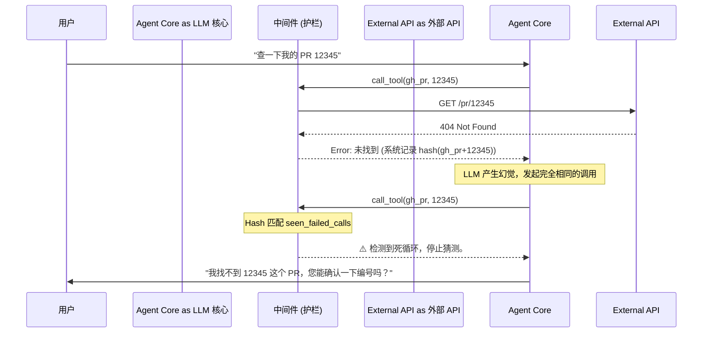

# 别再用 Prompt 修复幻觉：构建有状态 Agent 中间件的工程实践

## 架构师视角：如何将“可预测性”注入非确定性 AI 系统

## Executive Summary (内容摘要)
大语言模型（LLM）本质上是概率引擎。当我们将它包装成自治的 Agent 时，这种概率特性在调用外部工具时就成了致命的弱点。很多工程师试图通过不断调整 Prompt 来解决 AI 的失败（如工具调用死循环、意图路由混乱），这是一种架构上的反模式。本文通过拆解近期的一个 LLM Agent 生产级代码补丁，揭示了为什么**确定性中间件（状态拦截与启发式路由）**是构建高可用 AI 系统的唯一可扩展路径，从而将行业焦点从“更聪明的模型”转移到“更健壮的系统工程”上。

---

## Main Article (正文)

### Context: 生产级 Agent 的现实 (业务背景)
当你部署一个连接了真实 API 的 LLM Agent 时，Demo 通常完美无缺。用户要求查询一个 PR 状态，LLM 提取仓库名，调用 GitHub 工具，并总结结果。

但在生产环境中，用户不会输入结构化的 JSON，他们往往会输入碎片化、语序颠倒的口语（比如：*"用 MCP 查一下 qantas 我的代码仓库那个 PR..."*）。当 LLM 遇到缺失的上下文时，它会基于统计学概率去“填补”空白。它可能会捏造一个 PR 编号（比如 `12345`），或者猜错命名空间（用 `qantas/` 替代 `qantasloyalty/`），然后直接执行工具。

### Trigger: 幻觉闭环 (故障触发)
当工具调用返回 `404 Not Found` 报错时，LLM 会在它的上下文窗口中看到这个错误。人类遇到这种情况会停下来向用户确认，但 LLM 被“完成任务”的指令所驱动，往往会再次捏造一个稍微不同但依然错误的参数，甚至**不断重复完全相同的错误调用**。

因为此时上下文窗口中充斥着刚刚失败的记录，模型陷入了局部最优解的陷阱（Local Minimum）。它被锁死在了一个相同的工具调用死循环中，迅速耗尽 Token 额度，导致整个对话任务彻底崩溃。

### Escalation: 提示词工程的陷阱 (事态升级)
面对这种问题，工程师本能的反应是去修改 System Prompt：
*`"绝对不要瞎猜 PR 号。如果不知道，必须向用户提问！"`*

在规模化生产中，这种做法注定失败。Prompt 指令仅仅是一种“概率上的微调”。在处理边缘用户的输入，或是长对话轮次中，LLM 的注意力机制（Attention Mechanism）迟早会忽略这条指令。试图用自然语言去修复系统级的控制流问题，无异于试图通过让操作系统“小心点”来修复内存泄漏。

### Investigation: 故障层级拆解 (深度分析)
为了彻底解决这个问题，我们必须从不同深度审视整个系统：

* **表象层 (Surface):** Agent 看起来很蠢，不断重复同样的错误动作。
* **机制层 (Mechanism):** LLM 的自回归（Autoregressive）特性迫使它基于权重极高的近期历史（即刚刚失败的调用）来预测下一个 Token，导致幻觉被放大。
* **系统层 (System):** LLM 与 API 之间的交互界面缺乏“记忆”。每次工具调用都是孤立评估的。
* **规模层 (Scale):** 随着接入的工具越来越多（Jira, GitHub, 内部微服务），参数组合呈指数级爆炸，基于 Prompt 的防御策略根本无法维护。

### Resolution: 确定性状态管理 (架构重构)
真正的解法不是写更好的 Prompt，而是引入**确定性中间件**。在最近的架构优化中，我们落地了三种核心模式：

1. **有状态的调用拦截 (Stateful Call Interception):** 我们在 Agent 的运行循环中引入了 `seen_failed_calls` 注册表。每一次工具调用都会基于工具名和参数生成一个哈希签名。如果调用失败（如 404），该签名会被记录。如果 LLM 试图再次发起完全相同的调用，网关层会直接拦截，并向上下文强行注入一条确定性的错误信息：*"⚠️ 检测到调用死循环。停止猜测，请使用搜索工具。"*
2. **输入参数归一化 (Input Normalization):** 在请求到达工具前，通过启发式规则将用户口语化的简称（把 `qantas/` 映射为 `qantasloyalty/`）进行归一化。我们绝不信任 LLM 能完美格式化字符串；我们像对待传统 REST API 一样对输入进行严格清洗。
3. **流式可观测性 (Streaming Observability):** 使用异步生成器 (`yield Event("tool", ...)`)，将 Agent 的内部状态（包括刚刚拦截的死循环警告）实时推流给用户。彻底打破 AI 系统的黑盒状态。

### Lesson (核心总结)
**必须用确定性的护栏来包裹概率引擎。** 永远不要依赖 LLM 来管理自身的控制流。要把 LLM 当作一个极度不可靠的客户端，在它调用你的内部 API 之前，建立起强大的防御边界。

---

## The Popular Belief (流行观点)
“要让 AI Agent 更可靠，你需要更牛的提示词工程（Prompt Engineering），更大的模型，或者使用基于向量数据库（Vector DB）和 Embeddings 的复杂语义路由。”

## Why It Seems Correct (为什么看似正确)
OpenAI 和 Anthropic 每天都在宣传新模型的“指令遵循”能力有多强。此外，整个 AI 生态都在疯狂推销向量数据库，将其包装成解决路由和记忆问题的万能药。

## Where It Breaks Down (痛点与陷阱)
在超长上下文窗口下，指令遵循能力会显著衰减。此外，在产品 V1 阶段就使用语义路由（Embeddings）进行意图分类，会引入不必要的延迟、成本和非确定性。两句稍微不同的话可能会得出不同的向量距离，导致路由分发行为极其诡异且难以调试。

## A Better Mental Model (认知升级)
**用简单、确定性的技术来管理复杂、非确定性的 AI。** 一个简单的正则表达式字典（匹配 `\bqantas\b`）配合动作关键词进行意图路由，在 V1 阶段比基于 LLM 的分类器要优越得多。它 100% 可测试，延迟为 0。把 LLM 宝贵的算力留给深度推理，而不是简单的路由分发。

---

## Principal Engineer Perspective (架构师视角)

### Junior Engineer (初级工程师)
*关注点：功能实现*
“我会在 System Prompt 里加上‘不要陷入死循环’，然后用 LangChain 的错误解析器来抓取报错。”

### Senior Engineer (高级工程师)
*关注点：正确性与可维护性*
“我会在工具执行外层加上 try-catch，如果失败了，就把报错信息拼接回历史消息里，这样 LLM 就知道它刚才失败了。”

### Staff Engineer (专家工程师)
*关注点：架构设计与团队影响*
“LLM 是不可靠的。我会构建一个拦截器模式。如果 LLM 重复一个失败的工具签名，我会直接在网络层短路请求，注入系统级的覆写提示词，并用 Mock 网关编写单元测试，以数学概率证明死循环一定会被打破。”

### Principal Engineer (首席架构师)
*关注点：系统演进与战略风险*
“根本问题在于我们的编排层（Orchestration Layer）没有状态。通过在工具边界引入确定性状态机（`seen_failed_calls`），我们将 Agent 的可靠性与基座模型的能力彻底解耦。这意味着即便明天我们换了一个大模型，我们的 Agent 也不会出现质量倒退。同时，我们采用的启发式正则路由，避免了在简单的分类任务上被向量数据库厂商过度绑定。”

---

## Recommended Diagrams (推荐架构图)

### 工具调用死循环拦截架构 (Tool Call Loop Interception Architecture)
* **目的:** 展示确定性中间件如何在错误的工具调用抵达外部 API 之前对其进行拦截。

Frequently Asked Questions (FAQ)
1. 拦截完全相同的工具调用，会不会导致由于偶发网络抖动引起的正常重试也被拦截？
不会。seen_failed_calls 注册表只应该记录确定性的业务失败（例如 400 参数错误，404 资源不存在）。像 500, 502, 504 这样的瞬时网络错误，应该在 LLM 之下、网络请求之上的那一层进行标准的指数退避重试（Exponential Backoff），这对 LLM Agent 来说是完全透明的。

2. 为什么在 V1 阶段推荐用正则和硬编码关键词做意图路由，而不是 Embeddings？
复杂度的把控。在系统早期，确定性的规则 100% 可被单元测试覆盖，处理延迟为 0ms，且不需要消耗任何算力成本。只有当你的规则集庞大到无法人工维护时，才应该引入 Embeddings 和语义路由。

3. 如果网关直接拦截并伪造返回给 LLM，会不会破坏多轮对话的流畅度？
不会，因为这种拦截是作为“模拟的工具调用结果”注入到 LLM 上下文中的。在 LLM 看来，就像是 API 给了它一个非常严厉的警告。大模型会自然地适应这种上下文，并转变策略（比如改用搜索工具或向用户提问）。

4. 流式可观测性 (yield Event) 到底有什么实际价值？
建立信任。当用户对着屏幕干等 LLM 思考 15 秒时，他们往往会放弃使用。通过流式传输实时抛出 Event，告诉用户系统正在调用什么工具（并展示截断后的结果），可以帮助用户建立对 AI 运作原理的心理模型，极大降低等待焦虑。

5. 未来的新模型（如 GPT-5 或 Claude 4）会不会让这种防御性中间件变得多余？
不会。只要模型的底层原理依然是概率学，幻觉的概率就永远大于零。在企业级系统中，你不能把架构建立在“希望它不要出错”的假设上。无论模型多聪明，确定性的工程边界将永远是必需品。

Key Takeaways (核心收获)
AI 是概率性的，但架构必须是确定性的： 永远不要依赖 System Prompt 来接管关键的业务控制流。

有状态的工具链： Agent 不仅需要记住对话，更需要记住它的行为动作。必须在网关层拦截重复失败的工具调用。

延迟满足你的复杂度： 不要一上来就上向量数据库。从正则匹配和启发式路由开始，直到它们真的无法满足业务需求。

一切皆可流式输出： 在 Agent 系统中，透明度不是锦上添花，而是核心需求。必须将工具调用的中间状态实时暴露给用户。

SEO Metadata
Primary Title: 自治AI的错觉：为什么生产级 Agent 必须具备确定性护栏

SEO Description: 深入剖析 LLM Agent 在生产环境中的工具调用死循环与意图路由难题，学习首席架构师如何利用确定性护栏与状态管理构建高可用 AI 系统。

Keywords: LLM Agent, Tool Calling, 幻觉死循环, 语义路由, AI 架构, Prompt 工程, 确定性护栏, LangGraph, MCP, 大模型落地.

TL;DR: 为了防止 AI Agent 陷入无限工具调用死循环，请停止迷信 Prompt 修改。构建有状态的确定性中间件来拦截重复报错，并在引入向量数据库之前，坚持使用简单高效的启发式路由。