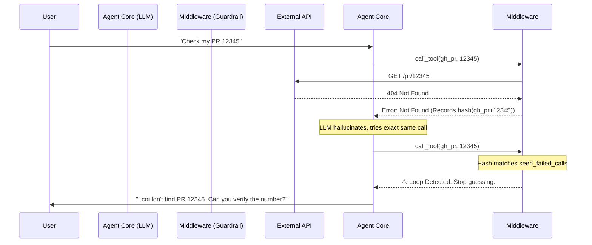

# Why Your LLM Agent Works in Demos but Fails in Production

## The Illusion of Autonomous AI: Why Production Agents Need Deterministic Guardrails

## Executive Summary
Large Language Models are probabilistic engines. When wrapped into autonomous agents, this probabilistic nature becomes a liability at the tool-calling boundary. Engineers often attempt to solve AI failures—like infinite tool-calling loops or poor intent routing—by endlessly tweaking prompts. This is a fundamental architectural anti-pattern. This article deconstructs a recent production patch for an LLM agent, revealing why deterministic middleware (stateful call interception and heuristic routing) is the only scalable way to build resilient AI systems, shifting the focus from "smarter models" to "robust system engineering."

---

## Main Article

### Context: The Reality of Autonomous Agents
When you deploy an LLM agent connected to real-world APIs, the demo usually goes flawlessly. The user asks for a pull request status, the LLM extracts the repository name, calls the GitHub tool, and summarizes the result. 

But in production, users don't speak in clean, machine-readable JSON. They type fragmented sentences like *"check qantas my pr about code gen api repo."* When the LLM encounters missing context, it relies on its statistical training to fill the gap. It guesses a PR number (e.g., `12345`), guesses a repository namespace (`qantas/` instead of `qantasloyalty/`), and executes the tool.

### Trigger: The Hallucination Loop
When the tool call fails with a `404 Not Found`, the LLM sees the error in its context window. A human would stop and ask for clarification. The LLM, driven by probability and an alignment to "complete the task," often hallucinates a slightly different—but equally wrong—parameter, or simply repeats the exact same call. 

Because the context window is now heavily weighted with the failed attempt, the model gets stuck in an infinite loop of identical tool calls, rapidly burning through token limits and completely breaking the user experience.

### Escalation: The Prompt Engineering Trap
The instinctive engineering response is to update the system prompt: 
*`"NEVER guess PR numbers. ALWAYS ask the user if you don't know."`*

This fails at scale. Prompt instructions are merely probabilistic nudges. Under edge-case user inputs or deep into a multi-turn conversation, the LLM's attention mechanism will eventually ignore the instruction. Trying to fix a systemic control-flow problem with natural language is like trying to fix a memory leak by asking the operating system to be careful.

### Investigation: Deconstructing the Failure Layers
To solve this, we must look at the system across different layers of depth:

* **Surface Layer:** The agent appears "stupid" and repetitive.
* **Mechanism Layer:** The LLM's autoregressive nature forces it to predict the next token based on the heavily weighted, immediate past (the failed tool call), trapping it in a local minimum.
* **System Layer:** The interface between the LLM and the API lacks memory. Every tool call is evaluated in isolation.
* **Scale Layer:** As you add more tools (Jira, GitHub, Internal APIs), the permutation of possible hallucinated arguments explodes, making prompt-based guardrails impossible to maintain.

### Resolution: Deterministic State Management
The solution is not a better prompt; it is deterministic middleware. In a recent architecture patch, we implemented three core patterns:

1. **Stateful Call Interception:** We introduced a `seen_failed_calls` registry in the Agent's runtime loop. Every tool execution creates a unique cryptographic signature of the tool name and arguments. If a call fails, its signature is recorded. If the LLM attempts the exact same call again, the middleware *intercepts it at the gateway* and injects a deterministic error back into the context window: *"⚠️ Call Loop Detected. Stop guessing and use search tools."*
2. **Input Normalization:** Before hitting the tool, heuristic normalization intercepts common user shorthand (mapping `qantas/` to `qantasloyalty/`). We don't trust the LLM to format strings perfectly; we sanitize inputs just as we would in a traditional REST API.
3. **Streaming Observability:** Using asynchronous generators (`yield Event("tool", ...)`), the agent's internal state—including these intercepted loop warnings—is streamed to the user. The system is no longer a black box.

### Lesson
**Wrap your probabilistic engines in deterministic guardrails.** Do not rely on the LLM to govern its own control flow. Treat the LLM as an untrusted client calling your internal APIs. 

---

## The Popular Belief
"To make an AI agent more reliable, you need better prompt engineering, a larger model, or complex semantic routing using Embeddings and Vector Databases."

## Why It Seems Correct
OpenAI and Anthropic constantly release models with better "instruction following." Furthermore, the AI ecosystem heavily markets Vector Databases as the default solution for routing and memory.

## Where It Breaks Down
Instruction following degrades in long context windows. Furthermore, relying on Semantic Routing (Embeddings) for intent classification introduces unnecessary latency, cost, and non-determinism. Two slightly different phrases might yield different embedding distances, causing erratic routing behavior.

## A Better Mental Model
Use dumb, deterministic tech to manage smart, non-deterministic tech. A simple Regex dictionary matching `\bqantas\b` coupled with action keywords is vastly superior, more testable, and magnitudes faster for V1 intent routing than an LLM-based classifier. Reserve the LLM's compute for reasoning, not routing.

---

## Principal Engineer Perspective

### Junior Engineer
*Focus: Implementation*
"I will add 'Do not loop' to the system prompt and use LangChain's retry parser to catch the errors."

### Senior Engineer
*Focus: Correctness & Maintainability*
"I will implement a try-catch block around the tool execution, and if it fails, I will append the error to the message history so the LLM knows it failed."

### Staff Engineer
*Focus: Architecture & Team Impact*
"LLMs are unreliable. I will build an interceptor pattern. If the LLM repeats a failed tool signature, I'll short-circuit the network call, inject a system-level override prompt, and build unit tests with Mock Gateways to prove the loop breaks."

### Principal Engineer
*Focus: System Evolution & Strategic Risk*
"The fundamental issue is that our orchestration layer lacks state. By introducing a deterministic state-machine at the tool boundary (`seen_failed_calls`), we decouple agent reliability from model capability. This means when we swap models tomorrow, our agents won't regress. Furthermore, our heuristic routing prevents vendor lock-in with vector databases for simple classification tasks."

---

## Recommended Diagrams

### Tool Call Loop Interception Architecture
* **Purpose:** To illustrate how deterministic middleware intercepts identical failed tool calls before they hit external APIs.

Frequently Asked Questions (FAQ)
1. Doesn't blocking identical tool calls prevent legitimate retries for transient network errors?
The seen_failed_calls registry should only track deterministic failures (e.g., 400 Bad Request, 404 Not Found, Validation Errors). Transient errors (500, 502, 504) should be handled by standard exponential backoff retries below the LLM layer, completely invisible to the agent.

2. Why use Regex and hardcoded keywords for Intent Routing instead of Embeddings?
Complexity scaling. In the early stages of a system, deterministic rules are 100% testable, have 0ms latency, and cost nothing. You only move to Embeddings/Semantic routing when your ruleset becomes too large to maintain, not before.

3. If the LLM is intercepted, doesn't it break the conversational flow?
No, because the interception is injected into the LLM's context window as a simulated "Tool Result." To the LLM, it simply looks like the API replied with a stern warning. The LLM naturally adapts and changes its approach.

4. How does Streaming Observability help?
Trust. When users wait 15 seconds for an LLM to think, they abandon the app. Yielding raw Event streams showing exactly which tool is being called (and its truncated result) builds mental models for the user about how the AI operates, reducing frustration during complex tasks.

5. Will newer models (like GPT-5 or Claude 4) make this middleware obsolete?
No. As long as models remain probabilistic, there is a non-zero chance of hallucination. In enterprise systems, you cannot architect around a "hopefully it won't hallucinate" strategy. Deterministic boundaries will always be required.

Key Takeaways
AI is Probabilistic, Architecture must be Deterministic: Never rely on system prompts to govern critical control flows.

Stateful Tooling: Agents need memory of their actions, not just their conversations. Intercept identical failed tool calls at the gateway.

Earn your Complexity: Start with Regex and keyword heuristics for routing. Prove it fails before adopting costly semantic routers.

Stream Everything: Transparency in agent systems is a requirement, not a feature. Expose tool calls to the user immediately.

SEO Metadata
Primary Title: The Illusion of Autonomous AI: Why Production Agents Need Deterministic Guardrails

SEO Description: Discover why LLM agents fail in production due to tool call loops and complex intent routing, and learn how Principal Engineers solve this with deterministic guardrails.

Keywords: LLM Agent, Tool Calling, Hallucination Loops, Semantic Routing, AI Architecture, Prompt Engineering, Deterministic Guardrails, LangChain, MCP.

TL;DR: To stop AI agents from getting stuck in infinite tool-calling loops, stop relying on prompts. Build deterministic, stateful middleware to intercept identical failures, and use simple heuristic routing before scaling to vector databases.

