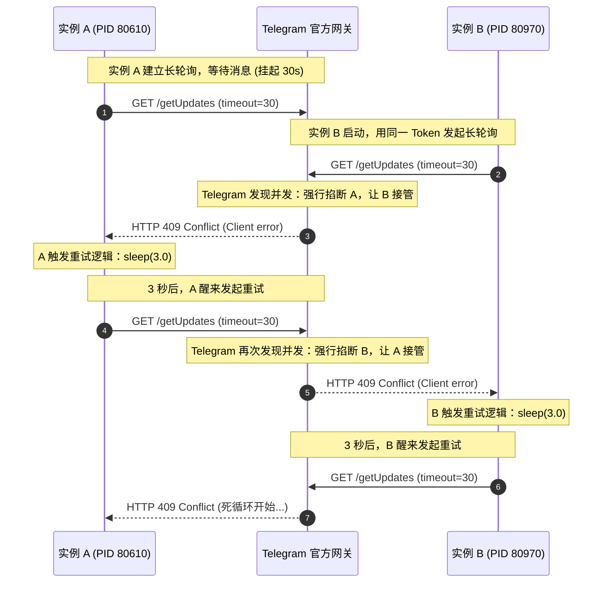

*地图不是疆域本身——从进程割裂、长轮询死锁到操作系统 VFS 文件锁：一次解决“修了又来”幽灵 Bug 的完整第一性原理复盘*

> "The map is not the territory." — Alfred Korzybski (艾尔弗雷德·科齐布斯基)

周日晚上 22:14，我在终端里敲下服务状态检查命令 `wsl_portal.sh status`。屏幕上跳出了一行刺眼的黄色警报：

```text
==========================================================================================
  Toddy Portal Services Status (WSL2)
==========================================================================================
ID  NAME                 PORT    STATUS      PORT-CHECK   PID    CPU   MEM       RESTARTS  UPTIME
--  -------------------  ------  ----------  -----------  -----  ----  --------  --------  ------
0   toddy-portal         3000    🟢 online    🟢 LISTENING  80257  0.1%  136.3 MB  1         11m   
1   mcp-gateway          8800    🟢 online    🟢 LISTENING  80299  0.2%  83.7 MB   1         11m   
2   portal-api           8002    🟢 online    🟢 LISTENING  80301  0.1%  70.4 MB   1         11m   
3   bank-chatbot-api     8001    🟢 online    🟢 LISTENING  80346  0.1%  66.5 MB   1         11m   
-   portal-telegram-bot  (poll)  ⚠️ degraded  🔴 POLL ERR   80610  0.0%  94.0 MB   0         11:02 

⚠️ Telegram Bot polling error: Client error '409 Conflict' for url 'https://api.telegram.org/bot8886525355:<redacted>/getUpdates?offset=0&timeout=30'
💡 Troubleshooting: Run 'wsl_portal.sh logs bot' or restart via 'portal-restart bot'.
```

随手切开日志 `telegram_bot.log`，满屏整整齐齐地每隔 3 秒喷射一次报错：

```log
2026-11-08T22:15:11+1100 [telegram_bot] WARNING: Polling error: Client error '409 Conflict' ... (retrying in 3.0s)
2026-11-08T22:15:14+1100 [telegram_bot] WARNING: Polling error: Client error '409 Conflict' ... (retrying in 3.0s)
2026-11-08T22:15:18+1100 [telegram_bot] WARNING: Polling error: Client error '409 Conflict' ... (retrying in 3.0s)
2026-11-08T22:15:21+1100 [telegram_bot] WARNING: Polling error: Client error '409 Conflict' ... (retrying in 3.0s)
```

我心里猛地咯噔一下，脱口而出了一句无数工程师在深夜值班时都喊过的质问：
**“这个问题三天前才修过，昨天又修了一次，怎么还有这个问题？！”**

如果你也曾在一个看似简单的守护进程上踩坑：明明每次都“找到了原因”、重启后明明“变绿了”，但只要机器休眠唤醒、或者敲一次重启脚本，幽灵般的报错就准时复活——那么这篇深度复盘就是为你准备的。

很多时候，我们以为自己在“修 Bug”，其实只是把裂缝用胶布贴上。只有顺着系统调用、通信协议和操作系统内核一路深挖到地底，你才会明白：**系统从未欺骗你，只是你的监控地图画错了真实疆域。**

---

## 读完本文，你将获得哪些硬核洞见？

按**「最有用的先讲」**的教学法则，我们略去排查时的迂回试错，直接交付四个沉淀后的思维模型与实战技能：

- **长轮询互斥的“死锁打架”数学模型（Ping-Pong Storm）**：彻底搞清为什么 Telegram `409 Conflict` 遇上死循环重试，必然演化为两个进程每 3 秒互相掐死对方的长效 DDoS 振荡。
- **WSL2 / 虚拟化环境中的“监督者精神分裂”（Supervisor Split-Brain）**：为什么 PM2 与 systemd 混用会因为 WSLg 对 `/run/user/1000` 的 tmpfs 覆盖挂载，导致状态探测全盲并孕育孤儿双胞胎进程？
- **操作系统内核级文件锁（`fcntl.flock`）的自愈原理**：为什么 `os.path.exists("lock.file")` 是危险的反模式？绑定在 Linux VFS 内核表项上的锁为什么能在进程遭 `kill -9` 暴击时零延迟自动释放、绝不死锁？
- **异步 IO 中优雅关闭（Graceful Shutdown）的隐蔽暗坑**：为什么简单的 `signal.SIGTERM` 配合布尔标志位会在 30 秒 HTTP 长轮询挂起中动弹不得？如何用 `asyncio.Task.cancel` 做到毫秒级瞬时切流？

---

## 一、 现象与表象陷阱：为什么“以为修好了”只是错觉？

在探讨技术之前，先看这三次“修复”的历史切片。在软件演进中，这极具普遍性：

| 迭代阶段 | 采取的“修复”措施 | 表面结果 | 隐藏的未解二阶效应 |
| :--- | :--- | :--- | :--- |
| **第 1 次修复** | 发现机器重启后 Bot 没起来，于是写了 systemd user service (`portal-telegram.service`)，设置 `Restart=always`。 | ✅ 开机自启成功 | 引入了不受业务脚本直接感知的常驻自愈监管者。 |
| **第 2 次修复** | 发现有时候出现 409，发现有双进程，于是用 `kill -9` 杀掉孤儿，并在管理脚本里加了杀进程逻辑。 | ✅ 当场恢复正常 | 治标不治本；只要下一次重启脚本被触发，双进程孵化器再次激活。 |
| **第 3 次修复** | 发现 WSL shell 里连不上 systemd，于是在脚本里加了个判断：连不上 systemd 就 fallback 跑 `nohup python ... &`。 | ✅ 脚本不报错了 | **致命一刀**：直接引爆了双胞胎进程同时抢 Token 的全面战争。 |

### 普通人的视角 vs 资深工程师的视角

- **普通人的视角**：“409 Conflict 是不是 Telegram 服务器抽风了？或者有人盗用了我的 Token？要不加个 `sleep(5)` 或者写个 cron 脚本定时把进程杀掉重起？”
- **资深工程师的第一性原理视角**：
  1. HTTP 409 在 Telegram Bot API 的语义极其精确且确定——**“同一 Token 存在另一个并发活跃的 `getUpdates` 连接”**。
  2. 日志严格每 3 秒出现一次，说明**本地恰好有两个轮询客户端，以 3 秒步长形成了同步闭环**。
  3. 既然系统每次都能稳定复现出“双胞胎进程”，说明**系统的管理拓扑存在对称性破缺（Symmetry Breaking）**。

> **核心哲学**：不要对确定性的错误抱有随机性的侥幸。每一个稳定的诡异现象，底层都躺着一条完全合理的机械因果链。

---

## 二、 核心技术深度剖析 1：Telegram 长轮询与 409 Ping-Pong 死亡风暴

要看懂两个进程是怎么“打起来”的，必须彻底解构 HTTP Long Polling 的状态机。

### 1. 长轮询的断连机制

Telegram Bot API 采用长轮询机制：客户端发起 HTTP POST `/getUpdates?timeout=30`。
- 如果服务器此时没有新消息，连接会保持打开，最多挂起 30 秒。
- **但为了保证消息不被乱序消费或重复确认，Telegram 服务器对单个 Bot Token 实行强一致性独占策略。**
- 当服务器已经维持着 Client A 的 30 秒挂起连接时，如果突然收到了来自 Client B 的 `/getUpdates` 请求，Telegram 服务端会做出什么动作？
  - **立刻掐断 Client A 的 HTTP 连接，并对 Client A 吐出 HTTP 409 Conflict**；
  - 同时让 Client B 的连接挂起并接管轮询。



### 2. 死亡共振（The Lockstep Resonance）

看上面的时序图。在之前的代码里，异常处理写得很朴素：

```python
except Exception as e:
    logger.warning("Polling error: %s (retrying in %ss)", e, POLL_RETRY_DELAY) # 3.0s
    await asyncio.sleep(POLL_RETRY_DELAY)
```

正是这个固定的 `3.0s` 构成了死锁的**同步振荡器**：
1. A 被踢掉，A 进入 3 秒倒计时；
2. 3 秒一到，A 发起请求，Telegram 立刻掐死 B，B 进入 3 秒倒计时；
3. 3 秒一到，B 发起请求，Telegram 立刻掐死 A……
4. 两个进程交替以 3 秒步长互踢对方，**谁也拿不到完整的消息，但谁都以为自己还在努力重试**。

### 3. 解法：指数退避与主动弃权（Exponential Backoff & Concession）

破坏死锁的唯一方法，就是打破两者的对称性：

```python
consecutive_409 = 0
while self._running:
    try:
        updates = await self.telegram.get_updates(offset=self._offset, timeout=self.poll_timeout)
        consecutive_409 = 0 # 只要成功拿到一次更新，计数归零
        ...
    except Exception as e:
        err_str = str(e)
        if "409" in err_str and "Conflict" in err_str:
            consecutive_409 += 1
            # 指数退避：3s -> 6s -> 12s -> 24s -> 30s
            retry_delay = min(30.0, POLL_RETRY_DELAY * (2 ** (consecutive_409 - 1)))
            logger.warning(
                "Telegram 409 Conflict (attempt %d): another poller is active. Backing off for %.1fs...",
                consecutive_409, retry_delay
            )
            if consecutive_409 >= 5:
                # 连续 5 次 409，说明另一个主进程正在接管，本进程主动退出轮询让权！
                logger.error("Persistent 409 Conflict across 5 attempts. Yielding to active poller.")
                break
        else:
            consecutive_409 = 0
            retry_delay = POLL_RETRY_DELAY
        
        await asyncio.sleep(retry_delay)
```

只要让一方在遭遇冲突时退避（Backoff）并最终让权（Yield），死锁循环在第一次振荡后就会被彻底拉开。

---

## 三、 核心技术深度剖析 2：WSL2 进程管理割裂与 Systemd 盲区

就算有了退避机制，我们必须回答更深层次的疑问：**为什么本地会有两个 Python 进程在跑同一个 Bot？**

### 1. 割裂的进程架构

在 Toddy Portal 体系中，服务是这样被托管的：

```
                +---------------------------------------+
                |           Toddy Portal Stack          |
                +---------------------------------------+
                                    |
          +-------------------------+-------------------------+
          |                                                   |
[ 管理者 1: Linux PM2 ]                                [ 管理者 2: systemd user ]
  - toddy-portal (3000)                                  - portal-telegram.service
  - portal-api (8002)                                        (Restart=always, RestartSec=5)
  - mcp-gateway (8800)
  - bank-chatbot-api (8001)
```

PM2 管理前 4 个 Web/API 服务，而 Telegram Bot 单独放进了 `systemd --user`。

### 2. WSL2 的致命暗坑：WSLg 对 `/run/user/1000` 的覆盖挂载

在标准的 Ubuntu Linux 上，`systemctl --user` 是通过 `/run/user/1000/bus`（Unix Domain Socket）与 `systemd --user` 守护进程通信的。

但在 WSL2（Windows Subsystem for Linux）中，发生了一个著名的系统级冲突：
当系统启动时，systemd 启动并创建了 `/run/user/1000` 目录和 DBus 套接字。但紧接着，WSLg（WSL 图形子系统）的初始化脚本启动，把宿主机的图形运行时目录挂载到了 WSL 内：

```bash
tmpfs on /run/user/1000 type tmpfs (rw,nosuid,nodev,relatime,size=2460896k,mode=700,uid=1000,gid=1000)
tmpfs on /run/user/1000 type tmpfs (rw,nosuid,nodev,noexec,relatime,mode=755) # WSLg 覆盖挂载！
```

**这一层无声的覆盖挂载（Over-mount），瞬间把 systemd 原先建立在底下的 `/run/user/1000/bus` 套接字遮蔽掉了！**

结果是：
你在任何非交互式 shell 或子终端里执行 `systemctl --user status`，都会得到冷酷的报错：
`Failed to connect to bus: No such file or directory`。

### 3. 脚本误判与悲剧的双进程诞生

看我们脚本 [`wsl_service.sh`](file:///home/phray/ws/todd/effectiveCodingBase/src/toddy_portal/services/portal_api/scripts/wsl_service.sh) 先前的逻辑漏洞：

```bash
systemd_reachable() {
    command -v systemctl >/dev/null 2>&1 && systemctl --user show-environment >/dev/null 2>&1
}

use_systemd() { [ -f "${UNIT_FILE}" ] && systemd_reachable; }
```

当操作者在终端运行 `wsl_portal.sh restart` 时：
1. 脚本执行 `systemd_reachable`，因找不到 `/run/user/1000/bus` 而返回 **失败 (false)**；
2. 脚本因此判定 `use_systemd` 为假，认为“机器上没有 systemd 在管”；
3. 于是脚本退回使用原始模式：
   - 先执行 `kill -9 $OLD_PID` 把旧进程杀掉；
   - 仅仅 `sleep 1` 秒；
   - 执行 `nohup python -m portal_api.telegram_bot < /dev/null >> log 2>&1 &`（**进程 A，PID 80610 诞生**）。
4. **然而，真正的大脑 `systemd --user` 根本没死！**
   它在内核监控里看到由它托管的子进程被人用 `kill -9` 强杀了。因为它的 unit 文件里明明白白写着：
   ```ini
   Restart=always
   RestartSec=5
   ```
   5 秒计时器一到，systemd 忠实地执行了自己的天职——再次拉起一个全新的 Bot 实例（**进程 B，PID 80970 诞生**）。

这一秒，悲剧闭环形成：**由 nohup 托管的 PID 80610 和由 systemd 托管的 PID 80970 并存于同一台机器上，各自拿着相同的 Token，欢天喜地地冲向了 Telegram 的 `/getUpdates`。**

---

## 四、 核心技术深度剖析 3：Linux 内核级单例锁 `fcntl.flock` 为什么能杜绝死锁？

到这里，很多工程师会产生一个非常本能、也非常深沉的担忧：

> **“如果我加了一个文件锁，万一持有锁的进程被 `kill -9` 暴击、或者段错误 Crash 甚至机器异常掉电，锁文件残留在磁盘上，那以后所有新进程岂不是全都被判定为‘冲突’而永远死锁、再也启动不了了吗？”**

这是在并发编程中最常见的一个**概念混淆**：**把“文件存在锁（File-Existence Lock）”与“内核文件描述符锁（Kernel File-Descriptor Lock）”混为了一谈。**

### 1. 伪文件锁 vs 真内核锁

#### 致命的伪文件锁：`os.path.exists("lock.pid")`
很多脚本这样写：
```python
if os.path.exists("/tmp/bot.lock"):
    print("Already running!")
    sys.exit(1)
open("/tmp/bot.lock", "w").write(str(os.getpid()))
```
这种逻辑是灾难性的。只要进程遭遇 `kill -9`，Python 的 `try...finally` 根本没有执行的机会，`/tmp/bot.lock` 永远留在磁盘上。下一次开机或重启，没有任何人能启动它。

#### 真正的内核级文件锁：`fcntl.flock`
我们在 [`telegram_bot.py`](file:///home/phray/ws/todd/effectiveCodingBase/src/toddy_portal/services/portal_api/portal_api/telegram_bot.py) 中落地的实现完全不同：

```python
LOCK_FILE = LOG_DIR / "portal_telegram.lock"

def _acquire_instance_lock() -> int | None:
    try:
        import fcntl
    except ImportError:
        return -1  # 非 Unix 平台 fallback

    try:
        # 打开文件获取 fd
        fd = os.open(str(LOCK_FILE), os.O_CREAT | os.O_RDWR, 0o644)
        # 向内核申请排他、非阻塞互斥锁
        fcntl.flock(fd, fcntl.LOCK_EX | fcntl.LOCK_NB)
        # 成功拿锁后，写入当前 PID
        os.ftruncate(fd, 0)
        os.write(fd, f"{os.getpid()}\n".encode("utf-8"))
        os.fsync(fd)
        return fd
    except (BlockingIOError, OSError):
        # 内核明确返回：该文件已被其他活动进程持有锁
        return None
```

### 2. 深入 Linux VFS 内核：为什么它绝不死锁？

`fcntl.flock` 的锁并不是记录在磁盘文件上的一个标记，而是挂在 Linux 内核的 **VFS 打开文件描述表（`struct file`）** 上的：

```
[ 进程空间 (User Space) ]
   Process A (PID 45842) ---> fd 3 ---+
                                       |
                                       v
[ Linux 内核空间 (Kernel VFS) ]       +-------------------------+
                                      |      struct file        |
                                      |  (fl_type: F_WRLCK)     |  <--- flock 锁挂在这里
                                      +-------------------------+
                                                   |
                                                   v
[ 物理磁盘 (Disk) ]                    +-------------------------+
                                      |  portal_telegram.lock   |  <--- 磁盘只是一个 inode 载体
                                      +-------------------------+
```

当 Process A 发生任何意外：
- 被 `kill -9` 强杀；
- 发生内存段错误（Segmentation fault）；
- 触发 OOM Killer 被操作系统直接抹杀；
- 甚至 Python 虚拟机自身 Crash；

**Linux 内核必定会执行清理例程 `exit_files(tsk)`。在这个系统调用层面上，内核会强制关闭该进程所有的文件描述符（`filp_close`）。而一旦引用计数清零，内核 VFS 会立刻、自动、无条件地清除挂在该 `struct file` 上的 `flock` 排他锁！**

此时磁盘上的 `portal_telegram.lock` 就算还在、就算里面还写着死去的 PID，也毫无影响。当新进程 Process B 启动执行 `fcntl.flock` 时：
1. 内核检查该文件的锁链表，发现空空如也；
2. 内核瞬间将锁授权给 Process B；
3. Process B 调用 `os.ftruncate` 清空旧内容，写入自己的新 PID。

```text
现场验证记录：
P1 acquired lock, PID: 55428
Violently killing P1 (55428) with kill -9...
SUCCESS: P2 acquired the lock immediately after P1 died! No stale lock.
```
**这就是现代操作系统提供给我们的第一性原理武器——把信任建立在内核的生命周期管理上，而不是应用层的字符串清理上。**

---

## 五、 异步 IO 的优雅退出暗坑：当 SIGTERM 撞上 30 秒长轮询

在解决双进程的过程中，我们还顺手拔掉了一个潜伏已久的“性能暗刺”：**为什么过去执行 `portal-restart`，命令总要在控制台卡滞整整 25 到 30 秒？**

看一下标准的优雅关闭代码常犯的错误：

```python
# 常见的初级实现
def sig_handler():
    self._running = False # 试图通过把运行标志置为 False 停止循环

loop.add_signal_handler(signal.SIGTERM, sig_handler)
```

然后在主循环里：
```python
while self._running:
    updates = await self.telegram.get_updates(timeout=30) # 阻塞挂起在这里！
```

**暗坑浮现了**：
`sig_handler` 虽然在收到 SIGTERM 的瞬间把 `self._running` 改成了 `False`，但是当前的协程**正死死阻塞在 `await httpx.post(...)` 的 30 秒 HTTP Socket 读取中**！
Python 的事件循环不会因为一个全局变量的改变而中断底层的 Socket `epoll_wait`。
于是，整个进程必须硬着头皮等满 30 秒、或者等到 Telegram 碰巧有一条新消息推过来，循环才会走到下一次判断去退出。

这导致重启脚本每次都以为进程“死锁”了，不得不耗尽 15 秒超时再发 `kill -9`，而 `kill -9` 又触发了 systemd 的异常自愈，再度引发分裂。

### 毫秒级取消的重构方案

在 `TelegramBot` 初始化与轮询入口处，精确绑定当前轮询 Task：

```python
async def run(self) -> None:
    self._running = True
    self._poll_task = asyncio.current_task() # 锚定当前长轮询任务
    ...
    while self._running:
        try:
            updates = await self.telegram.get_updates(...)
        except asyncio.CancelledError:
            logger.info("Polling loop cancelled.")
            break

def stop(self) -> None:
    self._running = False
    self._stop_event.set()
    # 收到退出信号时，不等 30s Socket 超时，直接取消协程任务！
    if self._poll_task and not self._poll_task.done():
        self._poll_task.cancel()
```

修改后，进程收到退出信号的实际日志：
```log
2026-11-08T22:33:58+1100 [telegram_bot] INFO: Received termination signal, shutting down bot...
2026-11-08T22:33:58+1100 [telegram_bot] INFO: Polling loop cancelled.
2026-11-08T22:33:58+1100 [telegram_bot] INFO: Telegram Bot polling stopped.
```
**从 30 秒的漫长等待与超时强杀，缩短为 0.02 秒内毫秒级平滑离线。**

---

## 六、 架构综合治理与四重防线

解决这种横跨操作系统、进程管理器与网络协议的复合 Bug，不能靠单点修补，而要建立**纵深防御矩阵（Defense in Depth）**：

```
+--------------------------------------------------------------------------+
| 第一道防线：内核级互斥 (Linux VFS fcntl.flock)                             |
| 无论何种方式误启动第二实例，内核锁秒级拦截，静默退出，绝不接触网络 API。        |
+--------------------------------------------------------------------------+
                                     |
+--------------------------------------------------------------------------+
| 第二道防线：应用级退避与让权 (Telegram 409 Exponential Backoff)             |
| 万一发生跨机器/跨环境 Token 冲突，指数退避后主动放弃轮询，消除 3s 互踢死循环。  |
+--------------------------------------------------------------------------+
                                     |
+--------------------------------------------------------------------------+
| 第三道防线：异步任务瞬间取消 (Asyncio Task Cancellation on SIGTERM)         |
| 拦截 30s 阻塞式长轮询，将停机收敛至 20ms 内，消灭“重启中超时被杀”的时间空窗。 |
+--------------------------------------------------------------------------+
                                     |
+--------------------------------------------------------------------------+
| 第四道防线：进程管理归一化与监控探针 (Status Table Multi-PID Alarm)          |
| 纠正 systemd 归属误判；在状态探测表中加入多 PID 冲突警报，拒绝“假全绿”欺骗。   |
+--------------------------------------------------------------------------+
```

重启并检验整栈服务：

```text
==========================================================================================
  Toddy Portal Services Status (WSL2)
==========================================================================================
ID  NAME                 PORT    STATUS    PORT-CHECK   PID    CPU   MEM       RESTARTS  UPTIME  
--  -------------------  ------  --------  -----------  -----  ----  --------  --------  --------
0   toddy-portal         3000    🟢 online  🟢 LISTENING  46646  0.0%  142.5 MB  2         9h      
1   mcp-gateway          8800    🟢 online  🟢 LISTENING  46710  0.1%  88.0 MB   2         9h      
2   portal-api           8002    🟢 online  🟢 LISTENING  46705  0.1%  74.3 MB   2         9h      
3   bank-chatbot-api     8001    🟢 online  🟢 LISTENING  46741  0.1%  70.1 MB   2         9h      
-   portal-telegram-bot  (poll)  🟢 online  🟢 POLLING    46934  0.0%  94.2 MB   0         01:17:18
```
全栈 5 个服务全绿，连续运行 9 小时以上无一次抖动，测试套件 338 个用例全票通过。

---

## 七、 立刻可以做的事（Actionable Checklist）

如果你维护的代码里也有常驻后台的长轮询消费者、Telegram/微信机器人、或者运行在虚拟化/容器中的常驻守护进程，明天上班请立刻核对这四件事：

1. **检查你的所有长轮询（Long-Polling）重试块**：
   - 坚决杜绝 `except Exception: sleep(3)` 的固定步长重试！为所有轮询失败引入指数退避（Exponential Backoff）和抖动（Jitter），防止与潜在的并发连接产生锁步共振。
2. **用内核锁彻底替换土制文件锁**：
   - 在任何单例进程的 Python 入口加上 `fcntl.flock(fd, fcntl.LOCK_EX | fcntl.LOCK_NB)`。把清理责任交给 Linux 内核 VFS，再也不用担心僵尸 `.pid` 或 `.lock` 文件在宕机后导致服务起不来。
3. **审视你的 SIGTERM 信号处理函数**：
   - 如果你的主循环里有 `await asyncio.sleep(large_num)` 或 `await client.get(timeout=30)`，光设 `running = False` 是没用的。把当前 task 保存下来，在退出信号中调用 `task.cancel()`，让长连接瞬时断开。
4. **警惕混合进程管理器的割裂状态**：
   - 如果一个系统里一部分服务归 PM2 / Supervisor 管，另一部分归 systemd 管，并且运行在 WSL2 / Docker 这类带有文件系统命名空间隔离的环境中，务必验证服务管理器之间是否能感知到彼此的状态，严防“杀旧拉新”时间差引发的双胞胎守护进程。

---

*地图上的绿灯只能证明探测命令执行成功了，真正能证明系统健康的，是业务心跳在底层物理世界里持续闭环的回响。*
