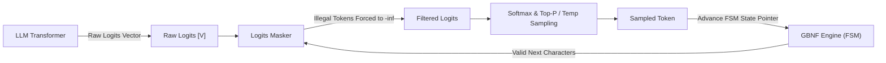

> "Whereof one cannot speak, thereof one must be silent." — Ludwig Wittgenstein, *Tractatus Logico-Philosophicus*

# The Cost of Rigid Grammars: Why GBNF and Logits Masking Force LLMs into Zero-Token Silence

*From GBNF state machines and intrusive Logits masking to resilient schema engineering in production — how to diagnose Premature EOS in local LLMs.*

During a routine concurrency audit of an automated editorial pipeline this morning, an uncanny exception stack trace flashed across the monitoring console:

```text
json.decoder.JSONDecodeError: Failed to parse or repair JSON from ollama output: : line 1 column 1 (char 0)
```

If you regularly integrate LLMs with backend services, your immediate reflex upon seeing `JSONDecodeError` is familiar: Did the model forget a closing brace? Did it emit an unescaped backslash or newline inside a string literal?

Yet when we inspected the OpenTelemetry distributed trace and the raw HTTP payloads exchanged with Ollama, an unsettling reality emerged:
**The HTTP call completed with a crisp `200 OK`. The server spent a full 3 seconds evaluating thousands of prompt tokens (`prompt_eval_count: 3421`). But the actual completion returned by the model had a length of exactly zero — not a character, not a space, not even a newline. `eval_count` stood plainly at `0`.**

Having burned thousands of compute cycles on prompt pre-processing, this 20B parameter local model threw in the towel the exact microsecond generation was supposed to begin, terminating immediately with an `<eos>` token.

This was neither an Out-Of-Memory (OOM) crash, nor a network timeout, nor a deserialization bug in Python. It was a subtle, insidious architectural deadlock that strikes deep within the sampling mechanics of local inference engines: **Logits Mask Deadlock and Premature EOS under Grammar-Constrained Generation**.

If you are deploying local models with Ollama, llama.cpp, or vLLM, or enforcing strict JSON schemas on autonomous agents, this post will save you dozens of hours of futile debugging.

---

### What We Will Dissect in This Post

1. **The Tyranny of the Automaton**: How GBNF (Grammar Backus-Naur Form) works under the hood in C++.
2. **Ambushed Before the Softmax**: How dynamic Logits Masking annihilates probability mass.
3. **`format: schema` vs. `format: "json"`**: The critical divide between a single-track rail and elastic resilience.
4. **Architectural First Principles**: Why rigid, intrusive constraints breed catastrophic fragility.
5. **The 2026 Industrial Solution**: Two-stage graceful degradation paired with deterministic post-processing.

---

## 1. Prometheus in Chains: What is GBNF Grammar?

Fundamentally, an autoregressive Large Language Model is an auto-attentive token predictor over high-dimensional space. It possesses no innate concept of syntax; it merely computes a discrete probability distribution over its vocabulary given preceding context:

$$P(w_t \mid w_1, w_2, \dots, w_{t-1}) = \text{Softmax}(z_t)$$

In enterprise systems, unconstrained sampling is rarely acceptable. When an agent must generate an API payload or execute database queries, the response must strictly conform to JSON standards.

To tame this stochasticity, modern inference runtimes (such as `llama.cpp` and `Ollama`) implement **GBNF (Grammar Backus-Naur Form)**.

### How GBNF Intercepts Generation

GBNF is not an auditor that inspects output after completion. It is an **active gatekeeper that alters raw neural logits before sampling occurs**:



1. **Grammar Compilation**: When you supply a JSON Schema (e.g., `{"type": "object", "properties": {"markdown": {"type": "string"}}}`), the inference engine compiles it into a **Deterministic Finite Automaton (DFA / Pushdown Automaton)**.
2. **Per-Token Logits Masking**:
   - The automaton occupies state $S_t$.
   - The GBNF engine calculates the valid character set $C_{\text{valid}}$ acceptable in state $S_t$.
   - Every token in the vocabulary ($|V| \approx 32,000$ to $150,000$) whose text prefix violates $C_{\text{valid}}$ is forced to negative infinity:
     $$z_i' = -\infty \quad (\forall i \notin \text{ValidTokens}(C_{\text{valid}}))$$
3. **State Transition**: Only valid tokens survive the Softmax filter. Once a token is selected, the state machine advances.

While academically celebrated as "guaranteed correctness", in messy production contexts, this intrusive mechanism turns brittle under real-world priors.

---

## 2. Ambushed at Token Zero: Logits Mask Deadlock and Premature EOS

Let us look closely at how that empty string `""` was forged at step zero.

Consider an instruction given to a local model: "Draft and polish the opening section of this technical post", accompanied by a strict `format: schema`:

```json
{
  "type": "object",
  "properties": {
    "markdown": { "type": "string" }
  },
  "required": ["markdown"]
}
```

### 1. The Harsh Dictate at Step Zero

Before producing any characters, the GBNF state machine sits in its initial state $S_0$.
By standard JSON grammar, an Object literal **must** begin with an opening brace `{` (permitting only preceding whitespace):

$$C_{\text{valid}}(S_0) = \{ \text{'\{'}, \text{' '}, \text{'\textbackslash t'}, \text{'\textbackslash n'} \}$$

**Out of tens of thousands of tokens in the model vocabulary, only the infinitesimal fraction beginning with `{` or whitespace are permitted to exist.**

### 2. The Collision of Neural Priors and Syntactic Chains

Modern open-weight models (especially in the 14B–20B range, or reasoning variants influenced by DeepSeek-R1 and Qwen-Thinking) exhibit strong intrinsic attention priors when confronted with long prompt context:

- **Prior A (Reasoning Pre-roll)**: The model's training makes it eager to emit `<think>` as its first token.
- **Prior B (Conversational Niceties)**: When prompted in English, it strongly defaults to tokens like `Sure`, `Here`, or `Below`.
- **Prior C (Direct Continuation)**: When given a rich introductory hook, the model's highest probability logits lean toward continuing the prose directly.

In the model's raw logits:
- `<think>` might hold $82\%$ probability mass;
- Conversational or prose openers hold $17\%$;
- **The literal character `{`, divorced from context, holds less than $0.001\%$ probability.**

### 3. Mask Collapse and the Escape Hatch

When the GBNF engine steps in and aggressively masks out $99.999\%$ of the distribution:

```
Raw Logits:
[ <think>: +14.2 ] [ Sure: +11.8 ] [ Prose: +9.4 ] ... [ {: -6.3 ] ... [ <eos>: -1.2 ]
                          │
                   GBNF Masking
                          ▼
Masked Logits:
[ <think>: -inf  ] [ Sure: -inf  ] [ Prose: -inf  ] ... [ {: -6.3 ] ... [ <eos>: -1.2 ]
```

Notice what happened:
In the masked distribution, the **End-of-Sequence (`<eos>`) token** — which is often left unmasked as an escape hatch or emergency boundary in sampler implementations — **suddenly becomes the highest probability token in the entire vocabulary!**

The sampler discovers that all natural generation paths have been obliterated, while the remaining valid syntax tokens sit deep in the negative tail. It takes the path of least resistance: `<eos>`.

**The result:**
- Generated tokens: `eval_count: 0`
- Response content: `""` (Empty string)
- Termination reason: `done_reason: "stop"`

Downstream callers receive not an invalid JSON object, but a ghost.

---

## 3. `format: schema` vs. `format: "json"`: Two Competing Philosophies

Modern inference APIs usually offer two methods for structured generation. Many developers treat them as trivial styling options, but their underlying failure modes are fundamentally opposed:

| Dimension | `format: schema` (Strict Mode) | `format: "json"` (Elastic Mode) |
| :--- | :--- | :--- |
| **Engine Mechanism** | Full GBNF Context-Free Grammar DFA | Minimal bracket and escape tracking |
| **Token Zero Constraint** | Extreme: forces `{` on the very first token | Relaxed: allows preambles before JSON objects |
| **Chain-of-Thought (CoT) Compatibility** | **Abysmal**. Forbids `<think>` tags, breaking reasoning models | **Excellent**. Allows thinking blocks prior to output |
| **Deadlock Rate** | **High** on $\le 20\text{B}$ quantized models | **Near Zero** |
| **Field Completeness Guarantee** | Complete in theory; empty in practice due to deadlocks | Relies on prompt alignment; needs post-processing |
| **Decoding Latency Overhead** | High per-token state transitions | Negligible |

### The Principal Engineer's Insight
`format: schema` attempts to solve data validation **at the instant of generation**. It imposes a deterministic engineering contract onto a probabilistic system.
For colossal frontier models (like GPT-4), the model has sufficient parameter capacity to follow the constraint without derailing. But for 14B–20B local models, rigid grammars frequently cause attention collapse.

---

## 4. Architectural Invariant: Why Over-Constrained Systems Become Brittle

A timeless truth of systems architecture holds:
**Robustness against uncertainty is never achieved by making boundaries more rigid, but by building elastic depth.**

In classical software engineering, Parnas information hiding and contract-first APIs urge strict validation at boundaries.
However, when dealing with a probabilistic generator, applying strict grammar constraints introduces **symmetry breaking**:

```
                  [Rigid Grammar Constraint]
Prompt ──> GBNF forces first token to '{' ──> Attention conflict ──> Premature EOS ──> Fatal Crash

                  [Elastic Resilient Architecture]
Prompt ──> format: 'json' (Relaxed) ──> Free generation ──> json-repair recovery ──> Pipeline Success
```

By eliminating $99\%$ of the token exploration space up front, the system replaces small, repairable syntax errors with an unrecoverable catastrophic failure: **generating absolutely nothing.**

In production, missing quotes or malformed escapes can be repaired in 2 milliseconds with `json-repair`. But 0-token deadlocks forfeit the entire 3-minute GPU run.

---

## 5. The 2026 Industrial Solution: Two-Stage Graceful Degradation

High-availability AI pipelines should adopt a three-tier design: **Soft Guidance + Graceful Fallback + Resilient Repair**.

```mermaid
flowchart TD
    Req[Editorial Task / Section Prompt] --> TryStrict[Attempt 1: Strict GBNF (format: schema)]
    TryStrict --> CheckOutput{Is output empty or eval_count == 0?}
    
    CheckOutput -->|No: Has Content| RobustParser[Robust Parser: Fast Path -> json-repair -> Regex]
    CheckOutput -->|Yes: Deadlock Detected!| FallbackFree[Attempt 2: Graceful Fallback to format: 'json']
    
    FallbackFree --> SystemPromptInject[Inject JSON Schema into System Prompt]
    SystemPromptInject --> LowerTemp[Lower Temperature to 0.5]
    LowerTemp --> CallFreeMode[Free JSON Mode Generation]
    
    CallFreeMode --> RobustParser
    
    RobustParser -->|Parsed Object| Success[Proceed to Redaction & Review]
    RobustParser -->|Pure Markdown Fallback| RecoverSingleKey[Map text to {'markdown': text}]
    RecoverSingleKey --> Success
```

### Production Implementation

In our shared provider layer ([`llm_core/structured.py`](file:///home/phray/ws/todd/effectiveCodingBase/ai/mcp/llm_core/llm_core/structured.py)), we implement the deadlock circuit breaker:

```python
class OllamaProvider:
    name = "ollama"
    
    def complete_json(self, system, user, schema, *, temperature=None):
        # 1. First attempt: Strict GBNF grammar
        body = {
            "model": self.model,
            "stream": False,
            "format": schema,
            "options": {"num_ctx": self._num_ctx},
            "messages": [
                {"role": "system", "content": system},
                {"role": "user", "content": user}
            ]
        }
        if temperature is not None:
            body["options"]["temperature"] = temperature
            
        resp = httpx.post(f"{self._base_url}/api/chat", json=body, timeout=self._timeout)
        resp.raise_for_status()
        b = resp.json()
        raw_content = (b.get("message", {}).get("content") or "").strip()
        eval_count = b.get("eval_count", 0)

        # 2. SME Guard: Detect Logits Mask Deadlock / Premature EOS
        if not raw_content or eval_count == 0:
            logger.warning(
                "Ollama GBNF mask deadlock detected (eval_count=%s, empty content). "
                "Executing graceful fallback to format='json' with prompt schema injection...",
                eval_count
            )
            fallback_system = f"{system}\n\nReturn a single JSON object strictly matching:\n{json.dumps(schema)}"
            fallback_body = dict(body)
            fallback_body["format"] = "json"  # Release strict grammar constraint
            fallback_body["messages"] = [
                {"role": "system", "content": fallback_system},
                {"role": "user", "content": user}
            ]
            fallback_body["options"]["temperature"] = min(temperature or 0.7, 0.5)
            
            resp = httpx.post(f"{self._base_url}/api/chat", json=fallback_body, timeout=self._timeout)
            resp.raise_for_status()
            b = resp.json()
            raw_content = (b.get("message", {}).get("content") or "").strip()

        # 3. Downstream deterministic repair with json-repair
        data = parse_json_result(raw_content, schema=schema, provider_name="ollama")
        return (data, {"tokens_in": b.get("prompt_eval_count"), "tokens_out": b.get("eval_count")})
```

---

## 6. Practical Takeaways

Wittgenstein was right about philosophy: whereof one cannot speak, thereof one must be silent.
But in machine learning engineering, when our grammars become so suffocating that the model is silenced entirely, the flaw lies with the architect, not the machine.

### Immediate Actions for Your Stack

1. **Audit Local LLM Calls**:
   - Search your codebase for `format: {...}`.
   - Guard every response with `if not content or eval_count == 0` to catch 0-token early terminations.
2. **Loosen Up on Small Models ($\le 20\text{B}$)**:
   - Prefer `format: "json"` over nested GBNF schemas.
   - Leave breathing room for thinking tokens (`<think>`) and use downstream libraries (`json-repair`) to handle serialization quirks.
3. **Master the Traceback Mental Model**:
   - When seeing `JSONDecodeError`, inspect the length of the raw string before blaming JSON parsers. Checking whether the content is empty separates the senior engineer from the principal architect.

*Constraints are essential to establish boundaries, but true systems resilience requires the wisdom to leave room for elasticity.*
