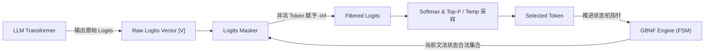

> 维特根斯坦在《逻辑哲学论》中写过一句话：凡是可以说的，都可以清楚地说；凡是不能说的，就应该沉默。

# 语法锁死的代价：当 GBNF 遇上 Logits 掩码，大模型为什么会“零 Token 沉默”？

*从 GBNF 状态机、Logits 强行掩码，到生产环境结构化输出的“松弛设计”——资深架构师如何拆解本地 LLM 的 Premature EOS*

今天上午在做博客自动化流水线的并发巡检时，值班终端上跳出了一截极其反直觉的错误堆栈：

```text
json.decoder.JSONDecodeError: Failed to parse or repair JSON from ollama output: : line 1 column 1 (char 0)
```

如果你经常处理后端服务与大模型的对接，看到 `JSONDecodeError` 可能会下意识地以为：模型是不是漏闭合了花括号？或者字符串里混进了未转义的反斜杠？

但翻开 OpenTelemetry 的分布式追踪和 Ollama 的底层网络交互日志时，令人头皮发麻的一幕出现了：
**HTTP 请求返回了标准的 `200 OK`，耗时整整跑了 3 秒的 Prompt 预处理（Prompt Eval），但模型实际吐出的正文长度是 0 —— 它连一个空格、一个换行都没有生成，`eval_count` 赫然写着 `0`。**

在耗费了数千 Token 的前置计算后，这个 20B 参数的本地开源模型在接到生成的发令枪时，瞬间缴械投降，直接抛出了终止符 `<eos>`。

这不是显存溢出（OOM），不是连接超时，更不是下游 Python 代码的反序列化 Bug。这是大模型在面对**语法强约束采样（Grammar-Constrained Generation）**时，发生的一种极其隐蔽的底层死锁——**Logits 掩码死锁与早退（Premature EOS）**。

如果你正准备在团队内部大规模落地本地 LLM、调用 Ollama / llama.cpp / vLLM 的结构化输出（Structured Outputs），或者正在为复杂 Agent 编写严格的 JSON Schema 契约，这篇文章或许能为你省下几十个小时的无谓排错。

---

### 导读：在这篇文章中，我们将穿透以下层次

1. **有限状态机（FSM）的暴政**：GBNF（Grammar BNF）文法规则在 C++ 层面究竟如何运转？
2. **Softmax 之前的截杀**：Logits 动态掩码（Masking）机制与死锁发生的数学机理。
3. **`format: schema` 与 `format: "json"` 的本质分歧**：单向死轨 vs. 动态弹性。
4. **架构第一性原理**：为什么在工程实践中，“硬文法强锁”往往会演变成生产灾难？
5. **2026 工业级自愈设计**：如何通过两段式降级与 `json-repair` 打造坚不可摧的结构化管道。

---

## 一、 戴上镣铐的普罗米修斯：什么是 GBNF 文法？

大语言模型（LLM）从本质上讲，是一个**高维空间上的自回归自注意力序列预测器**。它并不“懂得”语法，它只是根据上下文计算下一个 Token 在词表（Vocabulary）上的离散概率分布：

$$P(w_t \mid w_1, w_2, \dots, w_{t-1}) = \text{Softmax}(z_t)$$

但在生产业务中，我们几乎无法容忍“自由发挥”。如果一个 Agent 需要调用 SQL 查询或返回固定的 API 结果，我们要求输出必须是百分之百合法的 JSON。

为了驯服这种随机性，现代推理引擎（如 `llama.cpp` 及封装它的 `Ollama`）引入了一套经典编译原理工具：**GBNF（Grammar Backus-Naur Form，巴科斯范式扩展）**。

### 1. GBNF 是如何介入推理底层的？

GBNF 并不是在模型生成完一段话后再去校验的“质检员”，而是一个**在每一次采样前硬生生修改神经元激活动态的“监工”**：



1. **预编译阶段**：当你把一个 JSON Schema（例如包含 `{"type": "object", "properties": {"markdown": {"type": "string"}}}`）传给 Ollama 时，底层会将这个 Schema 解析并编译为一个由 GBNF 规则表示的**确定性有限状态机（DFA / Pushdown Automaton）**。
2. **解码每一步（Per-Token Decoding）**：
   - 状态机指针处于状态 $S_t$；
   - GBNF 引擎迅速计算出：在当前状态 $S_t$ 下，下一个字符**允许**出现哪些符号集合 $C_{\text{valid}}$；
   - 词表中的每一个 Token（假设词表大小为 32,000 或 150,000），只要其文本前缀**不符合** $C_{\text{valid}}$，其对应的 Logit 值就会被强行改写为负无穷大：
     $$z_i' = -\infty \quad (\forall i \notin \text{ValidTokens}(C_{\text{valid}}))$$
3. **状态跃迁**：经过 Softmax 之后，只有合法的 Token 拥有非零概率。选定 Token 后，状态机前进一步，等待下一个时刻。

这套机制在学术上被赞誉为“无缝的保证（Guaranteed Syntax）”，但在复杂的现实面前，它恰恰埋下了死锁的引信。

---

## 二、 杀机四伏的第 0 步：Logits 掩码死锁与 Premature EOS

现在，我们把镜头推到微观的神经元与采样器前，看看今天上午那个空字符串 `""` 是如何在第 0 步诞生的。

假设我们给本地模型下达了指令：“请重写并润色这篇技术博文的第一节”，并强加了如下严格的 `format: schema`：

```json
{
  "type": "object",
  "properties": {
    "markdown": { "type": "string" }
  },
  "required": ["markdown"]
}
```

### 1. 状态机在第 0 步的严酷法令

状态机在未收到任何生成字符时，处于初始状态 $S_0$。
根据 JSON 对象的文法规范，一个合法的 JSON Object 必须以左花括号 `{` 开始（允许前置空白符）：

$$C_{\text{valid}}(S_0) = \{ \text{'\{'}, \text{' '}, \text{'\textbackslash t'}, \text{'\textbackslash n'} \}$$

**也就是说，在词表成千上万个 Token 中，只有以空白或 `{` 开头的极少数 Token 是被允许活下来的。**

### 2. 模型内在认知与外在枷锁的撞车

然而，现代开源模型（特别是 14B~20B 规模的模型，或者受 DeepSeek-R1、Qwen-Thinking 影响的推理模型）在接收到一篇长达上千字的文章时，其注意力机制被强烈的先验模式主导：

- **偏好 A（思考先行）**：如果模型自带思维链（Chain of Thought），它最想吐出的第一个 Token 是 `<think>`。
- **偏好 B（自然语言习惯）**：如果模型对英文提示习惯性礼貌，它最想吐出的是 `Sure`、`Here` 或 `Below`。
- **偏好 C（直接作答）**：如果文章开篇是一句强烈的金句，模型注意力最想顺理成章地续写金句文字（如 `在`、`上周`、`#`）。

在模型的未约束原始 Logits 分布中：
- `<think>` 的概率可能是 $82\%$；
- `Sure` 或自然文字的概率可能是 $17\%$；
- **而以 `{` 开头的冷冰冰的 JSON 起始符，在此时的注意力上下文里，概率可能连 $0.001\%$ 都不到！**

### 3. 掩码陷阱与逃生门崩溃

当 GBNF 监工手起刀落，将除了 `{` 之外的 $99.999\%$ 的概率质量全部强制归零（赋值为 $-\infty$）时：

```
原始概率分布 (Raw Logits):
[ <think>: +14.2 ] [ Sure: +11.8 ] [ 上周: +9.4 ] ... [ {: -6.3 ] ... [ <eos>: -1.2 ]
                          │
                   GBNF 强制过滤
                          ▼
掩码后概率分布 (Masked Logits):
[ <think>: -inf  ] [ Sure: -inf  ] [ 上周: -inf  ] ... [ {: -6.3 ] ... [ <eos>: -1.2 ]
```

看到了吗？
在被清洗后的世界里，原本代表“句子终结”的特殊标记 **`<eos>`（End-of-Sequence）**，因为在许多量化词表和采样实现中没有被文法强行禁用（或者作为解析卡死时的合规逃生出口），它的 Logit（虽然不高，比如 `-1.2`）**竟然瞬间变成了全局最高概率！**

采样器检测到合法的文本内容极其反自然，而终止符 `<eos>` 成为了数学上最合理的解。
模型在第一步就击中了 `<eos>`。

**结果诞生了：**
- 生成 Token 数：`eval_count: 0`
- 输出内容：`""`（空字符串）
- 终止原因：`done_reason: "stop"`

下游的 Python 代码拿到的不是一个错误的 JSON，而是一具“未曾出生的尸体”。

---

## 三、 `format: schema` vs `format: "json"`：两种哲学的碰撞

在 Ollama 和各类现代推理 API 中，通常提供两种开启结构化输出的方式。许多工程师误以为它们只是“传字典还是传字符串”的语法糖，但它们底层的抗脆弱性完全不可同日而语：

| 维度 | `format: schema`（严格模式） | `format: "json"`（宽松语法模式） |
| :--- | :--- | :--- |
| **底层实现** | 完整的 GBNF / 正则上下文无关文法状态机 | 仅跟踪基本 JSON 括号栈与基础标点 |
| **首 Token 约束** | 极严苛：强制首字符为 `{` 或特定前缀 | 宽松：只要在输出流中构造出合法 JSON 即可 |
| **思维链（CoT）兼容性** | **极差**。会直接扼杀 `<think>` 标签，导致思考型模型彻底崩溃 | **优秀**。允许模型先在思考区推理，再输出 JSON 块 |
| **Logits 掩码死锁率** | **高**（尤其在 $\le 20\text{B}$ 本地量化模型上高发） | **极低**（几乎不会发生零 Token 早退） |
| **字段完整性保证** | 理论百分之百，实际常因死锁吐空 | 依靠模型遵循能力，存在字段漏填风险 |
| **吞吐开销（Latency）** | 高。每个 Token 遍历复杂文法规则表 | 低。极轻量级的括号匹配过滤 |

### 资深架构师的洞察：
`format: schema` 试图在**生成时刻（Generation Time）**解决一切数据校验问题。这是一种典型的“确定性工程对概率学模型的霸权”。
当模型的参数体量不够庞大（如 GPT-4 能够轻松驾驭，而 14B/20B 本地模型很容易注意力解构），这种强加的静态文法就会变成勒死模型的绞索。

---

## 四、 架构第一性原理：为什么“强约束”反而导致“系统脆弱”？

在计算机体系结构与软件设计中，有一个被反复验证的不变式：
**系统对抗不确定性的能力，从来不来自于更硬的栅栏，而来自于纵深的弹性。**

在传统软件工程中，Parnas 信息隐藏和契约式设计教会我们：入参校验要严格（Strict Input Validation）。
但当我们面对的是一个具有随机探索特性的**概率生成器**时，把防御做成“硬文法强锁”，就会引发经典的**对称性破缺**：

```
                    【硬文法强锁模式】
Prompt ──> GBNF 强制首字符必须为 { ──> 模型注意力冲突 ──> 触发 EOS 早退 ──> 全局崩溃

                    【弹性韧性架构】
Prompt ──> format: "json" (宽松语法) ──> 模型自如思考并生成 ──> 下游 json-repair 自愈 ──> 业务平稳
```

当我们在上游用 GBNF 抹杀了模型 $99\%$ 的探索空间，系统看似在语法上滴水不漏，实际上却把所有的风险压缩成了一个极端风险：**不是完美输出，就是暴毙为空。**

而在生产环境中，“字段格式轻微瑕疵”往往只需要几毫秒的启发式代码或 `json-repair` 就能无损修复；而“模型根本没输出任何东西”，却会导致耗时数分钟的 GPU 算力完全作废。

---

## 五、 2026 工业级自愈设计：两段式降级流水线

在真正高可用的 Agent 与博客生成流水线中，我们应该如何构建兼具“高合规性”与“零死锁”的系统？

答案就是：**先验软引导 + 运行时弹性降级 + 后验容错自愈（Soft Guidance + Graceful Fallback + Resilient Repair）**。

### 1. 架构流转图

```mermaid
flowchart TD
    Req[Editorial Task / Section Prompt] --> TryStrict[Attempt 1: Strict GBNF (format: schema)]
    TryStrict --> CheckOutput{Is output empty or eval_count == 0?}
    
    CheckOutput -->|No: Has Content| RobustParser[Robust Parser: Fast Path -> json-repair -> Regex]
    CheckOutput -->|Yes: Deadlock Detected!| FallbackFree[Attempt 2: Graceful Fallback to format: 'json']
    
    FallbackFree --> SystemPromptInject[Inject JSON Schema into System Prompt]
    SystemPromptInject --> LowerTemp[Lower Temperature to 0.5]
    LowerTemp --> CallFreeMode[Free JSON Mode Generation]
    
    CallFreeMode --> RobustParser
    
    RobustParser -->|Parsed Object| Success[Proceed to Redaction & Review]
    RobustParser -->|Pure Markdown Fallback| RecoverSingleKey[Map text to {'markdown': text}]
    RecoverSingleKey --> Success
```

### 2. 核心防御实现代码

在 [`ai/mcp/llm_core/llm_core/structured.py`](file:///home/phray/ws/todd/effectiveCodingBase/ai/mcp/llm_core/llm_core/structured.py) 的 `OllamaProvider` 中，我们为死锁安装上了自动脱困弹簧：

```python
class OllamaProvider:
    name = "ollama"
    
    def complete_json(self, system, user, schema, *, temperature=None):
        # 1. 首次尝试：使用严格文法约束 format: schema
        body = {
            "model": self.model,
            "stream": False,
            "format": schema,
            "options": {"num_ctx": self._num_ctx},
            "messages": [
                {"role": "system", "content": system},
                {"role": "user", "content": user}
            ]
        }
        if temperature is not None:
            body["options"]["temperature"] = temperature
            
        resp = httpx.post(f"{self._base_url}/api/chat", json=body, timeout=self._timeout)
        resp.raise_for_status()
        b = resp.json()
        raw_content = (b.get("message", {}).get("content") or "").strip()
        eval_count = b.get("eval_count", 0)

        # 2. 核心 SME 守卫：检测 Logits 掩码死锁 / 零 Token 早退
        if not raw_content or eval_count == 0:
            logger.warning(
                "Ollama GBNF mask deadlock detected (eval_count=%s, empty content). "
                "Executing graceful fallback to format='json' with prompt schema injection...",
                eval_count
            )
            # 降级策略：撤销硬文法，改为宽松 json 模式，将 Schema 注入系统提示词
            fallback_system = f"{system}\n\nReturn a single JSON object strictly matching:\n{json.dumps(schema)}"
            fallback_body = dict(body)
            fallback_body["format"] = "json"  # 释放首字符强锁
            fallback_body["messages"] = [
                {"role": "system", "content": fallback_system},
                {"role": "user", "content": user}
            ]
            # 稍微降低温度以帮助模型收敛
            fallback_body["options"]["temperature"] = min(temperature or 0.7, 0.5)
            
            resp = httpx.post(f"{self._base_url}/api/chat", json=fallback_body, timeout=self._timeout)
            resp.raise_for_status()
            b = resp.json()
            raw_content = (b.get("message", {}).get("content") or "").strip()

        # 3. 依靠下游 json-repair 和 parse_json_result 消除一切轻微格式缺陷
        data = parse_json_result(raw_content, schema=schema, provider_name="ollama")
        return (data, {"tokens_in": b.get("prompt_eval_count"), "tokens_out": b.get("eval_count")})
```

---

## 六、 总结与立刻可以做的事

回顾维特根斯坦的那句名言：“凡是可以说的，都可以清楚地说；凡是不能说的，就应该沉默。”

在神经网络的生成世界里，当我们用过于狭隘的文法去定义“什么能说”时，模型不仅无法“清楚地说”，反而会因为自由度的瞬间归零而直接陷入“永久的沉默”。

### 立刻可以做的事：

1. **检查团队内所有本地大模型调用**：
   - 搜寻所有的 `format: {...}` 或 `response_format: {"type": "json_object"}`。
   - 对返回值加上 `if not content or eval_count == 0` 的零 Token 异常熔断监控。
2. **停止对本地小模型使用多层嵌套的 GBNF 强约束**：
   - 对于 $\le 20\text{B}$ 的模型，优先采用 `format: "json"`。
   - 让模型保留自然思考（CoT）与生成的空间，把反序列化的脏活留给 `json-repair`。
3. **在生产日志中建立 Traceback 心智模型**：
   - 不要一看到 `JSONDecodeError` 就责怪解析库；
   - 先看传入解析器的原始字符串长度（Length）与状态码。看空不看错，是区分 Senior 与 Principal 的分水岭。

*约束是为了守护边界，但唯有留出弹性的留白，智能才得以安全涌现。*
