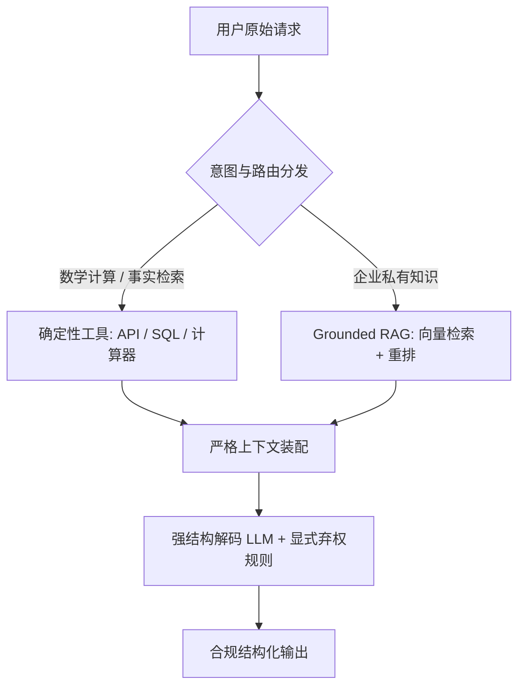
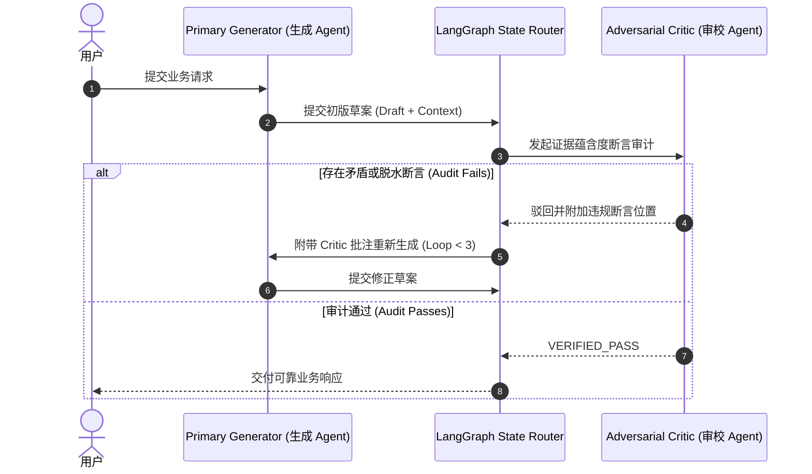
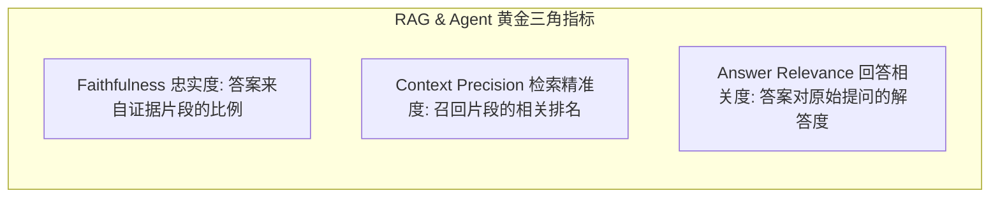
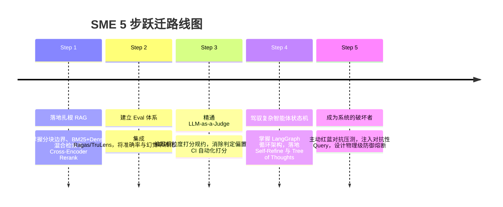

> “凡是可以说的，都可以清楚地说；凡是不能说的，就应该沉默。” — 路德维希·维特根斯坦《逻辑哲学论》

# 大模型“幻觉”不是 Bug，而是概率模型的固有特性：全生命周期工程治理与 SME 进阶实战

*从被动的 Prompt 许愿，到三层主动防御架构与自动化 Evals 门禁——如何跨越从初级调用者到领域专家（SME）的工程鸿沟*

在阿尔卑斯山脉的意大利与瑞士边界，曾有一支部队在行军途中遭遇暴风雪。大雪封山、通信断绝、补给告罄，全连陷入了漫天冰雪的绝望绝境。就在大家几乎放弃时，一名士兵在一处废弃哨所的角落里找到了一张泛黄折损的古老地图。尽管上面的文字是谁也看不懂的古拉丁文，但凭借图纸上绘制得极其精密详尽的等高线、山脊折角与峡谷走向，濒临溃散的队伍重新燃起了生机。士兵们紧紧攥着这张地图，对照着周围隐约的山势轮廓，边走边摸索修正路线，历经数个昼夜，奇迹般地走出了那片死亡雪谷。

脱险归营后，年轻的指挥官将这张地图视若神明、奉为救命奇迹精心装裱。直到多年后，一位精通古拉丁文的资深地理学家受邀参观，端详良久后哭笑不得地揭开了真相：
“长官，这根本不是阿尔卑斯山，这是几百公里外匈牙利和奥地利平原的一张古老地图。”

为什么一张完全风马牛不相及的虚假地图，不仅没有让这支部队丧命，反而让他们在绝境中重获信心？

组织行为学与认知科学（Karl Weick）早就给出了深刻的解释：人类面对混乱与未知时，最深层的恐惧从来不是道路的艰险，而是“没有方向与失控感”。只要眼前出现了一套逻辑自洽、线条清晰、看起来极其笃定的秩序系统，人类大脑就会本能地抓住它，并产生巨大的掌控感与安全感错觉。

走出绝境的士兵之所以能活下来，是因为他们在现实中每迈出一步，双脚都踏在真实的积雪与岩壁上，物理世界的反馈逼着他们不断动态对账与纠偏；**但大语言模型（LLM）没有物理身体，更没有与客观世界直连的对账通道。**

当你向大模型提问时，它递到你面前的每一次回答，本质上就是**那张“奥地利的虚假地图”**。

正如我在阅读脑科学与人工智能常识时记下的那段反思：
> “常识是我们与 AI 最本质的区别。AI 之所以仍然会产生幻觉，因为它缺乏常识。它认为一切都是可解的，而人类知道自己不知道，甚至有自省能力的人知道‘自己不知道自己不知道’。拥有常识有助于我们在面对未知的情况下，做出更为明智的选择。”

大语言模型（Transformer）底层的损失函数从立项第一天起，就只奖赏“句法流畅度”与“概率层面的合情合理（Plausibility）”。它生来就没有人类那种抓抓头说“对不起，这题我真不知道”的生理羞耻感；作为自回归补全器，它认定“一切提问都必须被连续输出”。当提示词撞入它的认知死角时，它会以 0.98 的自信度、严密的法言法语和无可挑剔的排版，当场为你手绘一张极其逼真的“奥地利地图”。

在聊天界面里，一张编造的地图或许只是个让人会心一笑的段子；但在企业级金融、核心风控或生产调度系统中，把一张未经校验的“幻觉地图”直接接入业务决策链路，等待整套架构的只能是坠入深渊。

**“幻觉”不是系统偶然出现的逻辑 Bug，而是概率自回归模型最核心的造物机制。** 治理幻觉，绝不能靠在 Prompt 里大声疾呼“请不要撒谎”，而必须在系统设计、运行期审校与自动化 Evals 门禁之间，构筑一套不依赖模型道德自觉的确定性工程防线。

## 你将从本文获得什么

- **第一性原理透视**：理解自回归生成的目标函数与参数化记忆（Parametric Memory）的本质，彻底分清概率拟合与事实真值的鸿沟。
- **三层工程防御全景图**：掌握设计期（预防）、执行期（纠偏）、运维期（度量）的系统级治理方案，告别玄学 Prompt Engineering。
- **可直接落地的工业级代码与架构**：获得包括强模式解码、基于 LangGraph 的 Generator-Critic 审校状态机，以及 Ragas 核心指标 CI 门禁的参考实现。
- **SME 领域专家的跃迁蓝图**：从基础 RAG、评测基准搭建，到对抗性红蓝压测（Red Teaming）的 5 步专业进化指南。

## 一、根因解构：参数化记忆的“庄周梦蝶”

普通工程师在面对幻觉时，习惯将其视为“待修复的 Bug”；而资深架构师则清楚，**幻觉是自回归大语言模型的固有特性，甚至可以说是它具备非凡联想与泛化能力的孪生阴影**。

### 1.1 自回归概率补全的数学底色

主流大型语言模型的核心训练与推理任务极其单纯：

$$P(w_1, w_2, \dots, w_T) = \prod_{t=1}^T P(w_t \mid w_1, w_2, \dots, w_{t-1})$$

在每一个时间步 $t$，模型都在计算词表（Vocabulary）上所有 Token 的条件概率分布。它的优化目标是最小化交叉熵损失（Cross-Entropy Loss），本质是在奖赏“符合人类语言分布的合理性（Plausibility）与流畅度（Fluency）”，而非“现实物理世界的本体真值（Ontological Truth）”。

模型所有的“知识”，都以浮点数权重的形式弥散在多层 Transformer 的参数化记忆（Parametric Memory）中。当用户给出一个提示词时，模型并非在只读数据库中执行精确的 SQL 键值查找，而是在高维流形空间中进行概率轨迹积分。

当查询落入模型参数分布稀疏的边缘地带时，由于自回归机制必须不间断地输出下一个 Token，模型在数学层面的唯一出路就是选择当前分布下概率最高、句法最通顺的 Token 序列。于是，一段逻辑严密、语气坚定却完全虚构的内容便自然而然地诞生了。

### 1.2 信息单向性与认知投影

在系统架构中，存在一个核心概念模型：**信息单向性（Information Directionality）**。

大模型并不能主动访问物理世界，它所有的外部输入在进入注意力机制前，都被投影为纯粹的向量表征。它无法感知“客观事实是否存在”，它只能计算“这个词接在后面是否足够自然”。

| 比较维度 | 传统软件工程 Bug | 大模型幻觉（Hallucination） |
|---|---|---|
| **本质归因** | 确定性代码逻辑缺陷、边界未处理、空指针异常 | 自回归概率采样的数学必然性、参数化记忆混淆 |
| **状态可见性** | 堆栈跟踪清晰、内存断点可复现、执行路径确定 | 隐空间权重激活交织、每次采样具随机性、机理不可见 |
| **修复范式** | 补丁代码、调整分支条件、回归单元测试 | 物理隔离虚构空间、动态上下文注入、外部工具接管 |
| **防御确定性** | 修复后 100% 杜绝同类输入崩溃 | 依靠概率控制与多层防御网将错误率降至极低区间 |

📌 **核心洞见 1**：不要把大模型当成全知全能的搜索引擎或数据库，它本质上是一台高维概率补全器。你无法通过在提示词里大声疾呼“不准撒谎”去扭转概率分布的数学规律；治理幻觉的唯一出路是建立系统工程的物理围栏。

> **本章哲学**：将确定性留给代码与外部事实，将概率性留给语言理解与概括。

## 二、预防篇（系统设计）：在编译期将确定性锚定在上下文之中

既然参数化记忆不可靠，最彻底的工程手段就是在系统架构设计层面，彻底剥离模型依赖内部权重猜测事实的权力。



### 2.1 确定性工具执行：让计算与客观事实重归代码

绝不应当由大模型的参数权重去计算数学公式、统计数据库指标或查询实时天气。

```python
from typing import Annotated
from pydantic import BaseModel, Field

class RefundEligibilityQuery(BaseModel):
    policy_id: Annotated[str, Field(description="企业保单唯一编号，例如 POL-2026-X89")]
    region_code: Annotated[str, Field(description="ISO 地区编码，例如 AU, US, CN")]
    incident_timestamp: Annotated[int, Field(description="事故发生 Unix 时间戳")]

def check_refund_eligibility_tool(query: RefundEligibilityQuery) -> dict:
    """通过确定性核心微服务校验退款资格，模型仅负责提取结构化参数，严禁猜测政策。"""
    # 调用底层核心鉴权与保单结算系统
    return {
        "policy_id": query.policy_id,
        "eligible": False,
        "reason_code": "CROSS_REGION_EXCLUSION_SECTION_4",
        "official_ref": "https://internal.policy/doc/2026/section-4"
    }
```

通过严格的 Tool Calling 架构，大模型在此处仅充当“自然语言参数提取器”，具体的政策真值与计算判定完全交由运行在沙箱或微服务中的确定性代码执行。

### 2.2 扎根式 RAG（Grounded RAG）：上下文的物理围栏

扎根式 RAG 的架构原则非常严苛：**大模型不再是知识源，它只是只读上下文的翻译与归纳引擎**。

在生产落地中，普通 RAG 与工业级 Grounded RAG 的分水岭体现在以下细节：
1. **语义分块与重叠（Chunking & Overlap）**：放弃简单的固定字符切分，采用基于 Markdown 标题层级或语义边界切分，保留上下文前置父标题路径。
2. **混合检索（Hybrid Search）**：密集向量（Dense Vector）捕获语义相似度，稀疏索引（BM25）死锁专业术语与代码编号。
3. **Cross-Encoder 深度重排（Reranking）**：将初筛的 Top-50 片段通过交叉编码器打分收敛至 Top-3，彻底剔除噪音注入。

装配 Prompt 时，使用防逃逸的 XML 标签建立物理隔离：

```text
<system_directive>
You are an evidence-bound summarizer. You must strictly synthesize the answer based ONLY
on the verified context between <verified_context> and </verified_context>.
If the answer cannot be explicitly derived from the text, you MUST trigger the abstain rule.
Do NOT use prior knowledge or extrapolate beyond the provided text.
</system_directive>

<verified_context>
{reranked_context_chunks}
</verified_context>

<user_query>
{user_question}
</user_query>
```

### 2.3 强模式结构化约束：通过语法树压缩自由度

当允许大模型自由输出自由格式的 Markdown 时，它的采样空间覆盖几万个 Token 的排列组合，极易在无拘无束的文本流中溜进幻觉。

现代推理引擎（如 Outlines、vLLM 的 Guided Decoding 以及 OpenAI/Anthropic 的 Structured Outputs）通过在采样阶段进行 Logit Masking，构建了基于上下文无关文法（CFG）的状态机。任何不符合模式定义的 Token，在数学上其概率直接被强行置为零（$-\infty$）。

```python
from pydantic import BaseModel, Field
from typing import List, Literal

class ClaimVerificationResponse(BaseModel):
    decision: Literal["APPROVED", "REJECTED", "INSUFFICIENT_INFORMATION"] = Field(
        description="严格决策分类，无中间模糊态"
    )
    direct_quote: str = Field(
        description="必须逐字逐句摘自 context 的原文引用，不允许修改任何标点"
    )
    confidence_score: float = Field(
        ge=0.0, le=1.0, description="模型自评证据匹配度"
    )
    missing_elements: List[str] = Field(
        default_factory=list, description="如果信息不足，列出缺失的关键证据项"
    )
```

### 2.4 显式弃权规则：赋予模型沉默的至高权力

维特根斯坦的哲理在此处成了系统健壮性的第一道硬性防线。模型之所以信口开河，是因为提示词往往默认要求它“给出一个解答”。

在工程规范中，必须在系统指令中引入**显式弃权契约（Explicit Abstain Contract）**：

> “当提供的上下文未包含回答所需完整依据时，输出预设的保留字 `STATUS: ABSTAIN_NO_GROUNDED_DATA`。在此场景下，输出任何猜测性句子均视为最高级系统崩溃。”

| 预防机制 | 核心防御目标 | 引入的开销与延迟 | 残留防御盲区与破局思路 |
|---|---|---|---|
| **确定性工具** | 数值运算、状态判定、实时数据 | 额外 API 网络 I/O，50-200ms | 参数提取失真；需结合 Pydantic 字段级校验 |
| **Grounded RAG** | 行业与企业专业领域知识脱靶 | 检索向量检索与重排耗时，100-300ms | 检索漏检（Recall 低）；需通过混合检索解决 |
| **强结构化输出** | 格式逃逸、自由发挥、长篇发散 | 极小，引导解码有微量推理开销 | 字段内依然可能出现伪造；需限制字段长度与枚举值 |
| **显式弃权规则** | 强制回答导致的无中生有 | 零开销 | 模型过度防御（False Abstain）；需通过黄金测试集校准 |

> **本章哲学**：凡是能用代码确定性解决的问题，绝不交给概率；凡是上下文未包含的事实，让模型学会优雅地闭嘴。

## 三、纠偏篇（运行期执行）：状态机驱动的双 Agent 审校环

在复杂推理与多步智能体执行中，哪怕前置了严格的 RAG，大模型在综合长文本时仍可能发生微妙的概念扭曲（如将“A 允许在非高峰期操作”篡改为“A 允许无限制操作”）。

让同一个大模型在原对话历史中“反思自我（Self-Refine）”往往是徒劳的——它会被自己的初始采样概率引导，产生强烈的**确认偏差（Confirmation Bias）**。

### 3.1 审校分离原则与自然语言推理（NLI）

真正的运行期纠偏必须建立在**审校分离（Auditor-Actor Separation）**的架构之上：
- **Primary Generator（主生成器）**：负责理解用户意图，组装上下文并撰写回答草稿。
- **Adversarial Critic（对抗审校器）**：完全隔离生成过程的思考链，只拿到两份文本——原始检索证据和生成草稿。它的唯一任务是对草稿中的每一句话进行自然语言推理（Natural Language Inference）审查，判定其与证据的关系是“蕴含（Entailment）”、“中立（Neutral）”还是“矛盾（Contradiction）”。



### 3.2 基于 LangGraph 的审校状态机实战

下面是一个工业级的双 Agent 审校环实现代码，展示了如何用 LangGraph 将纠偏逻辑固化为确定性状态图：

```python
from typing import TypedDict, List
from langgraph.graph import StateGraph, END

class AgentAuditState(TypedDict):
    query: str
    context: str
    draft: str
    critic_verdict: str
    critic_notes: str
    revision_count: int

def generate_node(state: AgentAuditState) -> dict:
    """主生成节点：仅根据输入与检索上下文起草初稿"""
    prompt = f"Context: {state['context']}\nQuery: {state['query']}\nDraft a factual answer:"
    # 模拟主模型生成
    draft = "根据保单第4条，用户在特定授权下可申请跨区赔付。"
    return {"draft": draft}

def critic_audit_node(state: AgentAuditState) -> dict:
    """审校节点：独立审计，不关心用户情绪，只核对事实蕴含关系"""
    audit_prompt = (
        f"Verified Source: {state['context']}\n"
        f"Claim to Verify: {state['draft']}\n"
        "Check every factual claim against the source. "
        "Output VERDICT: PASS if strictly supported, else FAIL with line reference."
    )
    # 模拟审校逻辑
    if "特定授权" in state['draft'] and "特定授权" not in state['context']:
        return {
            "critic_verdict": "FAIL",
            "critic_notes": "Claim mentions '特定授权' which is absent in source text.",
            "revision_count": state["revision_count"] + 1
        }
    return {"critic_verdict": "PASS", "critic_notes": "All claims grounded."}

def revision_router(state: AgentAuditState) -> str:
    """状态流转路由决策"""
    if state["critic_verdict"] == "PASS":
        return "deliver_result"
    if state["revision_count"] >= 3:
        return "fallback_abstain"
    return "refine_draft"

def refine_node(state: AgentAuditState) -> dict:
    """针对批注的定向修复节点"""
    fix_prompt = (
        f"Original Draft: {state['draft']}\n"
        f"Critic Feedback: {state['critic_notes']}\n"
        "Rewrite the draft strictly removing the unsupported statements."
    )
    # 模拟修正
    return {"draft": "根据保单第4条，用户跨区域赔付属于除外责任。"}

# 构建确定性状态图
workflow = StateGraph(AgentAuditState)
workflow.add_node("generator", generate_node)
workflow.add_node("critic", critic_audit_node)
workflow.add_node("refiner", refine_node)

workflow.set_entry_point("generator")
workflow.add_edge("generator", "critic")
workflow.add_conditional_edges(
    "critic",
    revision_router,
    {
        "deliver_result": END,
        "refine_draft": "refiner",
        "fallback_abstain": END,
    }
)
workflow.add_edge("refiner", "critic")
app = workflow.compile()
```

🩸 **血泪教训**：永远不要让主生成器兼职充当审校员。在同一个执行上下文中让大模型“自检”，其自恋倾向会促使它将之前的虚构继续圆下去；审校者的 System Prompt 必须独立存在，且其注意力必须被强制锚定在证据比对，而非对话友好性上。

> **本章哲学**：审校分离是软件工程几十年的基石。从双人 Code Review 到双 Agent 状态机，权力分立才有一致性。

## 四、运维与流水线篇（CI/CD & Evals）：没有度量就没有发布

管理学大师彼得·德鲁克曾断言：“你无法改进你无法衡量的东西。”

在传统微服务中，代码提交经过单元测试、集成测试与自动化冒烟测试；但在大模型应用中，很多团队甚至在修改了三行 System Prompt 后，仅仅在聊天 WebUI 里手动测试了两句，就敢把 Prompt 合并到主分支发布上线。这是现代软件交付体系中的裸奔。

### 4.1 黄金评测集（Golden Datasets）的工程化沉淀

告别随机手测的第一步，是构建版本化受控的黄金数据集：
1. **真实流量回捞**：从生产访问日志和历史客诉单中提炼 200 到 500 个高频典型问题。
2. **人工标注与真值绑定（Ground Truth Context）**：每个问题精确对应一段官方核准的权威知识片段。
3. **负向诱导样本（Adversarial & Unanswerable Queries）**：故意设计 30% 故意诱导模型猜测的提问（如“根据我们的政策，第99条特殊豁免条款是什么？”），验证系统是否能 100% 触发弃权规则。

### 4.2 Ragas 核心评测指标三剑客

在自动化评测框架中，严密的量化指标替代了工程师的主观“感觉良好”：



- **Faithfulness（忠实度/真实度）**：
  $$\text{Faithfulness} = \frac{|\text{被检索上下文严格支持的断言数}|}{|\text{生成回答中的全部断言总数}|}$$
  该指标直接锁定幻觉率。任何低于 0.95 的输出，在工业生产线上都是不可接受的缺陷。
- **Context Precision（检索精准度）**：衡量检索阶段返回的 Top-K 结果中，真正有用的证据是否排在最前列，防止“迷失在中间（Lost in the Middle）”。
- **Answer Relevance（答案相关度）**：通过让评测模型根据生成的答案反向生成问题，计算反向问题与原始提问的语义 Embedding 相似度，防止模型在规避幻觉时“答非所问”。

### 4.3 工业级 LLM-as-a-Judge 与 CI/CD 质量门禁

在持续集成流水线中，我们使用推理能力更强、参数规模更大的权威模型（如 Claude 3.5 Sonnet 或 GPT-4o）充当严格的质检法官。

```python
# test_rag_pipeline_regression.py
import pytest
from ragas import evaluate
from ragas.metrics import faithfulness, answer_relevance
from datasets import Dataset

# 模拟由 CI 触发的 200 条黄金测试样本
golden_dataset = Dataset.from_dict({
    "question": ["跨区域退款政策是什么？", "未提供凭证能否极速理赔？"],
    "contexts": [
        ["保单条款明确规定：所有跨区理赔需返回投保属地审核，无即时闪退通道。"],
        ["理赔指引要求：所有理赔申请必须上传原始票据扫描件。"]
    ],
    "answer": [
        "跨区理赔必须返回投保属地审核，系统不提供即时闪退服务。",
        "不能，所有理赔均需上传原始票据凭证。"
    ]
})

def test_hallucination_rate_regression():
    """CI 门禁：任何 Prompt 或模型路由变更，忠实度不得低于阈值"""
    results = evaluate(
        golden_dataset,
        metrics=[faithfulness, answer_relevance]
    )
    
    score_faithfulness = results["faithfulness"]
    score_relevance = results["answer_relevance"]
    
    print(f"\n[CI Eval Results] Faithfulness: {score_faithfulness:.4f}, Relevance: {score_relevance:.4f}")
    
    # 严格门禁断言
    assert score_faithfulness >= 0.98, f"Faithfulness dropped below threshold! Current: {score_faithfulness}"
    assert score_relevance >= 0.90, f"Answer relevance dropped below threshold! Current: {score_relevance}"
```

📌 **核心洞见 2**：在现代企业级 AI 系统中，幻觉率应当作为与服务可用性（99.99%）等同对待的 SRE 错误预算（Error Budget）。没有 CI 自动化评测流水线护航的模型上线，与不写单元测试直接在生产数据库跑脚本没有本质区别。

> **本章哲学**：资深工程师看 Prompt 效果，架构师看 Eval 波动曲线与 CI 自动化阻断率。

## 五、成为 SME 的进阶之路：从调用者到架构师的 5 步蜕变

从只会调用第三方 API 的初级开发者，到成为团队中不可替代的领域专家（Subject Matter Expert, SME），必须跨越从“概念理解”到“工业落地”的五重进阶。



### 5.1 实操进阶清单

1. **第一步：亲手写一个工业级 Grounded RAG 管道**
   不要依赖高度封装的现成黑盒框架。亲手使用底层客户端实现分块策略（Chunking）、语义相似度计算与混合检索（Hybrid Search）。亲身体验检索召回率（Recall）下降是如何直接引发下流模型开始参数化记忆臆造的。
2. **第二步：把度量框架搬进日常工程**
   全面拥抱 Ragas、TruLens 或 LangSmith。在日常开发中，用指标分数说话。不再说“我觉得这个回答更生动了”，而是明确指出“该 Prompt 迭代将 Faithfulness 从 0.91 提升至 0.97，同时将上下文延迟控制在 180ms 以内”。
3. **第三步：精通“以模型审模型（LLM-as-a-Judge）”**
   熟练掌握如何撰写强约束的评测判定词。深入理解大模型作为法官时的固有偏置——位置偏置（Position Bias）、冗长偏置（Verbosity Bias）与自我偏好偏置（Self-preference Bias），并设计交换对比与归一化消除这些系统误差。
4. **第四步：攻克复杂智能体拓扑结构**
   跳出简单的单向链式调用（Linear Chain），深入学习高级验证模式：
   - **Self-Refine（自我精炼）**：多轮定向纠错。
   - **Tree of Thoughts（ToT, 思维树）**：分支探索与前瞻评估，对不可行路径执行主动剪枝。
   - **状态图编排**：利用 LangGraph 编写包含持久化（Checkpointer）、条件跳转与人工干预（Human-in-the-loop）的高可用架构。
5. **第五步：主动做自己系统的“破坏者”（Break Your Own Systems）**
   顶尖的 SME 往往是最好的黑客。在发布前主动进行红蓝对抗（Red Teaming）：
   - 构造越狱诱导词（Prompt Injection）；
   - 输入指鹿为马的事实陷阱；
   - 构造模糊不清、故意缺少关键约束的提问。
   观察系统是否能严格坚守“显式弃权”和“强模式拦截”，并由此反哺强化系统边界。

### 5.2 工程师成熟度进化矩阵

| 能力维度 | 初级调用者（Prompt Tinkerer） | 资深 AI 工程师（Senior AI Engineer） | SME 领域专家架构师（Principal SME） |
|---|---|---|---|
| **面对幻觉的认知** | 认为是模型质量差，频繁更换底模 | 意识到是系统工程问题，开始挂载 RAG 与 Prompt 守卫 | 从概率模型第一性原理出发，视其为需系统治理的物理特性 |
| **防御实现手段** | 增加全大写的 System 警告词 | 落地基于 Pydantic 的强模式输出与标准 RAG | 构建多 Agent 审校环、状态图拦截与确定性计算下沉 |
| **质量验证方式** | 每次修改在 WebUI 随机肉眼测试 3 轮 | 拥有简单的测试脚本，手动查看输出对比 | 黄金测试集驱动，CI/CD 自动化门禁拦截，基于 Ragas 统计治理 |
| **系统健壮性设计** | 无弃权机制，要求模型必答 | 编写“若不知道请说不知道”的普通规则 | 设定显式弃权 Token，熔断降级路由，可量化容错预算 |

> **本章哲学**：初学者把模型当大脑，资深者把模型当组件，而 SME 将整个系统视为对抗熵增的精密机械。

## 六、🧭 举一反三：从分布式共识看 AI 系统可靠性

> **Generalize**：在计算机系统设计史上，我们并非第一次面对“不可靠组件”。传统的分布式系统（如 Paxos、Raft 或拜占庭容错 PBFT）从一开始就假定网络会丢包、节点会宕机甚至恶意伪造信息。大语言模型就是分布式网络里一个算力极高、但天生带有拜占庭行为特征的“不可靠节点”。

治理大模型幻觉的本质，就是重走一遍分布式系统的容错哲学：**绝不建立对单一节点的绝对信任，而是在节点外层构建状态机、审查机制与多数派共识**。


## 立刻可以做的事

1. **今天下午**：打开你正在维护的系统提示词，删掉那些带有情绪化的 `PLEASE BE ACCURATE`，换上一条带有确定性错误编码的显式弃权规则：`STATUS: INSUFFICIENT_CONTEXT`，并在网关层对该 Token 设置告警捕获。
2. **本周内**：在生产数据库中筛选出最近遭遇的 20 个因事实偏差引起的工单，写成一个结构化的 `golden_eval_v1.json`，并将它们作为最基础的本地断言测试套件。
3. **下周启动**：将核心业务 API 的自由字符串返回全面重构为 Pydantic 强结构化输出（Structured Outputs），从根本上封堵字段级别的自由发散空间。

## 预告

下一篇特稿，我们将直接切入对抗性工程前沿——**《自动化 Red Teaming 深度实战：如何用变异测试压测你的 RAG 系统边界》**，拆解如何通过自制红队 Agent 批量生成恶意诱导样本，自动化寻找知识库中的逻辑断层。

---

*概率模型的魅力在于它的不可预知，而工程系统的尊严在于它的绝对可靠。优秀的工程师从不祈求模型不犯错，而是构建一个让错误无处遁形的精密熔断体系。*
