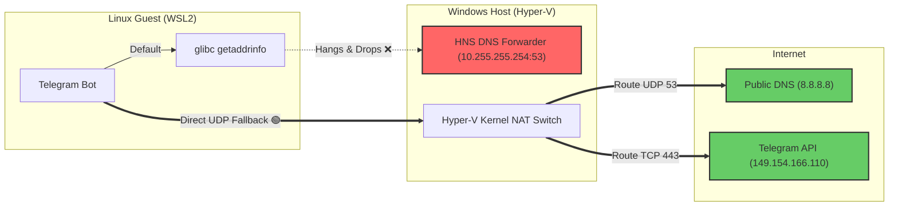

> 思想最好的归宿，永远不是被供奉，而是继续生长。

# Ping 得通、PID 活着，但你的服务已经死了

*从「假性存活」到「透明自愈」——一次跨越虚拟化网络断层的深度复盘*

周日上午 11:42，我给自己的 Telegram 机器人发了这条消息：

> `/quote 。思想最好的归宿，永远不是被供奉，而是继续生长。`

没有回复。连着发了两次，屏幕那头依然是一片死寂。

我第一反应是去查服务的状态。输入 `wsl_portal.sh status`，控制台弹出了一个看似完全健康的表格：

```
==========================================================================================
  Toddy Portal Services Status (WSL2)
==========================================================================================
ID  NAME                 PORT    STATUS    PORT-CHECK   PID    CPU   MEM      RESTARTS  UPTIME  
--  -------------------  ------  --------  -----------  -----  ----  -------  --------  --------
0   toddy-portal         3000    🟢 online  🟢 LISTENING  14577  0.1%  64.1 MB  16        14h 41m 
1   portal-api           8002    🟢 online  🟢 LISTENING  14628  0.0%  15.0 MB  15        14h 41m 
2   bank-chatbot-api     8001    🟢 online  🟢 LISTENING  14633  0.0%  14.4 MB  14        14h 41m 
3   mcp-gateway          8800    🟢 online  🟢 LISTENING  14716  0.2%  45.7 MB  17        14h 41m 
-   portal-telegram-bot  (poll)  🟢 online  N/A (bot)    15375  0.0%  32.7 MB  0         14:40:52
```

每一个指示灯都是绿的。`portal-telegram-bot` 赫然显示着 `🟢 online`，PID `15375`，存活时间整整 14 小时 40 分钟。

然而，当我切进日志文件 `telegram_bot.log` 时，眼前的景象却完全相反——屏幕被同一行报错淹没，整整刷了四个多小时：

```log
2026-11-08T07:34:00+1100 [telegram_bot] WARNING: Polling error: [Errno -3] Temporary failure in name resolution (retrying in 3.0s)
2026-11-08T07:34:13+1100 [telegram_bot] WARNING: Polling error: [Errno -3] Temporary failure in name resolution (retrying in 3.0s)
...
2026-11-08T11:42:06+1100 [telegram_bot] WARNING: Polling error: [Errno -3] Temporary failure in name resolution (retrying in 3.0s)
```

从早上 7:34 笔记本唤醒的那一刻起，每隔 13 秒，它就遭遇一次 DNS 失败。它没有崩溃，没有触发系统的 `Restart=always`，只是在死循环里不停重试。

**进程还活着，端口没冲突，监控显示全绿，但它已经聋哑了四个小时。**

这篇文章记录的就是这个极具隐蔽性的「僵尸故障」：它为什么会发生？为什么底层网络明明畅通却唯独 DNS 彻底瘫痪？以及更关键的——如何构建一套不被系统底座挟持、拥有透明自愈能力的应用级网络防线。

---

## 读完你会得到

- **一种识破「监控假象」的第一性直觉**：为什么 `kill -0 $PID` 是最懒惰也是最危险的健康检查，业务状态必须锚定在核心反馈环上。
- **一张剖析 WSL2 跨边界网络的 X 光片**：彻底搞清为什么宿主机休眠后 NAT 路由毫发无损，却唯独把 UDP 53 割裂成了黑洞。
- **一套零外部依赖的 Python 应用级自愈解法**：如何在不等待 glibc 超时、不依赖宿主机 DNS 的情况下，用纯标准库实现透明 fallback，并避开 `anyio` 传入 `bytes` 的隐蔽暗坑。
- **两个「以为修好了却没修好」的经典陷阱**：为什么改完 `wsl.conf` 不重启等于白改，为什么 `systemd=true` 会让 DNS 修复功亏一篑。

下面按「最有用的先讲」排序，不按我当时的迂回顺序——我走过的弯路，你直接跨过去就好。

---

## 一、最隐蔽的崩溃不是 Crash，而是「假死」

在软件可靠性工程里，挂掉的进程（Dead Process）从来不是最可怕的。Crash 会产生核心转储，会触发 systemd 或 supervisor 的自动拉起，会立刻让报警器炸响。

最可怕的是**僵尸服务（Zombie Service）**：它的心跳还在（PID 存在），内存占着，OS 调度着它，但它的有效吞吐量已经跌到了零。

把两个观测源摆在一起：

| 观测维度 | 表面看到的信号 | 背后的真相 | 结论 |
|---|---|---|---|
| **OS 进程表** (`ps`) | PID `15375` 存活 14h 40m | 进程在执行死循环 `sleep(3.0)` | 误判为健康 |
| **状态工具** (`status_table.py`) | `🟢 online` | 只测了 `kill -0 15375` | 假阳性（False Positive） |
| **真实业务** (`get_updates`) | 连续 4 小时无响应 | `api.telegram.org` 域名解析失败 | **业务已死** |

这就是典型的**对称性破缺（Symmetry Breaking）**：**「进程存在」与「服务可用」之间的对称性被打破了。**

当我们把健康检查简化为一个系统调用 `kill -0` 时，我们测量的实际上只是「操作系统还记得这个进程号」，而不是「这个进程还在为人类工作」。

> **第一性原则**：永远不要监控进程的呼吸，要监控进程的吞吐。如果一个轮询服务连续 N 次无法完成握手，它在语义上就已经死了。

---

## 二、扒开虚拟网络黑盒：为什么休眠唤醒只丢了 DNS？

为了搞清楚真相，我在 WSL 里做了一组经典的层级排查：

### 第一步：测 L3 路由与外网连通性
```bash
$ ping -c 1 8.8.8.8
64 bytes from 8.8.8.8: icmp_seq=1 ttl=109 time=13.2 ms
```
**结果**：ICMP 正常，外网 IP 直连延迟只有 13ms。底层的虚拟 NAT 交换机完全工作。

### 第二步：测 L4/L7 与 Telegram 服务器直连
既然无法解析域名，那绕过 DNS 直接用 Telegram 的官方公网 IP 发起 TLS 连接呢？
```bash
$ curl -I --resolve api.telegram.org:443:149.154.166.110 https://api.telegram.org
HTTP/2 302 
server: nginx/1.30.1
location: https://core.telegram.org/bots
```
**结果**：瞬时响应（sub-100ms），证书校验完美通过！这证明：
1. 宿主机与外网的 TCP/HTTPS 畅通无阻；
2. TLS SNI 证书协商毫无问题；
3. **唯一的断点，百分之百卡死在域名解析（DNS）这一环。**

### 第三步：对比查询系统默认 DNS 与公网 DNS

先看系统的 `/etc/resolv.conf`：
```
nameserver 10.255.255.254
```
这是 WSL2 启动时自动生成的虚拟网关地址，指向 Windows 宿主机的 Hyper-V 虚拟交换机。

分别对两个 DNS 发起查询：
```bash
# 1. 查宿主机虚拟代理：
$ dig @10.255.255.254 google.com +time=2 +tries=1
;; communications error to 10.255.255.254#53: timed out

# 2. 查公网 DNS：
$ dig @8.8.8.8 google.com +time=2 +tries=1
;; Query time: 8 msec
;; SERVER: 8.8.8.8#53(8.8.8.8) (UDP)
google.com.  IN  A  172.217.25.174
```

真相大白了：**`10.255.255.254:53` 彻底失联了，而 `8.8.8.8:53` 只需要 8 毫秒。**



### 为什么休眠会让宿主机 DNS 代理暴毙？

理解这一点需要**知人论世**——理解微软为什么要把 WSL 的 DNS 设计成这样：

WSL2 是跑在轻量级 Hyper-V 虚拟机里的独立 Linux 内核。为了让 Linux 能无缝解析 Windows 宿主机的内网域名（比如公司的内部域控、企业 VPN 分流），WSL 没有直接配置 `8.8.8.8`，而是在 Windows 宿主机端起了一个转发代理（Host Network Service, HNS），把虚拟网关 `10.255.255.254` 假扮成 DNS 服务器。

当 Windows 进入休眠（Hibernation/Modern Standby）时：
1. 宿主机的真实物理网卡（Wi-Fi 或 Ethernet）被断电注销；
2. 唤醒后，Windows 重新连接 Wi-Fi，获得了新的 DHCP Lease；
3. 然而，宿主机上的 HNS 虚拟 DNS 代理服务经常在此刻出现死锁、未重新绑定新网卡，或者防火墙规则未及时刷新；
4. 此时，WSL 内核发往 `10.255.255.254:53` 的 UDP 包会被静默丢弃；
5. 由于 glibc 的 `getaddrinfo` 默认具有 5 秒超时且重试 2 次的机制，每一个普通的域名请求都会在内核里白白卡死 10-15 秒，最后抛出 `[Errno -3] Temporary failure in name resolution`。

### 同一时刻，Windows 宿主机自己的 DNS 也未必幸免

这次排查过程中我还发现了一个有趣的事实：**不只是 WSL，Windows 宿主机自身的有线网络 DNS 也同时挂了。**

在 Windows 端用 PowerShell 诊断时，以太网适配器（`以太网`）状态显示 Connected、链路 1 Gbps，IP 地址 `192.168.0.200` 一切正常。但同时它还残留了一个 `169.254.226.32` 的 APIPA 地址——这是 Windows 在 DHCP 请求超时后自动分配的临时地址（Automatic Private IP Addressing），说明在某次唤醒时 DHCP 曾经失败过。

更关键的是，以太网和 WLAN 的 DNS 服务器都指向路由器 `192.168.0.1`，而路由器的 DNS 转发服务本身就不响应了：

```powershell
PS> Resolve-DnsName google.com
# 超时，无响应

PS> Resolve-DnsName google.com -Server 8.8.8.8
# 瞬间返回结果
```

`ping 8.8.8.8` 正常（延迟 11ms），说明底层网络畅通，但路由器的 DNS 转发功能在休眠唤醒后卡死了。**这意味着整台机器——无论是 Windows 原生进程还是 WSL 里的服务——都陷入了「能 ping 不能上网」的诡异状态。**

修复 Windows 端很简单：把以太网和 WLAN 的 DNS 服务器从路由器 `192.168.0.1` 改成公共 DNS `8.8.8.8` / `1.1.1.1`。路由器 DNS 的好处是局域网内有缓存加速和本地域名解析（比如 NAS 的 hostname），但缺点就是路由器 DNS 转发挂了所有设备都跟着瘫——对于开发者来说，公共 DNS 的稳定性收益远大于那点局域网缓存的便利。

---

## 三、不要把应用的命悬在 /etc/resolv.conf 上

很多人的解决思路到这里就停了：改 `/etc/wsl.conf`，禁用 `generateResolvConf`，手动把 `/etc/resolv.conf` 写死成 `8.8.8.8`。

这当然是治本的方法（我们在文末提供了操作步骤——但请一定读完「陷阱」章节再动手），但作为系统架构师，我们要问一个更深的问题：

> **如果一个服务跑在无法随意修改系统配置的沙箱环境、容器、或者被运维管控的机器上，宿主机 DNS 崩了，你的应用就只能跟着陪葬吗？**

答案是：**在应用层建立自治的逃生通道。**

### 纯 Python 实现的透明 DNS 自愈层

我们在 `portal_api` 里设计并注入了一个零外部依赖的弹性 DNS 拦截器：[`dns_resilience.py`](file:///home/phray/ws/todd/effectiveCodingBase/src/toddy_portal/services/portal_api/portal_api/dns_resilience.py)。

它的逻辑极为克制与精密：

1. **协议层后备**：使用 Python 标准库 `socket` 构造 raw UDP DNS 查询包，直接发往 `8.8.8.8` 和 `1.1.1.1`；
2. **内存解析**：手写 15 行二进制 unpack 逻辑，解析 DNS Answer 区域的 A 记录与 CNAME 链条；
3. **静态兜底映射**：硬编码核心服务（如 `api.telegram.org` -> `149.154.166.110`）作为绝对防线；
4. **透明 Hook**：在运行时包装 `socket.getaddrinfo`，对业务代码完全无感。

核心的拦截机制如下：

```python
def resilient_getaddrinfo(host: Any, port: Any, family: int = 0, type: int = 0, proto: int = 0, flags: int = 0) -> Any:
    global _system_dns_failing_until
    now = time.time()

    # 规范化主机名（处理 bytes 与 str）
    if isinstance(host, bytes):
        host_str = host.decode("ascii", errors="ignore").strip().rstrip(".")
    elif isinstance(host, str):
        host_str = host.strip().rstrip(".")
    else:
        host_str = str(host or "").strip()

    is_named_host = (
        bool(host_str)
        and not host_str.replace(".", "").isdigit()
        and host_str not in ("localhost", "127.0.0.1", "::1")
    )

    # 1. 快速熔断降级：若系统 DNS 刚挂过，直接走后备 DNS，绝不被 glibc 拖慢 10 秒
    if is_named_host and now < _system_dns_failing_until:
        ips = resolve_fallback(host_str)
        if ips:
            try:
                return _orig_getaddrinfo(ips[0], port, family, type, proto, flags)
            except Exception:
                pass

    # 2. 正常路径：优先相信系统 DNS
    try:
        res = _orig_getaddrinfo(host, port, family, type, proto, flags)
        _system_dns_failing_until = 0.0  # 系统 DNS 恢复，清除故障标记
        return res
    except socket.gaierror as exc:
        if is_named_host:
            logger.warning("System DNS failed for %s (%s). Engaging fallback DNS...", host_str, exc)
            _system_dns_failing_until = now + 60.0  # 开启 60 秒快速后备通道
            ips = resolve_fallback(host_str)
            if ips:
                return _orig_getaddrinfo(ips[0], port, family, type, proto, flags)
        raise exc
```

### 一个藏得很深的暗坑：`anyio` 传入的不是 `str`

在开发这个自愈模块时，我踩到了一个极具启发性的技术细节：

我们在单元测试里使用 `requests` 或 `urllib` 测试时，一切完美；但一放到基于 `httpx.AsyncClient` 的 Telegram 机器人里，依然抛出 `ConnectTimeout`。

深入断点追踪 `httpcore` 和 `anyio` 源码后，我才发现了这道暗流：
现代异步库 `anyio` 在调用 `getaddrinfo` 之前，执行了这样一行代码：
```python
encoded_host = idna2008_resolve(host) if isinstance(host, str) else host
```
它为了支持国际化域名，在底层直接将域名编码成了 **`bytes`**（即 `b'api.telegram.org'`）！

如果你在拦截器里天真地写：
```python
if isinstance(host, str):  # ❌ 对于 anyio 永远是 False！
```
那么所有现代异步 HTTP 框架（`httpx`、`fastapi`、`httpcore`）的请求都会直接绕过你的保护逻辑，继续跌入系统 DNS 10 秒超时的深渊。

这就是为什么健壮的底层网络工具必须**防御性地同时接纳 `bytes` 与 `str`**。

---

## 四、把谎言从状态面板中抹去

解决了自愈问题后，我们还必须解决那个致命的「假阳性监控」。

原有的 `status_table.py` 判断逻辑简单粗暴：
```python
# 旧代码：只要 PID 活着，就盖章 🟢 online
tg_status = "🟢 online" if tg_running else "🔴 stopped"
```

我们把它改造成了真正感知业务脉搏的探针：

```python
# 新代码：深入探测日志中的真实轮询心跳
if tg_running:
    # 提取最后 4KB 日志
    recent_errs = [l for l in lines[-10:] if "Polling error:" in l]
    if recent_errs:
        last_err = recent_errs[-1]
        if "Temporary failure in name resolution" in last_err:
            tg_status = "⚠️ degraded"
            tg_port_check = "🔴 NO DNS"
            tg_warning_note = "⚠️ Telegram Bot cannot resolve api.telegram.org (WSL DNS failure)."
    else:
        tg_port_check = "🟢 POLLING"
```

现在，当 DNS 故障发生时，控制台再也不会粉饰太平，而是会诚实地红灯示警：

```
-   portal-telegram-bot  (poll)  ⚠️ degraded  🔴 NO DNS     15375  0.0%  44.1 MB  0  14:52:51
⚠️ Telegram Bot cannot resolve api.telegram.org (WSL DNS failure).
💡 Troubleshooting: Run 'wsl_portal.sh logs bot' or restart via 'portal-restart bot'.
```

而当自愈机制生效后，状态将明确显示为：
```
-   portal-telegram-bot  (poll)  🟢 online    🟢 POLLING    70022  0.0%  93.7 MB  0  03:01
```

---

## 五、「改了 wsl.conf 就万事大吉？」——两个让你功亏一篑的陷阱

如果你只看到前面的分析就急着去改配置，很可能会踩进我亲历的两个坑。这两个陷阱相互咬合，你必须同时理解才能一次修好。

### 陷阱一：改了 wsl.conf 却没重启 WSL——等于什么都没改

在我的第一轮修复中，我在 `/etc/wsl.conf` 中加入了：
```ini
[network]
generateResolvConf = false
```
然后直接删掉了 `/etc/resolv.conf` 这个 symlink，手动创建了一个写死公共 DNS 的静态文件：
```
nameserver 8.8.8.8
nameserver 1.1.1.1
nameserver 10.255.255.254
```

看起来完美。然而几分钟后再次 `cat /etc/resolv.conf`，发现它又被覆盖回了老样子：

```
# This file was automatically generated by WSL. To stop automatic generation of this file...
nameserver 10.255.255.254
```

**原因**：`wsl.conf` 是 WSL 实例**启动时**读取的配置文件。当前正在运行的 WSL 实例仍然使用的是旧配置——`generateResolvConf` 实际上还是 `true`。WSL 的内部守护进程在运行过程中会持续维护 `/etc/resolv.conf` 的状态，你手动改了它，它就给你改回来。

**解法**：修改 `wsl.conf` 之后，必须在 **Windows 端** 执行一次完整关闭：

```powershell
wsl --shutdown
```

等待 3-5 秒后再重新启动 WSL 实例。此时 `generateResolvConf = false` 才会真正生效，WSL 不再自动生成 `/etc/resolv.conf`。

### 陷阱二：`systemd=true` 的夺权——你以为交给了你，其实交给了 systemd-resolved

当我在 `wsl.conf` 中同时启用了 `systemd=true`（现代 WSL2 发行版的标准配置），第二个意外出现了。

`wsl --shutdown` 后重新启动 WSL，检查 `/etc/resolv.conf`：

```bash
$ ls -la /etc/resolv.conf
lrwxrwxrwx 1 root root 39 Nov  8 21:18 /etc/resolv.conf -> ../run/systemd/resolve/stub-resolv.conf

$ cat /etc/resolv.conf
nameserver 127.0.0.53
options edns0 trust-ad
```

文件变成了一个**全新的 symlink**——不再指向 WSL 的 `/mnt/wsl/resolv.conf`，而是指向 `systemd-resolved` 的 stub 配置文件。nameserver 变成了 `127.0.0.53`，这是 systemd-resolved 的本地 stub resolver 地址。

发生了什么？当 `generateResolvConf = false` 生效后，WSL 自己不再管 `/etc/resolv.conf`。但如果你同时开了 `systemd=true`，systemd 的初始化流程会启动 `systemd-resolved` 服务，而 **systemd-resolved 有自己的一套 DNS 管理机制**，它会把 `/etc/resolv.conf` 重新链接到自己的 stub 文件。

此时检查 resolved 的上游配置：

```bash
$ resolvectl status
Global
         Protocols: -LLMNR -mDNS -DNSOverTLS DNSSEC=no/unsupported
  resolv.conf mode: stub

Link 2 (eth0)
    Current Scopes: none
         Protocols: -DefaultRoute ...
```

**没有任何上游 DNS 服务器被配置。** `systemd-resolved` 启动了，接管了所有 DNS 查询，但它不知道该往哪里转发——所有发往 `127.0.0.53` 的查询都坠入了黑洞。

这就形成了一条完美的故障链条：

```
你手动写的 resolv.conf（8.8.8.8）
    ↓ wsl.conf 没重启，被 WSL 覆盖回 10.255.255.254
    ↓ wsl --shutdown 后重启
    ↓ WSL 不再生成 resolv.conf（generateResolvConf=false 生效了）
    ↓ 但 systemd-resolved 接管，创建新 symlink → 127.0.0.53
    ↓ resolved 没有上游 DNS → 所有查询超时
    ↓ DNS 依然是坏的，只是换了一种死法
```

**解法**：不要对抗 systemd-resolved——配置它。创建一个 drop-in 配置文件，告诉它使用公共 DNS 作为上游：

```bash
sudo mkdir -p /etc/systemd/resolved.conf.d
sudo tee /etc/systemd/resolved.conf.d/public-dns.conf << 'EOF'
[Resolve]
DNS=8.8.8.8 1.1.1.1
FallbackDNS=8.8.4.4 1.0.0.1
EOF

sudo systemctl restart systemd-resolved
```

验证：

```bash
$ resolvectl status | head -6
Global
           Protocols: -LLMNR -mDNS -DNSOverTLS DNSSEC=no/unsupported
    resolv.conf mode: stub
         DNS Servers: 8.8.8.8 1.1.1.1
Fallback DNS Servers: 8.8.4.4 1.0.0.1

$ dig google.com +short
172.217.25.174  ✅
```

这个 drop-in 文件会在每次 WSL 启动时被 systemd-resolved 自动加载，不会被覆盖，也不需要每次手动配置。

---

## 六、三层防御体系总结

构建高可靠系统不是追求「永不发生故障」，而是在层层设防中把故障的影响半径压缩至最小：

| 防御层次 | 发生位置 | 解决什么问题 | 关键机制 |
|---|---|---|---|
| **第一层：系统底座** | `/etc/wsl.conf` + `resolved.conf.d/` | 彻底切断 WSL 对 Windows 虚拟代理的单一依赖 | `generateResolvConf = false` + systemd-resolved 上游配置 |
| **第二层：应用自愈** | `dns_resilience.py` | 即使系统底座崩塌，关键服务也能脱困 | 拦截 `getaddrinfo` + Raw UDP 查询 + 60s 快速熔断 |
| **第三层：真实观测** | `status_table.py` | 拒绝欺骗性监控，暴露隐蔽故障 | 穿透检查核心循环日志，呈现 `🟢 POLLING` / `🔴 NO DNS` |

---

## 立刻可以做的事

1. **在你的 WSL 里执行这条命令验证一下**：
   ```bash
   dig @10.255.255.254 google.com +time=2 +tries=1
   ```
   如果返回 `timed out`，说明你的开发环境也正处于休眠引发的 DNS 悬空状态中。

2. **永久固定 WSL DNS（需要一次 sudo + 一次重启）**：

   **Step 1**：配置 `wsl.conf`，阻止 WSL 自动生成 resolv.conf：
   ```bash
   sudo tee /etc/wsl.conf << 'EOF'
   [network]
   generateResolvConf = false
   [interop]
   enabled=true
   appendWindowsPath=true
   [boot]
   systemd=true
   EOF
   ```

   **Step 2**：在 Windows 端重启 WSL（**必须做，否则 Step 1 不生效**）：
   ```powershell
   wsl --shutdown
   ```

   **Step 3**：重新进入 WSL，为 systemd-resolved 配置上游 DNS：
   ```bash
   sudo mkdir -p /etc/systemd/resolved.conf.d
   sudo tee /etc/systemd/resolved.conf.d/public-dns.conf << 'EOF'
   [Resolve]
   DNS=8.8.8.8 1.1.1.1
   FallbackDNS=8.8.4.4 1.0.0.1
   EOF
   sudo systemctl restart systemd-resolved
   ```

   **Step 4**：验证：
   ```bash
   resolvectl status | grep "DNS Servers"
   # 应显示：DNS Servers: 8.8.8.8 1.1.1.1

   dig google.com +short
   # 应返回 IP 地址
   ```

   > ⚠️ **不要跳过 Step 2 直接做 Step 3**。如果 WSL 没有重启，`generateResolvConf = false` 未生效，WSL 内部守护进程会持续覆盖 `/etc/resolv.conf`，你的所有修改都会被静默回滚。同时，如果跳过 Step 3，`systemd=true` 环境下 systemd-resolved 会接管 DNS 但没有上游服务器，DNS 会以另一种方式失败。

3. **顺手修一下 Windows 宿主机的 DNS**：
   如果你的路由器 DNS 也不稳定，在 Windows 的网络设置中把以太网和 WLAN 的 DNS 服务器手动改为 `8.8.8.8`（首选）和 `1.1.1.1`（备用）。路由器 DNS 缓存带来的那点局域网加速，远不值得承担它挂掉时全家断网的风险。

4. **审视你现有系统中的进程探针**：
   检查你的 Supervisor、PM2 或 Kubernetes 的 Liveness 探针，它测量的究竟是进程表里的一个整数（PID），还是能代表业务价值的数据回环？


---

*思想最好的归宿不是被供奉，而是继续生长；服务的最佳状态不是 PID 恒久不灭，而是在风暴中一次次悄然自愈。*
