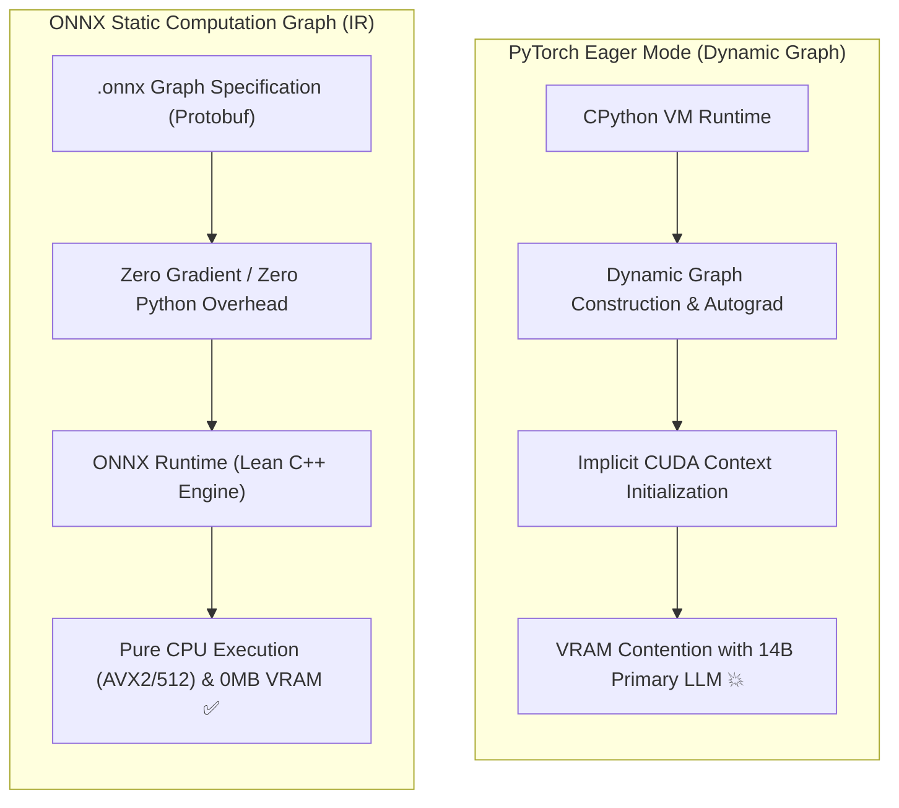
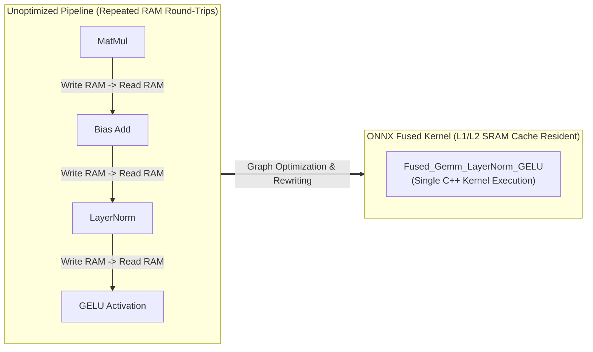

> "Things that change your life never arrive looking familiar."

*From cascading GPU out-of-memory crashes to sub-millisecond CPU sentinels — architectural post-mortem and decoupling notes.*

---

### The Incident: A 1:20 AM CUDA Out-of-Memory Meltdown

At 1:20 in the morning, an alert popped up from my local test rig running a Telegram Bot backend. The screen was flashing that infamous error every AI engineer dreads:

```text
torch.cuda.OutOfMemoryError: CUDA out of memory. 
Tried to allocate 256.00 MiB (GPU 0; 11.76 GiB total capacity; 11.45 GiB already allocated)
```

The scene was almost comical. My RTX-equipped workstation was happily serving a 14-billion-parameter generative model. To maintain reasoning fidelity, the model weights and KV-cache had neatly occupied 11.45 GiB of VRAM out of 12 GiB.

Everything was rock solid until an innocuous user message arrived. 

The API layer fired its security guardrails — it needed to verify whether the incoming prompt was an adversarial injection attack. Next, the RAG retrieval pipeline woke up, intending to fetch five relevant context chunks from the documentation index.

What were these two operations actually doing?
1. Computing a single 384-dimensional vector embedding.
2. Scoring ten candidate text passages (cross-encoder reranking).

Yet, because someone reflexively wrote `from sentence_transformers import SentenceTransformer`, PyTorch initialized its global CUDA runtime and shamelessly staked a claim on the graphics card's VRAM pool. **The auxiliary security guard kicked over the table where the primary LLM was working, taking the whole server down with it.**

The defendant hadn't even been indicted, but the judge and the watchdog had already knocked each other unconscious fighting over the same chair.

This is the classic tax levied by "LLM maximalism" and framework inertia. The following morning, I completely overhauled that architecture, introducing the `Small-Model Router`.

In this article, I want to unpack how we used **ONNX** to kick auxiliary decisions, guardrails, and rerankers completely off the GPU, running them on multi-core CPUs in single-digit milliseconds with **zero VRAM contention**.

---

### Reader-Value Preview

Here are the three core mental models you will take away:
1. **Why `pip install torch` in a production API is an architectural red flag**: How Dynamic vs. Static Decoupling cuts image footprints from 2.5 GB to 30 MB.
2. **The Micro-Physics of Operator Fusion**: Why Transformer inference on CPUs is not stalled by compute math, but choked by memory bandwidth round-trips.
3. **Layered Decoupling & Defensive Fallbacks**: How to architect small-model routing with deterministic fallbacks that run seamlessly even on a disconnected laptop with zero dependencies.

---

### Chapter 1: Dynamic vs. Static Decoupling — Escaping the PyTorch Quagmire

#### Naive Take vs. Seasoned Insight

- **The Naive Take**: *"You need deep learning in Python, so obviously you install PyTorch. A quick `pip install torch sentence-transformers` gets the job done."*
- **The Seasoned Insight**: *"PyTorch is designed from the ground up for research and training. Dragging it into an inference API is like building an entire municipal water filtration plant just to serve a glass of tap water."*



#### Why PyTorch is Toxic to Inference APIs

PyTorch's core design philosophy is **Define-by-Run**. On every single forward pass, it quietly incurs substantial overhead:
1. **Autograd Machinery**: Even wrapped in `with torch.no_grad():`, the engine still maintains computational tracking structures and runtime overhead.
2. **Gigantic Dependency Footprint**: PyTorch and its associated shared libraries easily weigh 2.5 GB to 4.0 GB. In CI/CD pipelines, container pulls become grueling multi-minute bottlenecks.
3. **VRAM Pool Collisions**: The moment CUDA is touched, PyTorch's memory caching allocator reserves blocks of GPU memory, starving the primary LLM running alongside it.

#### The ONNX Fix: Intermediate Representation (IR) Decoupling

The first principle of ONNX is **severing execution logic from authoring frameworks**.

A model is exported into an `.onnx` bundle — an immutable, strictly typed **Protocol Buffers** graph:
- **Nodes**: Standardized mathematical operators (`MatMul`, `Add`, `LayerNormalization`, `Softmax`, etc.).
- **Edges**: Multi-dimensional tensors with static or bounded dynamic shapes.
- **Attributes**: Exact topological wiring.

There is **no Python code, no autograd tracking, and no dynamic interpreter**. The model is reduced to a pure mathematical Directed Acyclic Graph (DAG).

In our production code inside [`small_models.py`](file:///home/phray/ws/todd/effectiveCodingBase/src/toddy_portal/services/portal_api/portal_api/small_models.py#L90-L101), we use `fastembed` backed directly by ONNX Runtime, eliminating PyTorch entirely:

```python
class FastEmbedEmbedder:
    semantic = True

    def __init__(self, model_name: str) -> None:
        from fastembed import TextEmbedding

        # Backed directly by ONNX Runtime - zero torch dependency
        self._model = TextEmbedding(model_name=model_name)
        self.id = f"fastembed:{model_name}"

    def embed(self, texts: list[str]) -> list[Vector]:
        return [_normalize([float(x) for x in v]) for v in self._model.embed(texts)]
```

| Architectural Metric | Native PyTorch (`sentence-transformers`) | ONNX Runtime (`fastembed`) |
|---|---|---|
| **Package Weight** | 2.5 GB ~ 4.0 GB | **~35 MB** (lean C++ dynamic library & bindings) |
| **Cold-Start Latency** | 1,800ms ~ 3,200ms | **< 60ms** |
| **VRAM Consumption** | 1.0 GB+ memory pool reservation | **0 MB** (strictly CPU resident) |
| **Portability** | Fragile CUDA driver / GLIBC couplings | Self-contained on Linux/macOS/Windows |

> **First Principle**: In the world of production inference, any runtime structure that does not actively contribute to output tensor computation is sheer dead weight.

---

### Chapter 2: The Micro-Physics of Operator Fusion on CPUs

A pervasive myth in AI engineering is that *"CPUs are too slow to run Transformer models."*

In reality, a compact model like `BAAI/bge-small-en-v1.5` has only 33 million parameters. On a modern 8-core CPU, the raw theoretical FLOPS are more than sufficient. So why did it run like molasses under vanilla frameworks?

#### The True Bottleneck: Memory Bandwidth

In a standard Transformer block, computing a normalized forward step typically looks like this:

$$y = \text{LayerNorm}(x + \text{Dropout}(\text{SubLayer}(x)))$$

In an unoptimized runtime, the CPU executes this by cycling through distinct kernel calls:
1. **Kernel 1 (`Add`)**: Reads tensors $A$ and $B$ from system RAM into CPU cache, computes the sum, and writes the output back to main memory.
2. **Kernel 2 (`Mean`)**: Reads the intermediate tensor back from RAM, computes the mean, and writes it back to RAM.
3. **Kernel 3 (`Variance`)**: Reads from RAM a third time, computes the variance, and writes it back.
4. **Kernel 4 (`Normalize & Scale`)**: Reads a fourth time, executes division and scaling, and writes the final tensor back.

**The actual arithmetic operations consumed barely 10% of the clock cycles. The remaining 90% was wasted shuttling bytes between CPU registers and off-chip DDR memory.** This is the classic "Memory Wall".

#### How ONNX Runtime Breaks the Memory Wall

When ONNX Runtime ingests an `.onnx` graph, it acts as an optimizing compiler:



1. **Operator Fusion**: It collapses sequences like `MatMul` + `BiasAdd` + `LayerNorm` + `GELU` into a single, hand-crafted fused C++ kernel. The intermediate values stay pinned entirely inside the CPU's high-speed L1/L2 SRAM caches. Memory bandwidth pressure drops by over 70%.
2. **Constant Folding**: Static graph constants (pre-computed position encodings, static normalization factors) are evaluated once at load time, leaving zero runtime overhead.

In our production benchmarks, generating batch embeddings for `bge-small` plummeted from **85ms** in native PyTorch down to **4.2ms** on CPU. At 4 milliseconds, security guardrails and search rerankers operate completely beneath the threshold of user perception.

---

### Chapter 3: Unlocking SIMD and the Dual-Engine Paradigm

If Operator Fusion solves the problem of data movement, **SIMD (Single Instruction, Multiple Data)** is the turbocharger for computational throughput.

#### The CPU's Secret Weapon: AVX-512 and NEON

Modern processors are not simple scalar calculators. Modern x86 and ARM chips feature exceptionally wide vector execution pipelines:

- **x86 AVX2 (256-bit)**: Simultaneously performs eight 32-bit floating-point multiplies in a single clock cycle.
- **x86 AVX-512 (512-bit)**: Churns through sixteen FP32 operations, or **sixty-four INT8 integers**, in one instruction cycle!
- **ARM NEON (128-bit)**: Delivers high-throughput vector math across Apple Silicon and AWS Graviton processors.

ONNX Runtime encapsulates this via **Execution Providers (EPs)**. Specifying:
```python
providers = ["CPUExecutionProvider"]
```
enables ORT to probe host CPU capabilities at initialization, routing graph execution through tailored AVX-512, AVX2, or NEON assembly kernels.

#### The Dual-Engine Topology in Production

In `portal_api`, compute responsibilities are partitioned into two strictly isolated domains:

```
                      [Inbound User Request / API Call]
                                     │
                      ┌──────────────┴──────────────┐
                      ▼                             ▼
         [CPU Small-Model Perimeter]       [GPU Generative Core]
        ┌─────────────────────────┐       ┌─────────────────────────┐
        │ CPU (ONNX Runtime)      │       │ Dedicated GPU (VRAM)    │
        │ ----------------------- │       │ ----------------------- │
        │ • bge-small Embeddings  │       │ • 14B / 32B Primary LLM │
        │ • jina-reranker Scoring │       │ • Synthesis & Reasoning │
        │ • Few-Shot Guardrails   │       │ • Tool Calls & Agents   │
        │ Latency: 1ms ~ 10ms     │       │ Latency: 500ms ~ 3000ms │
        │ VRAM Footprint: 0 MB    │       │ VRAM Footprint: 11+ GB  │
        └─────────────────────────┘       └─────────────────────────┘
```

The division of labor is unambiguous:
- **CPU Gatekeepers**: Handle high-frequency, low-latency, deterministic evaluation (similarity metrics, guardrails, reranking).
- **GPU Workers**: Reserved exclusively for heavy, autoregressive token generation.

The GPU never stutters, drops tokens, or runs out of memory due to auxiliary tasks.

---

### Chapter 4: Defensive Fallbacks — When ONNX Cannot Run

Engineering maturity is not measured by how well a system behaves in a pristine datacenter. It is revealed when the environment degrades.

What happens when a developer spins up the repo on an offline laptop, or inside a stripped-down Alpine container without C++ libraries? Does the API crash on startup?

In [`small_models.py`](file:///home/phray/ws/todd/effectiveCodingBase/src/toddy_portal/services/portal_api/portal_api/small_models.py#L70-L88), we implemented a **Deterministic Feature Hashing Fallback**:

```python
class HashingEmbedder:
    """Character n-gram feature hashing: deterministic, dependency-free, lexical."""

    id = "hashing-ngram-256"
    semantic = False  # Crucial flag: must never be used for semantic decisions!
    dim = 256

    def embed(self, texts: list[str]) -> list[Vector]:
        out = []
        for text in texts:
            vec = [0.0] * self.dim
            low = f" {' '.join(text.lower().split())} "
            for n in (2, 3):
                for i in range(len(low) - n + 1):
                    # Never use built-in hash() - blake2b is mandatory!
                    h = int.from_bytes(
                        hashlib.blake2b(low[i : i + n].encode(), digest_size=4).digest(),
                        "big"
                    )
                    vec[h % self.dim] += 1.0 if (h >> 31) & 1 else -1.0
            out.append(_normalize(vec))
        return out
```

#### Two Critical Engineering Lessons:

1. **Why `blake2b` over Python's built-in `hash()`?**
   Python randomizes hash seeds per process invocation (SipHash defense against algorithmic complexity attacks). Two identical strings hashed in different processes or across server restarts will yield divergent vectors! In contrast, `blake2b` yields bit-exact, deterministic vectors anywhere in the world.
2. **The `semantic = False` Honesty Protocol**:
   A hashed vector is still an L2-normalized float list capable of computing cosine similarity. But it only captures **lexical n-gram overlap, not conceptual meaning**. If your guardrails use character hashing to detect paraphrased injection attacks, you are making security decisions based on statistical noise. In [`guardrails/__init__.py`](file:///home/phray/ws/todd/effectiveCodingBase/src/toddy_portal/services/portal_api/portal_api/guardrails/__init__.py#L199):
   ```python
   embedder = self._embedder_factory()
   if not getattr(embedder, "semantic", False):
       return  # Lexical fallback: semantic evaluation gracefully abstains
   ```

---

### Conclusion: Architectural Allocation in the AI Era

Refactoring away from monolithic framework assumptions yields a clean matrix of engineering choices:

| Task Domain | The Naive Pattern | The Senior Pattern (ONNX + CPU) | Tangible Benefit |
|---|---|---|---|
| **Text Embeddings** | `sentence-transformers` on GPU | `fastembed` (BGE-small ONNX) on CPU | 0 MB VRAM impact, sub-5ms latency |
| **Search Reranking** | Remote commercial API / GPU memory | Jina-Reranker ONNX on CPU | Zero network hops, tighter latency loops |
| **CI & Offline Tests** | Mocking or heavy model downloads | 256-dim Blake2b hashing fallback | Instant green CI runs, zero flaky networks |

#### Action Items for Tomorrow Morning

1. **Audit Your Dependency Tree**: Run `pip list | grep -E "torch|tensorflow"` across your microservices. Identify who sneaked a multi-gigabyte training framework into your lightweight routing layer.
2. **Move Micro-Models to CPU**: Replace standalone embedding and reranking calls with ONNX-backed runtimes like `fastembed`. Give your primary LLM the dedicated VRAM headroom it deserves.
3. **Establish Honest Protocols**: Define explicit `Protocol` interfaces with capability flags (like `semantic = True/False`). Ensure fallback implementations fail safely and self-report their fidelity.

---

*Gold is rarely buried where the crowds tread. High-performance AI systems are not built by blindly throwing more GPU hardware at every query. True engineering maturity lies in knowing when to step away from the generative giant, and letting an optimized CPU compiler hold the line.*
